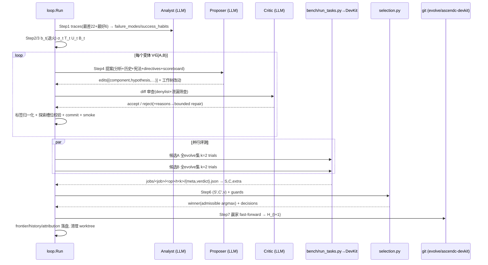

# RRSI × AscendC-DevKit 整体运行流程详解

> **对象仓库**：`/home/s00940212/experiments/rrsi-devkit`
> **重点领域**：`domains/ascendc-devkit`（以 `third_party/AscendC-DevKit` 为被进化 harness）
> **依据**：仓库源码通读（`rrsi/` 核心循环、`domains/ascendc-devkit/` 领域实例、`third_party/AscendC-DevKit/` harness 本体）
> **文档日期**：2026-10-22

---

## 目录

1. [系统定位：这个仓库在做什么](#1-系统定位)
2. [仓库结构与角色划分](#2-仓库结构与角色划分)
3. [被进化的对象：AscendC-DevKit harness](#3-被进化的对象)
4. [核心概念与数学框架](#4-核心概念与数学框架)
5. [端到端运行流程（总览）](#5-端到端运行流程总览)
6. [阶段一：baseline — 评测 H₀](#6-阶段一baseline)
7. [阶段二：calibrate — 估计噪声带 δ](#7-阶段二calibrate)
8. [阶段三：round — 进化主循环七步详解](#8-阶段三round--进化主循环)
9. [候选起草细节：propose → critic → smoke → commit](#9-候选起草细节)
10. [领域评测链路：bench/run_tasks.py → DevKit batch → score.py](#10-领域评测链路)
11. [选择算法 Algorithm 2 详解](#11-选择算法-algorithm-2)
12. [领域防护体系：guards / critic_patterns / component_signals](#12-领域防护体系)
13. [防过拟合（正则化）机制汇总](#13-防过拟合机制汇总)
14. [四个 LLM 角色与领域 briefs](#14-四个-llm-角色)
15. [产物目录与可审计性](#15-产物目录与可审计性)
16. [断点续跑与故障恢复](#16-断点续跑与故障恢复)
17. [本实例配置速查（rrsi.json + 默认超参）](#17-配置速查)
18. [关键文件索引](#18-关键文件索引)

---

## 1. 系统定位

**RRSI（Regularized Recursive Self-Improvement，正则化递归自我改进）** 是一个
「进化 agent harness 而非进化模型」的搜索框架（论文 arXiv:2609.24972）。

核心前提：一个 LLM agent 的能力上限很大程度上由其 **harness** 决定——即围绕
冻结模型之外的部分：提示词、控制流、工具、记忆、上下文管理。RRSI 保持编辑空间
**完全开放**（这些部分全都允许改），转而对**搜索轨迹**施加正则化，防止 harness
在小规模训练集（evolve set）上过拟合——「in-distribution 大涨、out-of-distribution
归零」是朴素 harness 进化的典型失败模式。

`domains/ascendc-devkit` 是该方法的一个领域实例：

> **被进化的 harness** = `third_party/AscendC-DevKit`——一个把「算子需求包
> （desc.md + golden.py + proto.yaml + cases）」端到端变成「可编译、精度达标、
> 性能达标的 AscendC 算子」的分阶段 agent 流水线；
> **评测基准** = cann-bench 的算子任务集（编译 20 分 + 功能 30 分 + 性能 50 分）；
> **运行硬件** = 昇腾 NPU（目标芯片 A5 / Ascend 950，RegBase arch35）。

一句话：**模型冻结、任务冻结、评分冻结，只有「写算子的流水线本身」在逐轮进化。**

---

## 2. 仓库结构与角色划分

```
rrsi-devkit/
├── rrsi.py                      # CLI 入口（baseline/calibrate/run/round/status/…）
├── rrsi/                        # ★ 搜索核心（领域无关，method 层）
│   ├── loop.py                  #   Run：一轮 round 的七步 + baseline/heldout/readjudicate
│   ├── analyst.py / digester.py #   Analyze(H_t, D)：失败模式分析（角色1）
│   ├── propose.py               #   提案者（角色2）
│   ├── critic.py                #   泄漏审查者（角色3）
│   ├── selection.py             #   Algorithm 2：准入 + argmax（纯函数）
│   ├── evaluate.py              #   Evaluate：S/C 聚合（missing 记 0 占满分母）
│   ├── history.py               #   编辑历史 L_t、T_t/U_t/B_t、σ_t
│   ├── schedule.py              #   退火编辑预算 b_t（cosine）
│   ├── components.py            #   组件词表 K、novelty ν、标签归一化
│   ├── calibrate.py             #   噪声带 δ 的 bootstrap 估计
│   ├── gitops.py / driver.py / domain.py / llm.py / config.py
├── domains/
│   └── ascendc-devkit/          # ★ 本领域实例（接线层 + 领域知识层）
│       ├── adapter.py           #   Domain 实现：任务集/运行/打分/guards/smoke 接线
│       ├── rrsi.json            #   本实例超参 + bench 配置（NPU 卡号、CANN 路径…）
│       ├── briefs.py            #   四个角色的领域提示词（analyst/digester/proposer/critic）
│       ├── render.py            #   trial 产物 → 文本轨迹（EVAL VERDICT/STAGE TABLE/…）
│       ├── SKILL.md             #   领域宪法一：proposer 的硬规则（10 条）
│       ├── PATTERNS.md          #   领域宪法二：机制模式库（防止重复探索）
│       ├── bench/               #   ★ 冻结评测层（score/tasks/config/run_tasks）
│       └── data/                #   任务 split：ops_train.txt / ops_heldout.txt
├── third_party/
│   └── AscendC-DevKit/          # ★ 被进化的 harness（ascendc_devkit Python 包）
└── runs/ascendc-devkit/         # 运行产物：frontier/history/jobs/r{t}/…
```

### 冻结 vs 可进化（本实例的边界）

| 类别 | 内容 |
|---|---|
| **冻结** | policy LLM（写算子的模型）；cann-bench 任务集与评测器；NPU 与 CANN 工具链；AscendC 语言语义与 32 字节对齐规则；`bench/` 评分脚本（`adapter.py:123` 的 `critic_patterns` 强制拦截） |
| **可进化** | 仅 `third_party/AscendC-DevKit/src/ascendc_devkit` Python 包（`adapter.py:118` `harness_path`，`source_exts={".py"}`）；harness 内部 `.claude/skills/**` 技能树也在其运行时自进化通道内 |
| **git 机制** | 每个候选在自己的 worktree + 分支上起草；赢家 fast-forward `evolve/ascendc-devkit` 分支——**incumbent 永远是一个 commit**，可审计、可回滚、可 diff |

---

## 3. 被进化的对象

### 3.1 AscendC-DevKit 是什么

一个七层 Python 平台（`src/ascendc_devkit/`：`cli` / `application` / `orchestration` /
`domain` / `capabilities` / `adapters` / `infra`），通过 Claude Code CLI/opencode 后端
驱动冻结 policy 模型，把算子需求转化为可用 AscendC Kernel，再编译、跑精度用例、
跑性能基线。

它不是「反复执行同一提示词的简单循环」，而是一个**阶段图执行器**
（`GraphExecutor` 遍历 `StageNode` 树），阶段间有门禁（gate）、分支汇合、
作用域受限的纠错/升级回环。本实例 trial 实际执行的工作流为 `self_evolve_op`：

```
entry → context → requirement → [general-design | detailed-design]
      → test_design → codegen_init → codegen → precision_debug
      → cannbench_adapt → cannbench_eval → finalize
```

（`PATTERNS.md` §1.1；另一条工作流 `generate_ascendc` 尾段含 `perf → integrate`，
但本实例 trial **不跑**这两个阶段——把失败归因到它们等于归因一段从未执行的代码。）

要点：

- 链上没有独立 `verify` 阶段——精度验证由 `precision_debug` 复合阶段承担；
- `build/deploy/smoke` 不是独立阶段，而是 `codegen` 内 agent 自跑的 `redeploy`
  自修复循环；`cannbench_eval` 是一次性评分节点，不回环到 codegen；
- 每阶段独立调用一次 agent；State 为不可变 frozen dataclass；`events.jsonl`
  是运行历史的权威记录（event sourcing）。

### 3.2 技能树只读与产物经验

技能树（`.claude/skills/**`）对运行中的 agent 只读（`briefs.py`
`_SKILL_TREE_INTEGRITY`）：不允许修改技能脚本，也不允许把经验写进技能经验
库；工具脚本存在缺陷时，如实报告并绕过，而不是就地修补。

运行中产出的**抽象经验**（判断标准、常见陷阱、可复用模式；**不得存完整源码
答案**）写入本次 run 的产物目录（如 `{output_dir}/vf_experiences/`）；技能
经验库的并入不由运行中的 agent、也不由人工执行，而由 RSI 进化循环的出策/
审查环节在 round 间审阅产物经验后并入，供后续运行检索。

因此轨迹中出现技能树修改即属违规；其中编码了当前基准分布（golden 逻辑、用例
表、阈值、反作弊绕过路径）的修改属记忆化，拒绝；产物目录内的经验写入是预期
行为。

---

## 4. 核心概念与数学框架

### 4.1 评分与成本（`rrsi/evaluate.py`）

```
S_hat(H) = 1/(k·|D|) Σ_x Σ_j r(x, τ_x^(j))        # 经验得分，r ∈ [0,1]
C_hat(H) = 1/(k·|D|) Σ_x Σ_j c(τ_x^(j))           # 成本 = 平均每 trial policy tokens
```

本领域 `reward(trial) = clamp(overall_score / 100, 0, 1)`，
`overall_score = 编译20 + 功能30 + 性能50`。

**关键语义（反作弊设计）**：
- **missing trial**（infra 失败：无 snapshot 或无 meta/verdict）→ r = 0 但**占满
  分母**，绝不留空位；
- **present-zero**：编译失败/精度失败都有 verdict，reward 为 0——候选无法
  靠「把 trial 搞挂」提分。

### 4.2 符号表（`rrsi/config.py` 注释与论文一一对应）

| 符号 | 含义 | 代码位置 | 默认值 |
|---|---|---|---|
| `T` | 进化总轮数 t = 0..T−1 | `cfg.T` | 20 |
| `k` | 每任务 trial 数 | `cfg.k` | 2 |
| `m` | 每轮起草的候选数 | `cfg.m` | 2 |
| `b_min/b_max` | 退火编辑预算上下界 | `schedule.edit_budget` | 1 / 4 |
| `b_t` | 第 t 轮单个候选可捆绑的独立编辑数上限 | `ceil(b_min + (b_max−b_min)·½(1+cos(πt/T)))` | — |
| `w` | 停滞判定窗口 | `history.stall_flag` | 3 |
| `σ_t` | 停滞标志 `1[S_t − S_{t−w} ≤ δ]` | `stall_flag` | — |
| `T_t` | 已试组件集合（有实测编辑的组件） | `History.tried()` | — |
| `U_t` | 未试组件 `K \ T_t` | `exploration` | — |
| `g_t(l)` | 组件 l 近 `n_prune` 轮内的最大 ΔS | `History.yield_g` | — |
| `B_t` | 剪枝集 `{l ∈ T_t : g_t(l) ≤ 0}` | `History.prune_set` | `n_prune=4` |
| `δ` | 噪声带（实测） | `calibrate.py` / `cfg.delta` | `delta_z=2.0` |
| `β0/β1` | 真实增益的成本规则 | `selection.cost_rule` | 0.10 / 40 |
| `w_s/w_c/w_n` | 带内候选的塑形规则权重 | 同上 | 100 / 15 / 0.5 |
| `ν(l')` | novelty：**结构性组件**（skill/memory/client_tool/subagent）中
  incumbent 从未有过 accepted 编辑的种类数 | `components.novelty` | — |

### 4.3 组件词表 K（9 类，编辑按此归因）

```
prompt | control_flow | config | output_plumbing | context_mgmt
| client_tool | skill | memory | subagent
```

**编辑（edit）按独立性计数，不按行数**：一个独立机制指向的改动 = 1 个编辑；
依赖的若干文件改动算 1 个编辑。每条编辑携带 `(component, hypothesis, diff)` 标签，
标签由 `components.normalize` 对照 diff 强制校验——声明的组件与 diff 实际内容
不符会被重打标签（`loop.py:510`）。

---

## 5. 端到端运行流程（总览）

```bash
# ① 冒烟（可选）：harness 能编译、能 import、能端到端跑通
python3 rrsi.py --domain ascendc-devkit smoke

# ② baseline：评测 H₀，生成 runs/ascendc-devkit/frontier.json
python3 rrsi.py --domain ascendc-devkit baseline

# ③ calibrate：bootstrap 估计噪声带 δ → calibration.json
#    （baseline 子命令末尾已自动对单 job 校准；多样本需再跑）
python3 rrsi.py --domain ascendc-devkit calibrate [--jobs base,base2]

# ④ run：主循环 round 0..T-1（可 --start 续跑；touch runs/ascendc-devkit/STOP 停止）
python3 rrsi.py --domain ascendc-devkit run

# ⑤ 过程观测 / 收尾
python3 rrsi.py --domain ascendc-devkit status                  # frontier + 历史
python3 rrsi.py --domain ascendc-devkit heldout --label champ   # held-out 泛化验证
```

每轮高度概括：

```
分析 incumbent 失败 → 退火预算内起草 m 个候选 harness（各自 worktree）
→ Critic 反泄漏筛查（有界修复）→ 全 evolve 集实测（k trials/任务）
→ 噪声底线 + 成本规则 + guards 准入，argmax 取最优
→ 赢家 fast-forward 进化分支，更新 frontier/history/attribution
```

全程 **resume-safe**：崩溃重跑复用已存在的 `analysis_report.json` / `eval.json` /
已提交候选。

---

## 6. 阶段一：baseline

`rrsi/loop.py:181` `Run.baseline`：

1. `ensure_branch`：确保 `evolve/ascendc-devkit` 分支存在（基于 HEAD）；
2. checkout incumbent worktree（detached）；
3. 对完整 evolve split（本实例当前仅 1 个任务 `tasks/level1/exp`）跑
   `k=2` 个 trial；
4. missing 超过 `invalid_missing_frac`(0.15)×期望数 → 直接 `SystemExit`
   （baseline 无效不进循环）；
5. 写 `frontier.json`：`incumbent{t:0, commit, harness_tree, job, S, C}`、
   `S_star = S₀`、`trajectory`；history 记 `BASELINE` 条目。

---

## 7. 阶段二：calibrate

`rrsi/calibrate.py`：对**未改变的** base harness 的重复评测做 bootstrap，得
`δ = z · sd(null ΔS)`（`delta_z = 2.0`），写 `runs/ascendc-devkit/calibration.json`。
`cfg.delta` 显式给值时跳过。README 论文三实例固定 δ 为 0.017 / 0.004 / 0.020。

意义：真机运行有噪声；δ 之后的准入规则保证候选**不能顺着看似噪声的退化
一路下山**。

---

## 8. 阶段三：round — 进化主循环

`rrsi/loop.py:231` `Run.round(t)`，前置于 frontier 的一致性检查
（`evolve` 分支的 harness tree 必须等于 frontier 记录的 tree）。

### Step 1 — Analyze(H_t, D_evolve)（`loop.py:250`）

- `build_traces`：把 incumbent 每任务均值排序，取**最差 22 个任务的最差 trial**
  + **最好 6 个任务的最好 trial**（`n_fail_traces=22` / `n_success_traces=6`；
  success habits 是 proposer 不得破坏的既有行为）；
- `analyst.py` 用领域 brief（`briefs.py:ANALYST`）分析出
  `failure_modes` / `success_habits` → `r{t}/analysis_report.json`；
  跨轮全局汇总存 `global_analysis.json` 作为先验；
- 已存在则直接复用（resume-safe）。

### Step 2 — 退火编辑预算 b_t（`loop.py:274`）

`schedule.edit_budget`：早期轮允许捆绑多个协同编辑（b_max=4），随轮次 cosine
退火到 1——**后期每轮的测量归因到单一组件**。

### Step 3 — 历史/探索/剪枝摘要（`loop.py:277`）

`σ_t`（停滞标志）、`T_t`（tried）、`U_t`（untried）、`B_t`（prune set，
附带 incumbent 里各组件已接受的机制清单——**删除它们本身是合法编辑**）；
全部写入 `r{t}/directives.json`。

### Step 4 — 起草并筛选 m 个候选（`loop.py:291`）

对每个变体 v ∈ {A, B}（详见 §9）：worktree 起草 → proposer 提案 → critic 审查
→ 标签校验 → smoke 门禁 → commit。
若 `σ_t=1` 且存在未试组件，则**末尾 `m_draft`=1 个变体槽位被保留**给从未
exercise 过的组件（探索槽位，`loop.py:294` reserved 逻辑）。

### Step 5 — 并行评测（`loop.py:299`）

通过筛选（`gate_failure is None`）的候选用 `ThreadPoolExecutor`
（`eval_parallel`）在**完整 evolve 集**上评测，每任务 k=2 trials。
missing > 15% 视为 infra 失败自动重试一次，仍失败则 `eval_invalid`。

### Step 6 — Algorithm 2 裁决（`loop.py:304`）

对每个候选算 (ΔS, ΔC, ν)，跑准入三规则 + 领域 guards（详见 §11）；
`select_round` 返回 winner（admissible 中 S 最大者）与逐候选 decisions，
落盘 `r{t}/decisions.json`；逐编辑写 `history.jsonl`；预测命中归因写
`attribution.jsonl`（proposer 的 scoreboard）。

### Step 7 — H_{t+1}（`loop.py:328`）

- 有 winner：`git fast_forward` 把 `evolve/ascendc-devkit` 推到 winner commit，
  更新 `frontier.incumbent{t+1}` 与 `S_star = max(S*, S')`；
- 无 admissible：`H_{t+1} = H_t`（原地不动也是合法结果）；
- 清理本轮全部 worktree。

---

## 9. 候选起草细节

`rrsi/loop.py:453` `Run._draft`，每变体完整链路：

```
┌ worktree: runs/ascendc-devkit/wt/r{t}{V}  ← 分支 ascendc-devkit/r{t}{V}
│
│ ① propose（rrsi/propose.py）
│    输入：analysis_report + 编辑历史(compact渲染) + SKILL.md + PATTERNS.md
│          + directives(b_t/σ_t/U_t/B_t) + traces + per_task + digests
│          + scoreboard(预测命中记录) + variant_brief
│    输出：status=done, mechanism, n_edits, edits[{id,component,hypothesis,
│          predicted_affected,targets_mode}]，并直接在工作树上改文件
│    ✗ status≠done 或 n_edits=0 → gate_failure="no_proposal"
│
│ ② critic 审查（rrsi/critic.py，至多 1+repair_rounds=6 次）
│    领域正则 denylist(critic_patterns) + LLM 审查（briefs.py:CRITIC）
│    reject → 携带 reasons/risk_notes 回 proposer 修复重提（bounded repair）
│    accept → ③
│    ✗ 最终仍 reject → gate_failure="critic_reject"
│
│ ③ 标签校验（components.normalize）
│    声明的 component 与 diff 不符 → 按 diff 重打标签（记录日志）
│    探索槽位变体：重打标签后若 diff 中无任何未试组件 → 强制 reject
│
│ ④ commit（gitops.commit_path）
│    仅提交 harness_path 范围内的改动 → 候选 commit
│
│ ⑤ smoke 门禁（adapter.smoke，非选择规则、只是存活检查）
│    compileall 编译 → import 关键入口(batch_runner/dispatcher/EvalResult/cli)
│    → 清掉残留 verdict 后真跑 1 个冒烟任务 → missing=0 且 valid_rate>0
│    ✗ → gate_failure="smoke_fail"
│
└ 产出 Candidate{variant, edits, branch, commit, diff_path}
   （prep.json 落盘，供 readjudicate/reevaluate 复用）
```

**proposer 的提案纪律**（SKILL.md）：

- **Retroactive check（done() 必答）**：corrective（引用的失败案例若有此机制
  是否会好转）/ preservative（会不会破坏已通过行为）/ transfer（为何能迁移到
  未见算子，按能力维度命名）；
- **Predictions（必答）**：列出预期会移动的具体任务 id——评测后核对命中率，
  过度声称记过（scoreboard 反馈）；
- diff 必须收敛于目标机制：每行改动可追溯到失败类别 × 能力维度。

**proposer 的失败归因地图**（SKILL.md「The failure map」，与 briefs.py `_CLASSES`
一一对应）：COMPILE FAILED / DEPLOY(LOAD) FAILED / PRECISION FAILED /
PERF UNDER TARGET / NO SUBMISSION / INFRA——**机制配错失败类别，测量上
只表现为噪声**。

---

## 10. 领域评测链路

`adapter.run`（`adapter.py:197`）→ 调候选 worktree 里的
`domains/ascendc-devkit/bench/run_tasks.py`：

```
Domain.run
  └─ run_tasks.py --job r{t}{V} --n k --ids <evolve ids> --runs-dir runs/ascendc-devkit
       ├─ 自己负责：CANN 环境(source set_env.sh)、NPU 卡探测(npu_ids:[3])、
       │            cann-bench worktree、DevKit batch manifest
       ├─ 每轮把全部任务塞进一个 DevKit batch 并发执行
       └─ 每个 trial 产物：runs/ascendc-devkit/jobs/<job>/<op>/t<k>/meta.json
                           + verdict.json（resume-safe：已有产物直接跳过）
Domain.score
  └─ 冻结的 bench/score.py 读产物 → {task_id: TaskResult}
     （有意用主仓 bench 而非候选 worktree 副本——评测逻辑属于 RRSI 冻结部分）
```

**DevKit 侧一次 trial 的内部链路**：`scripts/batch_self_evolve.sh` 生成 manifest
（`workflow: self_evolve_op`）→ DevKit batch runner 并发跑各算子 → 阶段图执行
（§3.1 十一段链路）→ `report.json` + `kernel_eval` 评测报告。

**超时与尝试**：单 trial 上限 4 小时（`trial_timeout_sec: 14400`，宽限 600s），
每任务最多 `max_attempts: 3`。

**reward 聚合**：`score.py` 读 verdict（`scores_consistent is False` 直接记 0，
绝不接受越界 reward）→ `rrsi/evaluate.aggregate` 得 S、C（C 为有 token 计数的
trial 均值）与领域 extra（`valid_rate` / `pass_rate` / `no_submission_rate` /
`eval_missing_rate`，供 guards 使用）。

---

## 11. 选择算法 Algorithm 2

`rrsi/selection.py`（纯函数），对每个有测量的候选 H′（S′, C′）：

```
ΔS = S′ − S_t          ΔC = (C′ − C_t) / C_t        # ΔC 是相对量

成本规则 c：
  若 ΔS > δ:   c ⟺ ΔC ≤ β0 + β1·ΔS              # 增益越大，预算越大
              （β0=0.10：10% token 免费额度；β1=40：每 +1pp 得分买 +40% token）
  否则:        c ⟺ w_s·ΔS − w_c·ΔC + w_n·ν > 0    # 带内候选看塑形值
              （ν = 结构性组件 novelty，鼓励探索从未赢过的组件类型）

admissible ⟺ S′ ≥ S* − δ  且  c  且  领域 guards 全过     # 噪声底线

H_{t+1} = argmax_{H′ admissible} S′   （无则 H_t）
S*     = max(S*, S_{t+1})
```

判定顺序（`selection.judge`）：无测量 → 直接不可准入；低于底线 → 拒；
成本规则失败 → 拒；guard 违反 → 拒；其余 admissible。

**领域 guards**（`adapter.py:234`，非补偿性——总分再高踩一条即拒）：

| guard | 阈值（rrsi.json 可覆盖） | 防止的作弊 |
|---|---|---|
| missing 率上升 | ≤ +0.10 | 把难跑的 trial 弄成 infra 失败 |
| no-submission 率上升 | ≤ +0.20 | harness 不产出任何算子/部署产物 |
| valid 率下降 | ≤ 0.10 | snapshot 里拿不到 eval_result |
| pass 率下降 | ≤ 0.10 | cann-bench 用例通过率明显退步 |

---

## 12. 领域防护体系

### 12.1 critic_patterns（正则 denylist，`adapter.py:123`）

diff 命中即打回，评测前拦截：

| 模式 | 拦截内容 |
|---|---|
| `bench/(score\|tasks\|config\|run_tasks).py` | 修改冻结评测/管线层 |
| 绝对路径 / 向上逃逸出 harness | `/home/cann-bench`、`../../..` |
| 写死评分常量 | `overall_score = 100` 之类（写常数分而非计算） |
| 指向 RRSI 运行产物 | `jobs/*/t\d/`、`verdict.json` |

### 12.2 component_signals（diff → 组件词表映射，`adapter.py:137`）

按序匹配（output_plumbing → control_flow → context_mgmt → config →
client_tool → prompt → skill → subagent → memory），供标签归一化与
novelty 统计。

### 12.3 Critic 的两类头号检查（`briefs.py:CRITIC`）

1. **VERIFIER ESCAPE（绕过评测器）**：读/搜/引用评测器内部信息
   （cann-bench 报告、`reward.json`、`verification.md`、`/logs/verifier`、
   `FINAL_*_STATUS` 判定字符串）；硬编码只有评测器才知道的阈值/容差/参考值。
2. **TASK MEMORISATION（任务记忆化）**：按算子名/level 设特殊分支；把当前
   基准分布编码成 API 名清单或逐算子实现配方。

**明确允许的通用实践**：`ascend-hardware` 查硬件参数而非硬编码 UB/核数、
尾块掩码处理、DataCopy 前 32 字节对齐检查、编译器拒绝 API 时查知识库而非
瞎猜、部署前验证可调用性、防止 tiling 参数在上下文压缩后丢失。

**不得无替代禁用的安全机制**：环境/硬件预检查、知识库查询、
「编译→精度」门控链、DumpTensor 调试路径、逐阶段超时与停滞看门狗；
同时拒绝无退出条件的开放式「持续改进」循环（NO ARTEFACT = 0 分）。

---

## 13. 防过拟合机制汇总

| 侧 | 机制 | 落点 |
|---|---|---|
| 提案侧 | 退火预算 b_t 限制单候选捆绑编辑数（后期测量归因单组件） | `schedule.py` |
| | 编辑历史完整落盘；被证伪假设不得原样重提 | `history.py` + SKILL.md |
| | 停滞 σ_t=1 时保留未试组件探索槽位 | `exploration` + `loop.py:294` |
| | 无近期正收益组件进 B_t，**删除即合法编辑** | `History.prune_set` |
| 选择侧 | Critic 在**花评测钱之前**筛查泄漏 | `critic.py` |
| | 噪声底线 S* − δ | `selection.py` |
| | 成本规则：token 增长须由实测增益买单 | `selection.cost_rule` |
| | 带内塑形 + novelty ν 引导结构性探索 | 同上 |
| | 领域 guards 非补偿性拦截 | `adapter.guards` |
| 宪法 | 核心检验：「能否帮合格 AscendC 工程师处理**大量未见算子**？需要知道
  benchmark 里有什么才能回答的改动 = 非法」 | `SKILL.md` |
| | 正确粒度是**能力维度**（范式/搬运/buffer/流水/同步/单元/优化）而非算子 | 同上 |
| | 10 条硬规则：不动 verifier、机制优先于措辞、不破坏接口契约、
  不裸删安全机制、有界循环保终止、A5 target 不硬编码硬件参数等 | 同上 |
| | PATTERNS.md：已评估方向的结论沉淀，避免重复探索 | `PATTERNS.md` |
| 归因 | proposer 预测命中率 scoreboard 回流，过度声称记过 | `attribution.jsonl` |

---

## 14. 四个 LLM 角色

模型统一在 `rrsi.json` 配置（本实例三角色均为 `m:deepseek-v4.1-flash-1017`；
论文基线为 Claude Opus 4.8，经 LiteLLM 字符串任意替换）。

| 角色 | 代码 | 职责 | 领域 brief |
|---|---|---|---|
| Analyst | `rrsi/analyst.py`（派发 `digester.py`） | 读失败/成功 trace，产出 failure_modes / success_habits；先判失败类别（NO ARTEFACT / COMPILE-FAIL / LOAD-FAIL / ACCURACY-MISMATCH / UNDER-PERF / INFRA），再归因平台机制 vs policy 知识 | `briefs.ANALYST` |
| Digester | `rrsi/digester.py` | 把 trial 产物渲染为结构化文本轨迹：`EVAL VERDICT` → `STAGE TABLE (authoritative)` → `STAGE TIMELINE` → `STATE SNAPSHOT` → `AGENT SESSIONS`（每 agent 调用一个文件）→ `RUN LOG tail`；引用证据须写「小节名 + 行号/session/turn」 | `briefs.DIGESTER` + `render.py` |
| Proposer | `rrsi/propose.py` | 在预算内提出 (component, hypothesis, diff) 编辑；须过 retroactive check 与 predictions；初始源码视图是有预算的子集，`stages/` 等按需 `read_file` | `briefs.PROPOSER` + `SKILL.md` + `PATTERNS.md` |
| Critic | `rrsi/critic.py` | 评测前泄漏筛查（正则 denylist + LLM 审查），有界修复循环 | `briefs.CRITIC` |

（第四个「角色」选择器 `selection.py` 是纯函数，不是 LLM。）

---

## 15. 产物目录与可审计性

```
runs/ascendc-devkit/
├── frontier.json            # incumbent{t, commit, harness_tree, S, C}、S*、trajectory
├── calibration.json         # δ 及估计方法
├── global_analysis.json     # 跨轮 failure_modes / success_habits 先验
├── history.jsonl            # ★ 每编辑一条：component/hypothesis/diff/ΔS/ΔC/
│                            #   accepted/outcome/bundle/detail（readjudicate 会重写单轮）
├── attribution.jsonl        # 每编辑预测命中率 + 未预测回归（近20条回流给proposer）
├── jobs/<job>/<op>/t<k>/    # 原始 trial：meta.json + verdict.json
├── logs/<job>.log           # 评测脚本原始日志
├── wt/                      # 起草/评测用 worktree（轮末清理）
└── r{t}/
    ├── analysis_report.json # Step1 失败模式分析
    ├── directives.json      # b_t/σ_t/tried/explore/prune_set/δ/S*
    ├── decisions.json       # Algorithm 2 逐候选裁决
    └── <V>/                 # 变体 A/B
        ├── proposal.json (+ proposal_r*.json 修复轮)
        ├── diff.patch
        ├── critic.json (+ critic_a*.json)
        ├── smoke.json
        ├── prep.json        # 候选 commit/branch/edits（resume/重测入口）
        └── eval.json
```

设计意图（README）：**证据可审计**——每条编辑记录组件、假设、实测分数与
成本变化、裁决；proposer/analyst/critic 收到的提示词就是 `domains/<name>/`
里的普通文件。

---

## 16. 断点续跑与故障恢复

| 场景 | 机制 |
|---|---|
| round 中途崩溃后重跑 | 复用已存在 `analysis_report.json`；`_draft` 检测 `prep.json` 复用已提交候选；`_evaluate` 检测 `eval.json` 复用测量；`run_tasks.py` 按 meta+verdict 跳过已完成 trial |
| 评测 infra 故障 | missing > 15% 自动重试一次；仍失败记 `eval_invalid`（不进选择） |
| 事后改了 δ / 权重 | `readjudicate --t <t>`：对存储测量重跑 Algorithm 2，**零新评测**（要求 t 之后的轮已删，因后续候选基于旧 H_{t+1}） |
| 评测产物损坏 | `reevaluate --t <t> [--variants A,B]`：对已提交候选重测，然后自动 re-adjudicate |
| 人为停止 | `touch runs/ascendc-devkit/STOP` |
| 单轮试跑 | `round --t <t> --dry-run`：只做分析、停在 propose 之前 |

---

## 17. 配置速查

### `domains/ascendc-devkit/rrsi.json`（本实例实际配置）

| 键 | 值 | 说明 |
|---|---|---|
| `smoke_n` | 1 | 冒烟任务数（优先选 incumbent 全 trial 有效的算子） |
| `regression_threshold` | 0.1 | 逐任务归因的回归阈值 |
| `guards.*` | 0.1 / 0.2 / 0.1 / 0.1 | §11 四条非补偿性 guard |
| `bench.harness` | `../../third_party/AscendC-DevKit` | 被评测 harness 位置 |
| `bench.cann_bench` | `/home/s00940212/experiments/cann-bench` | 任务集与评分报告 |
| `bench.repo_profile` / `op_subdir` | cann-bench / `examples/aclnn_launch_example/csrc/ops` | 算子写入的目标仓 |
| `bench.chip` | `""`（DevKit 自探测；目标 A5） | soc_version 经 `domain/chip.py::to_soc_version()` 单点翻译 |
| `bench.python` | `/home/ma-user/anaconda3/envs/PyTorch-2.10.0/bin/python` | 评测解释器 |
| `bench.cann_env` | `/usr/local/Ascend/cann-9.1.0/set_env.sh` | CANN 环境 |
| `bench.npu_ids` | `[3]` | 指定卡 |
| `bench.trial_timeout_sec` | 14400 (+600 宽限) | 单 trial 4h |
| `bench.max_attempts` | 3 | 每任务尝试上限 |
| `proposer/analyst/critic_model` | `m:deepseek-v4.1-flash-1017` | 三角色模型 |

### 方法超参（`config.py` 默认，CLI 可覆盖）

`T=20, k=2, m=2, b_min=1, b_max=4, w=3, m_draft=1, delta_z=2.0,
beta0=0.10, beta1=40, w_s=100, w_c=15, w_n=0.5, n_prune=4,
repair_rounds=5, invalid_missing_frac=0.15, n_fail_traces=22, n_success_traces=6`

### 任务 split（`data/*.txt`）

- **evolve**：仅 `tasks/level1/exp`（注释注明这是「最小端到端」配置，
  baseline + 一轮进化能在单次会话内跑完；真实搜索应恢复六算子 split）
- **heldout**（只用于准入验证，从不进入提案）：`level2/gather`、`level2/scatter`、
  `level3/transpose`、`level3/top_k`

---

## 18. 关键文件索引

| 想了解 | 看哪里 |
|---|---|
| 一轮循环的权威实现 | `rrsi/loop.py:231` `Run.round` |
| Algorithm 2 公式与判定顺序 | `rrsi/selection.py:28`（docstring）+ `judge/cost_rule` |
| 退火预算公式 | `rrsi/schedule.py:28` |
| 历史摘要（T_t/U_t/B_t/σ_t/g_t） | `rrsi/history.py:28` |
| S/C 聚合与 missing 语义 | `rrsi/evaluate.py:28` |
| 领域接线（任务/评测/guards/smoke/冻结边界） | `domains/ascendc-devkit/adapter.py` |
| 打分实现（present-zero 语义） | `domains/ascendc-devkit/bench/score.py` |
| proposer 硬规则与失败归因地图 | `domains/ascendc-devkit/SKILL.md` |
| 机制模式库（阶段图故障类） | `domains/ascendc-devkit/PATTERNS.md` |
| 四角色领域提示词 | `domains/ascendc-devkit/briefs.py` |
| 轨迹渲染格式 | `domains/ascendc-devkit/render.py` |
| harness 工程原则（7层架构/不耦合算子/golden 权威） | `third_party/AscendC-DevKit/CLAUDE.md` |
| CLI 全部子命令 | `rrsi.py:29`（module docstring） |

---

## 附：一轮进化全程时序图



---

*本文档由源码通读生成；所有行为以仓库当前代码为准。若 `rrsi/` 或
`domains/ascendc-devkit/` 后续改动，请以 `rrsi/loop.py`、`rrsi/selection.py`、
`domains/ascendc-devkit/adapter.py` 为权威重新核对。*
