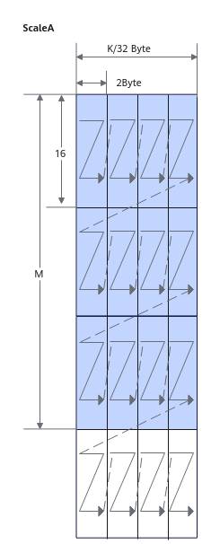
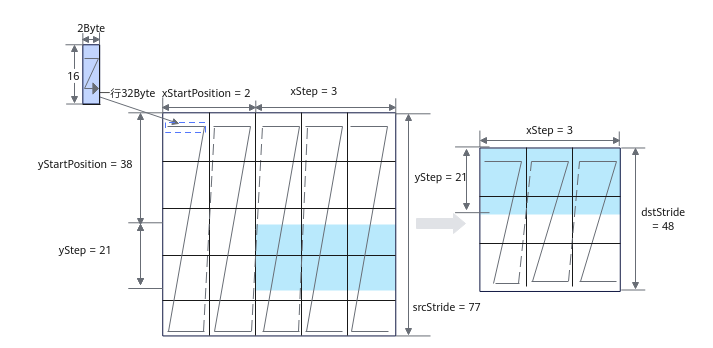

# Load2DMX

**页面ID:** atlasascendc_api_07_00193  
**来源:** https://www.hiascend.com/document/detail/zh/CANNCommunityEdition/900/API/ascendcopapi/atlasascendc_api_07_00193.html

---

#### 产品支持情况

| 产品 | 是否支持 |
| --- | --- |
| Atlas 350 加速卡 | √ |
| Atlas A3 训练系列产品/Atlas A3 推理系列产品 | x |
| Atlas A2 训练系列产品/Atlas A2 推理系列产品 | x |
| Atlas 200I/500 A2 推理产品 | x |
| Atlas 推理系列产品AI Core | x |
| Atlas 推理系列产品Vector Core | x |
| Atlas 训练系列产品 | x |

#### 功能说明

Load2D支持如下数据通路的搬运：

GM->A1; GM->B1; GM->A2; GM->B2;

A1->A2; B1->B2。

#### 函数原型

- Load2DMX接口

```
template <typename T, typename U = T>
__aicore__ inline void LoadData(const LocalTensor<U>& dst, const LocalTensor<T>& src, const LocalTensor<fp8_e8m0_t>& srcMx, const LoadData2DParamsV2& loadDataParams, const LoadData2DMxParams& loadMxDataParams)
```

- Load2Dv2MX接口，支持源操作数和目的操作数数据类型不一致

```
template <typename T, typename U>
__aicore__ inline void LoadData(const LocalTensor<U>& dst, const LocalTensor<T>& src0, const LocalTensor<fp8_e8m0_t>& srcMx, const LoadData2DParamsV2& loadDataParams, const LoadData2DMxParams& loadMxDataParams)
```

#### 参数说明

**表1 **模板参数说明

| 参数名称 | 含义 |
| --- | --- |
| T | 源操作数和目的操作数的数据类型。 - **Load2DMX接口**Atlas 350 加速卡，支持数据类型为：fp4x2_e2m1_t/fp4x2_e1m2_t/fp8_e4m3fn_t/fp8_e5m2_t |
| U | - 针对Load2DMX接口，U用来表示dst的数据类型，当src为fp8_e4m3fn_t、fp8_e5m2_t时，U需为T对应的MX数据类型，即AscendC::mx_fp8_e4m3_t和AscendC::mx_fp8_e5m2_t，否则编译失败。除此之外的数据类型要求T和U一致。 |

**表2 **通用参数说明

| 参数名称 | 输入/输出 | 含义 |
| --- | --- | --- |
| dst | 输出 | 目的操作数，类型为LocalTensor。 数据连续排列顺序由目的操作数所在TPosition决定，具体约束如下： - A2：ZZ格式/NZ格式；对应的分形大小为16 * (32B / sizeof(T))。- B2：ZN格式；对应的分形大小为 (32B / sizeof(T))  * 16。- A1/B1：无格式要求，一般情况下为NZ格式。NZ格式下，对应的分形大小为16 * (32B / sizeof(T))。 |
| src | 输入 | 源操作数，类型为LocalTensor或GlobalTensor。 数据类型需要与dst保持一致。 |
| srcMx | 输入 | 源操作数，类型为LocalTensor，仅支持fp8_e8m0_t类型。 |
| loadDataParams | 输入 | LoadData参数结构体，类型为： - LoadData2DMxParams，具体参考表3。 上述结构体参数定义请参考${INSTALL_DIR}/include/ascendc/basic_api/interface/kernel_struct_mm.h，${INSTALL_DIR}请替换为CANN软件安装后文件存储路径。 |

**表3 **LoadData2DMxParams结构体参数说明

| 参数名称 | 含义 |
| --- | --- |
| xStartPosition | 源矩阵X轴方向的起始位置，即M维度方向，单位为1个分形（1个单位代表一个32B的分形）。 |
| yStartPosition | 源矩阵Y轴方向的起始位置，即K维度方向，单位为32B。 |
| xStep | 源矩阵X轴方向搬运长度，即M维度方向，单位为1个分形（1个单位代表一个32B的分形）。取值范围：xStep∈[0, 255]。 |
| yStep | 源矩阵Y轴方向搬运长度，即K维度方向，单位为32B。取值范围：yStep∈[0, 255]。 |
| srcStride | 源矩阵X方向前一个分形起始地址与后一个分形起始地址的间隔，单位为32B。 |
| dstStride | 目标矩阵X方向前一个分形起始地址与后一个分形起始地址的间隔，单位为32B。 |

下面通过一个具体的示例来解释LoadData2DMX结构体参数。假设A矩阵shape为（M，K），则ScaleA矩阵shape为（M，K/32），ScaleA数据类型为fp8_e8m0_t，ScaleA矩阵分形排布见图1。

**图1 **ScaleA在L0A的分形排布


下图为ScaleA从L1搬运至L0A过程中的配置参数示意。每一行为32Byte，对应着图1中的一个分形。xStep为M维度分形的个数，如图中的xStep = M / 16 = 3，yStep为K维度32Byte的个数，如图中的yStep = K / 32 / 2 = 21，srcStride和dstStride同理，表示在K维度上32Byte的个数。



#### 约束说明
