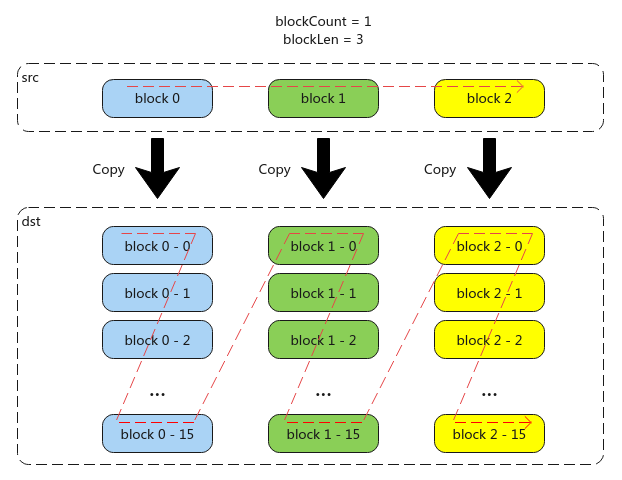
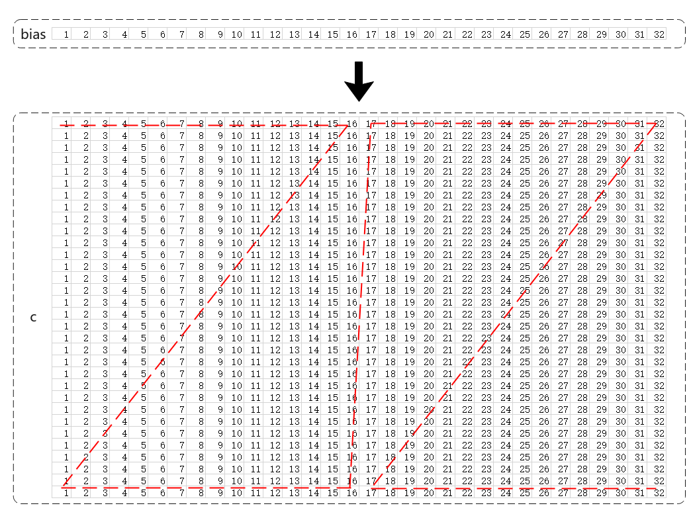

# BroadCastVecToMM(ISASI)

**页面ID:** atlasascendc_api_07_0257  
**来源:** https://www.hiascend.com/document/detail/zh/CANNCommunityEdition/900/API/ascendcopapi/atlasascendc_api_07_0257.html

---

#### 产品支持情况

| 产品 | 是否支持 |
| --- | --- |
| Atlas 350 加速卡 | x |
| Atlas A3 训练系列产品            /             Atlas A3 推理系列产品 | x |
| Atlas A2 训练系列产品            /             Atlas A2 推理系列产品 | x |
| Atlas 200I/500 A2 推理产品 | x |
| Atlas 推理系列产品            AI Core | √ |
| Atlas 推理系列产品            Vector Core | x |
| Atlas 训练系列产品 | x |

#### 功能说明

将矢量数据广播到矩阵中，每个数据块中的每16个elements会被连续复制16次；当前支持的数据传输通路：VECIN/VECCALC/VECOUT->CO1。

**图1 **功能示例


#### 函数原型

```
template <typename T, typename U>
__aicore__ inline void BroadCastVecToMM(const LocalTensor<T> &dst, const LocalTensor<U> &src, const int32_t blockCount, const uint8_t blockLen, const uint8_t srcGap, const uint8_t dstGap)
```

#### 参数说明

**表1 **模板参数说明

| 参数名 | 描述 |
| --- | --- |
| T | dst的数据类型。                       Atlas 推理系列产品            AI Core，支持的数据类型为：half/int16_t/uint16_t |
| U | src的数据类型。                       Atlas 推理系列产品            AI Core，支持的数据类型为：half/int16_t/uint16_t |

**表2 **参数说明

| **参数名称** | **类型** | **说明** |
| --- | --- | --- |
| dst | 输出 | 目的操作数，结果矩阵，类型为LocalTensor，支持的TPosition为CO1。          LocalTensor的起始地址需要256个元素对齐。          支持的数据类型为：half/float/int32_t。 |
| src | 输入 | 源操作数，输入矢量，类型为LocalTensor，支持的TPosition为VECIN/VECCALC/VECOUT。          支持的数据类型需要与dst一致。 |
| blockCount | 输入 | 指定该指令包含的连续广播数据块个数，取值范围：blockCount∈[1, 255]。 |
| blockLen | 输入 | 指定该指令每个连续广播数据块长度，单位为16个elements。取值范围：blockLen∈[1, 255]。 |
| srcGap | 输入 | 源操作数，相邻连续数据块的间隔（前面一个数据块的尾与后面数据块的头的间隔），单位为datablock(32Bytes)。 |
| dstGap | 输入 | 目的操作数，相邻连续数据块间的间隔（前面一个数据块的尾与后面数据块的头的间隔），单位为256个elements。 |

#### 约束说明

#### 调用示例

本示例中，输入bias形状为[1, 32]，输出c的形状为[32, 32]，格式为Nz。

**图2 **调用示例图


本示例仅展示样例中的部分代码。

```
// brcLocal为TPosition::CO1上的float类型的LocalTensor，biasLocal为TPosition::VECOUT上的float类型的LocalTensor
// blockCount = 1, blockLen = 1. 连续广播的数据块个数为1，每个数据块包含16个elements，共输出256个elements
// srcGap = 0, dstGap = 1. 源操作数与目的操作数之间连续
AscendC::BroadCastVecToMM(brcLocal, biasLocal, 1, 1, 0, 1)
```
