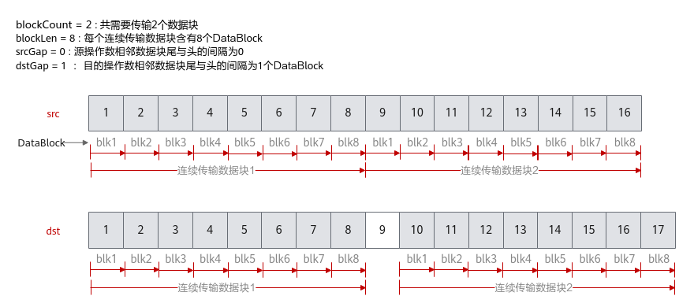
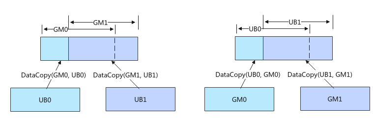

# 基础数据搬运

**页面ID:** atlasascendc_api_07_0103  
**来源:** https://www.hiascend.com/document/detail/zh/CANNCommunityEdition/900/API/ascendcopapi/atlasascendc_api_07_0103.html

---

#### 产品支持情况

| 产品 | 是否支持 **源操作数和目的操作数** **数据类型一致**的原型 | 是否支持 **源操作数和目的操作数** **数据类型不一致**的原型 |
| --- | --- | --- |
| Atlas 350 加速卡 | √ | √ |
| Atlas A3 训练系列产品/Atlas A3 推理系列产品 | √ | √ |
| Atlas A2 训练系列产品/Atlas A2 推理系列产品 | √ | √ |
| Atlas 200I/500 A2 推理产品 | √ | x |
| Atlas 推理系列产品AI Core | √ | x |
| Atlas 推理系列产品Vector Core | √ | x |
| Atlas 训练系列产品 | √ | x |

#### 功能说明

提供基础的数据搬运能力，数据在传输过程中保持原始格式和内容不变，支持连续和非连续的数据搬运。

#### 函数原型

- Global Memory -> Local Memory

```
// 连续搬运
template <typename T>
__aicore__ inline void DataCopy(const LocalTensor<T>& dst, const GlobalTensor<T>& src, const uint32_t count)

// 同时支持非连续搬运和连续搬运
template <typename T>
__aicore__ inline void DataCopy(const LocalTensor<T>& dst, const GlobalTensor<T>& src, const DataCopyParams& repeatParams)
```

- Local Memory -> Local Memory

```
// 连续搬运
template <typename T>
__aicore__ inline void DataCopy(const LocalTensor<T>& dst, const LocalTensor<T>& src, const uint32_t count)

// 同时支持非连续搬运和连续搬运
template <typename T>
__aicore__ inline void DataCopy(const LocalTensor<T>& dst, const LocalTensor<T>& src, const DataCopyParams& repeatParams)
```

- Local Memory -> Global Memory

```
// 连续搬运
template <typename T>
__aicore__ inline void DataCopy(const GlobalTensor<T>& dst, const LocalTensor<T>& src, const uint32_t count)

// 同时支持非连续搬运和连续搬运
template <typename T>
__aicore__ inline void DataCopy(const GlobalTensor<T>& dst, const LocalTensor<T>& src, const DataCopyParams& repeatParams)
```

- Local Memory -> Local Memory，支持源操作数和目的操作数数据类型不一致

```
// 同时支持非连续搬运和连续搬运
template <typename T, typename U>
__aicore__ inline void DataCopy(const LocalTensor<T>& dst, const LocalTensor<U>& src, const DataCopyParams& repeatParams)
```

> **注意:** 

各原型支持的具体数据通路和数据类型，请参考支持的通路和数据类型。

#### 参数说明

**表1 **模板参数说明

| 参数名 | 描述 |
| --- | --- |
| T、U | 操作数的数据类型。支持的数据类型请参考支持的通路和数据类型。 |

**表2 **参数说明

| 参数名 | 输入/输出 | 含义 |
| --- | --- | --- |
| dst | 输出 | 目的操作数，类型为LocalTensor或GlobalTensor。 LocalTensor位于C2时，起始地址要求64B对齐；LocalTensor位于C2PIPE2GM时，起始地址要求128B对齐；其他情况均要求32字节对齐。 GlobalTensor的起始地址要求按照对应数据类型所占字节数对齐。 |
| src | 输入 | 源操作数，类型为LocalTensor或GlobalTensor。 LocalTensor的起始地址要求32字节对齐。 GlobalTensor的起始地址要求按照对应数据类型所占字节数对齐。 |
| repeatParams | 输入 | 搬运参数，DataCopyParams类型。通过该参数可配置搬运的数据块大小、个数、间隔等信息，同时支持非连续和连续搬运。 具体定义请参考${INSTALL_DIR}/include/ascendc/basic_api/interface/kernel_struct_data_copy.h，${INSTALL_DIR}请替换为CANN软件安装后文件存储路径。 |
| count | 输入 | 参与搬运的元素个数。 > **注意:**  说明： count * sizeof(T)需要32字节对齐，若不对齐，搬运量将对32字节做向下取整。 |

**表3 **DataCopyParams结构体参数定义

| 参数名称 | 含义 |
| --- | --- |
| blockCount | 待搬运的连续传输数据块个数。uint16_t类型，取值范围：blockCount∈[1, 4095]。 |
| blockLen | 待搬运的每个连续传输数据块长度，单位为DataBlock（32字节）。uint16_t类型，取值范围：blockLen∈[1, 65535]。 特殊情况： - 当dst位于C2PIPE2GM时，单位为128B。- 一般情况：当dst位于C2时，表示源操作数的连续传输数据块长度，单位为64B。针对Atlas 350 加速卡，当dst位于C2时，表示源操作数的连续传输数据长度，单位为32B。 |
| srcGap | 源操作数相邻连续数据块的间隔（前面一个数据块的尾与后面数据块的头的间隔），单位为DataBlock（32字节）。uint16_t类型，srcGap不要超出该数据类型的取值范围。 在L1 Buffer -> Fixpipe Buffer场景中，srcGap特指源操作数相邻连续数据块的间隔（前面一个数据块的头与后面数据块的头的间隔），单位为DataBlock（32字节）。uint16_t类型，srcGap不要超出该数据类型的取值范围。 |
| dstGap | 目的操作数相邻连续数据块间的间隔（前面一个数据块的尾与后面数据块的头的间隔），单位为DataBlock（32字节）。uint16_t类型，dstGap不要超出该数据类型的取值范围。 特殊情况： - 当dst位于C2PIPE2GM时，单位为128B。- 一般情况：当dst位于C2时，表示源操作数的连续传输数据块长度，单位为64B。针对Atlas 350 加速卡，当dst位于C2时，表示源操作数的连续传输数据长度，单位为32B。 在L1 Buffer -> Fixpipe Buffer场景中，dstGap特指源操作数相邻连续数据块的间隔（前面一个数据块的头与后面数据块的头的间隔），单位为DataBlock（32字节）。uint16_t类型，dstGap不要超出该数据类型的取值范围。 |

下面的样例呈现了DataCopyParams结构体参数的使用方法，样例中完成了2个连续传输数据块的搬运，每个数据块含有8个DataBlock，源操作数相邻数据块之间无间隔，目的操作数相邻数据块尾与头之间间隔1个DataBlock。



#### 约束说明

- 如果需要执行多个DataCopy指令，且DataCopy的目的地址存在重叠，需要通过调用PipeBarrier(ISASI)来插入同步指令，保证多个DataCopy指令的串行化，防止出现异常数据。如下图左侧示意图，执行两个DataCopy指令，搬运的目的GM地址存在重叠，两条搬运指令之间需要通过调用PipeBarrier<PIPE_MTE3>()添加MTE3搬出流水的同步；如下图右侧示意图所示，搬运的目的地址Unified Buffer存在重叠，两条搬运指令之间需要调用PipeBarrier<PIPE_MTE2>()添加MTE2搬入流水的同步。



- 针对如下产品型号：

Atlas A2 训练系列产品/Atlas A2 推理系列产品

Atlas A3 训练系列产品/Atlas A3 推理系列产品

在跨卡通信算子开发场景，DataCopy类接口支持跨卡数据搬运，仅支持HCCS物理链路，不支持其他通路；开发者开发过程中，需要关注涉及卡间通信的物理通路，可通过npu-smi  info -t topo命令查询HCCS物理链路。

- 针对Atlas 350 加速卡，在UB -> L1 Buffer的数据搬运时，可以通过配置编译选项ENABLE_CV_COMM_VIA_SSBUF来选择两种搬运通路，当ENABLE_CV_COMM_VIA_SSBUF配置为true时，使用SSBuffer进行通信，数据通过UB->L1 Buffer之间的硬件通道进行搬运（推荐）；当ENABLE_CV_COMM_VIA_SSBUF为false时，数据搬运到L1 Buffer经过GM，该场景下需要借助Matmul高阶API进行注册操作。

#### 支持的通路和数据类型

下文的数据通路均通过逻辑位置TPosition来表达，并注明了对应的物理通路。TPosition与物理内存的映射关系见表1。

**表4 **Global Memory -> Local Memory具体通路和支持的数据类型

| 产品型号 | 数据通路 | 源操作数和目的操作数的数据类型（两者保持一致） |
| --- | --- | --- |
| Atlas 训练系列产品 | - GM -> VECIN（GM -> UB ）- GM -> A1、B1（GM -> L1 Buffer ） | int8_t、uint8_t、int16_t、uint16_t、int32_t、uint32_t、int64_t、 uint64_t、 half、float、double |
| Atlas 推理系列产品AI Core | - GM -> VECIN（GM -> UB ）- GM -> A1、B1（GM -> L1 Buffer ） | int8_t、uint8_t、int16_t、uint16_t、int32_t、uint32_t、int64_t、 uint64_t、 half、float、double |
| Atlas 推理系列产品Vector Core | - GM -> VECIN（GM -> UB ） | int8_t、uint8_t、int16_t、uint16_t、int32_t、uint32_t、int64_t、 uint64_t、 half、float、double |
| Atlas A2 训练系列产品/Atlas A2 推理系列产品 | - GM -> VECIN（GM -> UB ）- GM -> A1、B1、C1（GM -> L1 Buffer ） | int8_t、uint8_t、int16_t、uint16_t、int32_t、uint32_t、int64_t、 uint64_t、 half、bfloat16_t、float、double |
| Atlas A3 训练系列产品/Atlas A3 推理系列产品 | - GM -> VECIN（GM -> UB ）- GM -> A1、B1、C1（GM -> L1 Buffer ） | int8_t、uint8_t、int16_t、uint16_t、int32_t、uint32_t、int64_t、 uint64_t、 half、bfloat16_t、float、double |
| Atlas 200I/500 A2 推理产品 | - GM -> VECIN（GM -> UB ） | int8_t、uint8_t、int16_t、uint16_t、int32_t、uint32_t、int64_t、 uint64_t、 half、bfloat16_t、float、double |
| Atlas 350 加速卡 | - GM -> VECIN（GM -> UB ）- GM -> A1、B1、C1（GM -> L1 Buffer ） | b8、b16、b32、b64 |

**表5 **Local Memory -> Local Memory具体通路和支持的数据类型

| 产品型号 | 数据通路 | 源操作数和目的操作数的数据类型（两者保持一致） |
| --- | --- | --- |
| Atlas 350 加速卡 | - VECIN -> VECCALC或VECCALC -> VECOUT（UB -> UB）- VECIN、VECCALC、VECOUT -> TSCM（UB -> L1 Buffer）- A1、B1、C1 -> C2PIPE2GM（L1 Buffer -> Fixpipe Buffer） | bool、int8_t、uint8_t、hifloat8_t、fp8_e5m2_t、fp8_e4m3fn_t、fp8_e8m0_t、int16_t、uint16_t、half、bfloat16_t、int32_t、uint32_t、float、complex32、int64_t、uint64_t、double、complex64 |
| - C1 -> C2（L1 Buffer -> BiasTable Buffer） | half、bfloat16_t、int32_t、float |  |
| Atlas 训练系列产品 | - VECIN -> VECCALC或VECCALC -> VECOUT（UB -> UB） | int8_t、uint8_t、int16_t、uint16_t、int32_t、uint32_t、int64_t、 uint64_t、 half、float、double |
| Atlas 推理系列产品AI Core | - VECIN -> VECCALC或VECCALC -> VECOUT（UB -> UB）- VECIN、VECCALC、VECOUT -> A1、B1（UB -> L1 Buffer） | int8_t、uint8_t、int16_t、uint16_t、int32_t、uint32_t、int64_t、 uint64_t、 half、float、double |
| Atlas A2 训练系列产品/Atlas A2 推理系列产品 | - VECIN -> VECCALC或VECCALC-> VECOUT（UB -> UB）- VECIN、VECCALC、VECOUT -> TSCM（UB -> L1 Buffer）- A1、B1、C1-> C2PIPE2GM（L1 Buffer -> Fixpipe Buffer） | int8_t、uint8_t、int16_t、uint16_t、int32_t、uint32_t、int64_t、 uint64_t、 half、bfloat16_t、float、double |
| - C1 -> C2（L1 Buffer -> BiasTable Buffer） | int32_t、float |  |
| Atlas A3 训练系列产品/Atlas A3 推理系列产品 | - VECIN -> VECCALC或VECCALC-> VECOUT（UB -> UB）- VECIN、VECCALC、VECOUT -> TSCM（UB -> L1 Buffer）- A1、B1、C1-> C2PIPE2GM（L1 Buffer -> Fixpipe Buffer） | int8_t、uint8_t、int16_t、uint16_t、int32_t、uint32_t、int64_t、 uint64_t、 half、bfloat16_t、float、double |
| - C1 -> C2（L1 Buffer -> BiasTable Buffer） | int32_t、float |  |

**表6 **Local Memory -> Global Memory具体通路和支持的数据类型

| 产品型号 | 数据通路 | 源操作数和目的操作数的数据类型（两者保持一致） |
| --- | --- | --- |
| Atlas 训练系列产品 | - VECOUT -> GM（UB -> GM） | int8_t、uint8_t、int16_t、uint16_t、int32_t、uint32_t、int64_t、 uint64_t、 half、float、double |
| Atlas 推理系列产品AI Core | - VECOUT、CO2 -> GM（UB -> GM） | int8_t、uint8_t、int16_t、uint16_t、int32_t、uint32_t、int64_t、 uint64_t、 half、float、double |
| Atlas 推理系列产品Vector Core | - VECOUT -> GM（UB -> GM） | int8_t、uint8_t、int16_t、uint16_t、int32_t、uint32_t、int64_t、 uint64_t、 half、float、double |
| Atlas A2 训练系列产品/Atlas A2 推理系列产品 | - VECOUT -> GM（UB -> GM）- A1、B1 -> GM（L1 Buffer -> GM） | int8_t、uint8_t、int16_t、uint16_t、int32_t、uint32_t、int64_t、 uint64_t、 half、bfloat16_t、float、double |
| Atlas A3 训练系列产品/Atlas A3 推理系列产品 | - VECOUT -> GM（UB -> GM）- A1、B1 -> GM（L1 Buffer -> GM） | int8_t、uint8_t、int16_t、uint16_t、int32_t、uint32_t、int64_t、 uint64_t、 half、bfloat16_t、float、double |
| Atlas 200I/500 A2 推理产品 | - VECOUT -> GM（UB -> GM） | int8_t、uint8_t、int16_t、uint16_t、int32_t、uint32_t、int64_t、 uint64_t、 half、bfloat16_t、float、double |
| Atlas 350 加速卡 | - VECOUT -> GM（UB -> GM） | b8、b16、b32、b64 |

**表7 **Local Memory -> Local Memory具体通路和支持的数据类型（支持源操作数和目的操作数的数据类型不一致）

| 产品型号 | 数据通路 | 源操作数的数据类型 | 目的操作数的数据类型 |
| --- | --- | --- | --- |
| Atlas 350 加速卡 | C1 -> C2（L1 Buffer -> BiasTable Buffer） | bfloat16_t、half | float |
| Atlas A2 训练系列产品/Atlas A2 推理系列产品 | C1 -> C2（L1 Buffer -> BiasTable Buffer） | half | float |
| Atlas A3 训练系列产品/Atlas A3 推理系列产品 | C1 -> C2（L1 Buffer -> BiasTable Buffer） | half | float |

#### 调用示例

- Global Memory -> Local Memory

```
// srcLocal为half类型的LocalTensor，srcGlobal为half类型的GlobalTensor
// 使用传入count参数的搬运接口，完成连续搬运
AscendC::DataCopy(srcLocal, srcGlobal, 512);
// 使用传入DataCopyParams参数的搬运接口，支持连续和非连续搬运
DataCopyParams intriParams;
intriParams.blockCount = 1; // 连续数据块个数为1
intriParams.blockLen = 512 * sizeof(half) / 32; // 连续数据块长度，单位为DataBlock，此处长度为512个half元素
intriParams.srcGap = 0; // 源操作数做连续搬运
intriParams.dstGap = 0; // 目的操作数连续排布
AscendC::DataCopy(srcLocal, srcGlobal, intriParams);
```

- Local Memory -> Local Memory

```
// srcLocal、dstLocal为half类型的LocalTensor
// 使用传入count参数的搬运接口，完成连续搬运
AscendC::DataCopy(dstLocal, srcLocal, 512);
// 使用传入DataCopyParams参数的搬运接口，支持连续和非连续搬运
DataCopyParams intriParams;
intriParams.blockCount = 1; // 连续数据块个数为1
intriParams.blockLen = 512 * sizeof(half) / 32; // 连续数据块长度，单位为DataBlock，此处长度为512个half元素
intriParams.srcGap = 0; // 源操作数做连续搬运
intriParams.dstGap = 0; // 目的操作数连续排布
AscendC::DataCopy(dstLocal, srcLocal, intriParams);
```

- Local Memory -> Global Memory

```
// dstLocal为half类型的LocalTensor，dstGlobal为half类型的GlobalTensor
// 使用传入count参数的搬运接口，完成连续搬运
AscendC::DataCopy(dstGlobal, dstLocal, 512);
// 使用传入DataCopyParams参数的搬运接口，支持连续和非连续搬运
DataCopyParams intriParams;
intriParams.blockCount = 1; // 连续数据块个数为1
intriParams.blockLen = 512 * sizeof(half) / 32; // 连续数据块长度，单位为DataBlock，此处长度为512个half元素
intriParams.srcGap = 0; // 源操作数做连续搬运
intriParams.dstGap = 0; // 目的操作数连续排布
AscendC::DataCopy(dstGlobal, dstLocal, intriParams);
```

结果示例：

```
输入数据srcGlobal：[1 2 3 ... 512]
输出数据dstGlobal：[1 2 3 ... 512]
```
