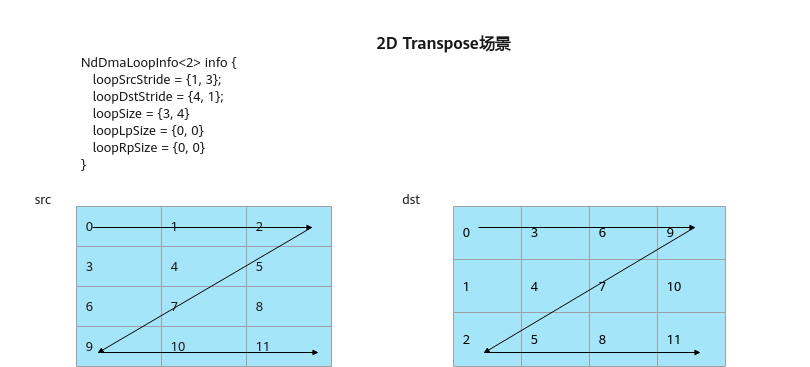
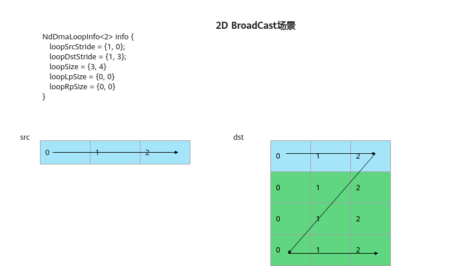
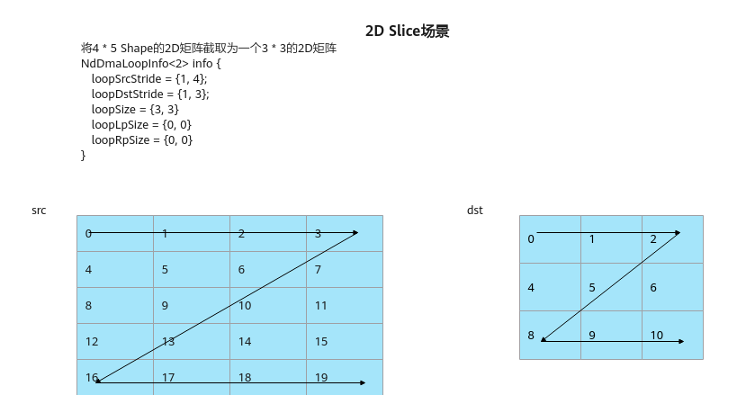
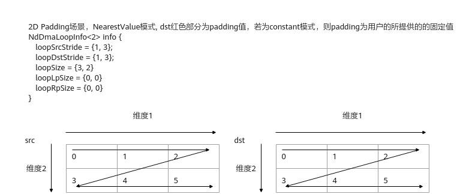

# 多维数据搬运（ISASI）

**页面ID:** atlasascendc_api_07_00131  
**来源:** https://www.hiascend.com/document/detail/zh/CANNCommunityEdition/900/API/ascendcopapi/atlasascendc_api_07_00131.html

---

#### 产品支持情况

| 产品 | 是否支持 |
| --- | --- |
| Atlas 350 加速卡 | √ |
| Atlas A3 训练系列产品/Atlas A3 推理系列产品 | x |
| Atlas A2 训练系列产品/Atlas A2 推理系列产品 | x |
| Atlas 200I/500 A2 推理产品 | x |
| Atlas 推理系列产品AI Core | x |
| Atlas 推理系列产品Vector Core | x |
| Atlas 训练系列产品 | x |

#### 功能说明

多维数据搬运接口，相比于基础数据搬运接口，可更加自由配置搬入的维度信息以及对应的Stride。

#### 函数原型

- Global Memory-> Local Memory ，支持多维度搬运

```
template <typename T, uint8_t dim, const NdDmaConfig& config = kDefaultNdDmaConfig>
__aicore__ inline void DataCopy(const LocalTensor<T>& dst, const GlobalTensor<T>& src, const NdDmaParams<T, dim>& params)
```

- NdDma DataCache刷新，在使用DataCopy接口进行数据搬运前，需要使用NdDmaDci接口刷新缓存保证DataCache为最新状态。

```
__aicore__ inline void NdDmaDci()
```

#### 参数说明

**表1 **模板参数说明

| 参数名 | 描述 |
| --- | --- |
| T | 源操作数或者目的操作数的数据类型。 |
| dim | 搬运的数据维度, 数据类型为uint8_t，支持的维度为[1, 5]。 |
| 搬运配置选项，NdDmaConfig类型，定义如下，具体参数说明请参考表 NdDmaConfig结构体参数定义。 ``` struct NdDmaConfig {     static constexpr uint16_t unsetPad = 0xffff;     bool isNearestValueMode = false;     uint16_t loopLpSize = unsetPad; // Left padding size of all dimensions, must be less than 256.     uint16_t loopRpSize = unsetPad; // Right padding size of all dimensions, must be less than 256.     bool ascOptimize = false;       // used for Ascend C optimization on special senario. }; ``` |  |

**表2 **参数说明

| 参数名称 | 输入/输出 | 含义 |
| --- | --- | --- |
| dst | 输出 | 目的操作数，类型为LocalTensor。 |
| src | 输入 | 源操作数，类型为GlobalTensor。 |
| 搬运参数 NdDmaParams类型，定义如下，具体参数说明请参考表 NdDmaParams结构体参数定义。 ``` template <typename T, uint8_t dim> struct NdDmaParams  {     NdDmaLoopInfo<dim> loopInfo;     T constantValue;  // 若有左右Padding，且不使能NearestValueMode时，该值将作为Padding值填充。 }; ```  NdDmaLoopInfo类型，定义如下，具体参数说明请参考表 NdDmaLoopInfo结构体参数定义。 ``` template <uint8_t dim> struct NdDmaLoopInfo  {     uint64_t loopSrcStride[dim] = {0}; // src stride info per loop.     uint32_t loopDstStride[dim] = {0}; // dst stride info per loop.     uint32_t loopSize[dim] = {0}; // Loop size per loop.     uint8_t loopLpSize[dim] = {0}; // Left padding size per loop.     uint8_t loopRpSize[dim] = {0}; // Right padding size per loop. }; // 注意: dim的有效范围为[1,5] ``` |  |  |

**表3 **NdDmaConfig结构体参数定义

| 参数名称 | 含义 |
| --- | --- |
| unsetPad | 表示不设置PaddingSize，固定为0xFFFF。 |
| isNearestValueMode | 表示Padding值填取方式，类型为bool。 True：使能最近值填充方式，即左右Padding值会选取当前维度最左或最右的值进行填充，可参考图1。 False：使能常数填充方式，即所有Padding值填充为固定值NdDmaParams::constantValue。 当数据类型为b64时，参数isNearestValueMode的值应为False。 |
| loopLpSize | 表示每个维度内的PaddingSize，当该值不为unsetPad时，则表示所有循环里的左PaddingSize为该值，且会使NdDmaLoopInfo::loopLpSize不生效。默认值为unsetPad，开发者可填的范围为默认值或[0,255]。 |
| loopRpSize | 表示每个维度内的PaddingSize，当该值不为unsetPad时，则表示所有循环里的右PaddingSize为该值，且会使NdDmaLoopInfo::loopRpSize不生效。默认值为unsetPad，开发者可填的范围为默认值或[0,255]。 |
| ascOptimize | 预留参数，暂不支持。 |

**表4 **NdDmaParams结构体参数定义

| 参数名称 | 含义 |
| --- | --- |
| loopInfo | 每维进行搬运的信息，类型为NdDmaLoopInfo<dim>。 NdDmaLoopInfo结构中数组类型的参数，其数组索引值对应实际维度信息，索引0 - 4对应1 - 5维。具体参数介绍可参考表 NdDmaLoopInfo结构体参数定义。 |
| constantValue | 数据类型为T的数值，当存在维度左右Padding，且不使能NearestValueMode时，该值将作为Padding值填充。 当数据类型为b64时，参数constantValue的值应为0。 |

**表5 **NdDmaLoopInfo结构体参数定义

| 参数名称 | 含义 |
| --- | --- |
| loopSrcStride | 表示每个维度内，该源操作数元素与下一个元素间的间隔。 单位为元素个数。数据类型为uint64_t，srcStride需在0, 240)。 |
| loopDstStride | 表示每个维度内，该目的操作数元素与下一个元素间的间隔。 单位为元素个数。数据类型为uint32_t，dstStride需在[0, 220)。 |
| loopSize | 表示每个维度内，处理的元素个数（不包含Padding元素）。 单位为元素个数。数据类型为uint32_t，dstStride需在[0, 220)。 |
| loopLpSize | 表示每个维度内，左侧需要补齐的元素个数。 单位为元素个数。数据类型为uint8_t，srcStride不要超出该数据类型的取值范围。 |
| loopRpSize | 表示每个维度内，右侧需要补齐的元素个数。 单位为元素个数。数据类型为uint8_t，srcStride不要超出该数据类型的取值范围。 |

以下以2维的例子介绍几个典型使用场景。

**图1 **2D Padding场景
![**图2 **2D Transpose场景


**图3 **2D BroadCast场景
**图4 **2D Slice场景


#### 通路说明

**表6 **数据通路和数据类型

| 支持型号 | 数据通路（通过TPosition表达） | 源操作数和目的操作数的数据类型 (两者保持一致) |
| --- | --- | --- |
| Atlas 350 加速卡 | GM -> VECIN | b8、b16、b32、b64 |

#### 约束说明

- 一条指令所能获取的所有数据的地址范围宽度不能超过40位（1TB），即：

源操作数的每一次循环的大小为：(loopLpSize + loopSize + loopRpSize -1 ) * loopSrcSize，目的操作数的每一次循环的大小为：(loopLpSize + loopSize + loopRpSize -1 ) * loopDstSize，所有的循环的大小加起来不超过2的40次方位。

- 当每层循环的dstStride为升序序列，则不同循环间的地址空间不能交织或者重叠。以一个2D Padding场景为例，loopSrcStride、loopDstStride第二个维度的stride值最小是3，数据3不能落在维度1的循环中。



- 该接口通过NDDMA进行数据搬运，对应的NDDMA Cache大小为32KB，在使用DataCopy接口进行数据搬运前，需要使用NdDmaDci接口刷新缓存，否则多核场景下读写同一块GM地址可能会导致部分核读取数据错误。

#### 调用示例

```
// T：搬运数据的类型
// xGm：保存DataCopy搬入数据
// xLocal：保存DataCopy搬出数据

// 2D Padding场景
// xGmShape：[2, 8]，搬运8列2行数据，左Padding 3，上Padding 1，右Padding 5，下Padding 1，xLocalShape：[4, 16]
AscendC::NdDmaLoopInfo<2> loopInfo{{1, 8}, {1, 16}, {8, 2}, {3, 1}, {5, 1}};
AscendC::NdDmaParams<T, 2> params{loopInfo, 0};  // padding的值为0
AscendC::NdDmaDci();  // 刷新cache
static constexpr AscendC::NdDmaConfig dmaConfig;  // 使用默认参数，也可以不传
AscendC::DataCopy<T, 2, dmaConfig>(xLocal, xGm, params);
```

结果示例如下：

```
输入数据（xGm）:
[[ 1.  2.  3.  4.  5.  6.  7.  8.]
 [ 9. 10. 11. 12. 13. 14. 15. 16.]]
搬运至Local的数据（xLocal）:
[[ 0.  0.  0.  0.  0.  0.  0.  0.  0.  0.  0.  0.  0.  0.  0.  0.]
 [ 0.  0.  0.  1.  2.  3.  4.  5.  6.  7.  8.  0.  0.  0.  0.  0.]
 [ 0.  0.  0.  9. 10. 11. 12. 13. 14. 15. 16.  0.  0.  0.  0.  0.]
 [ 0.  0.  0.  0.  0.  0.  0.  0.  0.  0.  0.  0.  0.  0.  0.  0.]]
```
