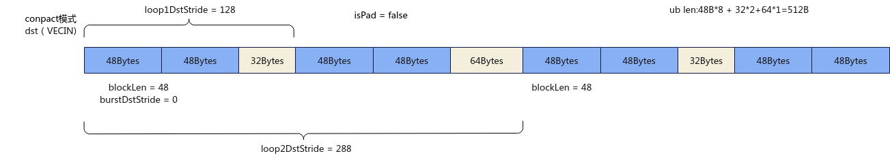

# SetLoopModePara

**页面ID:** atlasascendc_api_07_00242  
**来源:** https://www.hiascend.com/document/detail/zh/CANNCommunityEdition/900/API/ascendcopapi/atlasascendc_api_07_00242.html

---

#### 产品支持情况

| 产品 | 是否支持 |
| --- | --- |
| Atlas 350 加速卡 | √ |
| Atlas A3 训练系列产品/Atlas A3 推理系列产品 | x |
| Atlas A2 训练系列产品/Atlas A2 推理系列产品 | x |
| Atlas 200I/500 A2 推理产品 | x |
| Atlas 推理系列产品AI Core | x |
| Atlas 推理系列产品Vector Core | x |
| Atlas 训练系列产品 | x |

#### 功能说明

DataCopy、DataCopyPad过程中通过该接口使能loop mode并且设置loop mode的参数，需要和ResetLoopModePara搭配使用，在数据搬运结束后通过ResetLoopModePara重置loop mode的参数。支持的通路如下：

- GM->VECIN
- VECOUT->GM

#### 函数原型

```
__aicore__ inline void SetLoopModePara(const LoopModeParams& loopParams, DataCopyMVType type)
```

#### 参数说明

**表1 **参数说明

| 参数名 | 输入/输出 | 描述 |
| --- | --- | --- |
| loopParams | 输入 | 循环模式参数 LoopModeParams类型，定义如下，具体参数说明请参考表2。 ``` struct LoopModeParams {         loop1Size = 0;         loop2Size = 0;         loop1SrcStride = 0;         loop1DstStride = 0;         loop2SrcStride = 0;         loop2DstStride = 0 ; }; ``` |
| type | 输入 | 数据搬运模式。DataCopyMVType为枚举类型，定义如下，具体参数说明请参考表3。 ``` enum class DataCopyMVType : uint8_t {     UB_TO_OUT = 0,     OUT_TO_UB = 1, }; ``` |

**表2 **LoopModeParams结构体参数说明

| 参数名称 | 含义 |
| --- | --- |
| loop1Size | 用于设置内层循环的循环次数，数据类型为uint32_t，取值范围为0, 2^21)。 |
| loop2Size | 用于设置外层循环的循环次数，数据类型为uint32_t，取值范围为[0, 2^21)。 |
| loop1SrcStride | 用于设置内层循环中相邻迭代源操作数的数据块间的间隔，单位为Byte，数据类型为uint64_t。 - 当数据搬运模式是UB_TO_OUT的时候取值范围为[0, 2^21)，并且loop1SrcStride必须32B对齐。- 当数据搬运模式是OUT_TO_UB的时候取值范围为[0, 2^40)。 |
| loop1DstStride | 用于设置内层循环中相邻迭代目的操作数的数据块间的间隔，单位为Byte，数据类型为uint64_t。 - 当数据搬运模式是UB_TO_OUT的时候取值范围为[0, 2^40)。- 当数据搬运模式是OUT_TO_UB的时候取值范围为[0, 2^21)，并且loop1DstStride必须32B对齐。 |
| loop2SrcStride | 用于设置外层循环中相邻迭代源操作数的数据块间的间隔，单位为Byte，数据类型为uint64_t。 - 当数据搬运模式是UB_TO_OUT的时候取值范围为[0, 2^21)，并且loop2SrcStride必须32B对齐。- 当数据搬运模式是OUT_TO_UB的时候取值范围为[0, 2^40)。 |
| loop2DstStride | 用于设置外层循环中相邻迭代目的操作数的数据块间的间隔，单位为Byte，数据类型为uint64_t。 - 当数据搬运模式是UB_TO_OUT的时候取值范围为[0, 2^40)。- 当数据搬运模式是OUT_TO_UB的时候取值范围为[0, 2^21)，并且loop2DstStride必须32B对齐。 |

**表3 **DataCopyMVType结构体参数说明

| 参数名称 | 含义 |
| --- | --- |
| UB_TO_OUT | 从UB搬运到GM的通路。 |
| OUT_TO_UB | 从GM搬运到UB的通路。 |

下面的样例呈现了SetLoopModePara的使用方法。

- 样例中在数据类型为int8_t的场景下，数据块大小为384，配置DataCopyPad的数据搬运模式为Compact模式，blockLen = 48，blockCount = 2，表明每个连续传输数据块包含48Bytes，且连续传输数据块有两个，srcStride = 0, dstStride = 0，isPad = false，表明源操作数相邻数据块之间没有间隔且不需要填充用户自定义的数据；
- 再设置SetLoopModePara中LoopModeParams的参数：loop1Size = 2，loop2Size = 2，loop1SrcStride = 96，loop2SrcStride =192，loop1DstStride =  128，loop2DstStride = 288，DataCopyMVType为OUT_TO_UB，表明内层循环和外层循坏的次数分别为2次，内层循环和外层循环中相邻迭代源操作数的数据块间隔分别为96Bytes和192Bytes，内层循环和外层循环中相邻迭代目的操作数的数据块间隔分别为128Bytes和288Bytes，通路是从GM搬运到UB；
- 使用以上配置，调用SetLoopModePara再调用DataCopyPad就可以开启DataCopyPad的loop模式完成数据类型为int8_t的数据块大小为384的数据搬运。详细图解如下：

**图1 **源操作数搬运场景示例
![**图2 **目的操作数搬运场景示例


#### 约束说明

- 源操作数和目的操作数的起始地址需要保证32字节对齐。
- 目的操作数的数据不能重叠，如果有重叠，硬件层面不会报错或者告警，同时也不能保证重叠数据的正确性；但是不同迭代可以交织，例如内层循环中相邻迭代目的操作数的数据块间的间隔可以小于相邻连续目的操作数的数据块的间隔。
- 需要在每次使能loop mode并且设置loop mode的参数后通过ResetLoopModePara进行寄存器的复位，否则会影响到下一次对应通路的搬运的使用，引发异常。

#### 调用示例

本示例中操作数数据类型为int8_t。

```
AscendC::LocalTensor<int8_t> srcLocal = inQueueSrc.AllocTensor<int8_t>();
AscendC::DataCopyExtParams copyParams{2, 48 * sizeof(int8_t), 0, 0, 0}; // 结构体DataCopyExtParams最后一个参数是rsv保留位
AscendC::DataCopyPadExtParams<half> padParams{false, 0, 0, 0};
AscendC::LoopModeParams loopParam2Ub {2, 2, 96, 128, 192, 288};
AscendC::SetLoopModePara(loopParam2Ub, DataCopyMVType::OUT_TO_UB);
AscendC::DataCopyPad<int8_t, PaddingMode::Compact>(srcLocal, srcGlobal, copyParams, padParams); // 从GM->VECIN搬运 48 * 2 * 2 * 2 = 384Bytes
AscendC::ResetLoopModePara(DataCopyMVType::OUT_TO_UB);
AscendC::LoopModeParams loopParam2Gm {2, 2, 128, 96, 288, 192};
AscendC::SetLoopModePara(loopParams2Gm, DataCopyMVType::UB_TO_OUT);
DataCopyPad<T, PaddingMode::Compact>(dstGlobal, srcLocal, copyParams);
AscendC::ResetLoopModePara(DataCopyMVType::UB_TO_OUT);
```

结果示例如下：

```
输入数据src0Global: [1 2 3 ... 384]
输出数据dstGlobal:[1 2 3 ... 384]
```
