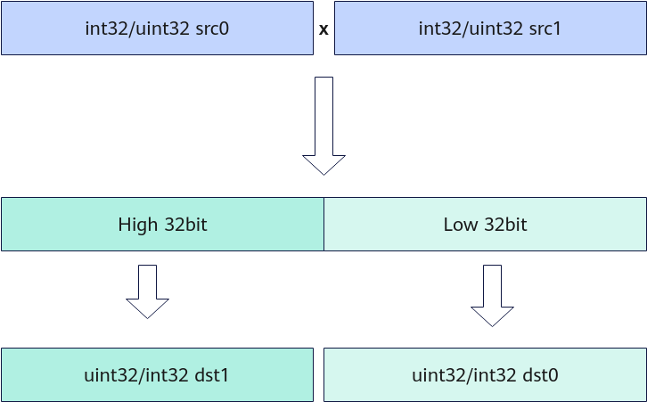

# Mull(ISASI)

**页面ID:** atlasascendc_api_07_00246  
**来源:** https://www.hiascend.com/document/detail/zh/CANNCommunityEdition/900/API/ascendcopapi/atlasascendc_api_07_00246.html

---

#### 产品支持情况

| 产品 | 是否支持 |
| --- | --- |
| Atlas 350 加速卡 | √ |
| Atlas A3 训练系列产品            /             Atlas A3 推理系列产品 | x |
| Atlas A2 训练系列产品            /             Atlas A2 推理系列产品 | x |
| Atlas 200I/500 A2 推理产品 | x |
| Atlas 推理系列产品            AI Core | x |
| Atlas 推理系列产品            Vector Core | x |
| Atlas 训练系列产品 | x |

#### 功能说明

对前count个输入数据src0、src1按元素相乘操作，将结果写入dst0Local，溢出部分写入dst1Local。计算过程如下：



#### 函数原型

```
template <typename T>
__aicore__ inline void Mull(const LocalTensor<T>& dst0, const LocalTensor<T>& dst1, const LocalTensor<T>& src0, const LocalTensor<T>& src1, const uint32_t count)
```

#### 参数说明

**表1 **模板参数说明

| 参数名 | 描述 |
| --- | --- |
| T | 操作数数据类型。          Atlas 350 加速卡，支持的数据类型为：int32_t、uint32_t。 |

**表2 **参数说明

| 参数名 | 输入/输出 | 描述 |
| --- | --- | --- |
| dst0、dst1 | 输出 | 目的操作数。          类型为LocalTensor，支持的TPosition为VECIN/VECCALC/VECOUT。          LocalTensor的起始地址需要32字节对齐。 |
| src0、src1 | 输入 | 源操作数。          类型为LocalTensor，支持的TPosition为VECIN/VECCALC/VECOUT。          LocalTensor的起始地址需要32字节对齐。          两个源操作数的数据类型需要与目的操作数保持一致。 |
| count | 输入 | 参与计算的元素个数。 |

#### 约束说明

#### 调用示例

```
AscendC::Mull(dst0Local, dst1Local, src0Local, src1Local, 512);
```

     结果示例如下：

```
输入数据src0Local：[-2039520159    95829766 -1522913829 ... ]
输入数据src1Local：[-1791575569  -291976917 -1973597151 ... ]
输出数据dst0Local：[-1560359025   212356098  1219226939 ... ]
输出数据dst1Local：[850752575   -6514620  699800065 ... ]
```
