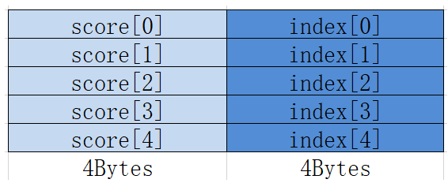
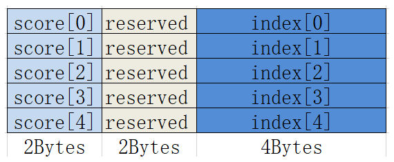

# MrgSort

**页面ID:** atlasascendc_api_07_0232  
**来源:** https://www.hiascend.com/document/detail/zh/CANNCommunityEdition/900/API/ascendcopapi/atlasascendc_api_07_0232.html

---

#### 产品支持情况

| 产品 | 是否支持 |
| --- | --- |
| Atlas 350 加速卡 | √ |
| Atlas A3 训练系列产品/Atlas A3 推理系列产品 | √ |
| Atlas A2 训练系列产品/Atlas A2 推理系列产品 | √ |
| Atlas 200I/500 A2 推理产品 | √ |
| Atlas 推理系列产品AI Core | x |
| Atlas 推理系列产品Vector Core | x |
| Atlas 训练系列产品 | x |

#### 功能说明

将已经排好序的最多4条队列，合并排列成1条队列，结果按照score域由大到小排序。

MrgSort指令处理的数据一般是经过Sort32指令处理后的数据，也就是Sort32指令的输出，队列的结构如下所示：

- 数据类型为float，每个结构占据8Bytes。



- 数据类型为half，每个结构也占据8Bytes，中间有2Bytes保留。



#### 函数原型

```
template <typename T>
__aicore__ inline void MrgSort(const LocalTensor<T>& dst, const MrgSortSrcList<T>& src, const MrgSort4Info& params)
```

#### 参数说明

**表1 **模板参数说明

| 参数名 | 描述 |
| --- | --- |
| T | Atlas 350 加速卡，支持的数据类型为：half/float Atlas A3 训练系列产品/Atlas A3 推理系列产品，支持的数据类型为：half/float Atlas A2 训练系列产品/Atlas A2 推理系列产品，支持的数据类型为：half/float Atlas 200I/500 A2 推理产品，支持的数据类型为：half/float |

**表2 **接口参数说明

| 参数名称 | 输入/输出 | 含义 |
| --- | --- | --- |
| dst | 输出 | 目的操作数，存储经过排序后的数据。 类型为LocalTensor，支持的TPosition为VECIN/VECCALC/VECOUT。 LocalTensor的起始地址需要32字节对齐。 |
| 源操作数，4个队列，并且每个队列都已经排好序，类型为MrgSortSrcList结构体，定义如下： ``` template <typename T> struct MrgSortSrcList {     __aicore__ MrgSortSrcList() {}     __aicore__ MrgSortSrcList(const LocalTensor<T>& src1In, const LocalTensor<T>& src2In, const LocalTensor<T>& src3In,         const LocalTensor<T>& src4In)     {         src1 = src1In[0];         src2 = src2In[0];         src3 = src3In[0];         src4 = src4In[0];     }     LocalTensor<T> src1; // 第一个已经排好序的队列     LocalTensor<T> src2; // 第二个已经排好序的队列     LocalTensor<T> src3; // 第三个已经排好序的队列     LocalTensor<T> src4; // 第四个已经排好序的队列 }; ```  源操作数的数据类型与目的操作数保持一致。src1、src2、src3、src4类型为LocalTensor，支持的TPosition为VECIN/VECCALC/VECOUT。LocalTensor的起始地址需要8字节对齐。 |  |  |
| params | 输入 | 排序所需参数，类型为MrgSort4Info结构体。 具体定义请参考${INSTALL_DIR}/include/ascendc/basic_api/interface/kernel_struct_proposal.h，${INSTALL_DIR}请替换为CANN软件安装后文件存储路径。 参数说明请参考表3。 |

**表3 **MrgSort4Info参数说明

| 参数名称 | 含义 |
| --- | --- |
| elementLengths | 四个源队列的长度（8Bytes结构的数目），类型为长度为4的uint16_t数据类型的数组，理论上每个元素取值范围[0, 4095]，但不能超出UB的存储空间。 |
| ifExhaustedSuspension | 某条队列耗尽后，指令是否需要停止，类型为bool，默认false。 |
| validBit | 有效队列个数，取值如下：- 3：前两条队列有效- 7：前三条队列有效- 15：四条队列全部有效 |
| repeatTimes | 迭代次数，每一次源操作数和目的操作数跳过四个队列总长度。取值范围：repeatTimes∈[1,255]。 repeatTimes参数生效是有条件的，需要同时满足以下四个条件：- src包含四条队列并且validBit=15- 四个源队列的长度一致- 四个源队列连续存储- ifExhaustedSuspension = False |

#### 约束说明

- 当存在score[i]与score[j]相同时，如果i>j，则score[j]将首先被选出来，排在前面。
- 每次迭代内的数据会进行排序，不同迭代间的数据不会进行排序。
- 需要注意此函数排序的队列非region proposal结构。

#### 调用示例

```
// 对8个已排好序的队列进行合并排序，repeatTimes = 2，数据连续存放
// 每个队列包含32个(score,index)的8Bytes结构
// 最后输出对score域的256个数完成排序后的结果
AscendC::MrgSort4Info params;
params.elementLengths[0] = 32;
params.elementLengths[1] = 32;
params.elementLengths[2] = 32;
params.elementLengths[3] = 32;
params.ifExhaustedSuspension = false;
params.validBit = 0b1111;
params.repeatTimes = 2;

AscendC::MrgSortSrcList<float> srcList;
srcList.src1 = workLocal[0];
srcList.src2 = workLocal[64]; // workLocal为float类型，每个队列占据256Bytes空间
srcList.src3 = workLocal[128];
srcList.src4 = workLocal[192];

AscendC::MrgSort<float>(dstLocal, srcList, params);
outQueueDst.EnQue<float>(dstLocal);
outQueueDst.FreeTensor(dstLocal);
```
