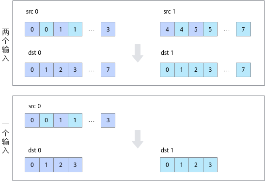

# DeInterleave

**页面ID:** atlasascendc_api_07_00037  
**来源:** https://www.hiascend.com/document/detail/zh/CANNCommunityEdition/900/API/ascendcopapi/atlasascendc_api_07_00037.html

---

#### 产品支持情况

| 产品 | 是否支持 |
| --- | --- |
| Atlas 350 加速卡 | √ |
| Atlas A3 训练系列产品            /             Atlas A3 推理系列产品 | x |
| Atlas A2 训练系列产品            /             Atlas A2 推理系列产品 | x |
| Atlas 200I/500 A2 推理产品 | x |
| Atlas 推理系列产品            AI Core | x |
| Atlas 推理系列产品            Vector Core | x |
| Atlas 训练系列产品 | x |

#### 功能说明

给定源操作数src0和src1，将src0和src1中的元素解交织存入结果操作数dst0和dst1中。解交织排列方式如下图所示，其中每个方格代表一个元素。



#### 函数原型

- 两个输入

```
template <typename T>
__aicore__ inline void DeInterleave(const LocalTensor<T>& dst0, const LocalTensor<T>& dst1, const LocalTensor<T>& src0, const LocalTensor<T>& src1, const int32_t count)
```

- 一个输入

```
template <typename T>
__aicore__ inline void DeInterleave(const LocalTensor<T>& dst0, const LocalTensor<T>& dst1, const LocalTensor<T>& src, const int32_t srcCount)
```

#### 参数说明

**表1 **模板参数说明

| 参数名 | 描述 |
| --- | --- |
| T | 操作数数据类型。 |

**表2 **参数说明

| 参数名 | 输入/输出 | 描述 |
| --- | --- | --- |
| dst0/dst1 | 输出 | 目的操作数。          类型为LocalTensor，支持的TPosition为VECIN/VECCALC/VECOUT。          LocalTensor的起始地址需要32字节对齐。          Atlas 350 加速卡，支持的数据类型为：uint8_t/int8_t/uint16_t/int16_t/half/bfloat16_t/uint32_t/int32_t/float/uint64_t/int64_t |
| src/src0/src1 | 输入 | 源操作数。          类型为LocalTensor，支持的TPosition为VECIN/VECCALC/VECOUT。          LocalTensor的起始地址需要32字节对齐。          源操作数的数据类型需要与目的操作数保持一致。          Atlas 350 加速卡，支持的数据类型为：uint8_t/int8_t/uint16_t/int16_t/half/bfloat16_t/uint32_t/int32_t/float/uint64_t/int64_t |
| count | 输入 | 输入/输出数据元素个数，dst0/dst1/src0/src1长度大小为count。count必须为偶数。 |
| srcCount | 输入 | 输入数据元素个数，两个输出的大小都为输入的一半。srcCount必须为偶数。 |

#### 约束说明

无

#### 调用示例

本样例中只展示Compute流程中的部分代码。

- 两个输入

```
AscendC::DeInterleave(dst0Local, dst1Local, src0Local, src1Local, 512);
```

结果示例如下：

```
输入数据src0Local: [1 2 3 ... 512]
输入数据src1Local: [513 514 515 ... 1024]
输出数据dst0Local: [1 3 5 ... 1023]
输出数据dst1Local: [2 4 6 ... 1024]
```

- 一个输入

```
AscendC::DeInterleave(dst0Local, dst1Local, srcLocal, 512);
```

结果示例如下：

```
输入数据srcLocal: [1 2 3 ... 512]
输出数据dst0Local: [1 3 5 ... 511]
输出数据dst1Local: [2 4 6 ... 512]
```
