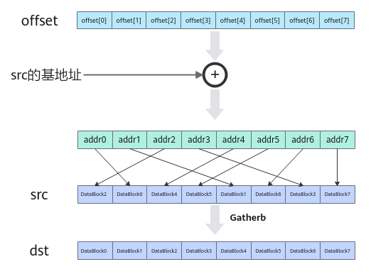

# Gatherb(ISASI)

**页面ID:** atlasascendc_api_07_0234  
**来源:** https://www.hiascend.com/document/detail/zh/CANNCommunityEdition/900/API/ascendcopapi/atlasascendc_api_07_0234.html

---

#### 产品支持情况

| 产品 | 是否支持 |
| --- | --- |
| Atlas 350 加速卡 | √ |
| Atlas A3 训练系列产品/Atlas A3 推理系列产品 | √ |
| Atlas A2 训练系列产品/Atlas A2 推理系列产品 | √ |
| Atlas 200I/500 A2 推理产品 | √ |
| Atlas 推理系列产品AI Core | x |
| Atlas 推理系列产品Vector Core | x |
| Atlas 训练系列产品 | x |

#### 功能说明

给定一个输入的张量和一个地址偏移张量，本接口根据偏移地址按照DataBlock的粒度将输入张量收集到结果张量中。



#### 函数原型

```
template <typename T>
__aicore__ inline void Gatherb(const LocalTensor<T>& dst, const LocalTensor<T>& src0, const LocalTensor<uint32_t>& offset, const uint8_t repeatTime, const GatherRepeatParams& repeatParams)
```

#### 参数说明

**表1 **模板参数说明

| 参数名 | 描述 |
| --- | --- |
| T | 操作数数据类型。 Atlas 350 加速卡，支持的数据类型为：int8_t/uint8_t/int16_t/uint16_t/int32_t/uint32_t/half/float/bfloat16_t/uint64_t/int64_t Atlas A3 训练系列产品/Atlas A3 推理系列产品，支持的数据类型为：uint16_t/uint32_t Atlas A2 训练系列产品/Atlas A2 推理系列产品，支持的数据类型为：uint16_t/uint32_t Atlas 200I/500 A2 推理产品，支持的数据类型为：int8_t/uint8_t/int16_t/uint16_t/half/float/int32_t/uint32_t/bfloat16_t/int64_t |

**表2 **参数说明

| 参数名称 | 输入/输出 | 含义 |
| --- | --- | --- |
| dst | 输出 | 目的操作数。 类型为LocalTensor，支持的TPosition为VECIN/VECCALC/VECOUT。 LocalTensor的起始地址需要32字节对齐。 |
| src0 | 输入 | 源操作数。 类型为LocalTensor，支持的TPosition为VECIN/VECCALC/VECOUT。 LocalTensor的起始地址需要32字节对齐。 源操作数的数据类型需要与目的操作数保持一致。 |
| offset | 输入 | 每个datablock在源操作数中对应的地址偏移。 类型为LocalTensor，支持的TPosition为VECIN/VECCALC/VECOUT。 LocalTensor的起始地址需要32字节对齐。 该偏移量是相对于src0的基地址而言的。每个元素值要大于等于0，单位为字节；且需要保证偏移后的地址满足32字节对齐。 |
| repeatTime | 输入 | 重复迭代次数，每次迭代完成8个datablock的数据收集，数据范围：repeatTime∈（0,255]。 |
| repeatParams | 输入 | 用于控制指令迭代的相关参数。 类型为GatherRepeatParams，具体定义可参考${INSTALL_DIR}/include/ascendc/basic_api/interface/kernel_struct_gather.h。${INSTALL_DIR}请替换为CANN软件安装后文件存储路径。 其中dstBlkStride、dstRepStride支持用户配置，参数说明参考表3。 |

**表3 **GatherRepeatParams结构体参数说明

| 参数名称 | 含义 |
| --- | --- |
| dstBlkStride | 单次迭代内，矢量目的操作数不同datablock间的地址步长。 |
| dstRepStride | 相邻迭代间，矢量目的操作数相同datablock间的地址步长。 |
| blockNumber | 预留参数。为后续的功能做保留，开发者暂时无需关注，使用默认值即可。 |
| src0BlkStride |  |
| src1BlkStride |  |
| src0RepStride |  |
| src1RepStride |  |
| repeatStrideMode |  |
| strideSizeMode |  |

#### 约束说明

无

#### 调用示例

```
uint32_t bufferLen = 128;
AscendC::GatherRepeatParams params{1, 8};
uint8_t repeatTime = bufferLen * sizeof(uint16_t) / 256;
AscendC::Gatherb<uint16_t>(y_buf, x_buf, offset_buf, repeatTime, params); // repeatTime重复迭代次数，每次迭代完成8个datablock的数据收集
```

结果示例：

```
输入数据(offsetLocal): [224 192 160 128 96 64 32 0]
输入数据(srcLocal): [0 1 2 3 4 5 6 7 ... 120 121 122 123 124 125 126 127]
输出数据(dstGlobal):[
112 113 114 115 116 117 118 119 120 121 122 123 124 125 126 127 
96 97 98 99 100 101 102 103 104 105 106 107 108 109 110 111
... 
0 1 2 3 4 5 6 7 8 9 10 11 12 13 14 15
]
```
