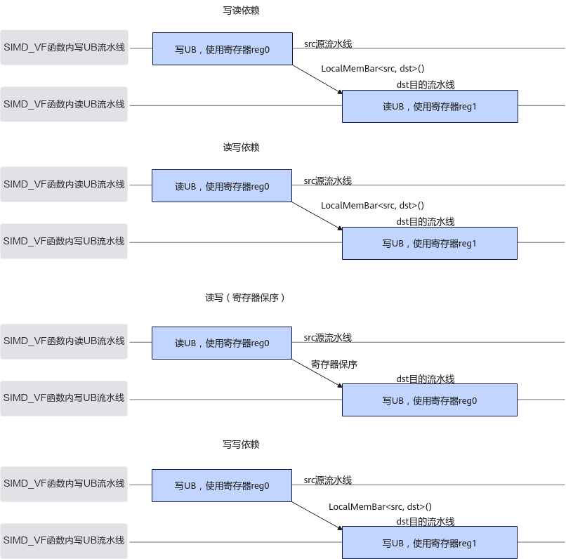

# LocalMemBar

**页面ID:** atlasascendc_api_07_00231  
**来源:** https://www.hiascend.com/document/detail/zh/CANNCommunityEdition/900/API/ascendcopapi/atlasascendc_api_07_00231.html

---

#### 产品支持情况

| 产品 | 是否支持 |
| --- | --- |
| Atlas 350 加速卡 | √ |
| Atlas A3 训练系列产品/Atlas A3 推理系列产品 | x |
| Atlas A2 训练系列产品/Atlas A2 推理系列产品 | x |
| Atlas 200I/500 A2 推理产品 | x |
| Atlas 推理系列产品AI Core | x |
| Atlas 推理系列产品Vector Core | x |
| Atlas 训练系列产品 | x |

#### 功能说明

Reg矢量计算宏函数内不同流水线之间的同步指令。该同步指令指定src源流水线和dst目的流水线，如下图所示，目的流水线将等待源流水线上所有指令完成才进行执行。读写场景下，当读指令使用的寄存器和写指令使用的寄存器相同时，可以触发寄存器保序，指令将会按照代码顺序执行，不需要插入同步指令，而当使用的寄存器不同时，如果要确保读写指令顺序执行，则需要插入同步指令，写写场景同理。

**图1 **流水线等待示意图


#### 函数原型

```
template <MemType src, MemType dst> 
__simd_callee__ inline void LocalMemBar()
```

#### 参数说明

**表1 **模板参数说明

| 参数名 | 描述 |
| --- | --- |
| src | 源流水线，类型为MemType，具体参见表2 MemType取值说明。 |
| dst | 目的流水线，类型为MemType，具体参见表2 MemType取值说明。 |

**表2 **MemType取值说明

| MemType取值 | 含义 |
| --- | --- |
| VEC_STORE | SIMD_VF函数内矢量写UB流水线。 对应寄存器到UB的搬运指令，如StoreAlign、StoreUnAlign、Store。 |
| VEC_LOAD | SIMD_VF函数内矢量读UB流水线。 对应UB到寄存器的搬运指令，如LoadAlign、LoadUnAlign、Load。 |
| SCALAR_STORE | SIMD_VF函数内标量写UB流水线。 对应标量写入UB的指令，如Duplicate。 |
| SCALAR_LOAD | SIMD_VF函数内标量读UB流水线。 对应UB读取标量的指令，如GetValue。 |
| VEC_ALL | SIMD_VF函数内所有矢量读写UB流水线。 |
| SCALAR_ALL | SIMD_VF函数内所有标量读写UB流水线。 |

**表3 **src和dst组合取值说明

| src | dst |
| --- | --- |
| VEC_STORE | VEC_LOAD |
| VEC_LOAD | VEC_STORE |
| VEC_STORE | VEC_STORE |
| VEC_STORE | SCALAR_LOAD |
| VEC_STORE | SCALAR_STORE |
| VEC_LOAD | SCALAR_STORE |
| SCALAR_STORE | VEC_LOAD |
| SCALAR_STORE | VEC_STORE |
| SCALAR_LOAD | VEC_STORE |
| VEC_ALL | VEC_ALL |
| VEC_ALL | SCALAR_ALL |
| SCALAR_ALL | VEC_ALL |

#### 约束说明

无

#### 调用示例

如下示例中dstPtr和src0Ptr为同一个UB地址，for循环中第二次循环中读UB矢量搬运和第一次循环中写UB矢量搬运操作了同一块UB地址空间，因此第二次循环中读UB矢量搬运需要等待第一次循环中写UB矢量搬运执行完成后才能执行，需要插入VEC_LOAD等待VEC_STORE的同步。

```
template<typename T>
__simd_vf__ inline void AddVF(__ubuf__ T* dstAddr, __ubuf__ T* src0Addr, __ubuf__ T* src1Addr, uint32_t count, uint32_t oneRepeatSize, uint16_t repeatTimes)
{
    AscendC::Reg::RegTensor<T> srcReg0;
    AscendC::Reg::RegTensor<T> srcReg1;
    AscendC::Reg::RegTensor<T> dstReg;
    AscendC::Reg::MaskReg mask;   
    for (uint16_t i = 0; i < repeatTimes; i++) {
        mask = AscendC::Reg::UpdateMask<T>(count);
        AscendC::Reg::LocalMemBar<AscendC::Reg::MemType::VEC_STORE, AscendC::Reg::MemType::VEC_LOAD>();
        AscendC::Reg::LoadAlign(srcReg0, src0Addr);
        AscendC::Reg::LoadAlign(srcReg1, src1Addr + i * oneRepeatSize);
        AscendC::Reg::Add(dstReg, srcReg0, srcReg1, mask);
        AscendC::Reg::StoreAlign(dstAddr, dstReg, mask);
    }
}
```
