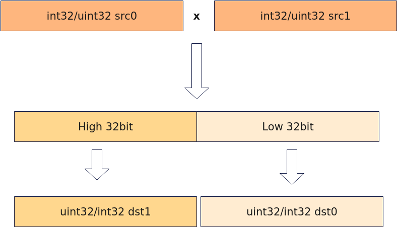

# Mull

**页面ID:** atlasascendc_api_07_0365  
**来源:** https://www.hiascend.com/document/detail/zh/CANNCommunityEdition/900/API/ascendcopapi/atlasascendc_api_07_0365.html

---

#### 产品支持情况

| 产品 | 是否支持 |
| --- | --- |
| Atlas 350 加速卡 | √ |
| Atlas A3 训练系列产品            /             Atlas A3 推理系列产品 | x |
| Atlas A2 训练系列产品            /             Atlas A2 推理系列产品 | x |
| Atlas 200I/500 A2 推理产品 | x |
| Atlas 推理系列产品            AI Core | x |
| Atlas 推理系列产品            Vector Core | x |
| Atlas 训练系列产品 | x |

#### 功能说明

根据mask对输入数据srcReg0、srcReg1按元素相乘操作，将结果写入dstReg0，溢出部分写入dstReg1。



#### 函数原型

```
template <typename T = DefaultType, typename U>
__simd_callee__ inline void Mull(U& dstReg0, U& dstReg1, U& srcReg0, U& srcReg1, MaskReg& mask)
```

#### 参数说明

**表1 **模板参数说明

| 参数名 | 描述 |
| --- | --- |
| T | 操作数数据类型。          Atlas 350 加速卡，支持的数据类型为：uint32_t/int32_t |
| U | 源操作数和目的操作数为RegTensor类型， 例如RegTensor<uint32_t>，由编译器自动推导，用户不需要填写。 |

**表2 **参数说明

| 参数名 | 输入/输出 | 描述 |
| --- | --- | --- |
| dstReg0 | 输出 | 目的操作数。          类型为RegTensor。 |
| dstReg1 | 输出 | 目的操作数。          类型为RegTensor。 |
| srcReg0 | 输入 | 源操作数。          类型为RegTensor。          两个源操作数的数据类型需要与目的操作数保持一致。 |
| srcReg1 | 输入 | 源操作数。          类型为RegTensor。          两个源操作数的数据类型需要与目的操作数保持一致。 |
| mask | 输入 | 源操作数元素操作的有效指示，详细说明请参考MaskReg。 |

#### 约束说明

无

#### 调用示例

```
template<typename T>
__simd_vf__ inline void MullVF(__ubuf__ T* dst0Addr, __ubuf__ T* dst1Addr, __ubuf__ T* src0Addr, __ubuf__ T* src1Addr, uint32_t count, uint32_t oneRepeatSize, uint16_t repeatTimes)
{
    AscendC::Reg::RegTensor<T> srcReg0;
    AscendC::Reg::RegTensor<T> srcReg1;
    AscendC::Reg::RegTensor<T> dstReg0;
    AscendC::Reg::RegTensor<T> dstReg1;
    AscendC::Reg::MaskReg mask;
    for (uint16_t i = 0; i < repeatTimes; i++) {
        mask = AscendC::Reg::UpdateMask<T>(count);        
        AscendC::Reg::LoadAlign(srcReg0, src0Addr + i * oneRepeatSize);
        AscendC::Reg::LoadAlign(srcReg1, src1Addr + i * oneRepeatSize);
        AscendC::Reg::Mull(dstReg0, dstReg1, srcReg0, srcReg1, mask);
        AscendC::Reg::StoreAlign(dst0Addr + i * oneRepeatSize, dstReg0, mask);
        AscendC::Reg::StoreAlign(dst1Addr + i * oneRepeatSize, dstReg1, mask);
    }
}
```
