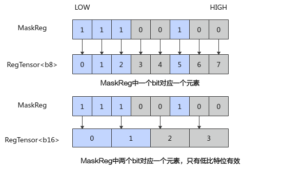

# MaskReg

**页面ID:** atlasascendc_api_07_0315  
**来源:** https://www.hiascend.com/document/detail/zh/CANNCommunityEdition/900/API/ascendcopapi/atlasascendc_api_07_0315.html

---

#### 功能说明

MaskReg用于指示在计算过程中哪些元素参与计算，宽度为RegTensor的八分之一（VL/8）。



#### 函数原型

```
template <typename T, MaskPattern mode = MaskPattern::ALL, const RegTrait& regTrait = RegTraitNumOne>
__simd_callee__ inline MaskReg CreateMask();

template <typename T, const RegTrait& regTrait = RegTraitNumOne>
__simd_callee__ inline MaskReg UpdateMask(uint32_t& scalarValue);
```

#### 参数说明

**表1 **参数说明

| 参数名 | 输入/输出 | 描述 |
| --- | --- | --- |
| T | 输入 | 模板参数，支持的数据类型为b8/b16/b32/b64。 |
| mode | 输入 | 创建MaskReg的模式，enum class类型。 ``` enum class MaskPattern {     ALL,      // 所有元素设置为True     VL1,      // 最低1个元素     VL2,      // 最低2个元素     VL3,      // 最低3个元素     VL4,      // 最低4个元素     VL8,      // 最低8个元素     VL16,     // 最低16个元素     VL32,     // 最低32个元素     VL64,     // 最低64个元素     VL128,    // 最低128个元素     M3,       // 3的倍数     M4,       // 4的倍数     H,        // 最低一半元素     Q,        // 最低四分之一元素     ALLF = 15 // 所有元素设置为false }; ``` |
| regTrait | 输入 | 当前仅针对b64/complex32数据类型生效，分为RegTraitNumOne和RegTraitNumTwo，含义和RegTensor的模板regTrait类型一致，配合RegTensor的regTrait一起使用。regTrait为RegTraitNumOne时，表明当前MaskReg的作用范围可覆盖至256B（一个VL的长度）。对于使用RegTraitNumOne的b64 RegTensor的指令，生成的b64 mask为每8位有效；RegTraitNumTwo表明当前MaskReg的作用范围可覆盖至512B（两个VL的长度），生成的b64 mask为每4位有效，作用于使用RegTraitNumTwo的b64 RegTensor的指令。该参数默认值为RegTraitNumOne。 |
| scalarValue | 输入/输出 | 矢量计算需要操作的元素的具体数量，生成对应的MaskReg，元素有效范围从0到VL_T（位宽为VL的T类型元素个数）。 执行完该函数后，scalarValue会减去VL_T。 scalarValue = (scalarValue < VL_T) ? 0 : (scalarValue - VL_T) |

#### 返回值说明

MaskReg

#### 支持的型号

Atlas 350 加速卡

#### 约束说明

无

#### 调用示例

```
AscendC::Reg::RegTensor<uint32_t> srcReg;
AscendC::Reg::MaskReg mask0 = AscendC::Reg::CreateMask<uint32_t,AscendC::Reg:: MaskPattern::ALL >();
AscendC::Reg::MaskReg mask1;
uint32_t scalarValue = 127;
for (uint16_t i = 0; i < 2; i++) {
    mask1 = AscendC::Reg::UpdateMask<uint32_t>(scalarValue);
    AscendC::Reg::LoadAlign<T, AscendC::Reg::PostLiteral::POST_MODE_UPDATE>(srcReg, srcAddr, 0);
    AscendC::Reg::Adds(srcReg, srcReg, 1, mask0);
    AscendC::Reg::StoreAlign<T, AscendC::Reg::PostLiteral::POST_MODE_UPDATE>(dst0Addr, srcReg, 0, mask0);
    AscendC::Reg::StoreAlign<T, AscendC::Reg::PostLiteral::POST_MODE_UPDATE>(dst1Addr, srcReg, 0, mask1);
}
```
