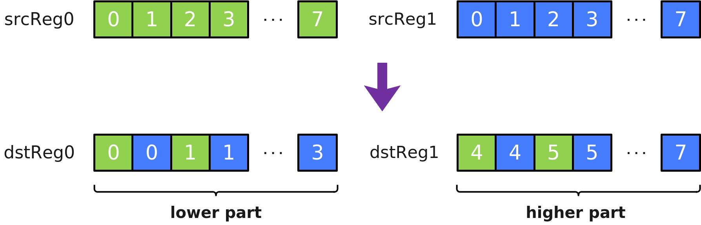

# Interleave

**页面ID:** atlasascendc_api_07_0405  
**来源:** https://www.hiascend.com/document/detail/zh/CANNCommunityEdition/900/API/ascendcopapi/atlasascendc_api_07_0405.html

---

#### 产品支持情况

| 产品 | 是否支持 |
| --- | --- |
| Atlas 350 加速卡 | √ |
| Atlas A3 训练系列产品            /             Atlas A3 推理系列产品 | x |
| Atlas A2 训练系列产品            /             Atlas A2 推理系列产品 | x |
| Atlas 200I/500 A2 推理产品 | x |
| Atlas 推理系列产品            AI Core | x |
| Atlas 推理系列产品            Vector Core | x |
| Atlas 训练系列产品 | x |

#### 功能说明

给定源操作数寄存器张量srcReg0和srcReg1，将srcReg0和srcReg1中的元素交织存入结果操作数dstReg0和dstReg1中。交织排列方式如下图所示，其中每个方格代表一个元素：



#### 定义原型

```
template <typename T = DefaultType, typename U>
__simd_callee__ inline void Interleave(U& dstReg0, U& dstReg1, U& srcReg0, U& srcReg1)
```

#### 参数说明

**表1 **模板参数说明

| 参数名 | 描述 |
| --- | --- |
| T | 目的操作数和源的数据类型。          Atlas 350 加速卡，支持的数据类型为：bool/uint8_t/int8_t/uint16_t/int16_t/uint32_t/int32_t/uint64_t/int64_t/half/float/bfloat16_t |
| U | 源操作数和目的操作数的RegTensor类型， 例如RegTensor<half>，由编译器自动推导，用户不需要填写。 |

**表2 **函数参数说明

| 参数名 | 输入/输出 | 描述 |
| --- | --- | --- |
| dstReg0、dstReg1 | 输出 | 目的操作数。          类型为RegTensor。 |
| srcReg0、srcReg1 | 输入 | 源操作数。          类型为RegTensor。          源操作数的数据类型需要与目的操作数保持一致。 |

#### 约束说明

- srcReg0，srcReg1，dstReg0，dstReg1的数据类型需要保持一致。
- srcReg0和srcReg1可以为同一个RegTensor。
- dstReg0和dstReg1不能为同一个RegTensor。
- 允许源操作数和目的操作数为同一个RegTensor，例如Interleave(srcReg0, srcReg1, srcReg0, srcReg1)。
- b64数据类型下仅支持RegTraitNumTwo。

#### 调用示例

```
template<typename T>
__simd_vf__ inline void InterleaveVF(__ubuf__ T* dst0Addr, __ubuf__ T* dst1Addr, __ubuf__ T* src0Addr, __ubuf__ T* src1Addr, uint32_t oneRepeatSize, uint16_t repeatTimes)
{
    AscendC::Reg::RegTensor<T> srcReg0;
    AscendC::Reg::RegTensor<T> srcReg1;
    AscendC::Reg::RegTensor<T> dstReg0;
    AscendC::Reg::RegTensor<T> dstReg1;
    AscendC::Reg::MaskReg mask = AscendC::Reg::CreateMask<T, AscendC::Reg::MaskPattern::ALL>();               
    for (uint16_t i = 0; i < repeatTimes; i++) {
        AscendC::Reg::LoadAlign(srcReg0, src0Addr + i * oneRepeatSize);
        AscendC::Reg::LoadAlign(srcReg1, src1Addr + i * oneRepeatSize);
        AscendC::Reg::Interleave(dstReg0, dstReg1, srcReg0, srcReg1);
        AscendC::Reg::StoreAlign(dst0Addr + i * oneRepeatSize, dstReg0, mask);
        AscendC::Reg::StoreAlign(dst1Addr + i * oneRepeatSize, dstReg1, mask);
    }
}
```
