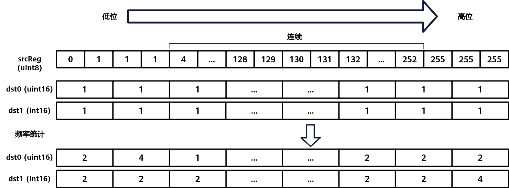
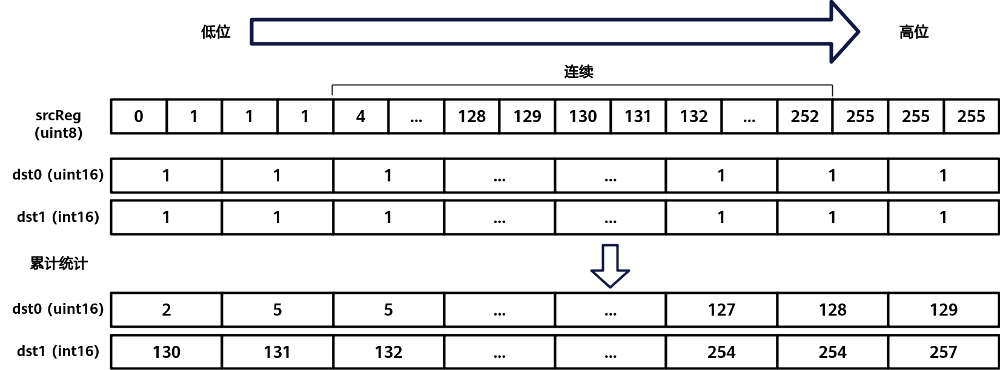

# Histograms

**页面ID:** atlasascendc_api_07_0425  
**来源:** https://www.hiascend.com/document/detail/zh/CANNCommunityEdition/900/API/ascendcopapi/atlasascendc_api_07_0425.html

---

#### 产品支持情况

| 产品 | 是否支持 |
| --- | --- |
| Atlas 350 加速卡 | √ |
| Atlas A3 训练系列产品            /             Atlas A3 推理系列产品 | x |
| Atlas A2 训练系列产品            /             Atlas A2 推理系列产品 | x |
| Atlas 200I/500 A2 推理产品 | x |
| Atlas 推理系列产品            AI Core | x |
| Atlas 推理系列产品            Vector Core | x |
| Atlas 训练系列产品 | x |

#### 功能说明

对直方图数据进行统计，在目的操作数dstReg的基础数据上加上源操作数srcReg数据的统计结果，包括数据的频率统计和累计统计。

- 频率统计

如下图所示，在低位模式下，dstReg（即 dst0）用于统计srcReg中[0-127]范围内（前半部分）各个值的出现频率；而在高位模式下，dstReg（即dst1）则统计[128-255]范围内（后半部分）的频率。dst0和dst1中的第n位（bit）表示srcReg中数值n的出现次数，并在原始dstReg数据的基础上进行累加。

**图1 **频率统计

- 累计统计

如下图所示，在低位模式下，目的寄存器dstReg（即dst0）会统计源寄存器srcReg中值落在低位区间[0-127]的数据分布情况；在高位模式下，目的寄存器dstReg（即dst1）则会统计srcReg中值落在高位区间[128-255]的数据分布情况。在dst0 和dst1中，第n位的数据表示srcReg中从0到n的所有数值在对应区间中出现的总频率。最终，统计结果会在目的寄存器原始数据的基础上进行累加。

**图2 **累计统计


#### 函数原型

```
template <typename T = DefaultType, typename U = DefaultType, HistogramsBinType mode, HistogramsType type, typename S, typename V>
__simd_callee__ inline void Histograms(V& dstReg, S& srcReg, MaskReg& mask)
```

#### 参数说明

**表1 **模板参数说明

| 参数名 | 描述 |
| --- | --- |
| T | 源操作数的数据类型。          Atlas 350 加速卡，支持的数据类型为：uint8_t |
| U | 目的操作数的数据类型。          Atlas 350 加速卡，支持的数据类型为：uint16_t |
| mode | HistogramsBinType枚举类型，用于控制统计src的低位区间[0-127]（前半部分）或高位区间[128-255]（后半部分）的数据。VL长度为256Byte，dst数据类型为uint16_t，一个dst可以存储128个数据，因此需要两个dst。                     - BIN0表示低位模式，统计src中[0-127]范围内的数据写入dst0。           - BIN1表示高位模式，统计src中[128-255]范围内的数据写入dst1。 |
| type | HistogramsType 枚举类型，表示统计模式。                       - FREQUENCY：频率统计模式，统计src中[0, 255]每个数的数量。每个dst有128个元素，其中dst0中每个元素对应src中[0, 127]每个元素的累加个数，dst1中每个元素对应src中[128,255]每个元素的累加个数。            - ACCUMULATE：累计统计模式，统计src中x<=0、x<=1、x<=2、x<=3......x<=254、x<=255每个区间的元素个数。每个dst有128个元素，其中dst0中每个元素对应src中[0, 127]每个元素区间累加个数，dst1中每个元素对应src中[128，255]每个元素区间累加个数。 |
| S | 目的操作数RegTensor类型，由编译器自动推导，用户不需要填写。 |
| V | 源操作数RegTensor类型，由编译器自动推导，用户不需要填写。 |

**表2 **参数说明

| 参数名 | 输入/输出 | 描述 |
| --- | --- | --- |
| dstReg | 输出 | 目的操作数。          类型为RegTensor。 |
| srcReg | 输入 | 源操作数。          类型为RegTensor。 |
| mask | 输入 | 源操作数元素操作的有效指示，详细说明请参考MaskReg。 |

#### 约束说明

无

#### 调用示例

```
template <typename T, typename U>
__simd_vf__ inline void HistogramsVF(__ubuf__ U* dstAddr, __ubuf__ T* srcAddr, uint32_t oneRepeatSize, uint16_t repeatTimes, AscendC::Reg::HistogramsBinType mode, AscendC::Reg::HistogramsType type)
{
    AscendC::Reg::RegTensor<T> srcReg;
    AscendC::Reg::RegTensor<U> dstReg;
    AscendC::Reg::MaskReg mask0 = AscendC::Reg::CreateMask<T>();
    AscendC::Reg::MaskReg mask1 = AscendC::Reg::CreateMask<T>();
    for (uint16_t i = 0; i < repeatTimes; ++i){
        AscendC::Reg::LoadAlign(srcReg, srcAddr + oneRepeatSize * i);
        AscendC::Reg::Histograms<T, U, mode, type>(dstReg, srcReg, mask0);
        AscendC::Reg::StoreAlign(dstAddr, dstReg, mask1);
    }
}
```
