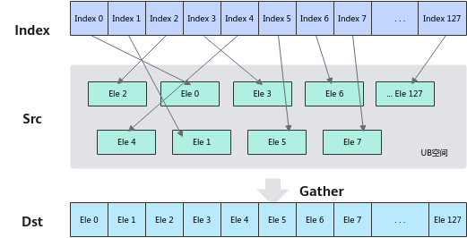
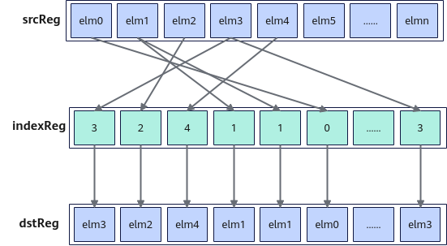

# Gather

**页面ID:** atlasascendc_api_07_0401  
**来源:** https://www.hiascend.com/document/detail/zh/CANNCommunityEdition/900/API/ascendcopapi/atlasascendc_api_07_0401.html

---

#### 产品支持情况

| 产品 | 是否支持 |
| --- | --- |
| Atlas 350 加速卡 | √ |
| Atlas A3 训练系列产品/Atlas A3 推理系列产品 | x |
| Atlas A2 训练系列产品/Atlas A2 推理系列产品 | x |
| Atlas 200I/500 A2 推理产品 | x |
| Atlas 推理系列产品AI Core | x |
| Atlas 推理系列产品Vector Core | x |
| Atlas 训练系列产品 | x |

#### 功能说明

- 收集UB中的元素

给定源操作数在UB中的基地址和索引，Gather指令根据索引位置将源操作数按元素收集到结果寄存器张量中。收集过程如下图所示：



- 收集RegTensor中的元素

根据索引位置indexReg将源操作数srcReg按元素收集到结果dstReg中。收集过程如下图所示：



#### 定义原型

- 收集UB中的元素

```
template <typename T0 = DefaultType, typename T1, typename T2 = DefaultType, typename T3, typename T4>
__simd_callee__ inline void Gather(T3& dstReg, __ubuf__ T1* baseAddr, T4& index, MaskReg& mask)
```

- 收集RegTensor中的元素

```
template <typename T = DefaultType, typename U = DefaultType, typename S, typename V>
__simd_callee__ inline void Gather(S& dstReg, S& srcReg, V& indexReg)
```

#### 参数说明

- 收集UB中的元素

**表1 **模板参数说明

| 参数名 | 描述 |
| --- | --- |
| T0 | 目的操作数的数据类型。 |
| T1 | 源操作数的数据类型。 |
| T2 | 索引值的数据类型。 |
| T3 | 目的操作数的RegTensor类型， 例如RegTensor<half>，由编译器自动推导，用户不需要填写。 |
| T4 | 索引值的RegTensor类型，例如RegTensor<uint16_t>，由编译器自动推导，用户不需要填写。 |

**表2 **函数参数说明

| 参数名 | 输入/输出 | 描述 |
| --- | --- | --- |
| dstReg | 输出 | 目的操作数。 类型为RegTensor。 T0数据类型需要与T1和T2数据类型配套使用。类型配套对应表详见约束说明。 支持的数据类型详见表5。 |
| baseAddr | 输入 | 源操作数在UB中的基地址。 类型为UB指针。 T1数据类型需要与T0和T2数据类型配套使用。类型配套对应表详见约束说明。 支持的数据类型详见表5。 |
| index | 输入 | dstReg中的每个元素在UB中相对于baseAddr的索引位置。地址偏移量要大于等于0。 类型为RegTensor。 T2数据类型需要与T0和T1数据类型配套使用。类型配套对应表详见约束说明。 支持的数据类型详见表5。 |
| mask | 输入 | src element操作有效指示，详细说明请参考MaskReg。 |

- 收集RegTensor中的元素

**表3 **模板参数说明

| 参数名 | 描述 |
| --- | --- |
| T | 目的操作数和源操作数的数据类型。 Atlas 350 加速卡，支持的数据类型为：b8/b16/b32 |
| U | 索引值的数据类型。 Atlas 350 加速卡，支持的数据类型为：uint8_t/uint16_t/uint32_t |
| S | 目的操作数的RegTensor类型，例如RegTensor<half>，由编译器自动推导，用户不需要填写。 |
| V | 索引值的RegTensor类型，例如RegTensor<uint16_t>，由编译器自动推导，用户不需要填写。 |

**表4 **函数参数说明

| 参数名 | 输入/输出 | 描述 |
| --- | --- | --- |
| dstReg | 输出 | 目的操作数。 类型为RegTensor。 |
| srcReg | 输入 | 源操作数。 类型为RegTensor。 数据类型需要与目的操作数保持一致。 |
| indexReg | 输入 | 数据索引。 类型为RegTensor。 数据类型的位宽需要与目的操作数的位宽保持一致。 srcReg为RegTensor类型，位宽是固定的VL，存储的元素个数固定。如果indexReg中索引值超出当前RegTensor中能存储的最大数据元素个数时，按照如下方式处理：设定当前RegTensor所能存储的最大数据元素个数为vlLength，indexReg中索引值为i，索引值更新为i % vlLength。 |

#### 约束说明

- 收集UB中的元素

  - T0，T1和T2数据类型需要配套使用。配套关系如下表：

**表5 **Gather操作数数据类型对应表

| **T0数据类型** | **T1数据类型** | **T2数据类型** |
| --- | --- | --- |
| int16_t | int8_t | uint16_t |
| uint16_t | uint8_t |  |
| int16_t | int16_t |  |
| uint16_t | uint16_t |  |
| half | half |  |
| bfloat16_t | bfloat16_t |  |
| int32_t | int32_t | uint32_t |
| uint32_t | uint32_t |  |
| float | float |  |
| uint64_t | uint64_t | uint32_t |
| int64_t | int64_t |  |
| uint64_t | uint64_t | uint64_t |
| int64_t | int64_t |  |

  - 当T1为B8数据类型时，T0为B16类型，这种情况下目的操作数的低8位与源操作数相同，高8位自动补0。例如T1为int8数据类型：

40=0b00101000 -> 0b0000000000101000，扩充至16位后等于40；

-40=0b11011000 -> 0b0000000011011000，扩充至16位后等于216。

  - 当T1为B64数据类型时，T0，T1，T2，T4, T3数据类型只支持以下组合:

| **T0数据类型** | **T1数据类型** | **T2数据类型** | T4数据类型 | T3数据类型 | 备注 |
| --- | --- | --- | --- | --- | --- |
| B64 | B64 | uint32_t | RegTensor<uint32_t> | RegTensor<uint64_t, RegTraitNumOne> | index的前32个数有效 |
| RegTensor<int64_t, RegTraitNumOne> |  |  |  |  |  |
| RegTensor<uint64_t, RegTraitNumTwo> | - |  |  |  |  |
| RegTensor<int64_t, RegTraitNumTwo> |  |  |  |  |  |
| B64 | B64 | uint64_t | RegTensor<uint64_t, RegTraitNumOne> | RegTensor<uint64_t, RegTraitNumOne> | - |
| RegTensor<int64_t, RegTraitNumOne> |  |  |  |  |  |
| RegTensor<uint64_t, RegTraitNumTwo> | RegTensor<uint64_t, RegTraitNumOne> | index的前32个数有效 |  |  |  |
| RegTensor<int64_t, RegTraitNumOne> |  |  |  |  |  |
| RegTensor<uint64_t, RegTraitNumTwo> | - |  |  |  |  |
| RegTensor<int64_t, RegTraitNumTwo> |  |  |  |  |  |

- 收集RegTensor中的元素

无约束

#### 调用示例

- 收集UB中的元素

```
template <typename T, typename U>
__simd_vf__ inline void GatherVF(__ubuf__ T* dstAddr, __ubuf__ T* src0Addr, __ubuf__ U* src1Addr, uint32_t count, uint32_t oneRepeatSize, uint16_t repeatTimes)
{
    AscendC::Reg::RegTensor<U> srcReg;
    AscendC::Reg::RegTensor<T> dstReg;
    AscendC::Reg::MaskReg mask;    
    for (uint16_t i = 0; i < repeatTimes; i++) {
        mask = AscendC::Reg::UpdateMask<T>(count);
        AscendC::Reg::LoadAlign(srcReg, src1Addr + i * oneRepeatSize);
        AscendC::Reg::Gather(dstReg, src0Addr, srcReg, mask);
        AscendC::Reg::StoreAlign(dstAddr + i * oneRepeatSize, dstReg, mask);
    }
}
```

- 收集RegTensor中的元素

```
template <typename T, typename U>
__simd_vf__ inline void GatherVF(__ubuf__ T* dstAddr, __ubuf__ T* src0Addr, __ubuf__ U* src1Addr, uint32_t count, uint32_t oneRepeatSize, uint16_t repeatTimes)
{
    AscendC::Reg::RegTensor<T> srcReg0, dstReg;
    AscendC::Reg::RegTensor<U> srcReg1;
    AscendC::Reg::MaskReg mask;
    AscendC::Reg::LoadAlign(srcReg1, src1Addr);
    for (uint16_t i = 0; i < repeatTimes; i++) {
        mask = AscendC::Reg::UpdateMask<T>(count);
        AscendC::Reg::LoadAlign(srcReg0, src0Addr + i * oneRepeatSize);
        AscendC::Reg::Gather(dstReg, srcReg0, srcReg1);
        AscendC::Reg::StoreAlign(dstAddr + i * oneRepeatSize, dstReg, mask);
    }
}
```
