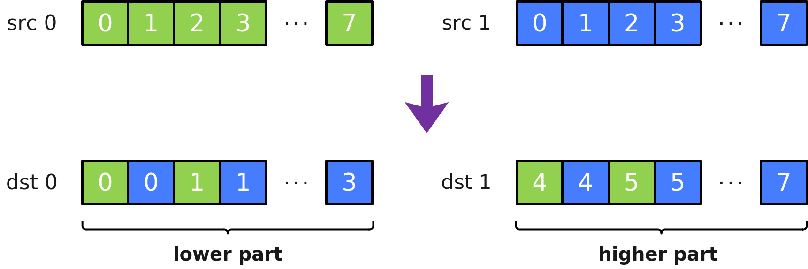

# Interleave

**页面ID:** atlasascendc_api_07_0335  
**来源:** https://www.hiascend.com/document/detail/zh/CANNCommunityEdition/900/API/ascendcopapi/atlasascendc_api_07_0335.html

---

#### 产品支持情况

| 产品 | 是否支持 |
| --- | --- |
| Atlas 350 加速卡 | √ |
| Atlas A3 训练系列产品            /             Atlas A3 推理系列产品 | x |
| Atlas A2 训练系列产品            /             Atlas A2 推理系列产品 | x |
| Atlas 200I/500 A2 推理产品 | x |
| Atlas 推理系列产品            AI Core | x |
| Atlas 推理系列产品            Vector Core | x |
| Atlas 训练系列产品 | x |

#### 功能说明

将源操作数src0和src1中的元素交织存入目的操作数dst0和dst1中。交织排列方式如下图所示，其中每个方格代表一个元素：



#### 函数原型

```
template <typename T>
__simd_callee__ inline void Interleave(MaskReg& dst0, MaskReg& dst1, MaskReg& src0, MaskReg& src1)
```

#### 参数说明

**表1 **模板参数说明

| 参数名 | 描述 |
| --- | --- |
| T | MaskReg所支持的数据类型，决定了交织的位宽大小，例如对于uint32_t类型，交织时以4bit为一组。          Atlas 350 加速卡支持的数据类型为：b8/b16/b32 |

**表2 **参数说明

| 参数名 | 描述 |
| --- | --- |
| dst0 | 目的操作数。 |
| dst1 | 目的操作数。 |
| src0 | 源操作数。 |
| src1 | 源操作数。 |

#### 约束说明

无

#### 调用示例

```
template <typename T>
__simd_vf__ inline void MaskInterleaveDeInterleaveVF(__ubuf__ T* dstAddr, __ubuf__ T* srcAddr, uint32_t count, uint32_t oneRepeatSize, uint16_t repeatTimes)
{
    AscendC::Reg::RegTensor<T> srcReg;
    AscendC::Reg::MaskReg maskFull = AscendC::Reg::CreateMask<T, AscendC::Reg::MaskPattern::ALL>();
    AscendC::Reg::MaskReg maskM3 = AscendC::Reg::CreateMask<T, AscendC::Reg::MaskPattern::M3>();
    AscendC::Reg::MaskReg newMask0;
    AscendC::Reg::MaskReg newMask1;
    AscendC::Reg::Interleave<T>(newMask0, newMask1, maskFull, maskM3);
    AscendC::Reg::DeInterleave<T>(newMask0, newMask1, newMask0, newMask1);
    AscendC::Reg::MaskReg mask;
    for (uint16_t i = 0; i < repeatTimes; ++i) {
        mask = AscendC::Reg::UpdateMask<T>(count);
        AscendC::Reg::LoadAlign(srcReg, srcAddr + i * oneRepeatSize);
        AscendC::Reg::Adds(srcReg, srcReg, 0, newMask0);
        AscendC::Reg::StoreAlign(dstAddr + i * oneRepeatSize, srcReg, mask);
    }
}
```
