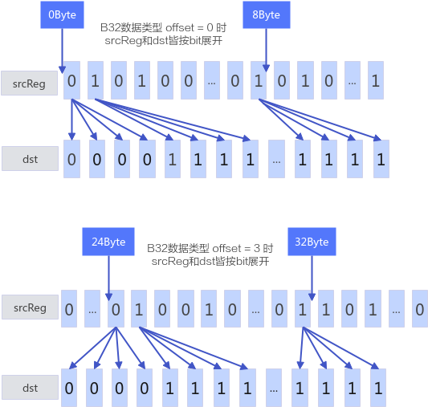

# MaskReg搬入

**页面ID:** atlasascendc_api_07_0325  
**来源:** https://www.hiascend.com/document/detail/zh/CANNCommunityEdition/900/API/ascendcopapi/atlasascendc_api_07_0325.html

---

#### 产品支持情况

| 产品 | 是否支持 |
| --- | --- |
| Atlas 350 加速卡 | √ |
| Atlas A3 训练系列产品/Atlas A3 推理系列产品 | x |
| Atlas A2 训练系列产品/Atlas A2 推理系列产品 | x |
| Atlas 200I/500 A2 推理产品 | x |
| Atlas 推理系列产品AI Core | x |
| Atlas 推理系列产品Vector Core | x |
| Atlas 训练系列产品 | x |

#### 功能说明

Reg矢量计算数据搬运接口，适用于从UB或RegTensor搬入MaskReg。

#### 函数原型

```
// MaskReg搬入使用 AddrReg 存储偏移量
template <typename T, MaskDist dist = MaskDist::DIST_NORM>
__simd_callee__ inline void LoadAlign(MaskReg& mask, __ubuf__ T* srcAddr, AddrReg offset);
// MaskReg搬入POST_MODE_NORMAL 场景
template <typename T, MaskDist dist = MaskDist::DIST_NORM>
__simd_callee__ inline void LoadAlign(MaskReg& mask, __ubuf__ T* srcAddr);
// MaskReg搬入POST_MODE_UPDATE 场景
template <typename T, PostLiteral postMode, MaskDist dist = MaskDist::DIST_NORM>
__simd_callee__ inline void LoadAlign(MaskReg& mask, __ubuf__ T* &srcAddr, int32_t offset);
// MaskReg从RegTensor搬入
template <typename T = DefaultType, int16_t offset, typename U>
__simd_callee__ inline void MaskGenWithRegTensor(MaskReg& dst, U& srcReg);
```

#### 参数说明

**表1 **MaskReg搬入使用AddrReg存储偏移量参数说明

| 参数名 | 输入/输出 | 描述 |
| --- | --- | --- |
| T | 输入 | 操作数数据类型。支持的数据类型为b8/b16/b32。 |
| dist | 输入 | 搬运模式， MaskDist类型。取值如下： - DIST_NORM，对齐约束为VL/8Byte，正常模式，搬运VL/8Byte数据。- DIST_US，对齐约束为VL/16Byte，上采样模式，搬运VL/16Byte数据，每bit重复一次。- DIST_DS，对齐约束为min(32, VL/4)Byte，下采样模式，搬运VL/4Byte数据，每间隔1bit被舍弃。 |
| mask | 输出 | 目的操作数，类型为MaskReg。 |
| srcAddr | 输入/输出 | 源操作数在UB上的起始地址。 |
| offset | 输入 | 实际搬运UB起始地址为 srcAddr + offset。 |

**表2 **MaskReg搬入POST_MODE_NORMAL场景参数说明

| 参数名 | 输入/输出 | 描述 |
| --- | --- | --- |
| T | 输入 | 操作数数据类型。支持的数据类型为b8/b16/b32/b64。 |
| dist | 输入 | 搬运模式， MaskDist类型。取值如下： - DIST_NORM，对齐约束为VL/8Byte，正常模式，搬运VL/8Byte数据。- DIST_US，对齐约束为VL/16Byte，上采样模式，搬运VL/16Byte数据，每bit重复一次。- DIST_DS，对齐约束为min(32, VL/4)Byte，下采样模式，搬运VL/4Byte数据，每间隔1bit被舍弃。 |
| mask | 输出 | 目的操作数，类型为MaskTensor。 |
| srcAddr | 输入/输出 | 源操作数在UB上的起始地址。 |

**表3 **MaskReg搬入POST_MODE_UPDATE场景参数说明

| 参数名 | 输入/输出 | 描述 |
| --- | --- | --- |
| T | 输入 | 操作数数据类型。支持的数据类型为b8/b16/b32/b64。 |
| dist | 输入 | 搬运模式， MaskDist类型。取值如下： - DIST_NORM，对齐约束为VL/8Byte，正常模式，搬运VL/8Byte数据。- DIST_US，对齐约束为VL/16Byte，上采样模式，搬运VL/16Byte数据，每bit重复一次。- DIST_DS，对齐约束为min(32, VL/4)Byte，下采样模式，搬运VL/4Byte数据，每间隔1bit被舍弃。 |
| postMode | 输入 | 用于控制是否使能post update。 - POST_MODE_NORMAL，正常场景，UB操作数地址不更新。 - POST_MODE_UPDATE，POST_MODE_UPDATE场景使用，UB地址同时作为输入和输出，每次调用会更新。 |
| mask | 输出 | 目的操作数，类型为MaskTensor。 |
| srcAddr | 输入/输出 | 源操作数在UB上的起始地址。 |
| offset | 输入 | 当offset为int32_t类型时，POST_MODE_NORMAL与POST_MODE_UPDATE含义不一致。- POST_MODE_NORMAL 场景：实际搬运UB起始地址为srcAddr + offset。- POST_MODE_UPDATE 场景：实际搬运UB起始地址为srcAddr，搬运后执行地址更新 srcAddr +=  offset。 |

**表4 **MaskReg从RegTensor搬入参数说明

| 参数名 | 输入/输出 | 描述 |
| --- | --- | --- |
| T | 输入 | 操作数数据类型。支持的数据类型为b16/b32。 |
| U | 输入 | 源操作数的RegTensor类型，例如RegTensor<half>，由编译器自动推导，用户不需要填写。 |
| dst | 输出 | 目的操作数，类型为MaskTensor。 |
| srcReg | 输入 | 源操作数，类型为RegTensor。 |
| offset | 输入 | offset决定了srcReg中数据搬运的起始地址，当数据类型为T为b16时，计算公式为offset* 16，由于VL为256Byte，因此此时offset取值范围为0-15，同理，T为b32数据类型时，计算公式为offset* 8，offset的取值范围为0-31。 当数据类型为B16时，dst[i] = srcReg[offset*VL/16 + i/2]，按bit位进行计算。 当数据类型为B32时，dst[i] = srcReg[offset*VL/32 + i/4],，按bit位进行计算。 |

**图1 **Offset功能示意图


#### 约束说明

无

#### 调用示例

```
template <typename T>
__simd_vf__ inline void LoadAlignVF(__ubuf__ T* dstAddr, __ubuf__ T* srcAddr, uint32_t count, uint32_t oneRepeatSize, uint16_t repeatTimes)
{
    AscendC::Reg::MaskReg mask;;
    for (uint16_t i = 0; i < repeatTimes; ++i) {
        mask = AscendC::Reg::UpdateMask<T>(count);
        AscendC::Reg::AddrReg offset = AscendC::Reg::CreateAddrReg<T>(i, oneRepeatSize);
        AscendC::Reg::LoadAlign(mask, srcAddr, offset);
        AscendC::Reg::StoreAlign(dstAddr, mask, offset);
    }
}

template <typename T, int16_t offset>
__simd_vf__ inline void MaskGenWithRegTensorVF(__ubuf__ T* dstAddr, __ubuf__ T* srcAddr)
{
    AscendC::Reg::RegTensor<T> srcReg;
    AscendC::Reg::MaskReg mask = AscendC::Reg::CreateMask<T>();
    AscendC::Reg::LoadAlign(srcReg, srcAddr);
    AscendC::Reg::MaskGenWithRegTensor<T, offset>(mask, srcReg);
    AscendC::Reg::StoreAlign(dstAddr, mask);
}
```
