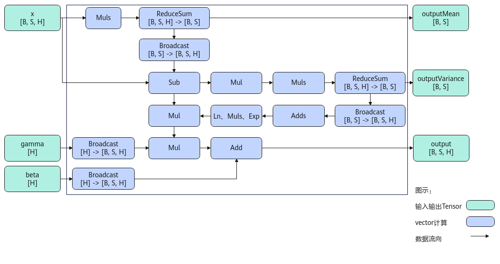
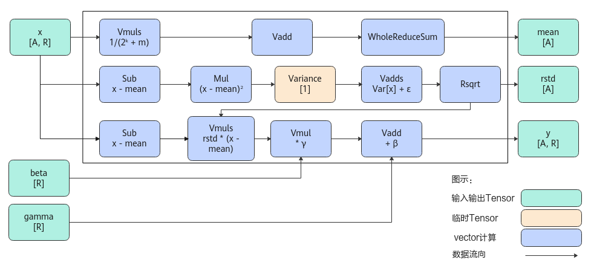

# LayerNorm

**页面ID:** atlasascendc_api_07_0797  
**来源:** https://www.hiascend.com/document/detail/zh/CANNCommunityEdition/900/API/ascendcopapi/atlasascendc_api_07_0797.html

---

#### 产品支持情况

| 产品 | 是否支持 |
| --- | --- |
| Atlas 350 加速卡 | √ |
| Atlas A3 训练系列产品            /             Atlas A3 推理系列产品 | √ |
| Atlas A2 训练系列产品            /             Atlas A2 推理系列产品 | √ |
| Atlas 200I/500 A2 推理产品 | x |
| Atlas 推理系列产品            AI Core | √ |
| Atlas 推理系列产品            Vector Core | x |
| Atlas 训练系列产品 | x |

#### 功能说明

根据接口输出的不同，本节介绍如下两种LayerNorm接口。

- 对shape为[B，S，H]的输入数据，输出归一化结果、均值和方差

在深层神经网络训练过程中，前面层训练参数的更新，会引起后面层输入数据分布的变化，导致权重更新不均衡及学习效率变慢。通过采用归一化策略，将网络层输入数据收敛到[0, 1]之间，可以规范网络层输入输出数据分布，加速训练参数收敛过程，使学习效率提升更加稳定。**LayerNorm是许多归一化方法中的一种。**

本接口实现了对shape大小为[B，S，H]输入数据的LayerNorm归一化，其计算公式如下，其中γ为缩放系数，β为平移系数，ε为防除零的权重系数：


其中，如下两个参数分别代表输入在H轴的均值和方差。


- 对shape为[A，R]的输入数据，输出归一化结果、均值、标准差的倒数或方差

本接口实现了对shape为[A，R]输入数据的LayerNorm归一化，其计算公式如下，其中γ为缩放系数，β为平移系数，ε为防除零的权重系数：


其中，如下三个参数分别代表输入在R轴的均值，方差和标准差的倒数。


#### 实现原理

- 对shape为[B，S，H]的输入数据，输出归一化结果、均值和方差

以float类型，ND格式，输入为inputX[B, S, H]，gamma[H]和beta[H]为例，描述LayerNorm高阶API内部算法框图，如下图所示。

**图1 **LayerNorm算法框图


计算过程分为如下几步，均在Vector上进行（下文中m指尾轴H的长度）：

  1. 计算均值：Muls计算x*1/m的值，再计算累加值ReduceSum，得到均值outputMean；
  2. 计算方差：Sub计算出输入x与均值的差值，再用Mul进行平方计算，最后用Muls乘上1/m并计算累加值，得到方差outputVariance；
  3. 处理gamma和beta：通过broadcast得到BSH维度的gamma和beta；
  4. 计算输出：方差通过broadcast（或Duplicate）得到BSH维度的tensor，再依次经过Adds(outputVariance, eps)、Ln, Muls, Exp（或Sqrt），最后与（x-均值）相乘，得到的结果乘上gamma，加上beta，得到输出结果。

- 对shape为[A，R]的输入数据，输出归一化结果、均值、标准差的倒数或方差

以float类型，ND格式，输入为inputX[A, R]，gamma[R] 和beta[R]为例，描述LayerNorm高阶API内部算法框架，如下图所示。

**图2 **LayerNorm-Rstd版本算法框图



计算过程分为如下几步，均在Vector上进行，整体按照以A轴为最外层循环进行计算：

  1. 计算均值：首先对x的每个元素乘以1/(2^k+m)，防止后续累加溢出。然后使用二分累加方式对数据进行求和：将数据拆分成一个整块和一个尾块，其中整块为2^k个元素，尾块为m个元素，将尾块数据叠加到整块数据。为方便描述，定义Vnum为参与单次计算的元素个数。对整块中，以Vnum长度为单位，奇偶位数据进行Vadd，得到一个Vnum长度的结果，对该结果做WholeReduceSum计算，得到输出均值mean；
  2. 计算rstd：用Sub计算出输入x与均值的差值，再用Mul计算，计算该差值的平方，为防止溢出，按照同样的二分累加方式，计算出该平方结果的方差Variance；方差与防除零系数ε相加，通过Rsqrt计算，得到输出rstd；
  3. 计算输出：用Sub计算出输入x与均值的差值，再与rstd相乘，得到的结果与gamma相乘，与beta相加，得到输出结果。

#### 函数原型

由于该接口的内部实现中涉及复杂的计算，需要额外的临时空间来存储计算过程中的中间变量。临时空间大小BufferSize的获取方法：通过LayerNorm Tiling中提供的GetLayerNormMaxMinTmpSize接口获取所需最大和最小临时空间大小，最小空间可以保证功能正确，最大空间用于提升性能。

临时空间支持**接口框架申请**和开发者**通过sharedTmpBuffer入参传入**两种方式，因此LayerNorm接口的函数原型有两种：

- 对shape为[B，S，H]的输入数据，输出归一化结果、均值和方差

  - 通过sharedTmpBuffer入参传入临时空间

```
template <typename T, bool isReuseSource = false>
__aicore__ inline void LayerNorm(const LocalTensor<T>& output, const LocalTensor<T>& outputMean, const LocalTensor<T>& outputVariance, const LocalTensor<T>& inputX, const LocalTensor<T>& gamma, const LocalTensor<T>& beta, const LocalTensor<uint8_t>& sharedTmpBuffer, const T epsilon, LayerNormTiling& tiling)
```

该方式下开发者需自行申请并管理临时内存空间，并在接口调用完成后，复用该部分内存，内存不会反复申请释放，灵活性较高，内存利用率也较高。

  - 接口框架申请临时空间

```
template <typename T, bool isReuseSource = false>
__aicore__ inline void LayerNorm(const LocalTensor<T>& output, const LocalTensor<T>& outputMean, const LocalTensor<T>& outputVariance, const LocalTensor<T>& inputX, const LocalTensor<T>& gamma, const LocalTensor<T>& beta, const T epsilon, LayerNormTiling& tiling)
```

该方式下开发者无需申请，但是需要预留临时空间的大小。

- 对shape为[A，R]的输入数据，输出归一化结果、均值、标准差的倒数或方差

  - 通过sharedTmpBuffer入参传入临时空间

```
template <typename U, typename T, bool isReuseSource = false, const LayerNormConfig& config = LNCFG_NORM>
__aicore__ inline void LayerNorm(const LocalTensor<T>& output, const LocalTensor<float>& outputMean, const LocalTensor<float>& outputRstd, const LocalTensor<T>& inputX, const LocalTensor<U>& gamma, const LocalTensor<U>& beta, const float epsilon, const LocalTensor<uint8_t>& sharedTmpBuffer, const LayerNormPara& para, const LayerNormSeparateTiling& tiling)
```

该方式下开发者需自行申请并管理临时内存空间，并在接口调用完成后，复用该部分内存，内存不会反复申请释放，灵活性较高，内存利用率也较高。

  - 接口框架申请临时空间

```
template <typename U, typename T, bool isReuseSource = false, const LayerNormConfig& config = LNCFG_NORM>
__aicore__ inline void LayerNorm(const LocalTensor<T>& output, const LocalTensor<float>& outputMean, const LocalTensor<float>& outputRstd, const LocalTensor<T>& inputX, const LocalTensor<U>& gamma, const LocalTensor<U>& beta, const float epsilon, const LayerNormPara& para, const LayerNormSeparateTiling& tiling)
```

该方式下开发者无需申请，但是需要预留临时空间的大小。

#### 参数说明

- 对shape为[B，S，H]的输入数据，输出归一化结果、均值和方差的接口 

**表1 **模板参数说明

| 参数名 | 描述 |
| --- | --- |
| T | 操作数的数据类型。            Atlas 350 加速卡，支持的数据类型为：half、float。                           Atlas A3 训练系列产品              /               Atlas A3 推理系列产品              ，支持的数据类型为：half、float。                           Atlas A2 训练系列产品              /               Atlas A2 推理系列产品              ，支持的数据类型为：half、float。                           Atlas 推理系列产品              AI Core，支持的数据类型为：half、float。 |
| isReuseSource | 是否允许修改源操作数，默认值为false。如果开发者允许源操作数被改写，可以使能该参数，使能后能够节省部分内存空间。            设置为**true**，则本接口内部计算时**复用**inputX的内存空间，节省内存空间；设置为**false**，则本接口内部计算时**不复用**inputX的内存空间。            对于float数据类型输入支持开启该参数，half数据类型输入不支持开启该参数。            isReuseSource的使用样例请参考更多样例。 |

**表2 **接口参数说明

| 参数名称 | 输入/输出 | 含义 |
| --- | --- | --- |
| output | 输出 | 目的操作数，shape为[B, S, H]，LocalTensor数据结构的定义请参考LocalTensor。            类型为LocalTensor，支持的TPosition为VECIN/VECCALC/VECOUT。 |
| outputMean | 输出 | 均值，shape为[B, S]，LocalTensor数据结构的定义请参考LocalTensor。            类型为LocalTensor，支持的TPosition为VECIN/VECCALC/VECOUT。 |
| outputVariance | 输出 | 方差，shape为[B, S]，LocalTensor数据结构的定义请参考LocalTensor。            类型为LocalTensor，支持的TPosition为VECIN/VECCALC/VECOUT。 |
| inputX | 输入 | 源操作数，shape为[B, S, H]，LocalTensor数据结构的定义请参考LocalTensor。inputX的数据类型需要与目的操作数保持一致，尾轴长度需要32B对齐。            类型为LocalTensor，支持的TPosition为VECIN/VECCALC/VECOUT。 |
| gamma | 输入 | 缩放系数，shape为[H]，LocalTensor数据结构的定义请参考LocalTensor。gamma的数据类型需要与目的操作数保持一致，尾轴长度需要32B对齐。            类型为LocalTensor，支持的TPosition为VECIN/VECCALC/VECOUT。 |
| beta | 输入 | 平移系数，shape为[H]，LocalTensor数据结构的定义请参考LocalTensor。beta的数据类型需要与目的操作数保持一致，尾轴长度需要32B对齐。            类型为LocalTensor，支持的TPosition为VECIN/VECCALC/VECOUT。 |
| sharedTmpBuffer | 输入 | 共享缓冲区，用于存放API内部计算产生的临时数据。该方式开发者可以自行管理sharedTmpBuffer内存空间，并在接口调用完成后，复用该部分内存，内存不会反复申请释放，灵活性较高，内存利用率也较高。共享缓冲区大小的获取方式请参考LayerNorm Tiling。            类型为LocalTensor，支持的TPosition为VECIN/VECCALC/VECOUT。 |
| epsilon | 输入 | 防除零的权重系数。 |
| tiling | 输入 | LayerNorm计算所需Tiling信息，Tiling信息的获取请参考LayerNorm Tiling。 |

- 对shape为[A，R]的输入数据，输出归一化结果、均值、标准差的倒数或方差的接口 

**表3 **模板参数说明

| 参数名 | 描述 |
| --- | --- |
| U | beta，gamma操作数的数据类型。            Atlas 350 加速卡，支持的数据类型为：half、bfloat16_t、float。                           Atlas A3 训练系列产品              /               Atlas A3 推理系列产品              ，支持的数据类型为：half、float。                           Atlas A2 训练系列产品              /               Atlas A2 推理系列产品              ，支持的数据类型为：half、float。                           Atlas 推理系列产品              AI Core，支持的数据类型为：half、float。 |
| T | output，inputX操作数的数据类型。            Atlas 350 加速卡，支持的数据类型为：half、bfloat16_t、float。                           Atlas A3 训练系列产品              /               Atlas A3 推理系列产品              ，支持的数据类型为：half、float。                           Atlas A2 训练系列产品              /               Atlas A2 推理系列产品              ，支持的数据类型为:half、float。                           Atlas 推理系列产品              AI Core，支持的数据类型为：half、float。 |
| isReuseSource | 该参数预留，传入默认值false即可。 |
| 配置LayerNorm接口中输入输出相关信息。LayerNormConfig类型，定义如下。                                                                                                                                             ``` struct LayerNormConfig {     bool isNoBeta = false;     bool isNoGamma = false;     bool isOnlyOutput = false;     bool isOutputRstd = true; }; ```                                                                                                                   - isNoBeta：计算时，输入beta是否使用。                                 - false：默认值，LayerNorm计算中使用输入beta。                   - true：LayerNorm计算中不使用输入beta。此时，公式中与beta相关的计算被省略。                             - isNoGamma：可选输入gamma是否使用。                                 - false：默认值，LayerNorm计算中使用可选输入gamma。                   - true：LayerNorm计算中不使用输入gamma。此时，公式中与gamma相关的计算被省略。                             - isOnlyOutput：是否只输出y，不输出均值mean与标准差的倒数rstd。当前该参数仅支持取值为false，表示y、mean和rstd的结果全部输出。               - isOutputRstd：选择输出标准差的倒数rstd还是方差。该参数仅支持Atlas 350 加速卡。                                 - true：默认值，输出标准差的倒数。                   - false：输出方差。 |  |

**表4 **接口参数说明

| 参数名称 | 输入/输出 | 含义 |
| --- | --- | --- |
| output | 输出 | 目的操作数，shape为[A, R]，LocalTensor数据结构的定义请参考LocalTensor。            类型为LocalTensor，支持的TPosition为VECIN/VECCALC/VECOUT。 |
| outputMean | 输出 | 均值，shape为[A]，LocalTensor数据结构的定义请参考LocalTensor。            类型为LocalTensor，支持的TPosition为VECIN/VECCALC/VECOUT。 |
| outputRstd | 输出 | 当模板参数config中的isOutputRstd为true，outputRstd为标准差的倒数，否则isOutputRstd为false时，outputRstd为方差，shape为[A]，LocalTensor数据结构的定义请参考LocalTensor。            请注意，该接口仅在Atlas 350 加速卡上支持输出方差。            类型为LocalTensor，支持的TPosition为VECIN/VECCALC/VECOUT。 |
| inputX | 输入 | 源操作数，shape为[A, R]，LocalTensor数据结构的定义请参考LocalTensor。inputX的数据类型需要与目的操作数保持一致，尾轴长度需要32B对齐。            类型为LocalTensor，支持的TPosition为VECIN/VECCALC/VECOUT。 |
| gamma | 输入 | 缩放系数，shape为[R]，LocalTensor数据结构的定义请参考LocalTensor。gamma的数据类型精度不低于源操作数的数据类型精度。            类型为LocalTensor，支持的TPosition为VECIN/VECCALC/VECOUT。 |
| beta | 输入 | 平移系数，shape为[R]，LocalTensor数据结构的定义请参考LocalTensor。beta的数据类型精度不低于源操作数的数据类型精度。            类型为LocalTensor，支持的TPosition为VECIN/VECCALC/VECOUT。 |
| epsilon | 输入 | 防除零的权重系数。 |
| sharedTmpBuffer | 输入 | 共享缓冲区，用于存放API内部计算产生的临时数据。该方式开发者可以自行管理sharedTmpBuffer内存空间，并在接口调用完成后，复用该部分内存，内存不会反复申请释放，灵活性较高，内存利用率也较高。共享缓冲区大小的获取方式请参考LayerNorm Tiling。            类型为LocalTensor，支持的TPosition为VECIN/VECCALC/VECOUT。 |
| LayerNorm计算所需的参数信息。LayerNormPara类型，定义如下。                                                                                                                                             ``` struct LayerNormPara {     uint32_t aLength;     uint32_t rLength;     uint32_t rLengthWithPadding; }; ```                                                                                                                   - aLength：指定输入inputX的A轴长度。               - rLength：指定输入inputX的R轴实际需要处理的数据长度。               - rLengthWithPadding：指定输入inputX的R轴对齐后的长度，该值是32B对齐的。 |  |  |
| tiling | 输入 | LayerNorm计算所需的Tiling信息，Tiling信息的获取请参考LayerNorm Tiling。 |

#### 约束说明

- 对shape为[B，S，H]的输入数据，输出归一化结果、均值和方差的接口：

  - output和inputX的空间可以复用。其他输出与输入的空间不可复用。
  - 输入数据中尾轴H不满足对齐要求时，开发者需要进行补齐，补齐的数据应设置为0，防止出现异常值从而影响网络计算。
  - 不支持对尾轴H轴的切分。
  - inputX、output、gamma、beta的H轴长度相同。
  - inputX、output、outputMean、outputVariance的B轴长度相同、S轴长度相同。

- 对shape为[A，R]的输入数据，输出归一化结果、均值、标准差的倒数或方差的接口：

  - 参数gamma和beta的数据类型精度不低于源操作数的数据类型精度。比如，对于Atlas 350 加速卡，inputX的数据类型是bfloat16_t，gamma、beta的数据类型可以是bfloat16_t、float，精度不低于inputX。
  - src和dst的Tensor空间不可以复用。
  - 不支持对R轴进行切分。

#### 调用示例

- 输入数据的shape为[B，S，H]，输出归一化结果、均值和方差的接口调用示例
      完整的调用样例请参考[LayerNorm样例](https://gitcode.com/cann/asc-devkit/tree/9.0.0/examples/01_simd_cpp_api/03_libraries/02_normalization/layernorm)。

```
AscendC::LayerNorm<float, false>(
    output,           // [输出] 归一化后的结果 y，shape [B, S, H]
    mean,             // [输出] 每个 (B, S) 位置上 H 维度的均值，shape [B, S]
    variance,         // [输出] 每个 (B, S) 位置上 H 维度的方差，shape [B, S]
    inputX,           // [输入] 原始输入数据 x，shape [B, S, H]，将被归一化
    gamma,            // [输入] 缩放系数 γ，shape [H]，用于缩放归一化后的数据
    beta,             // [输入] 平移系数 β，shape [H]，用于偏移归一化后的数据
    (float)epsilon,   // [输入] 防除零系数 ε，避免方差为0时除以0
    tiling            // [输入] Tiling 信息，包含硬件计算分块策略（如 block、thread 等）
);
```

       示例结果如下：

```
输入数据(inputX, shape:[1, 8, 8]): 
[  0.  1.  2.  3.  4.  5.  6.  7.
   8.  9. 10. 11. 12. 13. 14. 15.
  16. 17. 18. 19. 20. 21. 22. 23.
  24. 25. 26. 27. 28. 29. 30. 31.
  32. 33. 34. 35. 36. 37. 38. 39.
  40. 41. 42. 43. 44. 45. 46. 47.
  48. 49. 50. 51. 52. 53. 54. 55.
  56. 57. 58. 59. 60. 61. 62. 63. ]
输入数据(gamma, shape:[8]): 
[  0.  1.  2.  3.  4.  5.  6.  7. ]
输入数据(beta, shape:[8]): 
[  0.  1.  2.  3.  4.  5.  6.  7. ]
输出数据(output): 
[ 0.         -0.09107912  0.69070506  2.3453526   4.8728633    8.273237   12.546474   17.692575  
  0.         -0.09107912  0.69070506  2.3453526   4.8728633    8.273237   12.546474   17.692575 
  0.         -0.09107912  0.69070506  2.3453526   4.8728633    8.273237   12.546474   17.692575
  0.         -0.09107912  0.69070506  2.3453526   4.8728633    8.273237   12.546474   17.692575
  0.         -0.09107912  0.69070506  2.3453526   4.8728633    8.273237   12.546474   17.692575
  0.         -0.09107912  0.69070506  2.3453526   4.8728633    8.273237   12.546474   17.692575
  0.         -0.09107912  0.69070506  2.3453526   4.8728633    8.273237   12.546474   17.692575
  0.         -0.09107912  0.69070506  2.3453526   4.8728633    8.273237   12.546474   17.692575 ]
输出数据(mean): 
[ 3.5 11.5 19.5 27.5 35.5 43.5 51.5 59.5 ]
输出数据(variance): 
[ 5.25 5.25 5.25 5.25 5.25 5.25 5.25 5.25 ]
```

- 输入数据的shape为[A，R]，输出归一化结果、均值、标准差的倒数或方差的接口调用示例
      完整的调用样例请参考[LayerNormV2样例](https://gitcode.com/cann/asc-devkit/blob/9.0.0/examples/01_simd_cpp_api/03_libraries/02_normalization/layernorm_v2)。

```
// config：编译期常量，定义 LayerNorm 的行为配置
constexpr auto config = AscendC::LayerNormConfig{false, false, false, true};
// para：运行时参数，描述输入张量的维度信息
AscendC::LayerNormPara para = {aLength, rLength, rLengthWithPadding};

// LayerNorm 接口调用
AscendC::LayerNorm<float, float, false, config>(
    output,           // [输出] 归一化后的结果 y，shape [A, R]
    mean,             // [输出] 每个 A 位置上 R 维度的均值，shape [A]
    output1,          // [输出] 标准差的倒数 rstd（或方差），shape [A]
    inputX,           // [输入] 原始输入数据 x，shape [A, R]
    gamma,            // [输入] 缩放系数 γ，shape [R]
    beta,             // [输入] 平移系数 β，shape [R]
    (float)epsilon,   // [输入] 防除零系数 ε
    para,             // [输入] 包含 A 和 R 轴长度等信息的结构体
    tiling            // [输入] Tiling 策略信息
);
```
