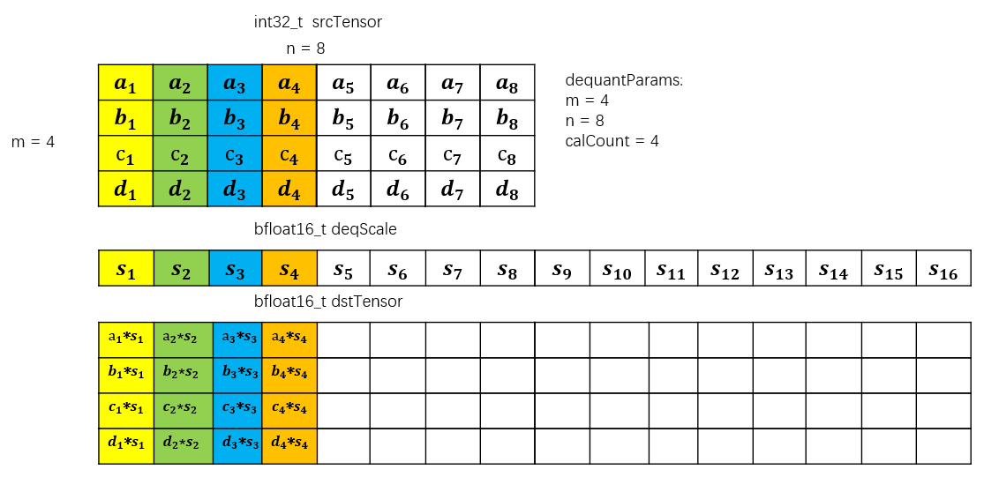
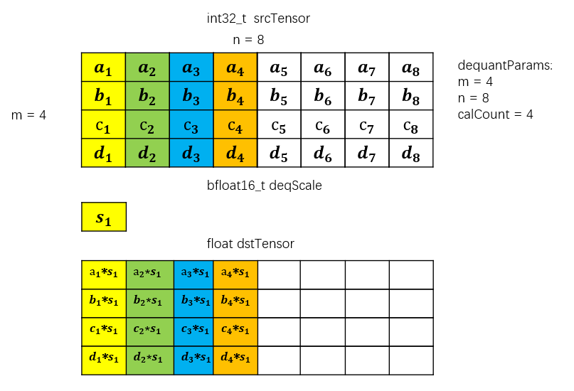
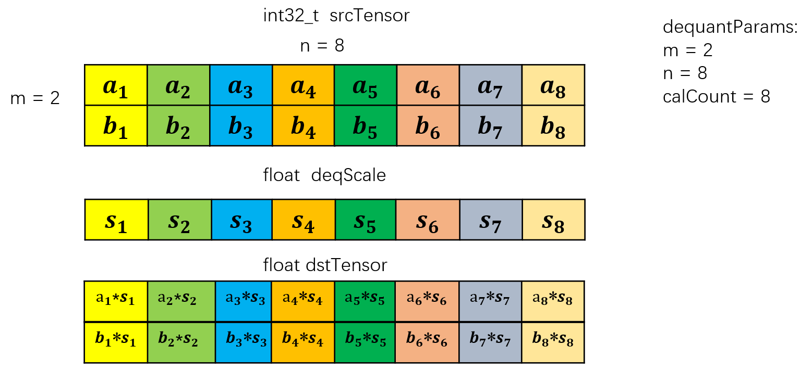
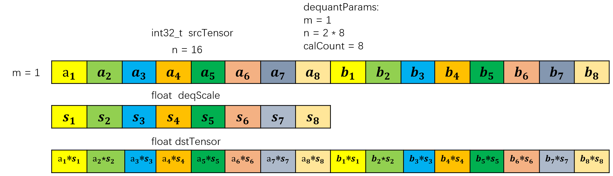
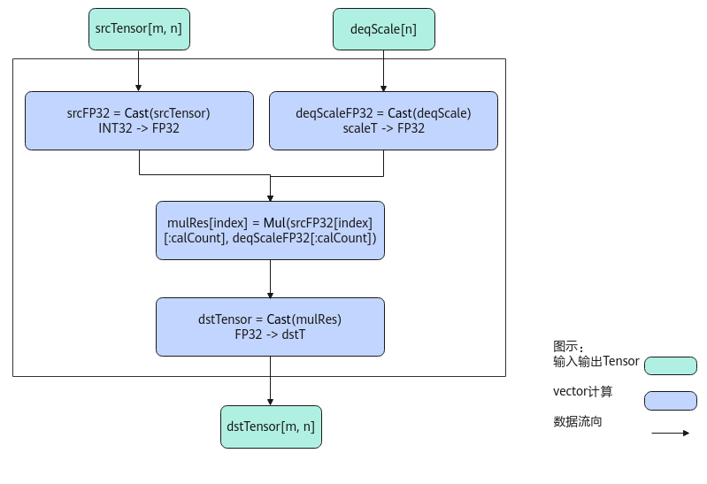
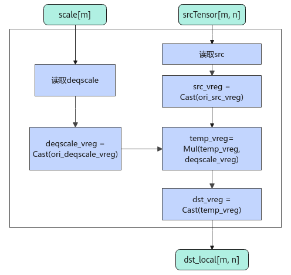

# AscendDequant

**页面ID:** atlasascendc_api_07_0820  
**来源:** https://www.hiascend.com/document/detail/zh/CANNCommunityEdition/900/API/ascendcopapi/atlasascendc_api_07_0820.html

---

#### 产品支持情况

| 产品 | 是否支持 |
| --- | --- |
| Atlas 350 加速卡 | √ |
| Atlas A3 训练系列产品            /             Atlas A3 推理系列产品 | √ |
| Atlas A2 训练系列产品            /             Atlas A2 推理系列产品 | √ |
| Atlas 200I/500 A2 推理产品 | x |
| Atlas 推理系列产品            AI Core | √ |
| Atlas 推理系列产品            Vector Core | x |
| Atlas 训练系列产品 | x |

#### 功能说明

按元素做反量化计算，比如将int32_t数据类型反量化为half/float等数据类型。**本接口最多支持输入为二维数据，不支持更高维度的输入。**

- 假设输入srcTensor的shape为**（m, n）**，每行数据（即n个输入数据）所占字节数要求**32字节对齐**，每行中进行反量化的元素个数为**calCount**；
- 反量化系数deqScale可以为标量或者向量，为向量的情况下，calCount <= deqScale的元素个数，只有前CalCount个反量化系数生效；
- 输出dstTensor的shape为**（m, n_dst）**， n * sizeof(dstT)不满足32字节对齐时，需要**向上补齐为32字节**，n_dst为向上补齐后的列数。

下面通过两个具体的示例来解释参数的配置和计算逻辑（下文中DequantParams类型为存储shape信息的结构体{m, n, calCount}）：

- 如下图示例中，srcTensor的数据类型为int32_t，m = 4，n = 8，calCount = 4，表明srcTensor中每行进行反量化的元素个数为4，deqScale中的前4个数生效，后12个数不参与反量化计算；dstTensor的数据类型为bfloat16_t，m = 4，n_dst = 16 (16 * sizeof(bfloat16_t) % 32 = 0)。计算逻辑是srcTensor的每n个数为一行，对于每行中的前calCount个元素，该行srcTensor的第i个元素与deqScale的第i个元素进行相乘写入dstTensor对应行的第i个元素，dstTensor对应行的第calCount + 1个元素~第n_dst个元素均为不确定的值。



- 如下示例中，srcTensor的数据类型为int32_t，m = 4，n = 8， calCount = 4，表明srcTensor中每行进行反量化的元素个数为4；dstTensor的数据类型为float，m = 4，n_dst = 8 (8 * sizeof(float) % 32 = 0)。对于srcTensor每行中的前4个元素都和标量deqScale相乘并写入dstTensor中每行的对应位置。



当用户将模板参数中的mode配置为**DEQUANT_WITH_SINGLE_ROW**时：

针对DequantParams {m, n, calCount}， 若同时满足以下3个条件：

1. m = 1
2. calCount为 32 / sizeof(dstT)的倍数
3. n % calCount = 0

此时 {1, n, calCount}会被视作为** {n / calCount, calCount, calCount}** 进行反量化的计算。

具体效果可看下图所示，传入的DequantParams为 {1, 16, 8}。因为dstT为float，所以calCount满足为8的倍数，在**DEQUANT_WITH_SINGLE_ROW**模式下会将{1, 2 * 8, 8}转换为 {2, 8, 8}进行计算。





- PER_TOKEN反量化：srcTensor的每组token（token为n方向，共有m组token）中的元素共享一组deqscale参数，srcTensor为[m, n]时，deqscale为[m, 1]。


- PER_GROUP反量化：这里定义group的计算方向为k方向，srcTensor在k方向上每groupSize个元素共享一组deqscale参数。srcTensor为[m, n]时，如果kDim=0，表示k是m方向，deqscale为[(m + groupSize - 1) / groupSize, n]；如果kDim=1，表示k是n方向，deqscale的shape为[m，(n + groupSize - 1) / groupSize]。

  - kDim=0：


  - kDim=1：


#### 实现原理

以数据类型int32_t，shape为[m, n]的输入srcTensor，数据类型scaleT，shape为[n]的输入deqScale和数据类型dstT，shape为[m, n]的输出dstTensor为例，描述AscendDequant高阶API内部算法框图，如下图所示。

**图1 **AscendDequant内部算法框图


计算过程分为如下几步，均在Vector上进行：

1. 精度转换：将srcTensor和deqScale都转换成FP32精度的tensor，分别得到srcFP32和deqScaleFP32；
2. Mul计算：srcFP32一共有m行，每行长度为n；通过m次循环，将srcFP32的每行与deqScaleFP32相乘，通过mask控制仅对前dequantParams.calcount个数进行mul计算，图中index的取值范围为 [0, m)，对应srcFP32的每一行；计算所得结果为mulRes，shape为[m, n]；
3. 结果数据精度转换：mulRes从FP32转换成dstT类型的tensor，所得结果为dstTensor，shape为[m, n]。

PER_TOKEN/PER_GROUP场景下，输入srcTensor数据类型是int32_t/float，此时内部算法框图如下所示。

**图2 **AscendDequant PER_TOKEN/PER_GROUP内部算法框图


PER_TOKEN/PER_GROUP场景的计算逻辑如下：

1. 读取数据：连续读取输入srcTensor；根据不同的场景，对输入deqscale，采用不同的读取方式；例如，PER_TOKEN场景做Broadcast处理，PER_GROUP场景做Gather处理；
2. 精度转换：根据不同输入的数据类型组合，对srcTensor/deqscale进行相应的数据类型转换；
3. 计算：对类型转换后的srcTensor和deqscale数据做乘法；
4. 精度转换：将上述计算得到的结果转换成dstT类型，得到最终输出。

#### 函数原型

- 反量化参数deqScale为矢量

  - 通过sharedTmpBuffer入参传入临时空间

```
template <typename dstT, typename scaleT, DeQuantMode mode = DeQuantMode::DEQUANT_WITH_SINGLE_ROW>
__aicore__ inline void AscendDequant(const LocalTensor<dstT>& dstTensor, const LocalTensor<int32_t>& srcTensor, const LocalTensor<scaleT>& deqScale, const LocalTensor<uint8_t>& sharedTmpBuffer, DequantParams params)
```

  - 接口框架申请临时空间

```
template <typename dstT, typename scaleT, DeQuantMode mode = DeQuantMode::DEQUANT_WITH_SINGLE_ROW>
__aicore__ inline void AscendDequant(const LocalTensor<dstT>& dstTensor, const LocalTensor<int32_t>& srcTensor, const LocalTensor<scaleT>& deqScale, DequantParams params)
```

  - PER_TOKEN/PER_GROUP量化
        仅支持Atlas 350 加速卡。

    - 通过sharedTmpBuffer入参传入临时空间

```
template <typename dstT, typename srcT, typename scaleT, const AscendDeQuantConfig& config, const AscendDeQuantPolicy& policy>
__aicore__ inline void AscendDequant(const LocalTensor<dstT>& dstTensor, const LocalTensor<srcT>& srcTensor, const LocalTensor<scaleT>& scaleTensor, const LocalTensor<scaleT>& offsetTensor, const LocalTensor<uint8_t>& sharedTmpBuffer, const AscendDeQuantParam& para)
```

    - 接口框架申请临时空间

```
template <typename dstT, typename srcT, typename scaleT, const AscendDeQuantConfig& config, const AscendDeQuantPolicy& policy>
__aicore__ inline void AscendDequant(const LocalTensor<dstT>& dstTensor, const LocalTensor<srcT>& srcTensor, const LocalTensor<scaleT>& scaleTensor, const LocalTensor<scaleT>& offsetTensor, const AscendDeQuantParam& para)
```

- 反量化参数deqScale为标量

  - 通过sharedTmpBuffer入参传入临时空间

```
template <typename dstT, typename scaleT, DeQuantMode mode = DeQuantMode::DEQUANT_WITH_SINGLE_ROW>
__aicore__ inline void AscendDequant(const LocalTensor<dstT>& dstTensor, const LocalTensor<int32_t>& srcTensor, const scaleT deqScale, const LocalTensor<uint8_t>& sharedTmpBuffer, DequantParams params)
```

  - 接口框架申请临时空间

```
template <typename dstT, typename scaleT, DeQuantMode mode = DeQuantMode::DEQUANT_WITH_SINGLE_ROW>
__aicore__ inline void AscendDequant(const LocalTensor<dstT>& dstTensor, const LocalTensor<int32_t>& srcTensor, const scaleT deqScale, DequantParams params)
```

由于该接口的内部实现中涉及复杂的数学计算，需要额外的临时空间来存储计算过程中的中间变量。临时空间支持**接口框架申请**和开发者**通过sharedTmpBuffer入参传入**两种方式。

- 接口框架申请临时空间，开发者无需申请，但是需要预留临时空间的大小。

- 通过sharedTmpBuffer入参传入，使用该tensor作为临时空间进行处理，接口框架不再申请。该方式开发者可以自行管理sharedTmpBuffer内存空间，并在接口调用完成后，复用该部分内存，内存不会反复申请释放，灵活性较高，内存利用率也较高。

接口框架申请的方式，开发者需要预留临时空间；通过sharedTmpBuffer传入的情况，开发者需要为sharedTmpBuffer申请空间。临时空间大小BufferSize的获取方式如下：通过GetAscendDequantMaxMinTmpSize中提供的GetAscendDequantMaxMinTmpSize接口获取需要预留空间的范围大小。

以下接口不推荐使用，新开发内容不要使用如下接口：

```
template <typename dstT, typename scaleT, DeQuantMode mode = DeQuantMode::DEQUANT_WITH_SINGLE_ROW>
__aicore__ inline void AscendDequant(const LocalTensor<dstT>& dstTensor, const LocalTensor<int32_t>& srcTensor, const LocalTensor<scaleT>& deqScale, const LocalTensor<uint8_t>& sharedTmpBuffer, const uint32_t calCount)
```

```
template <typename dstT, typename scaleT, DeQuantMode mode = DeQuantMode::DEQUANT_WITH_SINGLE_ROW>
__aicore__ inline void AscendDequant(const LocalTensor<dstT>& dstTensor, const LocalTensor<int32_t>& srcTensor, const LocalTensor<scaleT>& deqScale, const LocalTensor<uint8_t>& sharedTmpBuffer)
```

```
template <typename dstT, typename scaleT, DeQuantMode mode = DeQuantMode::DEQUANT_WITH_SINGLE_ROW>
__aicore__ inline void AscendDequant(const LocalTensor<dstT>& dstTensor, const LocalTensor<int32_t>& srcTensor, const LocalTensor<scaleT>& deqScale, const uint32_t calCount)
```

```
template <typename dstT, typename scaleT, DeQuantMode mode = DeQuantMode::DEQUANT_WITH_SINGLE_ROW>
__aicore__ inline void AscendDequant(const LocalTensor<dstT>& dstTensor, const LocalTensor<int32_t>& srcTensor, const LocalTensor<scaleT>& deqScale)
```

#### 参数说明

**表1 **模板参数说明

| 参数名 | 描述 |
| --- | --- |
| dstT | 目的操作数的数据类型。 |
| scaleT | deqScale的数据类型。 |
| mode | 决定当DequantParams为{1, n, calCount}时的计算逻辑，传入enum DeQuantMode，支持以下 2 种配置：                       - **DEQUANT_WITH_SINGLE_ROW**：当DequantParams {m, n, calCount} 同时满足以下条件：1、m = 1；2、calCount为 32 / sizeof(dstT)的倍数；3、n % calCount = 0时，即 {1, n, calCount} 会当作 {n / calCount, calCount, calCount} 进行计算。            - **DEQUANT_WITH_MULTI_ROW**：即使满足上述所有条件，{1, n, calCount} 依然只会当作 {1, n, calCount} 进行计算， 即总共n个数，前calCount个数进行反量化的计算。 |

**表2 **PER_TOKEN/PER_GROUP场景模板参数说明

| 参数名 | 描述 |
| --- | --- |
| srcT | 源操作数的数据类型。 |
| 量化接口配置参数，AscendDeQuantConfig类型，具体定义如下。                                                                                                                           ``` struct AscendDeQuantConfig {         bool hasOffset;         int32_t kDim = 1; } ```                                                                                                 - hasOffset：量化参数offset是否参与计算。                           - True：表示offset参数参与计算。               - False：表示offset参数不参与计算。                       - kDim：group的计算方向，即k方向。仅在PER_GROUP场景有效，支持的取值如下。                           - 0：k轴是第0轴，即m方向为group的计算方向；               - 1：k轴是第1轴，即n方向为group的计算方向。 |  |
| 量化策略配置参数，枚举类型，可取值如下：                                                                                                                           ``` enum class AscendDeQuantPolicy : int32_t {         PER_TOKEN,  // 配置为PER_TOKEN模式         PER_GROUP, // 配置为PER_GROUP模式         PER_CHANNEL_PER_GROUP, // 预留参数，暂不支持         PER_TOKEN_PER_GROUP // 预留参数，暂不支持 } ``` |  |

**表3 **接口参数说明

| 参数名 | 输入/输出 | 描述 |
| --- | --- | --- |
| dstTensor | 输出 | 目的操作数。类型为LocalTensor，支持的TPosition为VECIN/VECCALC/VECOUT。          Atlas 350 加速卡，支持的数据类型为：half、bfloat16_t、float。                       Atlas A3 训练系列产品            /             Atlas A3 推理系列产品            ，支持的数据类型为：half、bfloat16_t、float。                       Atlas A2 训练系列产品            /             Atlas A2 推理系列产品            ，支持的数据类型为：half、bfloat16_t、float。                       Atlas 推理系列产品            AI Core，支持的数据类型为：half、float。                     - dstTensor的行数和srcTensor的行数保持一致。           - n * sizeof(dstT)不满足32字节对齐时，需要**向上补齐为32字节**，n_dst为向上补齐后的列数。如srcTensor数据类型为int32_t，shape为 (4, 8)，dstTensor为bfloat16_t，则n_dst应从8补齐为16，dstTensor shape为(4, 16)。补齐的计算过程为：n_dst = (8 * sizeof(bfloat16_t) + 32 - 1) / 32 * 32 / sizeof(bfloat16_t)。 |
| srcTensor | 输入 | 源操作数。类型为LocalTensor，支持的TPosition为VECIN/VECCALC/VECOUT。          Atlas 350 加速卡，支持的数据类型为：int32_t。                       Atlas A3 训练系列产品            /             Atlas A3 推理系列产品            ，支持的数据类型为：int32_t。                       Atlas A2 训练系列产品            /             Atlas A2 推理系列产品            ，支持的数据类型为：int32_t。                       Atlas 推理系列产品            AI Core，支持的数据类型为：int32_t。          shape为 [m, n]，n个输入数据所占字节数要求**32字节对齐**。 |
| deqScale | 输入 | 源操作数。类型为标量或者LocalTensor。类型为LocalTensor时，支持的TPosition为VECIN/VECCALC/VECOUT。          Atlas 350 加速卡，当deqScale为矢量时，支持的数据类型为：uint64_t、float、bfloat16_t；当deqScale为标量时，支持的数据类型为bfloat16_t、float。                       Atlas A3 训练系列产品            /             Atlas A3 推理系列产品            ，当deqScale为矢量时，支持的数据类型为：uint64_t、float、bfloat16_t；当deqScale为标量时，支持的数据类型为bfloat16_t、float。                       Atlas A2 训练系列产品            /             Atlas A2 推理系列产品            ，当deqScale为矢量时，支持的数据类型为：uint64_t、float、bfloat16_t；当deqScale为标量时，支持的数据类型为bfloat16_t、float。                       Atlas 推理系列产品            AI Core，当deqScale为矢量时，支持的数据类型为：uint64_t、float；当deqScale为标量时，支持的数据类型为float。          dstTensor、srcTensor、deqScale支持的数据类型组合请参考表5和表6。 |
| sharedTmpBuffer | 输入 | 临时缓存。类型为LocalTensor，支持的TPosition为VECIN/VECCALC/VECOUT。          临时空间大小BufferSize的获取方式请参考GetAscendDequantMaxMinTmpSize。          Atlas 350 加速卡，支持的数据类型为：uint8_t。                       Atlas A3 训练系列产品            /             Atlas A3 推理系列产品            ，支持的数据类型为：uint8_t。                       Atlas A2 训练系列产品            /             Atlas A2 推理系列产品            ，支持的数据类型为：uint8_t。                       Atlas 推理系列产品            AI Core，支持的数据类型为：uint8_t。 |
| srcTensor的shape信息。DequantParams类型，具体定义如下：                                                                                                                           ``` struct DequantParams {     uint32_t m;             // srcTensor的行数     uint32_t n;             // srcTensor的列数     uint32_t calCount;      // 针对srcTensor每一行，前calCount个数为有效数据，与deqScale的前calCount个数或者deqScale标量进行乘法计算 }; ```                                                                                                 - DequantParams.n * sizeof(T)必须是32字节的整数倍，T为srcTensor中元素的数据类型。           - 因为是每n个数中的前calCount个数进行乘法运算，因此DequantParams.n和calCount需要满足以下关系            1 <= DequantParams.calCount <= DequantParams.n。           - deqScale为矢量时，DequantParams.calCount <= deqScale的元素个数。 |  |  |

**表4 **PER_TOKEN/PER_GROUP场景接口参数说明

| 参数名 | 输入/输出 | 描述 |
| --- | --- | --- |
| dstTensor | 输出 | 目的操作数。          类型为LocalTensor，支持的TPosition为VECIN/VECCALC/VECOUT。          Atlas 350 加速卡，支持的数据类型为：half、bfloat16_t、float。 |
| srcTensor | 输入 | 源操作数。          类型为LocalTensor，支持的TPosition为VECIN/VECCALC/VECOUT。          Atlas 350 加速卡，支持的数据类型为：int32_t、float。 |
| sharedTmpBuffer | 输入 | 临时缓存。          类型为LocalTensor，支持的TPosition为VECIN/VECCALC/VECOUT。          临时空间大小BufferSize的获取方式请参考GetAscendQuantMaxMinTmpSize。          Atlas 350 加速卡，支持的数据类型为：uint8_t。 |
| scaleTensor | 输入 | 量化参数scale。          类型为LocalTensor，支持的TPosition为VECIN/VECCALC/VECOUT。          Atlas 350 加速卡，支持的数据类型为：half、bfloat16_t、float。 |
| offsetTensor | 输入 | 量化参数offset。预留参数，当前暂不支持。          类型为LocalTensor，支持的TPosition为VECIN/VECCALC/VECOUT。          Atlas 350 加速卡，支持的数据类型和scaleTensor保持一致。 |
| 反量化接口的参数，定义如下：                                                                                                                           ``` struct AscendDeQuantParam {         uint32_t m;         uint32_t n;         uint32_t calCount;            uint32_t groupSize = 0; } ```                                                                                                 - m：m方向元素个数。           - n：n方向元素个数。n值对应的数据大小需满足32B对齐的要求，即shape最后一维为n的输入输出均需要满足该维度上32B对齐的要求。           - calCount:参与计算的元素个数。calCount必须是n的整数倍。           - groupSize ：PER_GROUP场景有效，表示groupSize行/列数据共用一个scale/offset。groupSize的取值必须大于0且是32的整倍数。 |  |  |

**表5 **支持的数据类型组合（deqScale为LocalTensor）

| dstTensor | srcTensor | deqScale |
| --- | --- | --- |
| half | int32_t | uint64_t           注意：当deqScale的数据类型是uint64_t时，数值低32位是参与计算的数据，数据类型是float，数值高32位是一些控制参数，本接口不使用。 |
| float | int32_t | float |
| float | int32_t | bfloat16_t |
| bfloat16_t | int32_t | bfloat16_t |
| bfloat16_t | int32_t | float |

**表6 **支持的数据类型组合（deqScale为标量）

| dstTensor | srcTensor | deqScale |
| --- | --- | --- |
| bfloat16_t | int32_t | bfloat16_t |
| bfloat16_t | int32_t | float |
| float | int32_t | bfloat16_t |
| float | int32_t | float |

**表7 **PER_TOKEN/PER_GROUP场景支持的数据类型组合

| srcDtype | scaleDtype | dstDtype |
| --- | --- | --- |
| int32_t | half | half |
| bfloat16_t | bfloat16_t |  |
| float | float |  |
| float | half |  |
| float | bfloat16_t |  |
| float | half | half |
| bfloat16_t | bfloat16_t |  |
| float | float |  |
| float | half |  |
| float | bfloat16_t |  |

#### 约束说明

- **不支持源操作数与目的操作数地址重叠。**

- PER_TOKEN/PER_GROUP场景，当前仅在Atlas 350 加速卡上支持。
- PER_TOKEN/PER_GROUP场景，连续计算方向（即n方向）的数据量要求32B对齐。

#### 调用示例

完整的算子样例请参考[dequant算子样例](https://gitcode.com/cann/asc-devkit/tree/9.0.0/examples/01_simd_cpp_api/03_libraries/03_quantization/dequant)。

```
// dstLocal: 存放反量化计算的结果Tensor
// srcLocal: 存放反量化计算的输入Tensor
// deqScaleLocal: 存放反量化计算量反量化系数的输入Tensor
// sharedTmpBuffer: 存放反量化计算过程中临时缓存的Tensor

uint32_t m = 4;  // srcTensor的行数
uint32_t n = 8;  // srcTensor的列数
uint32_t calCount = 6;  // 每行srcTensor的前calCount个数参与反量化计算

// 反量化参数deqScale为矢量，通过sharedTmpBuffer入参传入临时空间。
AscendC::AscendDequant(dstLocal, srcLocal, deqScaleLocal, sharedTmpBuffer, {m, n, calCount});

// 反量化参数deqScale为矢量，通过接口框架申请临时空间。
AscendC::AscendDequant(dstLocal, srcLocal, deqScaleLocal, {m, n, calCount});

// 反量化参数deqScale为标量，通过sharedTmpBuffer入参传入临时空间。
AscendC::AscendDequant(dstLocal, srcLocal, static_cast<float>(2.2), sharedTmpBuffer, {m, n, calCount});
// 反量化参数deqScale为标量，通过接口框架申请临时空间。
AscendC::AscendDequant(dstLocal, srcLocal, static_cast<float>(2.2), {m, n, calCount});
```

结果示例如下：

```
输入数据(srcLocal) int32_t数据类型:
[[-16 -15 -14 -13 -12 -11 -10  -9]
 [ -8  -7  -6  -5  -4  -3  -2  -1]
 [  0   1   2   3   4   5   6   7]
 [  8   9  10  11  12  13  14  15]]

反量化参数deqScaleLocal float数据类型:
[2.2  -2.2  2.2  -2.2  2.2  -2.2  0.  0.]

输出数据(dstLocal) float数据类型:
[[-35.2  33.  -30.8  28.6 -26.4  24.2 -10.   -9. ]
 [-17.6  15.4 -13.2  11.   -8.8   6.6  -2.   -1. ]
 [  0.   -2.2   4.4  -6.6   8.8 -11.    6.    7. ]
 [ 17.6 -19.8  22.  -24.2  26.4 -28.6  14.   15. ]]
```

PER_TOKEN/PER_GROUP场景调用示例如下。

```
// 注意m,n需从外部传入
constexpr static bool isReuseSource = false;
constexpr static AscendDeQuantConfig config = {has_offset, -1};
constexpr static AscendDeQuantPolicy policy = AscendDeQuantPolicy::PER_TOKEN; // 可修改枚举值以使能PER_GROUP
AscendDeQuantParam para;
para.m = m;
para.n = n;
para.calCount = calCount;
AscendDequant<dstType, srcType, scaleType, config, policy>(dstLocal, srcLocal, scaleLocal, offsetLocal, para);
```
