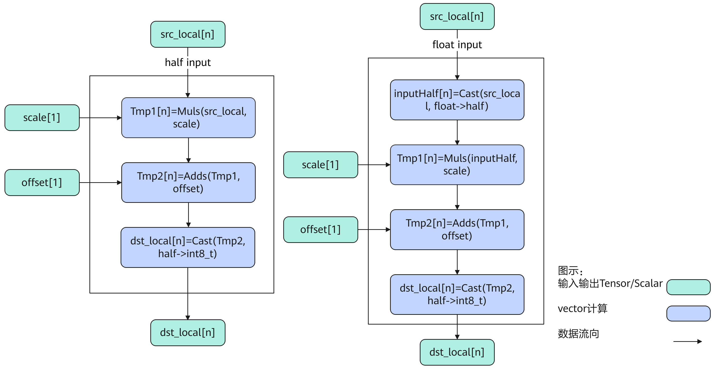
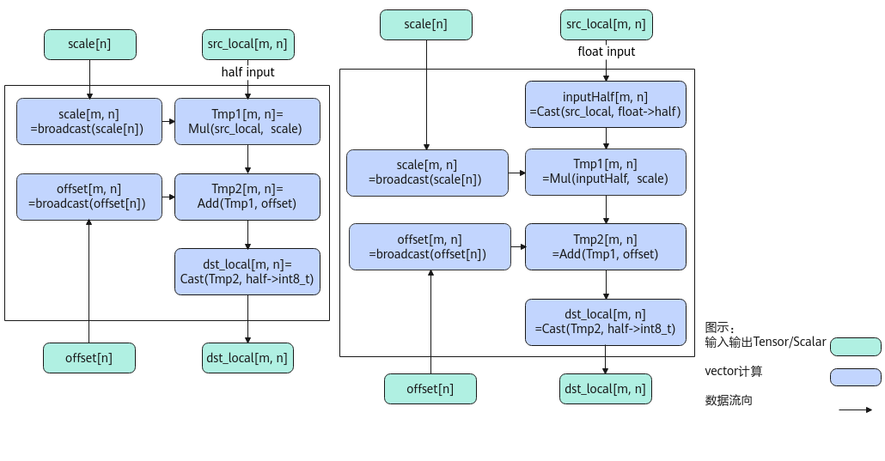
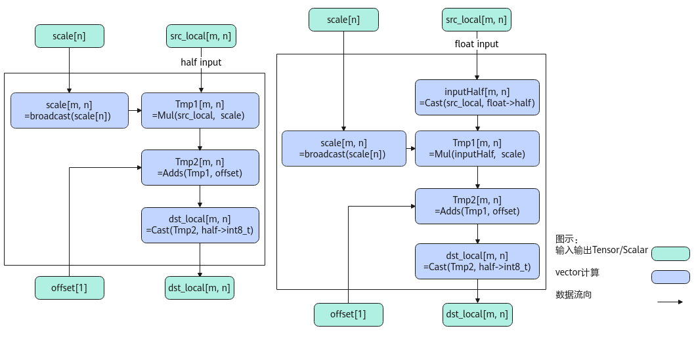
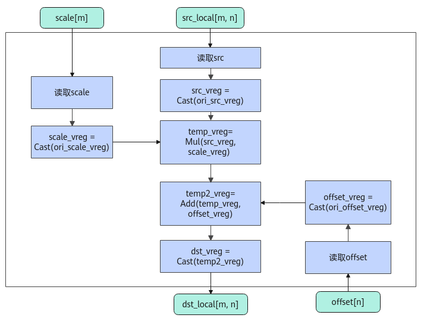
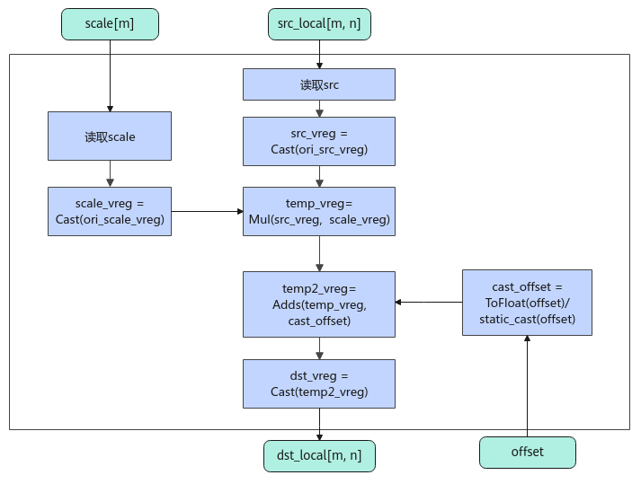

# AscendQuant

**页面ID:** atlasascendc_api_07_0818  
**来源:** https://www.hiascend.com/document/detail/zh/CANNCommunityEdition/900/API/ascendcopapi/atlasascendc_api_07_0818.html

---

#### 产品支持情况

| 产品 | 是否支持 |
| --- | --- |
| Atlas 350 加速卡 | √ |
| Atlas A3 训练系列产品            /             Atlas A3 推理系列产品 | √ |
| Atlas A2 训练系列产品            /             Atlas A2 推理系列产品 | √ |
| Atlas 200I/500 A2 推理产品 | x |
| Atlas 推理系列产品            AI Core | √ |
| Atlas 推理系列产品            Vector Core | x |
| Atlas 训练系列产品 | √ |

#### 功能说明

按元素做量化计算，比如将half/float数据类型量化为int8_t数据类型。计算公式如下，round表示四舍六入五成双取整，cast表示舍入模式：

- PER_TENSOR量化：整个srcTensor对应一个量化参数，量化参数的shape为[1]。


- PER_CHANNEL量化：srcTensor的shape为[m, n], 每个channel维度对应一个量化参数，量化参数的shape为[n]。


- PER_TOKEN量化：srcTensor的每组token（token为n方向，共有m组token）中的元素共享一组scale和offset参数，srcTensor的shape为[m, n]时，scale和offset的shape为[m, 1]。offset是可选输入。
- 
- PER_GROUP量化：这里定义group的计算方向为k方向，srcTensor在k方向上每groupSize个元素共享一组scale和offset。srcTensor的shape为[m, n]时，如果kDim=0，表示k是m方向，scale和offset的shape为[(m + groupSize - 1) / groupSize, n]；如果kDim=1，表示k是n方向，scale和offset的shape为[m，(n + groupSize - 1) / groupSize]。offset是可选输入。
      根据输出数据类型的不同，当前PER_GROUP分为两种场景：fp4x2_e2m1_t/fp4x2_e1m2_t场景（后续内容中简称为float4场景）和int8_t/hifloat8_t/fp8_e5m2_t/fp8_e4m3fn_t场景（后续内容中简称为b8场景）。

  - fp4x2_e2m1_t/float4_e1m2场景（float4场景）

    - kDim = 0:****


    - kDim = 1:


  - int8_t/hifloat8_t/fp8_e5m2_t/fp8_e4m3fn_t场景（b8场景）

    - kDim=0：


    - kDim=1：


#### 实现原理

**图1 **AscendQuant算法框图scale和offset都是scalar
**图2 **AscendQuant算法框图scale和offset都是Tensor
**图3 **AscendQuant算法框图scale是Tensor&offset是Scalar


如上图所示是AscendQuant内部算法框图，计算过程大致描述为如下几步，均在Vector上进行：

1. 精度转换：当输入的src，scale或者offset是float类型时，将其转换为half类型；
2. broadcast：当输入的scale或者offset是向量时，将其broadcast成和src相同维度；
3. 计算scale：当src和scale为向量时做Mul计算，当scale是scalar时做Muls计算，得到Tmp1；
4. 计算offset：当Tmp1和offset为向量时做Add计算，当offset是scalar时做Adds计算，得到Tmp2；
5. 精度转换：将Tmp2从half转换成int8_t类型，得到output。

**图4 **AscendQuant算法框图PER_TOKEN/PER_GROUP场景scale和offset都是tensor
**图5 **AscendQuant算法框图PER_TOKEN/PER_GROUP场景scale是tensor&offset是scalar


PER_TOKEN/PER_GROUP场景的计算逻辑如下：

1. 读取数据：连续读取输入src；根据不同的场景，对输入scale和offset，采用不同的读取方式；例如，PER_TOKEN场景做Broadcast处理，PER_GROUP场景做Gather处理；
2. 精度转换：根据不同输入的数据类型组合，对src/scale/offset进行相应的数据类型转换；
3. 计算：对类型转换后的数据做乘加操作；
4. 精度转换：将上述乘加操作得到的计算结果转换成dstT类型，得到最终输出。

#### 函数原型

- dstTensor为int8_t数据类型

  - PER_TENSOR量化：

    - 通过sharedTmpBuffer入参传入临时空间

      - 源操作数Tensor全部/部分参与计算

```
template <typename T, bool isReuseSource = false, const AscendQuantConfig& config = ASCEND_QUANT_DEFAULT_CFG>
__aicore__ inline void AscendQuant(const LocalTensor<int8_t>& dstTensor, const LocalTensor<T>& srcTensor, const LocalTensor<uint8_t>& sharedTmpBuffer, const float scale, const float offset, const uint32_t calCount)
```

      - 源操作数Tensor全部参与计算

```
template <typename T, bool isReuseSource = false, const AscendQuantConfig& config = ASCEND_QUANT_DEFAULT_CFG>
__aicore__ inline void AscendQuant(const LocalTensor<int8_t>& dstTensor, const LocalTensor<T>& srcTensor, const LocalTensor<uint8_t>& sharedTmpBuffer, const float scale, const float offset)
```

    - 接口框架申请临时空间

      - 源操作数Tensor全部/部分参与计算

```
template <typename T, bool isReuseSource = false, const AscendQuantConfig& config = ASCEND_QUANT_DEFAULT_CFG>
__aicore__ inline void AscendQuant(const LocalTensor<int8_t>& dstTensor, const LocalTensor<T>& srcTensor, const float scale, const float offset, const uint32_t calCount)
```

      - 源操作数Tensor全部参与计算

```
template <typename T, bool isReuseSource = false, const AscendQuantConfig& config = ASCEND_QUANT_DEFAULT_CFG>
__aicore__ inline void AscendQuant(const LocalTensor<int8_t>& dstTensor, const LocalTensor<T>& srcTensor, const float scale, const float offset)
```

  - PER_CHANNEL量化：

    - 通过sharedTmpBuffer入参传入临时空间

      - 源操作数Tensor全部/部分参与计算

```
template <typename T, bool isReuseSource = false, const AscendQuantConfig& config = ASCEND_QUANT_DEFAULT_CFG>
__aicore__ inline void AscendQuant(const LocalTensor<int8_t>& dstTensor, const LocalTensor<T>& srcTensor, const LocalTensor<uint8_t>& sharedTmpBuffer, const LocalTensor<T>& scaleTensor, const T offset, const uint32_t scaleCount, const uint32_t calCount)
```

```
template <typename T, bool isReuseSource = false, const AscendQuantConfig& config = ASCEND_QUANT_DEFAULT_CFG>
__aicore__ inline void AscendQuant(const LocalTensor<int8_t>& dstTensor, const LocalTensor<T>& srcTensor, const LocalTensor<uint8_t>& sharedTmpBuffer, const LocalTensor<T>& scaleTensor, const LocalTensor<T>& offsetTensor, const uint32_t scaleCount, const uint32_t offsetCount, const uint32_t calCount)
```

      - 源操作数Tensor全部参与计算

```
template <typename T, bool isReuseSource = false, const AscendQuantConfig& config = ASCEND_QUANT_DEFAULT_CFG>
__aicore__ inline void AscendQuant(const LocalTensor<int8_t>& dstTensor, const LocalTensor<T>& srcTensor, const LocalTensor<uint8_t>& sharedTmpBuffer, const LocalTensor<T>& scaleTensor, const T offset)
```

```
template <typename T, bool isReuseSource = false, const AscendQuantConfig& config = ASCEND_QUANT_DEFAULT_CFG>
__aicore__ inline void AscendQuant(const LocalTensor<int8_t>& dstTensor, const LocalTensor<T>& srcTensor, const LocalTensor<uint8_t>& sharedTmpBuffer, const LocalTensor<T>& scaleTensor, const LocalTensor<T>& offsetTensor)
```

    - 接口框架申请临时空间

      - 源操作数Tensor全部/部分参与计算

```
template <typename T, bool isReuseSource = false, const AscendQuantConfig& config = ASCEND_QUANT_DEFAULT_CFG>
__aicore__ inline void AscendQuant(const LocalTensor<int8_t>& dstTensor, const LocalTensor<T>& srcTensor, const LocalTensor<T>& scaleTensor, const T offset, const uint32_t scaleCount, const uint32_t calCount)
```

```
template <typename T, bool isReuseSource = false, const AscendQuantConfig& config = ASCEND_QUANT_DEFAULT_CFG>
__aicore__ inline void AscendQuant(const LocalTensor<int8_t>& dstTensor, const LocalTensor<T>& srcTensor, const LocalTensor<T>& scaleTensor, const LocalTensor<T>& offsetTensor, const uint32_t scaleCount, const uint32_t offsetCount, const uint32_t calCount)
```

      - 源操作数Tensor全部参与计算

```
template <typename T, bool isReuseSource = false, const AscendQuantConfig& config = ASCEND_QUANT_DEFAULT_CFG>
__aicore__ inline void AscendQuant(const LocalTensor<int8_t>& dstTensor, const LocalTensor<T>& srcTensor, const LocalTensor<T>& scaleTensor, const T offset)
```

```
template <typename T, bool isReuseSource = false, const AscendQuantConfig& config = ASCEND_QUANT_DEFAULT_CFG>
__aicore__ inline void AscendQuant(const LocalTensor<int8_t>& dstTensor, const LocalTensor<T>& srcTensor, const LocalTensor<T>& scaleTensor, const LocalTensor<T>& offsetTensor)
```

- dstTensor非固定数据类型
      仅支持Atlas 350 加速卡。

  - PER_TENSOR量化：

    - 通过sharedTmpBuffer入参传入临时空间

      - 源操作数Tensor全部/部分参与计算

```
template <typename dstT, typename srcT, bool isReuseSource = false>
__aicore__ inline void AscendQuant(const LocalTensor<dstT>& dstTensor, const LocalTensor<srcT>& srcTensor, const LocalTensor<uint8_t>& sharedTmpBuffer, const float scale, const float offset, const uint32_t calCount)
```

      - 源操作数Tensor全部参与计算

```
template <typename dstT, typename srcT, bool isReuseSource = false>
__aicore__ inline void AscendQuant(const LocalTensor<dstT>& dstTensor, const LocalTensor<srcT>& srcTensor, const LocalTensor<uint8_t>& sharedTmpBuffer, const float scale, const float offset)
```

    - 接口框架申请临时空间

      - 源操作数Tensor全部/部分参与计算

```
template <typename dstT, typename srcT, bool isReuseSource = false>
__aicore__ inline void AscendQuant(const LocalTensor<dstT>& dstTensor, const LocalTensor<srcT>& srcTensor, const float scale, const float offset, const uint32_t calCount)
```

      - 源操作数Tensor全部参与计算

```
template <typename dstT, typename srcT, bool isReuseSource = false>
__aicore__ inline void AscendQuant(const LocalTensor<dstT>& dstTensor, const LocalTensor<srcT>& srcTensor, const float scale, const float offset)
```

  - PER_CHANNEL量化：

    - 通过sharedTmpBuffer入参传入临时空间

      - 源操作数Tensor全部/部分参与计算

```
template <typename dstT, typename srcT, bool isReuseSource = false>
__aicore__ inline void AscendQuant(const LocalTensor<dstT>& dstTensor, const LocalTensor<srcT>& srcTensor, const LocalTensor<uint8_t>& sharedTmpBuffer, const LocalTensor<srcT>& scaleTensor, const srcT offset, const uint32_t scaleCount, const uint32_t calCount)
```

```
template <typename dstT, typename srcT, bool isReuseSource = false>
__aicore__ inline void AscendQuant(const LocalTensor<dstT>& dstTensor, const LocalTensor<srcT>& srcTensor, const LocalTensor<uint8_t>& sharedTmpBuffer, const LocalTensor<srcT>& scaleTensor, const LocalTensor<srcT>& offsetTensor, const uint32_t scaleCount, const uint32_t offsetCount, const uint32_t calCount)
```

      - 源操作数Tensor全部参与计算

```
template <typename dstT, typename srcT, bool isReuseSource = false>
__aicore__ inline void AscendQuant(const LocalTensor<dstT>& dstTensor, const LocalTensor<srcT>& srcTensor, const LocalTensor<uint8_t>& sharedTmpBuffer, const LocalTensor<srcT>& scaleTensor, const srcT offset)
```

```
template <typename dstT, typename srcT, bool isReuseSource = false>
__aicore__ inline void AscendQuant(const LocalTensor<dstT>& dstTensor, const LocalTensor<srcT>& srcTensor, const LocalTensor<uint8_t>& sharedTmpBuffer, const LocalTensor<srcT>& scaleTensor, const LocalTensor<srcT>& offsetTensor)
```

    - 接口框架申请临时空间

      - 源操作数Tensor全部/部分参与计算

```
template <typename dstT, typename srcT, bool isReuseSource = false>
__aicore__ inline void AscendQuant(const LocalTensor<dstT>& dstTensor, const LocalTensor<srcT>& srcTensor, const LocalTensor<srcT>& scaleTensor, const srcT offset, const uint32_t scaleCount, const uint32_t calCount)
```

```
template <typename dstT, typename srcT, bool isReuseSource = false>
__aicore__ inline void AscendQuant(const LocalTensor<dstT>& dstTensor, const LocalTensor<srcT>& srcTensor, const LocalTensor<srcT>& scaleTensor, const LocalTensor<srcT>& offsetTensor, const uint32_t scaleCount, const uint32_t offsetCount, const uint32_t calCount)
```

      - 源操作数Tensor全部参与计算

```
template <typename dstT, typename srcT, bool isReuseSource = false>
__aicore__ inline void AscendQuant(const LocalTensor<dstT>& dstTensor, const LocalTensor<srcT>& srcTensor, const LocalTensor<srcT>& scaleTensor, const srcT offset)
```

```
template <typename dstT, typename srcT, bool isReuseSource = false>
__aicore__ inline void AscendQuant(const LocalTensor<dstT>& dstTensor, const LocalTensor<srcT>& srcTensor, const LocalTensor<srcT>& scaleTensor, const LocalTensor<srcT>& offsetTensor)
```

  - PER_TOKEN/PER_GROUP量化：

    - 通过sharedTmpBuffer入参传入临时空间

      - offset操作数类型为Tensor

```
template <typename dstT, typename srcT, typename scaleT, bool isReuseSource = false, const AscendQuantConfig& config, const AscendQuantPolicy& policy>
__aicore__ inline void AscendQuant(const LocalTensor<dstT>& dstTensor, const LocalTensor<srcT>& srcTensor, const LocalTensor<uint8_t>& sharedTmpBuffer, const LocalTensor<scaleT>& scaleTensor, const LocalTensor<scaleT>& offsetTensor, const AscendQuantParam& para)
```

      - offset操作数类型为scalar

```
template <typename dstT, typename srcT, typename scaleT, bool isReuseSource = false, const AscendQuantConfig& config, const AscendQuantPolicy& policy>
__aicore__ inline void AscendQuant(const LocalTensor<dstT>& dstTensor, const LocalTensor<srcT>& srcTensor, const LocalTensor<uint8_t>& sharedTmpBuffer, const LocalTensor<scaleT>& scaleTensor,const scaleT offset, const AscendQuantParam& para)
```

    - 接口框架申请临时空间

      - offset操作数类型为Tensor

```
template <typename dstT, typename srcT, typename scaleT, bool isReuseSource = false, const AscendQuantConfig& config, const AscendQuantPolicy& policy>
__aicore__ inline void AscendQuant(const LocalTensor<dstT>& dstTensor, const LocalTensor<srcT>& srcTensor, const LocalTensor<scaleT>& scaleTensor, const LocalTensor<scaleT>& offsetTensor, const AscendQuantParam& para)
```

      - offset操作数类型为scalar

```
template <typename dstT, typename srcT, typename scaleT, bool isReuseSource = false, const AscendQuantConfig& config, const AscendQuantPolicy& policy>
__aicore__ inline void AscendQuant(const LocalTensor<dstT>& dstTensor, const LocalTensor<srcT>& srcTensor, const LocalTensor<scaleT>& scaleTensor, const scaleT offset, const AscendQuantParam& para)
```

由于该接口的内部实现中涉及复杂的数学计算，需要额外的临时空间来存储计算过程中的中间变量。临时空间支持**接口框架申请**和开发者**通过sharedTmpBuffer入参传入**两种方式。

- 接口框架申请临时空间，开发者无需申请，但是需要预留临时空间的大小。

- 通过sharedTmpBuffer入参传入，使用该tensor作为临时空间进行处理，接口框架不再申请。该方式开发者可以自行管理sharedTmpBuffer内存空间，并在接口调用完成后，复用该部分内存，内存不会反复申请释放，灵活性较高，内存利用率也较高。

接口框架申请的方式，开发者需要预留临时空间；通过sharedTmpBuffer传入的情况，开发者需要为sharedTmpBuffer申请空间。临时空间大小BufferSize的获取方式如下：通过GetAscendQuantMaxMinTmpSize中提供的GetAscendQuantMaxMinTmpSize接口获取需要预留空间的范围大小。

需要注意的是，在PER_TOKEN/PER_GROUP量化场景，内部实现不需要临时空间Buffer，对应的接口中sharedTmpBuffer为预留参数。

#### 参数说明

**表1 **dstTensor为int8_t数据类型模板参数说明

| 参数名 | 描述 |
| --- | --- |
| T | 操作数的数据类型。                       Atlas 训练系列产品            ，支持的数据类型为：half、float。                       Atlas A3 训练系列产品            /             Atlas A3 推理系列产品            ，支持的数据类型为：half、float。                       Atlas A2 训练系列产品            /             Atlas A2 推理系列产品            ，支持的数据类型为：half、float。                       Atlas 推理系列产品            AI Core，支持的数据类型为：half、float。 |
| isReuseSource | 是否允许修改源操作数。该参数预留，传入默认值false即可。 |
| 结构体模板参数，此参数可选配，AscendQuantConfig类型，具体定义如下。                                                                                                                           ``` struct AscendQuantConfig{ uint32_t calcCount = 0; uint32_t offsetCount = 0; uint32_t scaleCount = 0; uint32_t workLocalSize = 0; }; ```                                                                                                 - calcCount：实际计算数据元素个数。calcCount∈[0, srcTensor.GetSize()]，在调用带有scaleCount入参的接口时，calcCount若取非零值则必须是scaleCount的整数倍。           - offsetCount：实际量化参数元素个数。offsetCount∈[0, offsetTensor.GetSize()]，offsetCount与scaleCount的取值必须相等，要求是32的整数倍。若调用的接口不含offsetCount入参，取值为0即可。           - scaleCount：实际量化参数元素个数。scaleCount∈[0, scaleTensor.GetSize()]，要求是32的整数倍。若调用的接口不含scaleCount入参，取值为0即可。           - workLocalSize：临时缓存sharedTmpBuffer的大小，sharedTmpBuffer的大小/workLocalSize的获取方式请参考GetAscendQuantMaxMinTmpSize。该参数取值不能大于sharedTmpBuffer的大小。若调用的接口不含sharedTmpBuffer入参，取值为0即可。                    当上述参数的取值满足如下任一种场景，将使能参数常量化，即编译过程中使用常量化的相关参数，从而减少Scalar计算。                     - 若调用的接口不含scaleCount入参，calcCount和workLocalSize取值为非0时，使能参数常量化。           - 若调用的接口带有scaleCount入参，scaleCount、calcCount和workLocalSize取值为非0时，使能参数常量化。                    默认参数的配置示例如下。                                                                                                                           ``` constexpr AscendQuantConfig ASCEND_QUANT_DEFAULT_CFG = {0, 0, 0, 0}; ``` |  |

**表2 **dstTensor非固定数据类型的模板参数说明

| 参数名 | 描述 |
| --- | --- |
| dstT | 目的操作数的数据类型。          Atlas 350 加速卡，支持的数据类型为：int8_t、fp8_e4m3fn_t、fp8_e5m2_t、hifloat8_t、fp4x2_e1m2_t、fp4x2_e2m1_t。注意，对于fp4x2_e1m2_t、fp4x2_e2m1_t数据类型，仅在PER_GROUP场景下支持。 |
| srcT | 源操作数的数据类型。          Atlas 350 加速卡，支持的数据类型为：half、bfloat16_t、float。 |
| isReuseSource | 是否允许修改源操作数。该参数预留，传入默认值false即可。 |

**表3 **PER_TOKEN/PER_GROUP场景特有模板参数说明

| 参数名 | 描述 |
| --- | --- |
| scaleT | 量化参数scale和offset的数据类型。          Atlas 350 加速卡，支持的数据类型为：half、bfloat16_t、float。 |
| 量化接口配置参数，AscendQuantConfig类型，具体定义如下：                                                                                                                           ``` struct AscendQuantConfig {         bool hasOffset;         int32_t kDim = 1;         RoundMode roundMode = RoundMode::CAST_RINT; } ```                                                                                                 - hasOffset：量化参数offset是否参与计算。                           - True：表示offset参数参与计算。               - False：表示offset参数不参与计算。                       - kDim：group的计算方向，即k方向。仅在PER_GROUP场景有效，支持的取值如下：                           - 0：k轴是第0轴，即m方向为group的计算方向；               - 1：k轴是第1轴，即n方向为group的计算方向。                       - roundMode：量化过程中，数据由高精度数据类型转换为低精度数据类型的舍入模式，支持的取值有：CAST_NONE、CAST_RINT、CAST_ROUND、CAST_FLOOR、CAST_CEIL、CAST_TRUNC、CAST_HYBRID，各个舍入模式的详细介绍请参考精度转换规则。不同数据类型的量化支持不同的舍入模式，当量化过程中使用了不支持的舍入模式时，将回退到默认的舍入模式；例如，bfloat16_t数据类型量化为hifloat8_t数据类型时，如果配置的roundMode为不支持的CAST_RINT，实际执行量化时将回退到默认的roundMode（CAST_ROUND）。不同数据类型支持的舍入模式请见表4。 |  |
| 量化策略配置参数，枚举类型，可取值如下：                                                                                                                           ``` enum class AscendQuantPolicy : int32_t {         PER_TENSOR, // 预留参数，暂不支持         PER_CHANNEL, // 预留参数，暂不支持         PER_TOKEN, // 配置为PER_TOKEN场景         PER_GROUP,  // 配置为PER_GROUP场景         PER_CHANNEL_PER_GROUP, // 预留参数，暂不支持         PER_TOKEN_PER_GROUP // 预留参数，暂不支持 } ``` |  |

**表4 **PER_TOKEN/PER_GROUP场景支持的数据类型组合

| srcDtype | scaleDtype/offsetDtype | dstDtype | roundMode |
| --- | --- | --- | --- |
| half | half | fp8_e5m2_t/fp8_e4m3fn_t | - CAST_RINT（默认） |
| bfloat16_t | bfloat16_t |  |  |
| float | float |  |  |
| half | float |  |  |
| bfloat16_t | float |  |  |
| half | half | hifloat8_t | - CAST_ROUND（默认）CAST_HYBRID |
| bfloat16_t | bfloat16_t |  |  |
| float | float |  |  |
| half | float |  |  |
| bfloat16_t | float |  |  |
| half | half | int8_t | - CAST_RINT（默认）           - CAST_ROUND           - CAST_FLOOR           - CAST_CEIL           - CAST_TRUNC |
| bfloat16_t | bfloat16_t |  |  |
| float | float |  |  |
| half | float |  |  |
| bfloat16_t | float |  |  |
| half | half | fp4x2_e1m2_t/fp4x2_e2m1_t          （当前均只支持PER_GROUP场景） |  |
| half | float |  |  |
| bfloat16_t | bfloat16_t |  |  |
| bfloat16_t | float |  |  |

**表5 **PER_TENSOR接口参数说明

| 参数名 | 输入/输出 | 描述 |
| --- | --- | --- |
| dstTensor | 输出 | 目的操作数。          类型为LocalTensor，支持的TPosition为VECIN/VECCALC/VECOUT。 |
| srcTensor | 输入 | 源操作数。          类型为LocalTensor，支持的TPosition为VECIN/VECCALC/VECOUT。 |
| sharedTmpBuffer | 输入 | 临时缓存。          类型为LocalTensor，支持的TPosition为VECIN/VECCALC/VECOUT。          临时空间大小BufferSize的获取方式请参考GetAscendQuantMaxMinTmpSize。 |
| scale | 输入 | 量化参数。          类型为Scalar，支持的数据类型为float。 |
| offset | 输入 | 量化参数。          类型为Scalar，支持的数据类型为float。 |
| calCount | 输入 | 参与计算的元素个数。 |

**表6 **PER_CHANNEL接口参数说明

| 参数名 | 输入/输出 | 描述 |
| --- | --- | --- |
| dstTensor | 输出 | 目的操作数。          类型为LocalTensor，支持的TPosition为VECIN/VECCALC/VECOUT。 |
| srcTensor | 输入 | 源操作数。          类型为LocalTensor，支持的TPosition为VECIN/VECCALC/VECOUT。 |
| sharedTmpBuffer | 输入 | 临时缓存。          类型为LocalTensor，支持的TPosition为VECIN/VECCALC/VECOUT。          临时空间大小BufferSize的获取方式请参考GetAscendQuantMaxMinTmpSize。 |
| scaleTensor | 输入 | 量化参数。          类型为LocalTensor，支持的TPosition为VECIN/VECCALC/VECOUT。 |
| offsetTensor | 输入 | 量化参数。          类型为LocalTensor，支持的TPosition为VECIN/VECCALC/VECOUT。 |
| scaleCount | 输入 | 实际量化参数元素个数，且scaleCount∈[0, min(scaleTensor.GetSize(),dstTensor.GetSize())]，要求是32的整数倍。 |
| offsetCount | 输入 | 实际量化参数元素个数，且offsetCount∈[0, min(offsetTensor.GetSize(),dstTensor.GetSize())]，并且和scaleCount必须相等，要求是32的整数倍。 |
| calCount | 输入 | 参与计算的元素个数。calCount必须是scaleCount的整数倍。 |

**表7 **PER_TOKEN/PER_GROUP接口参数说明

| 参数名 | 输入/输出 | 描述 |
| --- | --- | --- |
| dstTensor | 输出 | 目的操作数。          类型为LocalTensor，支持的TPosition为VECIN/VECCALC/VECOUT。 |
| srcTensor | 输入 | 源操作数。          类型为LocalTensor，支持的TPosition为VECIN/VECCALC/VECOUT。 |
| sharedTmpBuffer | 输入 | 临时缓存。          类型为LocalTensor，支持的TPosition为VECIN/VECCALC/VECOUT。          临时空间大小BufferSize的获取方式请参考GetAscendQuantMaxMinTmpSize。 |
| scaleTensor | 输入 | 量化参数scale。          类型为LocalTensor，支持的TPosition为VECIN/VECCALC/VECOUT。 |
| offsetTensor/offset | 输入 | 量化参数offset。                     - offsetTensor：            类型为LocalTensor，支持的TPosition为VECIN/VECCALC/VECOUT。           - offset：            类型为Scalar。                    Atlas 350 加速卡，数据类型和scaleTensor保持一致。对于float4场景，offsetTensor/offset不生效。 |
| 量化接口的参数，AscendQuantParam类型，具体定义如下：                                                                                                                           ``` struct AscendQuantParam {         uint32_t m;         uint32_t n;          uint32_t calCount;           uint32_t groupSize = 0; } ```                                                                                                 - m：m方向元素个数。           - n：n方向元素个数。n值对应的数据大小需满足32B对齐的要求，即shape最后一维为n的输入输出均需要满足该维度上32B对齐的要求。           - calCount:参与计算的元素个数。calCount必须是n的整数倍。           - groupSize：PER_GROUP场景有效，表示groupSize行/列数据共用一个scale/offset。groupSize的取值必须大于0且是32的整倍数。 |  |  |

#### 约束说明

- 源操作数与目的操作数可以复用。

- 输入输出操作数参与计算的数据长度要求32B对齐。
- 当Scale为float类型时，其取值范围仍为half类型的取值范围。
- 
        Atlas 训练系列产品
       仅支持PER_TENSOR量化，不支持PER_CHANNEL量化。
- PER_TOKEN/PER_GROUP场景仅在Atlas 350 加速卡上支持。
- PER_TOKEN/PER_GROUP场景，连续计算方向（即n方向）的数据量要求32B对齐。

#### 调用示例

完整的算子样例请参考[quant算子样例](https://gitcode.com/cann/asc-devkit/tree/9.0.0/examples/01_simd_cpp_api/03_libraries/03_quantization/quant)。

- PER_TENSOR量化场景调用示例如下：

```
// dstLocal: 存放量化计算的结果Tensor，shape为1024
// srcLocal: 存放量化计算的输入Tensor，shape为1024，类型为float/half
// sharedTmpBuffer: 存放量化计算过程中临时缓存的Tensor

const float scale = 0.02;  // 量化参数
const float offset = 0.9; // 量化参数，dstLocal[i] = srcLocal[i] * scale + offset
uint32_t calCount = 1022;  // srcTensor的前calCount个于元素参与计算

// dstTensor为int8_t数据类型，通过sharedTmpBuffer入参传入临时空间
AscendC::AscendQuant<srcType>(dstLocal, srcLocal, sharedTmpBuffer, scale, offset, calCount);

// dstTensor非固定数据类型
AscendC::AscendQuant<dstType, srcType>(dstLocal, srcLocal, scale, offset, calCount);
```

结果示例如下：

```
输入数据（srcLocal）: [-512. -511. -510. ...  509.  510.  511.]
输入量化参数（scale）: 0.02
输入量化参数（offset）: 0.9
输出数据（dstLocal）: [-9 -9 -9 ... 11 51.   51.1]
```

- PER_CHANNEL量化场景调用示例如下：

```
// dstLocal: 存放量化计算的结果Tensor，shape为1024
// srcLocal: 存放量化计算的输入Tensor，shape为1024，类型为float/half
// scaleLocal：存放量化参数的输入Tensor
// offsetLocal：存放量化参数的输入Tensor
// sharedTmpBuffer: 存放量化计算过程中临时缓存的Tensor

uint32_t scaleCount = 64;  // 量化参数，要求是32的整数倍
uint32_t offsetCount = 64;  // 量化参数，要求与scaleCount相等
uint32_t calCount = 1022;  // srcTensor的前calCount个于元素参与计算

// dstTensor为int8_t数据类型，通过sharedTmpBuffer入参传入临时空间
AscendC::AscendQuant<srcType>(dstLocal, srcLocal, sharedTmpBuffer, scaleLocal, offsetLocal, scaleCount, offsetCount, calCount);

// dstTensor非固定数据类型
AscendC::AscendQuant<dstType, srcType>(dstLocal, srcLocal, scaleLocal, offsetLocal, scaleCount, offsetCount, calCount);
```

结果示例如下：

```
输入数据（srcLocal）: [-512. -511. -510. ...  509.  510.  511.]
输入量化参数（scale）: [0.02 0.02 0.02 ... 0.02]
输入量化参数（offset）: [1.01 1.02 1.03 ... 1.32]
输出数据（dstLocal）: [-9 -9 -9 ... 11 510.  511.]
```

PER_TOKEN/PER_GROUP场景调用示例如下。

- 未配置参数AscendQuantConfig的舍入模式roundMode，使用默认配置RoundMode::CAST_RINT。

```
// 注意m,n需从外部传入
constexpr static bool isReuseSource = false;
constexpr static AscendQuantConfig config = {has_offset, 1};
constexpr static AscendQuantPolicy policy = AscendQuantPolicy::PER_TOKEN; // 可修改枚举值以使能PER_GROUP
LocalTensor<uint8_t> sharedTmpBuffer = inQueue.AllocTensor<uint8_t>();
AscendQuantParam para;
para.m = m;
para.n = n;
para.calCount = calCount;
AscendQuant<dstType, srcType, scaleType, isReuseSource, config, policy>(dstLocal, srcLocal, sharedTmpBuffer, scaleLocal, offsetLocal, para);
```

- 主动配置参数AscendQuantConfig的舍入模式roundMode。

```
// 注意m,n需从外部传入
constexpr static bool isReuseSource = false;
constexpr static AscendQuantConfig config = {has_offset, 1, RoundMode::CAST_ROUND};
constexpr static AscendQuantPolicy policy = AscendQuantPolicy::PER_TOKEN; // 可修改枚举值以使能PER_GROUP
LocalTensor<uint8_t> sharedTmpBuffer = inQueue.AllocTensor<uint8_t>();
AscendQuantParam para;
para.m = m;
para.n = n;
para.calCount = calCount;
AscendQuant<dstType, srcType, scaleType, isReuseSource, config, policy>(dstLocal, srcLocal, sharedTmpBuffer, scaleLocal, offsetLocal, para);
```
