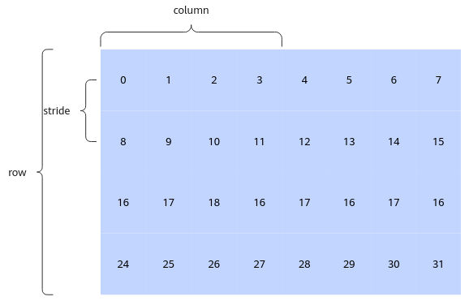

# PhiloxRandom

**页面ID:** atlasascendc_api_07_00005  
**来源:** https://www.hiascend.com/document/detail/zh/CANNCommunityEdition/900/API/ascendcopapi/atlasascendc_api_07_00005.html

---

#### 产品支持情况

| 产品 | 是否支持 |
| --- | --- |
| Atlas 350 加速卡 | √ |
| Atlas A3 训练系列产品/Atlas A3 推理系列产品 | x |
| Atlas A2 训练系列产品/Atlas A2 推理系列产品 | x |
| Atlas 200I/500 A2 推理产品 | x |
| Atlas 推理系列产品AI Core | x |
| Atlas 推理系列产品Vector Core | x |
| Atlas 训练系列产品 | x |

#### 功能说明

基于Philox随机数生成算法，给定随机数种子，生成若干的随机数。

Philox随机数生成的核心算法是一个基于记数的伪随机数生成算法，输入为一个128bit的记数器C，两个32bit的key（k0和k1），输出为4个32bit的整数。

#### 函数原型

- 连续模式

```
template <uint16_t Rounds = 7, typename T>
__aicore__ inline void PhiloxRandom(const LocalTensor<T>& dstLocal, const PhiloxKey& philoxKey, const PhiloxCounter& philoxCounter, uint16_t count)
```

- stride模式

```
template <uint16_t Rounds = 7, typename T>
__aicore__ inline void PhiloxRandom(const LocalTensor<T>& dstLocal, const PhiloxKey& philoxKey, const PhiloxCounter& philoxCounter, const PhiloxRandomParams& params)
```

#### 参数说明

**表1 **模板参数说明

| 参数名 | 描述 |
| --- | --- |
| Rounds | Philox算法内部实现迭代次数，支持取值7或10。 |
| T | 目的操作数数据类型，支持的数据类型为：uint32_t、int32_t、float。 其中uint32_t/int32_t为数据类型范围内的均匀分布，float为0-1范围内的均匀分布。 |

**表2 **参数说明

| 参数名 | 输入/输出 | 描述 |
| --- | --- | --- |
| dstLocal | 输出 | 目的操作数。 类型为LocalTensor，支持的TPosition为VECIN/VECCALC/VECOUT。 LocalTensor的起始地址需要32字节对齐。 |
| 随机数种子。两个32bit的key，定义如下： ``` using PhiloxKey = uint32_t[2]; ``` |  |  |
| 随机数种子。一个128bit的记数器C（由4个32bit组成），定义如下： ``` using PhiloxCounter = uint32_t[4]; ``` |  |  |
| count | 输入 | 生成目的操作数的元素个数。 |
| stride模式计算所需的参数信息。PhiloxRandomParams类型，定义如下： ``` struct PhiloxRandomParams {    uint32_t stride;  // 两行元素之间的间隔    uint32_t row;     // 表示生成的行数    uint32_t column;  // 表示生成的每一行的元素个数 } ```  - row * column大于0，不大于LocalTensor的大小。- column % 4 == 0，stride % 4 == 0，stride >= column。 |  |  |

**图1 **PhiloxRandom示意图


上图是一个生成随机数的示意图。

- 连续模式下使用philoxCounter={0, 0, 0, 0}，count=32来生成32个随机数。
- stride模式下可按列分两次生成，调用两次接口。第一次调用参数为philoxCounter={0, 0, 0, 0}，stride=8，row=4，column=4；第二次调用参数为philoxCounter={1, 0, 0, 0}（每次记数器C自增会生成128bit的随机数），stride=8，row=4，column=4。

#### 约束说明

无

#### 调用示例

完整算子样例请参考[philoxrandom样例](https://gitcode.com/cann/asc-devkit/tree/9.0.0/examples/01_simd_cpp_api/03_libraries/11_random/philoxrandom)。

```
// dstLocal：存放计算结果的Tensor
// philoxKey={0,0}, philoxCounter={0,0,0,0}

// stride模式，生成32*32个元素
PhiloxRandom<10>(dstLocal, philoxKey, philoxCounter, params);
// 连续模式，生成1024个元素
PhiloxRandom<10>(dstLocal, philoxKey, philoxCounter, 1024);
```

结果示例如下：

```
[0.31179297 0.8263413  0.6849456 ... 0.10521233 0.29894042 0.96700084]
```
