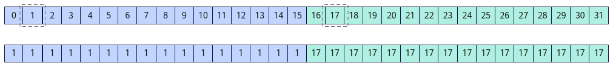

# asc_shfl

**页面ID:** atlasascendc_api_07_10391  
**来源:** https://www.hiascend.com/document/detail/zh/CANNCommunityEdition/900/API/ascendcopapi/atlasascendc_api_07_10391.html

---

#### 产品支持情况

| 产品 | 是否支持 |
| --- | --- |
| Atlas 350 加速卡 | √ |
| Atlas A3 训练系列产品            /             Atlas A3 推理系列产品 | x |
| Atlas A2 训练系列产品            /             Atlas A2 推理系列产品 | x |
| Atlas 200I/500 A2 推理产品 | x |
| Atlas 推理系列产品            AI Core | x |
| Atlas 推理系列产品            Vector Core | x |
| Atlas 训练系列产品 | x |

#### 功能说明

获取Warp内指定线程src_lane输入的用于交换的var值；如果目标线程是非活跃状态，获取到寄存器中未初始化的值。其中，参数width用于划分Warp内线程的分组。参数width设置参与交换的32个线程的分组宽度，默认值为32，即所有线程分为1组。

在多个分组场景（width小于32）下，每个分组交换操作是独立的，当前线程获取本组内线程编号为src_lane的var值。如果src_lane小于分组宽度width，src_lane是相对组内起始线程位置的逻辑LaneId；如果src_lane大于等于width，src_lane%width的结果是相对组内起始线程位置的逻辑LaneId。

例如，Warp内32个活跃线程调用asc_shfl(LaneId, 1, 16)接口，每个线程的返回值为当前线程所在分组内线程编号为1的var值。

**图1 **asc_shfl结果示意图


#### 函数原型

```
inline int32_t asc_shfl(int32_t var, int32_t src_lane, int32_t width = warpSize)
```

```
inline uint32_t asc_shfl(uint32_t var, int32_t src_lane, int32_t width = warpSize)
```

```
inline float asc_shfl(float var, int32_t src_lane, int32_t width = warpSize)
```

```
inline int64_t asc_shfl(int64_t var, int32_t src_lane, int32_t width = warpSize)
```

```
inline uint64_t asc_shfl(uint64_t var, int32_t src_lane, int32_t width = warpSize)
```

```
inline half asc_shfl(half var, int32_t src_lane, int32_t width = warpSize)
```

```
inline half2 asc_shfl(half2 var, int32_t src_lane, int32_t width = warpSize)
```

#### 参数说明

**表1 **参数说明

| 参数名 | 输入/输出 | 描述 |
| --- | --- | --- |
| var | 输入 | 线程用于交换的输入操作数。 |
| src_lane | 输入 | 期望获取的var值所在线程的LaneId。范围为[0, 32)。 |
| width | 输入 | Warp内参与交换的线程的分组宽度，默认值为32。width的取值范围为(0, 32]，width必须是2的倍数。 |

#### 返回值说明

- Warp内指定线程的var值
- 未初始化undefined的值

#### 约束说明

无

#### 需要包含的头文件

使用除half、half2类型之外的接口需要包含"simt_api/device_warp_functions.h"头文件，使用half和half2类型接口需要包含"simt_api/asc_fp16.h"头文件。

```
#include "simt_api/device_warp_functions.h"
```

```
#include "simt_api/asc_fp16.h"
```

#### 调用示例

SIMD与SIMT混合编程场景：

```
__simt_vf__ __launch_bounds__(1024) void KernelShfl(__gm__ int32_t* dst)
{
    // asc_vf_call参数：dim3{1024, 1, 1}
    int idx = threadIdx.x + blockIdx.x * blockDim.x;
    int32_t laneId = idx % 32;
    // 0-15线程返回值为1，16-31线程返回值为17
    int32_t result = asc_shfl(laneId, 1, 16);
    dst[idx] = result;
}
```
