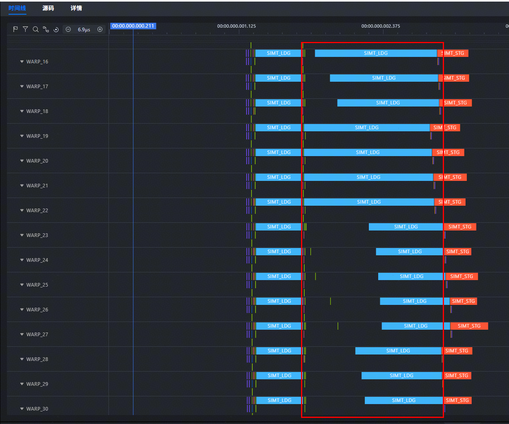
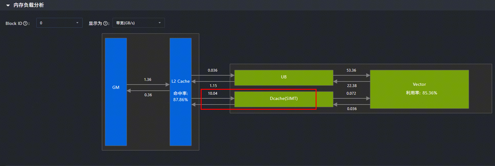
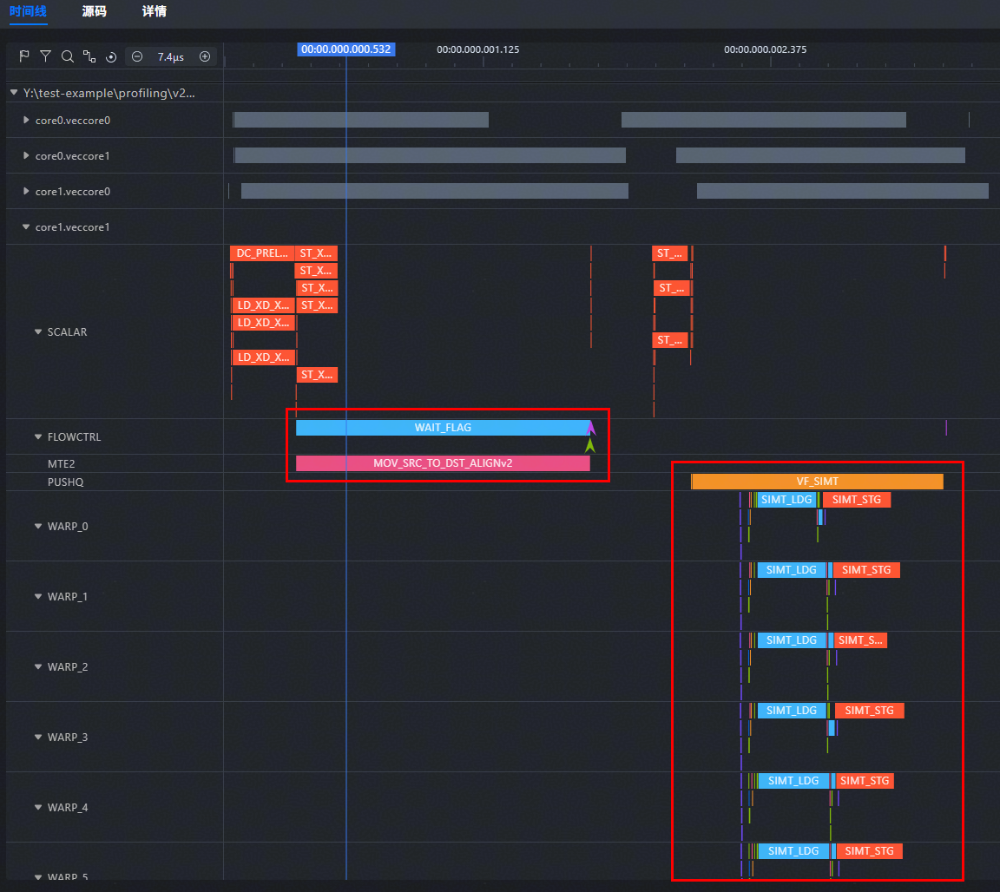
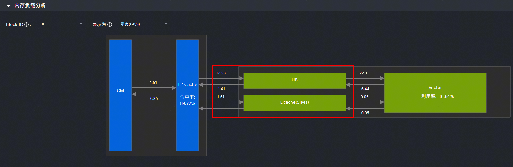
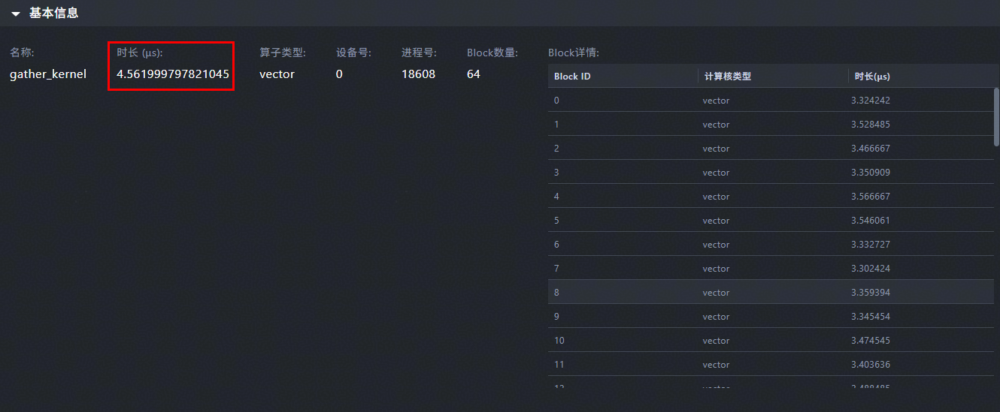
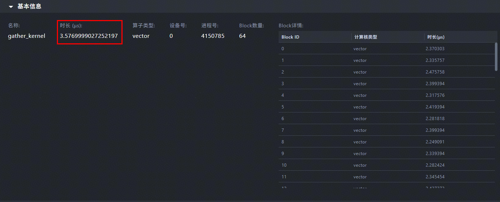

# 使用Unified Buffer提升内存访问效率

**页面ID:** atlas_ascendc_best_practices_10_10029  
**来源:** https://www.hiascend.com/document/detail/zh/CANNCommunityEdition/900/programug/Ascendcopdevg/atlas_ascendc_best_practices_10_10029.html

---

> **注意:** 

该性能优化建议适用于如下型号：

- Atlas 350 加速卡

【优先级】高

【描述】SIMT访问Global Memory的粒度为128B，在随机访问Global Memory中的数据时，访存效率较低。当所需访问的数据量远小于最大可用Unified Buffer空间（256KB - 系统预留8KB - 最小Dcache 32KB）时，可以使用SIMD搬运接口将数据从Global Memory搬运到Unified Buffer，使SIMT编程能够直接从Unified Buffer读取数据，从而提高内存访问效率，提升算子的整体性能。

【样例介绍】以SIMD与SIMT混合编程方式实现的gather算子为例，该算子从长度为8192的一维向量中获取指定索引的65536个数据。通过将输入数据预先搬运到Unified Buffer中，提高离散内存访问的效率，从而提升算子的整体性能。

**表1 **算子规格

| 名称 | name | shape | data type | format |
| --- | --- | --- | --- | --- |
| 算子输入 | input | 8192 | float | ND |
| index | 65536 | uint32_t | ND |  |
| 算子输出 | output | 65536 | float | ND |

SIMT线程层次结构为：

- 线程块数：64
- 单个线程块中线程数：1024

完整样例请参考[SIMD与SIMT混合编程使用UB提高内存访问效率](https://gitcode.com/cann/asc-devkit/tree/9.0.0/examples/01_simd_cpp_api/04_best_practices/03_fusion_compute_practices/simt_gather_with_ub)。

【反例】

    SIMT随机访问Global Memory上的input数据，触发数据加载到Dcache，随机访存效率低，代码如下。

```
namespace {
    constexpr uint32_t THREAD_COUNT = 1024;
    constexpr uint32_t INPUT_SIZE = 8192;
    constexpr uint32_t INDEX_SIZE = 65536;
}

__simt_vf__ __launch_bounds__(THREAD_COUNT) inline void simt_gather(
    __gm__ float* input,
    __gm__ uint32_t* index,
    __gm__ float* output)
{
    int32_t idx = blockIdx.x * blockDim.x + threadIdx.x;

    if (idx >= INDEX_SIZE) {
        return;
    }

    uint32_t gather_idx = index[idx];
    if (gather_idx > INPUT_SIZE) {
        return;
    }

    output[idx] = input[gather_idx];
}

__global__ __vector__ void gather_kernel(__gm__ float* input, __gm__ uint32_t* index, __gm__ float* output)
{
    asc_vf_call<simt_gather>(dim3(THREAD_COUNT), input, index, output);
}
```

【正例】

    使用SIMD接口将数据从Global Memory搬运到Unified Buffer，基于SIMT编程方式直接从Unified Buffer读取数据，访存效率远高于读取Global Memory上的数据，代码如下。

```
namespace {
    constexpr uint32_t THREAD_COUNT = 1024;
    constexpr uint32_t INPUT_SIZE = 8192;
    constexpr uint32_t INDEX_SIZE = 65536;
}

__simt_vf__ __launch_bounds__(THREAD_COUNT) inline void simt_gather(
    __ubuf__ float* input,
    __gm__ uint32_t* index,
    __gm__ float* output)
{
    int32_t idx = blockIdx.x * blockDim.x + threadIdx.x;

    if (idx >= INDEX_SIZE) {
        return;
    }

    uint32_t gather_idx = index[idx];
    if (gather_idx >= INPUT_SIZE) {
        return;
    }

    output[idx] = input[gather_idx];
}

__global__ __vector__ void gather_kernel(__gm__ float* input, __gm__ uint32_t* index, __gm__ float* output)
{
    __ubuf__ float input_buf[INPUT_SIZE];
    uint32_t blk_length = INPUT_SIZE * sizeof(float);
    asc_copy_gm2ub_align(input_buf, input, 1, blk_length, 0, 0, false, 0, 0, 0);

    if ASC_IS_AIV {
        asc_sync_notify(PIPE_MTE2, PIPE_V, EVENT_ID0);
        asc_sync_wait(PIPE_MTE2, PIPE_V, EVENT_ID0);
    }

    asc_vf_call<simt_gather>(dim3(THREAD_COUNT), input_buf, index, output);
}
```

【性能对比】

    下图为反例的流水图，线程中有两条SIMT_LDG指令，对应表示从Global Memory上加载数据，其中第二条指令占用区间分布不均，指令启动时间差异明显，同一个线程块中随机访问输入数据input，单次访存加载128B数据，而针对单精度浮点数，实际有效数据仅为4B，导致访存效率低。
    **图1 **反例指令流水图（仿真数据）


下图为反例的内存负载分析图，L2 Cache到Dcache数据传输带宽为10.04GB/s。

**图2 **反例内存负载分析（上板数据）


下图为正例的流水图，只有一条占用大区间的SIMT_LDG指令，MTE2流水新增搬运指令MOV_SRC_TO_DST_ALIGNv2。

**图3 **正例指令流水图（仿真数据）


下图为正例的内存负载分析图，L2 Cache到Dcache数据传输带宽降低为1.61GB/s，L2 Cache到Unified Buffer数据传输带宽提升至12.93GB/s。

**图4 **正例内存负载分析（上板数据）


对比算子运行时间，反例约为4.56us，正例约为3.57us，整体性能提升约21.71%。

**图5 **反例算子运行时间（上板数据）
**图6 **正例算子运行时间（上板数据）

