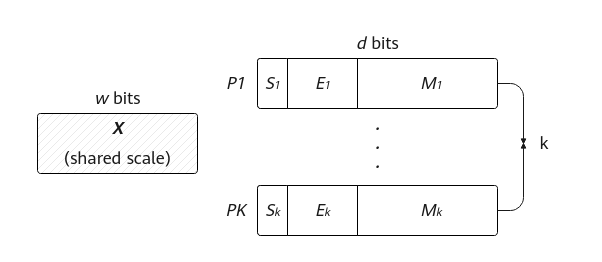
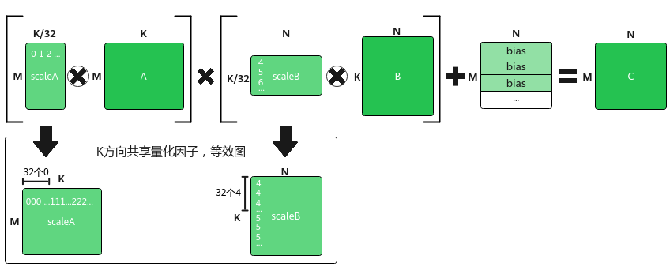
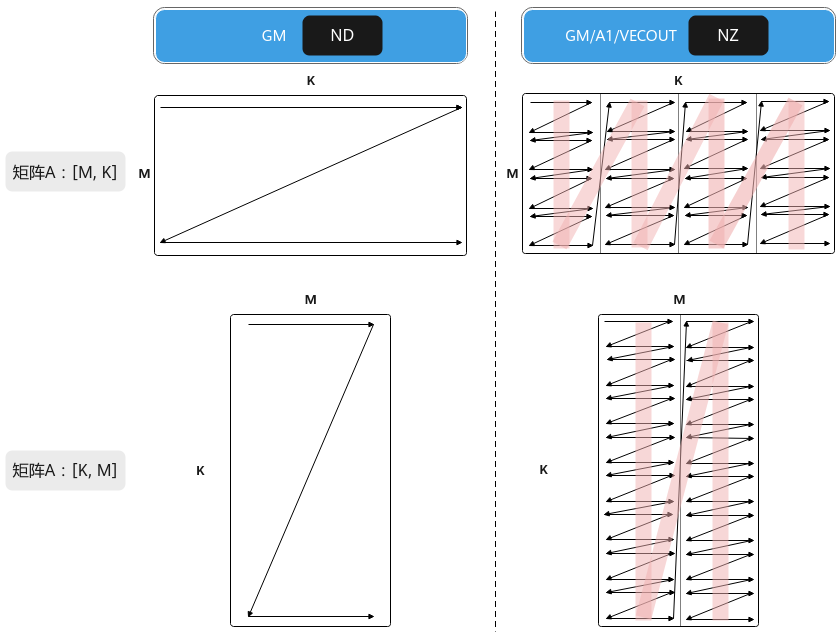
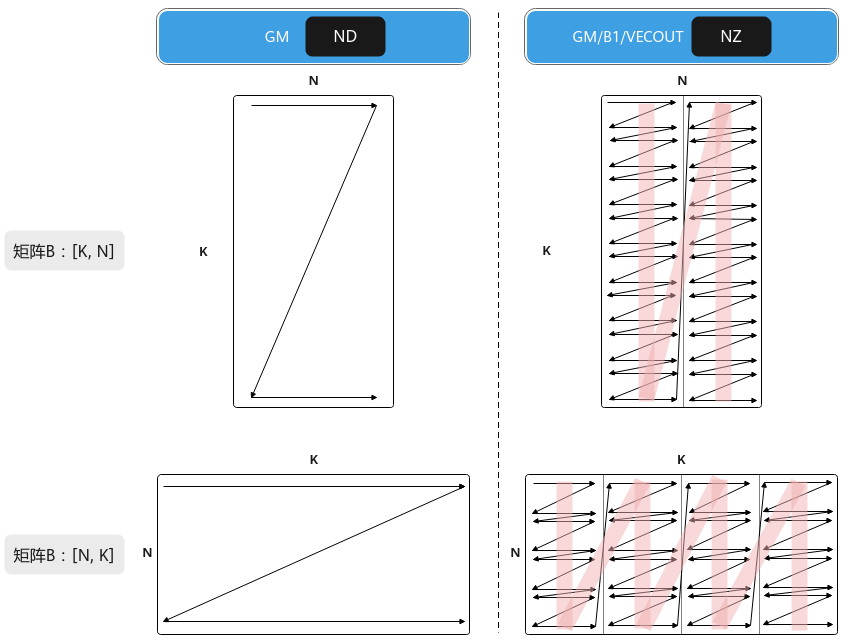
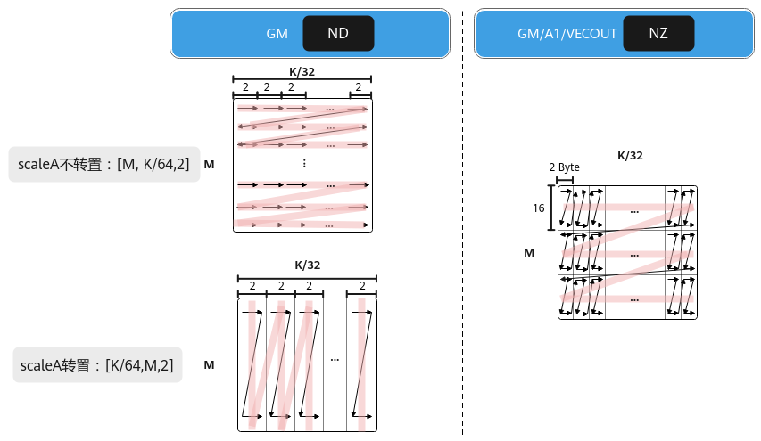
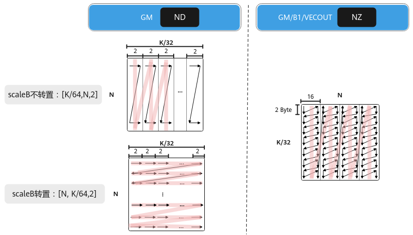

# MxMatmul场景

**页面ID:** atlas_ascendc_10_10029  
**来源:** https://www.hiascend.com/document/detail/zh/CANNCommunityEdition/900/programug/Ascendcopdevg/atlas_ascendc_10_10029.html

---

#### 背景介绍

浮点数在科学计算、图像处理、神经网络等领域应用广泛。以AI训练为例，现有的浮点数格式或数值范围不足，或精度不高，这影响了模型的收敛速度和性能。如果要同时满足数值范围和精度的要求，将会导致内存占用过大，从而增加数据存储和传输的成本。基于此种情况，业内提出了一种新的浮点数格式——微缩放（Microscaling，MX）格式。MX格式的浮点数可以支持更低比特位宽的AI训练和推理，并且占用的内存更少。符合MX标准的数据格式在使用8位或更低比特位的情况下，能够实现稳健的AI训练和推理模型精度。

     MX格式是一种块数据格式，若干个数据可以组成一个块（或者一个组），数据以块为单位。MX格式的数据由三部分构成：

- 共享缩放因子X，位宽为w bits；
- 私有元素Pi，位宽为d bits；
- 块大小k，表示多少个低比特数据形成一个块；

所有k个元素Pi有相同的位宽和数据类型，并且共享一个缩放因子X，每个包含k个元素的块可以使用（w+k*d）位进行编码。元素的数据类型和缩放因子可以独立选择。

下图为MX格式的浮点数的数据结构，S、E和M分别用于表示浮点数的符号、指数和尾数字段的值。其中，共享缩放因子X是一个用于整个数据块的缩放比例因子，它决定了数据块中所有元素的动态范围。通过引入共享缩放因子，MX格式的数据能够在保持低位宽的同时，灵活地表示不同范围的数据。块大小k指的是组成一个数据块（或组）的低比特数据的数量。私有元素Pi是指数据块中的每个低比特数据元素。这些元素经过缩放因子X的调整后，共同表示了一个高精度的浮点数或整数。

**图1 **MX格式组成示意图


MX格式的数据类型包含多种，例如MXFP8、MXFP4、MXFP16、MXINT4等。下表列举了MxMatmul场景（全称Microscaling Matmul）支持的数据类型。

**表1 **MxMatmul支持MX格式的数据类型

| 数据类型 | 私有元素数据类型 | 私有元素位宽（d） | 块大小(k) | 共享缩放因子数据类型 | 共享缩放因子位宽(w) |
| --- | --- | --- | --- | --- | --- |
| MXFP8 | fp8_e5m2_t | 8 | 32 | fp8_e8m0_t | 8 |
| MXFP8 | fp8_e4m3fn_t | 8 | 32 | fp8_e8m0_t | 8 |
| MXFP4 | fp4x2_e1m2_t | 4 | 32 | fp8_e8m0_t | 8 |
| MXFP4 | fp4x2_e2m1_t | 4 | 32 | fp8_e8m0_t | 8 |

#### 功能介绍

MxMatmul（全称Microscaling Matmul）为带有量化系数的矩阵乘法，即左矩阵和右矩阵均有对应的量化系数矩阵，左量化系数矩阵scaleA和右量化系数矩阵scaleB。MxMatmul场景中，左量化系数矩阵与左矩阵乘积，右量化系数矩阵与右矩阵乘积，对两个乘积的结果做矩阵乘法。

MxMatmul的计算公式为：C = (scaleA ⊗ A) * (scaleB ⊗ B) + Bias，“⊗”表示广播乘法，左/右矩阵与左/右量化系数矩阵做乘积时，K方向上每32个元素共享一个量化因子，如图2所示。

- A、scaleA、B、scaleB为源操作数。A为左矩阵，形状为[M, K]；scaleA为左量化系数矩阵，形状为[M, K/32]；B为右矩阵，形状为[K, N]；scaleB为右量化系数矩阵，形状为[K/32, N]。
- C为目的操作数，存放矩阵乘结果的矩阵，形状为[M, N]。
- Bias为矩阵乘偏置，形状为[1, N]。对(scaleA ⊗ A) * (scaleB ⊗ B)结果矩阵的每一行都采用该Bias进行偏置。

**图2 **MxMatmul矩阵乘示意图


矩阵A、scaleA、B、scaleB在不同位置中的排布格式分别如下图所示。

**图3 **A矩阵在不同位置的排布格式
**图4 **B矩阵在不同位置的排布格式
**图5 **scaleA矩阵在不同位置的排布格式
**图6 **scaleB矩阵在不同位置的排布格式


#### 使用场景

矩阵计算之前，需要对A、B矩阵进行量化操作的场景。当前该场景下，Matmul输入输出矩阵支持的数据类型如下表所示。

**表2 **MxMatmul支持的量化场景

| A矩阵 | B矩阵 | ScaleA矩阵/ScaleB矩阵 | Bias矩阵 | C矩阵 | 支持平台 |
| --- | --- | --- | --- | --- | --- |
| fp4x2_e1m2_t | fp4x2_e1m2_t/fp4x2_e2m1_t | fp8_e8m0_t | float/half/bfloat16_t | float/half/bfloat16_t | Atlas 350 加速卡 |
| fp4x2_e2m1_t | fp4x2_e2m1_t/fp4x2_e1m2_t | fp8_e8m0_t | float/half/bfloat16_t | float/half/bfloat16_t | Atlas 350 加速卡 |
| fp8_e4m3fn_t | fp8_e4m3fn_t/fp8_e5m2_t | fp8_e8m0_t | float/half/bfloat16_t | float/half/bfloat16_t | Atlas 350 加速卡 |
| fp8_e5m2_t | fp8_e4m3fn_t/fp8_e5m2_t | fp8_e8m0_t | float/half/bfloat16_t | float/half/bfloat16_t | Atlas 350 加速卡 |

#### 实现流程

Host侧自动获取Tiling参数的关键步骤介绍如下：

1. **创建Tiling对象**。

```
auto ascendcPlatform = platform_ascendc::PlatformAscendC(context->GetPlatformInfo());
matmul_tiling::MatmulApiTiling cubeTiling(ascendcPlatform);
```

传入硬件平台信息创建PlatformAscendC对象，然后创建Tiling对象，硬件平台信息可以通过GetPlatformInfo获取。

2. **设置A、B、C、Bias的内存逻辑位置、格式、数据类型以及是否转置的信息，设置scaleA、scaleB的内存逻辑位置、格式以及是否转置的信息。**

       调用SetScaleAType、SetScaleBType接口，设置scaleA、scaleB的内存逻辑位置、格式以及是否转置。

```
cubeTiling.SetAType(AscendC::TPosition::GM, CubeFormat::ND, matmul_tiling::DataType::DT_FLOAT8_E5M2, false);
cubeTiling.SetBType(AscendC::TPosition::GM, CubeFormat::ND, matmul_tiling::DataType::DT_FLOAT8_E5M2, true);
cubeTiling.SetScaleAType(AscendC::TPosition::GM, CubeFormat::ND, false);
cubeTiling.SetScaleBType(AscendC::TPosition::GM, CubeFormat::ND, true);
cubeTiling.SetCType(AscendC::TPosition::GM, CubeFormat::ND, matmul_tiling::DataType::DT_FLOAT);
cubeTiling.SetBiasType(AscendC::TPosition::GM, CubeFormat::ND, matmul_tiling::DataType::DT_FLOAT);
```

3. **使能****MxMatmul场景**。

       调用SetMadType接口，设置Tiling计算逻辑为MxMatmul场景。

```
cubetiling.SetMadType(MatrixMadType::MXMODE);
```

4. **设置矩阵shape信息。**

```
cubeTiling.SetShape(M, N, K);
cubeTiling.SetOrgShape(M, N, K); // 设置原始完整的形状M、N、K
```

5. **设置可用空间大小信息。**

       设置Matmul计算时可用的L1 Buffer/L0C Buffer/Unified Buffer空间大小，-1表示AI处理器对应Buffer的大小。

```
cubeTiling.SetBufferSpace(-1, -1, -1);
```

6. **按需设置其他参数，比如设置bias参与计算。**

```
cubeTiling.EnableBias(true);
```

7. **获取Tiling参数。**

```
MatmulCustomTilingData tiling;
if (cubeTiling.GetTiling(tiling.cubeTilingData) == -1){ 
    return ge::GRAPH_FAILED;  
}
```

8. Tiling参数的序列化保存等其他操作。

Kernel侧的关键步骤介绍如下：

1. **创建Matmul对象****。**

```
// MxMatmul场景通过MatmulTypeWithScale定义A、scaleA、B、scaleB的参数类型信息
typedef AscendC::MatmulTypeWithScale<AscendC::TPosition::GM, AscendC::TPosition::GM, CubeFormat::ND, fp8_e5m2_t, isTransposeA> aType; 
typedef AscendC::MatmulTypeWithScale<AscendC::TPosition::GM, AscendC::TPosition::GM, CubeFormat::ND, fp8_e5m2_t, isTransposeB> bType;
typedef AscendC::MatmulType<AscendC::TPosition::GM, CubeFormat::ND, float> cType; 
typedef AscendC::MatmulType<AscendC::TPosition::GM, CubeFormat::ND, float> biasType; 
// 定义matmul对象时，传入MatmulWithScalePolicy表明使能MxMatmul模板策略
AscendC::Matmul<aType, bType, cType, biasType, CFG_MDL, MatmulCallBackFunc<nullptr, nullptr, nullptr>, AscendC::Impl::Detail::MatmulWithScalePolicy> mm;
```

创建对象时需要传入A、scaleA、B、scaleB、C、Bias的参数类型信息， A、scaleA、B、scaleB类型信息通过MatmulTypeWithScale来定义，C、Bias类型信息通过MatmulType来定义，包括：内存逻辑位置、数据格式、数据类型、转置信息。同时，通过模板参数MatmulPolicy传入MatmulWithScalePolicy表明使能MxMatmul场景。

```
template <TPosition POSITION, TPosition SCALE_POSITION, CubeFormat FORMAT, typename TYPE, bool ISTRANS = false, TPosition SRCPOS = TPosition::GM, CubeFormat SCALE_FORMAT = FORMAT, bool SCALE_ISTRANS = ISTRANS, TPosition SCALE_SRCPOS = SRCPOS>
struct MatmulTypeWithScale: public MatmulType<POSITION, FORMAT, TYPE, ISTRANS> {
    constexpr static TPosition scalePosition = SCALE_POSITION;
    constexpr static CubeFormat scaleFormat = SCALE_FORMAT;
    constexpr static bool isScaleTrans = SCALE_ISTRANS;
    constexpr static TPosition srcScalePos = SCALE_SRCPOS;
};
```

2. **初始化操作。**

```
REGIST_MATMUL_OBJ(&pipe, GetSysWorkSpacePtr(), mm, &tiling); // 初始化
```

3. **设置左矩阵A、右矩阵B、左量化系数矩阵scaleA、右量化系数矩阵scaleB、Bias。**

       通过SetTensorScaleA、SetTensorScaleB设置左量化系数矩阵scaleA、右量化系数矩阵scaleB。

```
mm.SetTensorA(gm_a, isTransposeA);    // 设置左矩阵A
mm.SetTensorB(gm_b, isTransposeB);    // 设置右矩阵B
mm.SetTensorScaleA(gm_scaleA, isTransposeScaleA);    // 设置左量化系数矩阵scaleA
mm.SetTensorScaleB(gm_scaleB, isTransposeScaleB);    // 设置右量化系数矩阵scaleB
mm.SetBias(gm_bias);    // 设置Bias
```

4. **完成矩阵乘操作。**

  - 调用Iterate完成单次迭代计算，叠加while循环完成单核全量数据的计算。Iterate方式，可以自行控制迭代次数，完成所需数据量的计算，方式比较灵活。

```
while (mm.Iterate()) {   
    mm.GetTensorC(gm_c); 
}
```

  - 调用IterateAll完成单核上所有数据的计算。IterateAll方式，无需循环迭代，使用比较简单。

```
mm.IterateAll(gm_c);
```

5. **结束矩阵乘操作。**

```
mm.End();
```

更多完整的算子样例请参考[Scale的K方向为偶数的MxMatmul样例](https://gitcode.com/cann/asc-devkit/tree/9.0.0/examples/01_simd_cpp_api/03_libraries/00_matrix/matmul_mx_norm_even)、[Scale的K方向为奇数的MxMatmul样例](https://gitcode.com/cann/asc-devkit/tree/9.0.0/examples/01_simd_cpp_api/03_libraries/00_matrix/matmul_mx_norm_odd)、[mx_ub_tscm_nz样例](https://gitcode.com/cann/asc-devkit/tree/9.0.0/examples/01_simd_cpp_api/03_libraries/00_matrix/matmul_mx_ub_tscm_nz)、[matmul_mx_typepara样例](https://gitcode.com/cann/asc-devkit/tree/9.0.0/examples/01_simd_cpp_api/03_libraries/00_matrix/matmul_mx_typepara)。

#### 参数说明

**表3 **MatmulTypeWithScale参数说明

| 参数 | 说明 |
| --- | --- |
| POSITION | 左右矩阵的内存逻辑位置。          针对Atlas 350 加速卡：          A矩阵可设置为TPosition::GM，TPosition::VECOUT，TPosition::TSCM          B矩阵可设置为TPosition::GM，TPosition::VECOUT，TPosition::TSCM          注意：A、B矩阵设置为TPosition::TSCM时，对应的Format仅支持CubeFormat::NZ。 |
| SCALE_POSITION | 量化系数矩阵的内存逻辑位置。          针对Atlas 350 加速卡：          scaleA矩阵可设置为TPosition::GM，TPosition::VECOUT，TPosition::TSCM          scaleB矩阵可设置为TPosition::GM，TPosition::VECOUT，TPosition::TSCM          注意：scaleA、scaleB矩阵设置为TPosition::TSCM时，对应的SCALE_FORMAT仅支持CubeFormat::NZ。 |
| FORMAT | 数据的物理排布格式，详细介绍请参考数据格式。          针对Atlas 350 加速卡：          A矩阵可设置为CubeFormat::ND，CubeFormat::NZ，CubeFormat::VECTOR          B矩阵可设置为CubeFormat::ND，CubeFormat::NZ          注意：NZ排布格式，A/B的排布格式请参考数据格式。 |
| TYPE | 数据类型。          针对Atlas 350 加速卡：          A矩阵可设置为fp4x2_e1m2_t、fp4x2_e2m1_t、fp8_e4m3fn_t、fp8_e5m2_t          B矩阵可设置为fp4x2_e1m2_t、fp4x2_e2m1_t、fp8_e4m3fn_t、fp8_e5m2_t          **注意：具体数据类型组合关系请参考**MxMatmul支持数据类型。 |
| ISTRANS | 是否开启使能A、B矩阵转置的功能。默认值为false。参数支持的取值如下：          true：开启使能矩阵转置的功能，开启后，分别通过SetTensorA和SetTensorB中的isTransposeA、isTransposeB参数设置A、B矩阵是否转置。若设置A、B矩阵转置，Matmul会认为A矩阵形状为[K, M]，B矩阵形状为[N, K]。          false：不开启使能矩阵转置的功能，通过SetTensorA和SetTensorB不能设置A、B矩阵的转置情况。Matmul会认为A矩阵形状为[M, K]，B矩阵形状为[K, N]。 |
| SRCPOS | A/B矩阵的POSITION参数配置为TPosition::TSCM时，要设置TSCM中矩阵数据的来源的内存逻辑位置，默认为TPosition::GM。          针对Atlas 350 加速卡：          A矩阵可设置为TPosition::GM，TPosition::VECOUT          B矩阵可设置为TPosition::GM，TPosition::VECOUT |
| SCALE_FORMAT | 量化系数矩阵的物理排布格式，详细介绍请参考数据格式。默认值为FORMAT。          针对Atlas 350 加速卡：          scaleA矩阵可设置为CubeFormat::ND，CubeFormat::NZ，CubeFormat::VECTOR          scaleB矩阵可设置为CubeFormat::ND，CubeFormat::NZ          注意：          NZ排布格式请参考NZ。MxMatmul场景，scaleA、scaleB的数据类型为fp8_e8m0_t，分形大小H0=16，W0=2。          在Scale矩阵为ND格式的场景中，当通过SetTensorScaleA接口设置scaleA矩阵转置时，scaleA内存排布格式必须按照(K/64, M，2)排布，通过SetTensorScaleB接口设置scaleB矩阵不转置时，scaleB内存排布格式必须按照(K/64，N， 2)排布，详细介绍请参考数据格式。 |
| SCALE_ISTRANS | 是否开启使能scaleA、scaleB矩阵转置的功能。默认值为ISTRANS。参数支持的取值如下：          true：开启使能矩阵转置的功能。开启后，分别通过SetTensorScaleA和SetTensorScaleB中的isTransposeScaleA、isTransposeScaleB参数设置scaleA、scaleB矩阵是否转置。在Scale矩阵为ND格式的场景中，若设置scaleA、scaleB矩阵转置，Matmul会认为scaleA矩阵形状为[Ceil(K/64), M, 2]，scaleB矩阵形状为[N, Ceil(K/64), 2]。          false：不开启使能矩阵转置的功能。通过SetTensorScaleA和SetTensorScaleB不能设置scaleA、scaleB矩阵的转置情况。Matmul会认为scaleA矩阵形状为[M, Ceil(K/64), 2]，scaleB矩阵形状为[Ceil(K/64), N, 2]。          使用该参数的完整样例请参考[scaleA转置scaleB不转置的的MxMatmul样例](https://gitcode.com/cann/asc-devkit/tree/9.0.0/examples/01_simd_cpp_api/03_libraries/00_matrix/matmul_mx_scalea_trans)、[scaleA不转置scaleB转置的的MxMatmul样例](https://gitcode.com/cann/asc-devkit/tree/9.0.0/examples/01_simd_cpp_api/03_libraries/00_matrix/matmul_mx_scaleb_trans)。 |
| SCALE_SRCPOS | scaleA、scaleB矩阵的SCALE_POSITION参数设置为TPosition::TSCM时，需要通过本参数设置TSCM中矩阵数据来源的内存逻辑位置，默认值为SRCPOS。          针对Atlas 350 加速卡：          scaleA矩阵可设置为TPosition::GM，TPosition::VECOUT          scaleB矩阵可设置为TPosition::GM，TPosition::VECOUT |

#### 约束说明

- MxMatmul场景仅支持Norm模板和MDL模板。

- 在MxMatmul场景中，如果A与B矩阵的位置同时为GM，对singleKIn没有特殊限制，在这种情况下，若scaleA和scaleB的K方向大小（即Ceil(singleKIn, 32)）为奇数，用户需自行在scaleA和scaleB的K方向补0至偶数。例如，当singleKIn为30时，Ceil(singleKIn, 32)为1，用户需要自行在scaleA和scaleB的K方向补0，使K方向为偶数。对于其它A、B矩阵逻辑位置的组合情况，即A与B矩阵的位置不同时为GM，singleKIn以32个元素向上对齐后的数值必须是32的偶数倍。
- 在MxMatmul场景中，当输入数据类型为fp4x2_e2m1_t/fp4x2_e1m2_t时，内轴必须为偶数。
- 在MxMatmul场景中，通过将A矩阵和scaleA矩阵的数据格式设置为VECTOR，来开启GEMV模式。在此模式下，A和scaleA矩阵仅支持内存逻辑位置为GM，并且均不支持转置。
- A矩阵、B矩阵为UB输入时，矩阵的内轴需要向上32字节对齐，例如，A矩阵的形状为(M, K)时，将K对齐到32字节；A矩阵的形状为(K, M)时，将M对齐到32字节。
- scaleA矩阵、scaleB矩阵为UB输入时，矩阵的内轴需要向上32字节对齐，例如，scaleA矩阵的形状为(M, K/32)时，将K/32对齐到32字节；scaleA矩阵的形状为(K/32, M)时，将M对齐到32字节。
- 当scaleA和scaleB矩阵以ND格式输入时，高阶API在内部实现格式转换时，需要占用UB临时空间。开发者需使用SetLocalWorkspace接口配置临时空间，临时空间大小（单位字节）的计算公式如下。

```
int32_t scaleATmpBuf = 0;
int32_t scaleBTmpBuf = 0;
if constexpr (A_TYPE::scalePosition == TPosition::VECOUT) {
    if (A_TYPE::isScaleTrans) {
        scaleATmpBuf = CeilAlign(SingleCoreM, 32) * scaleK;
    } else {
        scaleATmpBuf = CeilAlign(scaleK, 32) * SingleCoreM;
    }
}
if constexpr (B_TYPE::scalePosition == TPosition::VECOUT) {
    if (B_TYPE::isScaleTrans) {
        scaleBTmpBuf = SingleCoreN * CeilAlign(scaleK, 32);
    } else {
        scaleBTmpBuf = scaleK * CeilAlign(SingleCoreN, 32);
    }
}
int32_t totalTmpBuf = scaleATmpBuf + scaleBTmpBuf;
```
