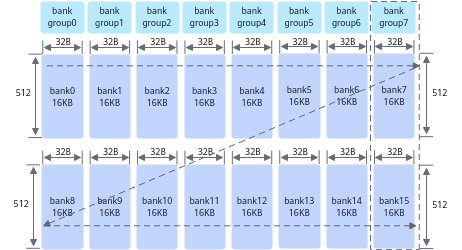
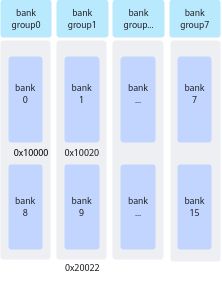
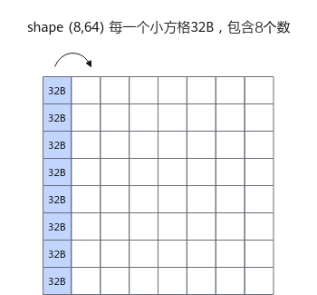
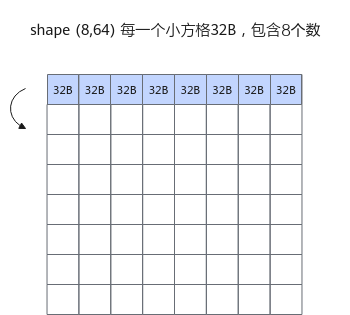
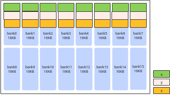
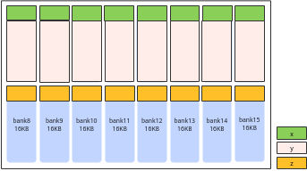

# 避免bank冲突（Atlas 350 加速卡）

**页面ID:** atlas_ascendc_best_practices_10_00021  
**来源:** https://www.hiascend.com/document/detail/zh/CANNCommunityEdition/900/programug/Ascendcopdevg/atlas_ascendc_best_practices_10_00021.html

---

为了提高数据访问的效率和吞吐量，Unified Buffer采用了bank（大小相等的内存模块）结构设计。Unified Buffer总大小为256K，划分为16个bank。每个bank由512行组成，每行长度为32B。这16个bank进一步组织为8个bank group，每个bank group包含2个bank，例如bank7和bank15组成一个bank group。

**图1 **bank结构示意图（图中箭头方向表示内存排布的顺序）


每个bank可以独立地进行数据的读写操作，允许多个数据请求同时进行。然而，当多个读写操作试图同时访问同一个bank，由于硬件资源的限制，这些操作必须排队等待，会导致bank冲突，引起性能下降。

具体来说，Vector计算单元每拍（一个指令周期）能够从每个bank group中读取或写入一行数据。当多个读写操作试图同时访问同一个bank，Vector计算单元无法在同一个周期内处理所有请求，导致这些请求排队等待。这种排队增加了数据访问的延迟，降低了系统的整体性能。

#### bank冲突的典型场景

bank冲突主要可以分为以下三种场景：

- **读写冲突**：读操作和写操作同时尝试访问同一个bank。
- **写写冲突**：多个写操作同时尝试访问同一个bank group。
- **读读冲突**：两个读操作同时尝试访问同一个bank，或者两个以上读操作同时尝试访问同一个bank group。

下文给出了一些具体的示例，假设，0x10000地址在bank0上，0x10020在bank1上，如下图所示：

**图2 **地址分配示意图


- 读写冲突示例

Vector指令的源操作数src和目的操作数dst同时读写到同一个bank时造成读写冲突，具体分析如下：

**表1 **读写冲突示例

| 序号 | src地址 | dst地址 | bank | bank group | 结论 |
| --- | --- | --- | --- | --- | --- |
| 示例1 | 0x10020 | 0x10000 | bank_id0 != bank_id1 | bank_group_id0 != bank_group_id1 | src地址和dst地址分别属于bank0和bank1，故无冲突。 |
| 示例2 | 0x10020 | 0x10120 | bank_id0 == bank_id1 | bank_group_id0 == bank_group_id1 | src地址和dst地址的地址都在bank0，故存在冲突。 |

- 写写冲突示例Vector指令目的操作数dst对应的8个DataBlock（block0-block7）同时写到一个bank group时造成写写冲突，具体分析如下：

**表2 **写写冲突示例

| 序号 | dst地址 | blk_stride | block0_addr | block1_addr | block2_addr | ... | 结论 |
| --- | --- | --- | --- | --- | --- | --- | --- |
| 示例1 | 0x10000 | 8 | 0x10000 | 0x10100 | 0x10200 | ... | 8个DataBlock均在一个bank group下，故全部冲突，8拍完成一个Repeat的写入。 |

- 读读冲突

  - Vector指令两个源操作数同时读到同一个bank时造成读读冲突，具体分析如下：

**表3 **双src场景读读冲突示例

| 序号 | src0地址 | src1地址 | bank | bank group | 结论 |
| --- | --- | --- | --- | --- | --- |
| 示例1 | 0x10000 | 0x10100 | bank_id0 == bank_id1 | bank_group_id0 == bank_group_id1 | 存在冲突。 |
| 示例2 | 0x10000 | 0x10020 | bank_id0 != bank_id1 | bank_group_id0 != bank_group_id1 | 无冲突。 |

  - Vector指令某一个源操作数对应的8个DataBlock(block0-block7）读到同一个bank时造成读读冲突，具体分析如下：

**表4 **单src场景读读冲突示例

| 序号 | src地址 | blk_stride | block0_addr | block1_addr | block2_addr | ... | 结论 |
| --- | --- | --- | --- | --- | --- | --- | --- |
| 示例1 | 0x10000 | 8 | 0x10000 | 0x10100 | 0x10200 | ... | 8个DataBlock均在一个bank下，故全部冲突，8拍完成一个Repeat的读操作。 |

#### 如何避免bank冲突

避免bank冲突的方法有两种：**优化计算逻辑**和**优化地址分配**。

- **优化计算逻辑**

对一个数据类型为float，shape为(16, 64)的输入每个元素加1。通过将计算逻辑由逐列计算改为逐行计算可避免同一Repeat下的冲突问题，实现方案对比如下：

| 实现方案 | 原始实现 | 优化实现 |
| --- | --- | --- |
| 实现方法 | 逐列计算，同一Repeat内输入的8个DataBlock都在同一个bank而发生读读冲突。 | 逐行计算，同一个Repeat内输入的8个DataBlock不在同一个bank内，避免了同一Repeat内的读读冲突。 |
| 示意图 |  |  |
| ``` uint64_t mask = 64; AscendC::UnaryRepeatParams params; params.dstBlkStride = 1; params.srcBlkStride = 1; for(uint16_t i = 0; i < 8; ++i){     AscendC::Adds(dst[i * 64], src[i * 64], 1, mask, 1, params); } ``` |  |  |

- **优化地址分配**

实现连续4096个float元素的加法z = x + y，通过在内存分配时适当扩大内存，保证在一个Repeat内，x/y和z不会同时出现同一个bank内。

实现方案对比如下：

| 实现方案 | 原始实现 | 优化实现 |
| --- | --- | --- |
| 实现方法 | 不做地址优化，直接使用InitBuffer分配内存，各个Tensor的地址分别为： x：起始地址0x00000，tensor长度为4096 * sizeof(float)字节 y：起始地址0x04000，tensor长度为4096 * sizeof(float)字节 z：起始地址0x08000，tensor长度为4096 * sizeof(float)字节 在一个Repeat内，x和y同时读同一个bank group，x/y和z同时读写同一个bank。 | 优化地址，使用InitBuffer分配内存时适当扩大内存申请，各个Tensor的地址分别为： x：起始地址0x00000，tensor长度为4096 * sizeof(float) 字节 y：起始地址0x04000，tensor长度为(8 * 16 * 1024 - (4096 * sizeof(float) )字节 z：起始地址0x20000，tensor长度为4096 * sizeof(float) 字节 y多申请空间，确保z不会和x/y落入同一个bank。 |
| 示意图 |  |  |
| ``` constexpr int32_t TOTAL_LENGTH = 1024 * 4; constexpr int32_t BUFFER_NUM = 1; constexpr int32_t BANKGROUP_SIZE  =  1024 * 128;  ... pipe.InitBuffer(inQueueX, BUFFER_NUM, TOTAL_LENGTH * sizeof(float)); pipe.InitBuffer(inQueueY, BUFFER_NUM, BANKGROUP_SIZE - TOTAL_LENGTH * sizeof(float)); pipe.InitBuffer(outQueueZ, BUFFER_NUM, TOTAL_LENGTH * sizeof(float)); ``` |  |  |
