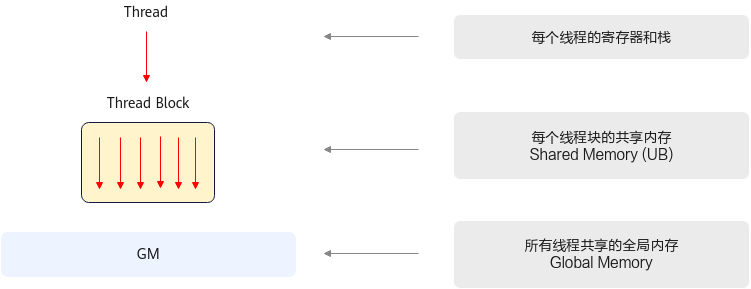
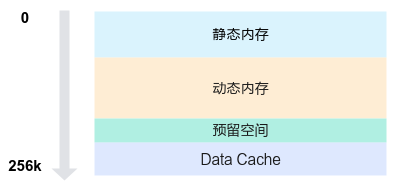

# 内存层级

**页面ID:** atlas_ascendc_10_10066  
**来源:** https://www.hiascend.com/document/detail/zh/CANNCommunityEdition/900/programug/Ascendcopdevg/atlas_ascendc_10_10066.html

---

SIMT线程可访问多种内存空间。下表汇总了SIMT编程中常见内存类型的作用域及其生命周期。

| 内存类型 | 线程作用域 | 生命周期 | 物理位置 |
| --- | --- | --- | --- |
| 全局内存 | Grid | 应用程序 | Device |
| 共享内存 | Block | 核函数 | Vector Core |
| 栈 | Thread | 核函数 | Device |
| 寄存器 | Thread | 核函数 | Vector Core |

- 全局内存是所有线程均可直接访问的内存资源，即Global Memory；
- 共享内存是线程块内所有线程共享的内存，即Unified Buffer，生命周期和线程块一致。
- 每个线程独立的寄存器和栈，用于存储局部变量。

内存层级如下图所示。



#### 全局内存（Global Memory）

Device侧的全局内存是整个Grid中所有线程均可访问的内存空间，其作用与CPU系统中的随机存取存储器（RAM）相似，运行在Device侧的核函数可直接访问全局内存，这种方式与CPU上代码访问系统内存的方式相同。

全局内存具有持久性：通过全局内存分配的空间、其中存储的数据将持续保留，直到该内存空间被释放或应用程序终止。用户通过Runtime API完成Device侧全局内存的管理。Host使用aclrtMalloc分配Device侧的全局内存，并通过aclrtMemcpy将数据从Host拷贝到Device侧的全局内存，或将数据从Device的全局内存拷贝回Host内存；通过aclrtMalloc分配的Device全局内存需使用aclrtFree接口释放。有关Runtime API的更多信息与细节，可以参考《Runtime运行时 API》章节。

在实际开发过程中，用户需在核函数启动前，通过Runtime API完成全局内存的分配与初始化；在核函数执行期间，SIMT每个线程均可读取和写入数据到全局内存；核函数执行完毕后，其写入全局内存的结果可拷贝回Host。由于全局内存对Grid内所有线程均开放访问，因此必须严格规避线程间的数据竞争。

下述代码为全局内存的使用提供了简易示例。数组 x、y、z 均存储于全局内存中，通过以下核函数实现每个线程对全局内存的访问和存储。

```
__global__ void add_custom(float* x, float* y, float* z, uint64_t total_length)
{
    // Calculate global thread ID
    int32_t idx = blockIdx.x * blockDim.x + threadIdx.x;
    // Maps to the row index of output tensor
    if (idx >= total_length) {
        return;
    }
    z[idx] = x[idx] + y[idx];
}
```

#### 共享内存（Unified Buffer）

共享内存是同一线程块内所有线程均可访问的内存空间，位于每个Vector Core（AIV）内部。与全局内存相比，共享内存的容量较小，但具有更高的带宽和更低的访问延迟，可视为内核执行期间由用户管理的高速缓存资源。由于共享内存可被线程块内的全部线程访问，因此需要注意避免同一线程块内线程间的数据竞争。通过使用asc_syncthreads接口，可以实现同一线程块内的线程同步，该函数会阻塞线程块内的所有线程，直至所有线程均执行到接口调用位置。

用户可通过动态或者静态方式申请共享内存。

1. 静态申请：分配一段指定大小的内存空间，其大小在编译时确定，不可动态修改，开发者通过数组分配申请使用。***该方式将在后续版本中支持***。

```
__ubuf__ half staticBuf[1024];
```

2. 动态申请：用户需要通过<<<>>>中参数dynUBufSize指定动态内存的空间大小，其大小在运行期确定，SIMT编程中可通过以下方式申请使用动态内存。***该方式将在后续版本中支持***。

```
extern __ubuf__ char dynamicBuf[];
```

由于Unified Buffer不仅作为共享内存，还有部分内存空间预留作内部使用，因此用户在申请共享内存时，应注意不能将所有共享内存用尽。如下图，Unified Buffer内存空间总大小为256KB，按功能划分为四个主要区域，从低地址到高地址依次为静态内存、动态内存、 预留空间和Data Cache。



具体结构如下：

1. 静态内存和动态内存对应用户静态、动态申请方式分配的内存。
2. 预留空间：编译器和Ascend C预留空间，大小固定为8KB。
3. Data Cache：SIMT专有的Data Cache空间，用于SIMT线程访问全局内存时的数据缓存，Data Cache的空间可配置范围在32KB到128KB，实际内存大小受用户配置的静态和动态内存大小影响，简单计算公式为DataCache空间大小 = UB大小（256KB） - 静态内存 - 动态内存 - 预留空间（8KB）。用户需要合理配置静态和动态内存大小，以确保Data Cache大于或等于32KB。

> **注意:** 

**静态内存分配、动态内存的动态数组分配方式目前开发中，将在后续版本中支持，请关注后续版本。**

- 若DataCache小于32KB，会出现校验报错。
- SIMT场景，算子开发不能使用全部的Unified Buffer空间，除了预留8KB空间外，还需至少为SIMT预留32KB的Data Cache空间。

#### 寄存器

     SIMT编程中，每个线程拥有独立的寄存器，其生命周期与核函数一致。寄存器的使用由编译器管理，并在核函数执行期间用于线程的局部存储。线程执行时可用寄存器数量与用户配置的blockDim有关，详见下表。 

**表1 **LAUNCH_BOUND的Thread数量与每个Thread可用寄存器数

| blockDim大小 | 每个Thread可用寄存器个数(个) |
| --- | --- |
| 1025~2048 | 16 |
| 513~1024 | 32 |
| 257~512 | 64 |
| 1~256 | 127 |

从上表可知，每个线程块中的线程数量越多，每个线程可使用的寄存器数量就越少。如果用户设置的线程数量过大，而每个线程的计算复杂度又较高时，编译器由于缺乏足够的寄存器来存储本地变量，可能会将数据临时存放到堆栈空间，从而极易导致寄存器溢出（stack spill），影响算子性能。因此，用户应根据实际的算子复杂度，合理配置blockDim。
