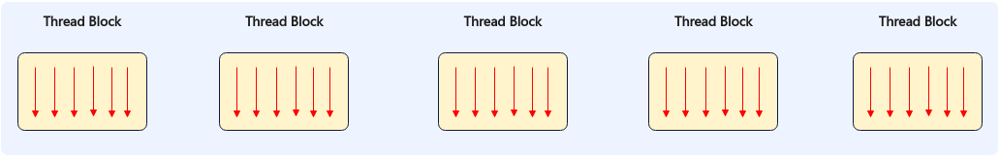
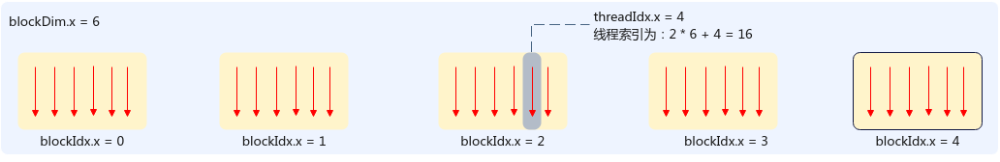

# 线程架构

**页面ID:** atlas_ascendc_10_10065  
**来源:** https://www.hiascend.com/document/detail/zh/CANNCommunityEdition/900/programug/Ascendcopdevg/atlas_ascendc_10_10065.html

---

SIMT编程模型的线程层次结构分为两层：

- 线程块网格（Grid）：由多个线程块（Thread Block）组成，使用内置变量gridDim来表示启用的线程块的个数，同一时刻一个AIV核只执行一个线程块任务。
- 线程块（Thread Block）：由若干线程（thread）组成，使用内置变量blockDim表示一个线程块启用的的线程个数，一个线程块最多可以启用2048个线程。

基于SIMT编程模型的程序，在AIV核上执行多个结构相同的线程块，执行的总线程数等于gridDim*blockDim。

gridDim由三维结构dim3来表示，{dimx，dimy，dimz}用于指定3个不同维度的线程块的大小，三维乘积的总数不超过65535，各线程块可通过线程块索引blockIdx进行标识。blockDim也由dim3三维结构表示，三维乘积的总数不超过2048，各线程可通过线程块内线程索引threadIdx进行标识。线程索引的计算示例如下图所示：

底层调度过程中，同一时刻一个AIV只能执行一个线程块任务，每个线程块会被切分成多个Warp。Warp是执行相同指令的线程的集合，每个Warp包含32个线程。每个AIV核包含4个Warp调度器（Warp Scheduler），调度器编号scheduler id为warp id % 4。在每个调度周期内，每个Warp调度器从其需要调度处理的Warp集合中选取一个就绪状态的Warp发射指令。
