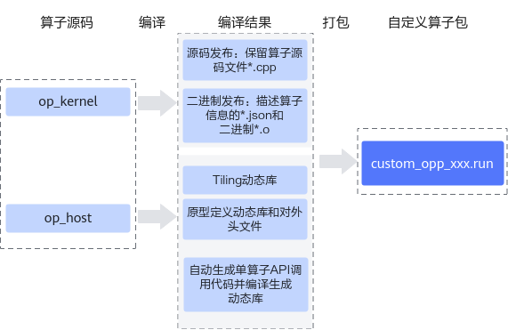

# 算子工程编译

**页面ID:** atlas_ascendc_10_0068  
**来源:** https://www.hiascend.com/document/detail/zh/CANNCommunityEdition/900/programug/Ascendcopdevg/atlas_ascendc_10_0068.html

---

算子kernel侧和host侧实现开发完成后，需要对算子工程进行编译，生成自定义算子安装包*.run，详细的编译操作包括：

- 编译Ascend C算子kernel侧代码实现文件*.cpp，分为源码发布和二进制发布两种方式。

  - **源码发布：**不对算子kernel侧实现进行编译，保留算子kernel源码文件*.cpp。该方式可以支持算子的在线编译、通过ATC模型转换的方式编译算子的场景。
  - **二进制发布：**对算子kernel侧实现进行编译，生成描述算子相关信息的json文件*.json和算子二进制文件*.o。算子调用时，如果需要直接调用算子二进制，则使用该编译方式，比如通过单算子API调用的方式完成单算子的调用，PyTorch框架中单算子调用的场景，动态网络中调用算子的场景。

- 编译Ascend C算子host侧代码实现文件*.cpp、*.h。

  - 将原型定义和shape推导实现编译成算子原型定义动态库libcust_opsproto_*.so，并生成算子原型对外接口op_proto.h。
  - 将Tiling实现编译成Tiling动态库liboptiling.so等。
  - 基于算子原型定义，自动生成单算子API调用代码和头文件aclnn_*.h，并编译生成单算子API调用的动态库libcust_opapi.so。

    上述编译过程示意图如下：
    **图1 **算子工程编译示意图


#### 编译步骤

1. 完成工程编译相关配置。

  - 修改工程目录下的**CMakePresets.json **cacheVariables的配置项。**CMakePresets.json**文件内容如下，需要配置的参数请参考表1，其他参数会在工程创建时自动生成。

```
{
    "version": 1,
    "cmakeMinimumRequired": {
        "major": 3,
        "minor": 19,
        "patch": 0
    },
    "configurePresets": [
        {
            "name": "default",
            "displayName": "Default Config",
            "description": "Default build using Unix Makefiles generator",
            "generator": "Unix Makefiles",
            "binaryDir": "${sourceDir}/build_out",
            "cacheVariables": {
                "CMAKE_BUILD_TYPE": {
                    "type": "STRING",
                    "value": "Release"
                },
                "ENABLE_SOURCE_PACKAGE": {
                    "type": "BOOL",
                    "value": "True"
                },
                "ENABLE_BINARY_PACKAGE": {
                    "type": "BOOL",
                    "value": "True"
                },
                "ASCEND_COMPUTE_UNIT": {
                    "type": "STRING",
                    "value": "*ascendxxx*"
                },
                "ENABLE_TEST": {
                    "type": "BOOL",
                    "value": "True"
                },
                "vendor_name": {
                    "type": "STRING",
                    "value": "customize"
                },
                "ASCEND_PYTHON_EXECUTABLE": {
                    "type": "STRING",
                    "value": "python3"
                },
                "CMAKE_INSTALL_PREFIX": {
                    "type": "PATH",
                    "value": "${sourceDir}/build_out"
                },
                "ENABLE_CROSS_COMPILE": {
                    "type": "BOOL",
                    "value": "False"
                },
                "CMAKE_CROSS_PLATFORM_COMPILER": {
                    "type": "PATH",
                    "value": "/usr/bin/aarch64-linux-gnu-g++"
                },
                "ASCEND_PACK_SHARED_LIBRARY": {
                    "type": "BOOL",
                    "value": "False"
                }
            }
        }
    ]
}
```

**表1 **需要开发者配置的参数列表

| 参数名称 | 参数描述 | 默认值 |
| --- | --- | --- |
| CMAKE_BUILD_TYPE | 编译模式选项，可配置为：                                 - “Release”，Release版本，不包含调试信息，编译最终发布的版本。                   - “Debug”，“Debug”版本，包含调试信息，便于开发者开发和调试。 | “Release” |
| ENABLE_SOURCE_PACKAGE | 是否开启源码编译 | “True” |
| ENABLE_BINARY_PACKAGE | 是否开启二进制编译 | “True” |
| vendor_name | 标识自定义算子所属厂商的名称。建议开发者自行指定所属厂商名称，避免和其他厂商提供的算子包冲突。 | “customize” |
| ASCEND_PACK_SHARED_LIBRARY | 是否开启动态库编译功能。 | “False” |

  - 配置编译相关环境变量（可选） 

**表2 **环境变量说明

| 环境变量 | 配置说明 |
| --- | --- |
| CMAKE_CXX_COMPILER_LAUNCHER | 用于配置C++语言编译器（如g++）、毕昇编译器的启动器程序为ccache，配置后即可开启cache缓存编译，加速重复编译并提高构建效率。使用该功能前需要安装ccache。              配置方法如下，在对应的CMakeLists.txt进行设置：              ``` set(CMAKE_CXX_COMPILER_LAUNCHER <launcher_program>) ```              其中<launcher_program>是ccache的安装路径，比如ccache的安装路径为/usr/bin/ccache，示例如下：              ``` set(CMAKE_CXX_COMPILER_LAUNCHER /usr/bin/ccache) ``` |

2. 在算子工程目录下执行如下命令，进行算子工程编译。

**./build.sh**

编译成功后，会在当前目录下创建build_out目录，并在build_out目录下生成自定义算子安装包**custom_opp_***<target os>****_****<target architecture>***.run**。

用户如果需要编译过程日志存盘，可以使用环境变量ASCENDC_BUILD_LOG_DIR来控制存储路径。用户设置该选项之后，如果编译过程中无错误产生，则对应的log文件后缀会添加"_success"，若编译过程有错误产生，则会在屏幕打印对应的报错信息，以及指示用户log文件的具体路径与文件名，同时，对应log文件后缀会添加“_error”。

```
# 如希望编译日志存储在/home/build_log/，则可以按照如下设置，默认不打开日志存储
export ASCENDC_BUILD_LOG_DIR=/home/build_log/
```

#### 算子包交叉编译

完成算子代码实现后，如果当前平台架构和运行环境一致则参考上一节的内容进行编译即可，如果需要实现算子包的交叉编译，您可以参考如下流程。

1. 交叉编译工具下载，下表以Ubuntu系列操作系统为例，展示了编译工具下载命令的样例。其他操作系统，请替换为实际的下载命令。

**表3 **Ubuntu系列操作系统交叉编译工具下载命令样例

| 当前平台架构 | 运行环境平台架构 | 编译工具下载命令 |
| --- | --- | --- |
| x86_64 | aarch64 | sudo apt-get install -y g++-aarch64-linux-gnu |
| aarch64 | x86_64 | sudo apt-get install g++-x86-64-linux-gnu |

2. 自定义算子工程交叉编译，构建生成自定义算子包。

  1. 修改CMakePresets.json中**ENABLE_CROSS_COMPILE**为True，使能交叉编译。

```
"**ENABLE_CROSS_COMPILE**": {
    "type": "BOOL",
    **"value": "True"**
 }
```

  2. 修改CMakePresets.json中**CMAKE_CROSS_PLATFORM_COMPILER**为安装后的交叉编译工具路径。

```
"**CMAKE_CROSS_PLATFORM_COMPILER**": {
    "type": "PATH",
    "value": "**/usr/bin/aarch64-linux-gnu-g++**"
}
```

  3. 在算子工程目录下执行如下命令，进行算子工程交叉编译。

**./build.sh**

编译成功后，会在当前目录下创建build_out目录，并在build_out目录下生成自定义算子安装包**custom_opp_***<target os>****_****<target architecture>***.run**

#### 支持自定义编译选项

在算子工程中，如果开发者想对算子kernel侧代码增加一些自定义的编译选项，可以参考如下内容进行编译选项的定制。

修改算子工程op_kernel目录下的CMakeLists.txt，使用add_ops_compile_options来增加编译选项，方法如下：

```
add_ops_compile_options(*OpType *COMPUTE_UNIT* soc_version**1* *soc_version2* ... OPTIONS *option1 option2* ...)
```

具体参数的介绍如下：

**表4 **具体参数介绍

| 参数名称 | 可选/必选 | 参数描述 |
| --- | --- | --- |
| OpType（算子类型） | 必选 | 第一个参数应传入算子类型，如果需要对算子工程中的所有算子生效，需要配置为ALL。 |
| COMPUTE_UNIT | 可选 | 标识编译选项在哪些AI处理器型号上生效，多个型号之间通过空格间隔。不配置时表示对所有AI处理器型号生效。          > **注意:**             说明：                        COMPUTE_UNIT具体配置如下：                         - 针对如下产品：在安装AI处理器的服务器执行**npu-smi info**命令进行查询，获取**Name**信息。实际配置值为AscendName，例如**Name**取值为*xxxyy*，实际配置值为Ascend*xxxyy*。                               Atlas A2 训练系列产品                /                 Atlas A2 推理系列产品                                               Atlas 200I/500 A2 推理产品                                               Atlas 推理系列产品                                               Atlas 训练系列产品                             - 针对                Atlas A3 训练系列产品               /                Atlas A3 推理系列产品               ，在安装AI处理器的服务器执行**npu-smi info -t board -i ***id*** -c ***chip_id*命令进行查询，获取**Chip Name**和**NPU Name**信息，实际配置值为Chip Name_NPU Name。例如**Chip Name**取值为Ascend*xxx*，**NPU Name**取值为1234，实际配置值为Ascend*xxx**_*1234。其中：                               - id：设备id，通过**npu-smi info -l**命令查出的NPU ID即为设备id。                 - chip_id：芯片id，通过**npu-smi info -m**命令查出的Chip ID即为芯片id。                           - 针对Atlas 350 加速卡，在安装AI处理器的服务器执行**npu-smi info -t board -i ***id*命令进行查询，获取**Chip Name**和**NPU Name**信息，实际配置值为Chip Name_NPU Name。例如**Chip Name**取值为Ascend*xxx*，**NPU Name**取值为1234，实际配置值为Ascend*xxx**_*1234。              其中，id为设备id，通过**npu-smi info -l**命令查出的NPU ID即为设备id。 |
| OPTIONS | 必选 | 自定义的编译选项。多个编译选项之间通过空格间隔。                     - 增加-D编译选项，用于在编译时定义宏。            ``` OPTIONS -Dname=definition ```           - 增加-g -O0等调试用编译选项。           - 支持传入毕昇编译器编译选项：            比如--cce-auto-sync=off，设置该选项可以关闭自动同步功能，自定义算子工程已默认开启，通常无需开发者手动设置。详细内容参见支持自动同步。            更多编译选项可以参考毕昇编译器编译选项。           - Ascend C框架提供的编译选项，具体内容参考下文详细介绍。 |

> **注意:** 

- 编译选项是基于“算子类型+AI处理器型号系列”进行配置的，也就是说不同的“算子类型+AI处理器型号系列”可以配置不同的编译选项。
>         

```
add_ops_compile_options(AddCustom* *COMPUTE_UNIT* *Ascend*xxxyy* ... OPTIONS -DNEW_MACRO1=xx)
add_ops_compile_options(AddCustom* *COMPUTE_UNIT* *Ascend*xxxyy* ... OPTIONS -DNEW_MACRO2=xx)
add_ops_compile_options(AddCustom* *COMPUTE_UNIT* *Ascend*xxxyy* ... OPTIONS -DNEW_MACRO3=xx)
```

- 对相同算子类型+AI处理器型号系列，做多次编译选项配置，以后配置的为准。
- 对ALL生效的编译选项和对单一算子生效的编译选项如果没有冲突，同时生效，如果有冲突，以单一算子的编译选项为准。

     Ascend C框架提供的编译选项介绍如下：

- --tiling_key，设置该选项后，只编译指定的TilingKey相关的kernel代码，用于加速编译过程。若不指定TilingKey编译，则默认编译所有的TilingKey。配置多个TilingKey时，TilingKey之间不能有空格。示例如下，其中1、2为tiling_key。

```
--tiling_key=1,2
```

- 编译宏开关请参考内置编译宏开关。
- --op_relocatable_kernel_binary，设置该选项为true时，会额外编译一份可被重新链接的二进制文件；不配置或设置为false时该选项均不生效。该选项用于自定义Tiling下沉算子使能SuperKernel的场景，配置该选项所生成的二进制文件，可以使算子在SuperKernel编译时直接复用二进制文件，降低编译耗时。
- --kernel-template-input，用于算子工程模板编程，设置该选项后，只编译指定的模板参数组合相关的Kernel代码，用于加速编译过程。若不设置该选项，则默认编译所有的模板参数组合。传入的参数为键值对列表，整体需用双引号或单引号包裹。不同模板参数之间用英文分号（;）分隔，相同模板参数配置多个值时用英文逗号（,）分隔。配置时不能有空格。示例如下：

```
--kernel-template-input="D_T_X=A1,A2;D_T_Y=B;D_T_Z=C"
--kernel-template-input='D_T_X=A1,A2;D_T_Y=B;D_T_Z=C'
```

配置模板参数组合时，模板参数名需要与Kernel入口处以及Host侧定义的模板参数名匹配。对于模板参数组合的值，如果存在自定义类型，需要替换为其对应数字值，如果为原生支持数据类型，则与Kernel入口处入参保持一致。示例如下：

```
// Host侧模板参数定义
#define ADD_TPL_FP16 10
#define ADD_TPL_FP32 20

ASCENDC_TPL_ARGS_DECL(AddCustomTemplateNativeDtype,
    ASCENDC_TPL_DATATYPE_DECL(D_T_X, C_DT_FLOAT, C_DT_FLOAT16, ASCENDC_TPL_INPUT(0)),
    ASCENDC_TPL_DTYPE_DECL(D_T_Y, ADD_TPL_FP16, ADD_TPL_FP32),
    ASCENDC_TPL_DATATYPE_DECL(D_T_Z, C_DT_FLOAT, C_DT_FLOAT16, ASCENDC_TPL_OUTPUT(0)),
    ASCENDC_TPL_UINT_DECL(TILE_NUM, ASCENDC_TPL_8_BW, ASCENDC_TPL_UI_MIX, 2, 0, 2, 3, 5, 10, 12, 13, 9, 8),
    ASCENDC_TPL_BOOL_DECL(IS_SPLIT, 0, 1),
);

ASCENDC_TPL_SEL(
    ASCENDC_TPL_ARGS_SEL(
    ASCENDC_TPL_DATATYPE_SEL(D_T_X, C_DT_FLOAT),
    ASCENDC_TPL_DTYPE_SEL(D_T_Y, ADD_TPL_FP32),
    ASCENDC_TPL_DATATYPE_SEL(D_T_Z, C_DT_FLOAT),
    ASCENDC_TPL_UINT_SEL(TILE_NUM, ASCENDC_TPL_UI_LIST, 1, 8),
    ASCENDC_TPL_BOOL_SEL(IS_SPLIT, 0, 1),
    ASCENDC_TPL_DETERMINISTIC_SEL(true),
    ASCENDC_TPL_KERNEL_TYPE_SEL(ASCENDC_TPL_AIV_ONLY),
    ),
    ASCENDC_TPL_ARGS_SEL(
    ASCENDC_TPL_DATATYPE_SEL(D_T_X, C_DT_FLOAT16),
    ASCENDC_TPL_DTYPE_SEL(D_T_Y, ADD_TPL_FP16),
    ASCENDC_TPL_DATATYPE_SEL(D_T_Z, C_DT_FLOAT16),
    ASCENDC_TPL_UINT_SEL(TILE_NUM, ASCENDC_TPL_UI_LIST, 1, 8),
    ASCENDC_TPL_BOOL_SEL(IS_SPLIT, 0, 1),
    ASCENDC_TPL_DETERMINISTIC_SEL(false),
    ASCENDC_TPL_KERNEL_TYPE_SEL(ASCENDC_TPL_AIV_ONLY),
    ),
);
#endif

//kernel入口
if constexpr (std::is_same_v<D_T_X, float> && std::is_same_v<D_T_Z, float>) {
        KernelAdd<D_T_X, float, D_T_Z> op;
        op.Init(x, y, z, tiling_data.totalLength, TILE_NUM);
        op.Process1();
    } else if constexpr (std::is_same_v<D_T_X, half> && std::is_same_v<D_T_Z, half>){
        KernelAdd<D_T_X, half, D_T_Z> op;
        op.Init(x, y, z, tiling_data.totalLength, TILE_NUM);
```

编译选项示例如下：

```
--kernel-template-input="D_T_X=10;D_T_Y=half;D_T_Z=10" 
--kernel-template-input="D_T_X=10,20;D_T_Y=half,float;D_T_Z=10,20"
```
