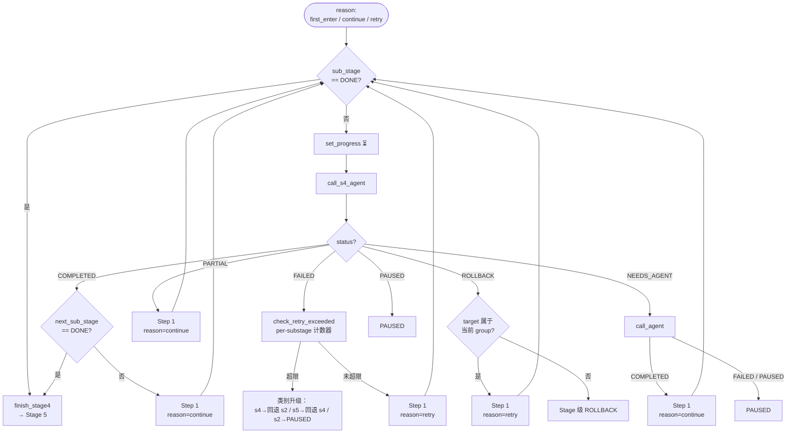

# 编排器调度与恢复逻辑

> 本文件包含主 SKILL（Orchestrator）的调度模板、决策伪代码和跨 session/compact 恢复流程。SubAgent 无需阅读本文件。

---

## §1 SubAgent 调用格式模板

主 SKILL 通过 **Agent tool** 调用 subagent，**不要使用 `@agent` 提及**——Claude Code 中 `@` 提及不能真正启动 subagent。

调用模板：

```
使用 Agent tool：
  subagent_type: ascendc-dev-s2-analysis  (或 s4-coding / s5-compile / ascendc-vf-test-agent)
  prompt: |
    请执行当前步骤的全部任务。
    【上下文】
    - 开发记录目录: {record_dir}
    - 算子名: {op_name}
    - 开发模式: 新增
    - 当前 Stage: {N}
    - SKILL_ROOT: {skill_root_abs_path}
    - AGENT_ROOT: {agent_md_abs_path}（指向 agents/ascendc-dev-s{N}-*.md 或 agents/ascendc-vf-test-agent.md）
    - current_sub_stage: {4.0 | 4.A | 4.B1 | 4.B2 | 4.C.0 | 4.C.N | 4.C.N.VT.M | 4.E | 4.F | 空}（仅 s4-coding 恢复/重试时注入，首次进入留空，统一使用 orchestration_plan.json 的 id，支持多级子步骤如 4.C.3.VT.0）
    - current_sub_stages: [{本次 execution_group 的有序 sub-stage ID 列表}]（仅 s4-coding；缺失时安全降级为 current_sub_stage 单项）
    - execution_group: {host_tiling | kernel_base | kernel_finalize... | finalize}（仅 s4-coding；由 orchestration_plan.json 声明）
    - checkpoint_groups: [{sub_stage=checkpoint_group, ...}]（仅 s4-coding；跨原检查点组的 execution group 以此逐步骤取上下文）
    - 已在主 SKILL 收集的项: {如已收集, 列出以避免重复问}
    【重试预算】SubAgent 自行从 dev record header "重试计数器"字段读取已用次数并自更新，无需主 SKILL 传入。
    【Session 环境快照】（s4-coding / s5-compile 按需读取）
      - 复用/降级规则见 [`references/env-and-platform.md`](env-and-platform.md) §3.5
      注入内容（从 dev record 复制）：
      {env_snapshot_or_empty}

    完成前请阅读 `AGENT_ROOT` 中本 Stage 的执行要求（仓库内相对路径，与你的 `subagent_type` 同名；主 SKILL.md 是 Orchestrator 工作流，不是 SubAgent 执行规范）。
    完成后请在最终回复**前 5 行内**输出机器可读标记（详见下方"返回解析"）。
```

> **编程模型不通过 prompt 传入**：`meta.json` 的 `programming_model` 字段是唯一权威源（由上游 CodegenStage 预写入）。所有 SubAgent 需要编程模型时统一从 `$RECORD_DIR/meta.json` 读取，主 SKILL 不在 prompt 中显式传入此字段。

> **SKILL_ROOT 与 AGENT_ROOT 必传**：主 SKILL 在 session 首次调度前按 SKILL.md「SKILL_ROOT 与 AGENT_ROOT」章节获取 `SKILL_ROOT` 绝对路径，并构造 `AGENT_ROOT={REPO_ROOT}/.claude/agents/{subagent_type}.md`。之后每次调度在 prompt 中同时注入两者。SubAgent 内部所有脚本调用格式为 `bash "$SKILL_ROOT/scripts/xxx.sh" [参数...]`，不依赖 cwd；需要回看自身规范时可 `Read "$AGENT_ROOT"`。

---

## §2 调度决策伪代码

```
IF status == COMPLETED:
  IF next_stage == DONE:
    流程完成，输出总结
  ELIF next_stage IN (2, 4, 5):
    推进 todo（详见 todo-template.md §"跨 Session 恢复时的 todo 重对齐"）
    IF next_stage == 4:
      进入 §7.2 的 3 步脚本驱动循环（reason=first_enter 或 continue）
    ELSE:
      调用 next_stage 对应的 SubAgent
  ELSE:
    异常：返回 PAUSED，告知用户

ELIF status == PARTIAL:
  # compact 中断导致的部分完成（sub-stage 有推进但 Stage 未验收）
  # 不消耗重试预算
  IF next_stage == 4:
    进入 §7.2 的 3 步脚本驱动循环（reason=continue）
  ELSE:
    重调 next_stage 对应的 SubAgent（SubAgent 从 dev record 进度表恢复断点）

ELIF status == FAILED:
  # E(t) 已移除：重试预算收敛为 per-type 计数器，升级决策权威在编排层
  # （codegen.py:_handle_regbase_failure / codegen_s4.py:check_retry_exceeded）。
  # 主 SKILL 读取 meta.json retries 计数器，按类别决策：
  #   - 未超限 → 重调对应 SubAgent / 进入 §7.2 循环（reason=retry）
  #   - 环境错误 → 返回 PAUSED，等待用户修复环境后重试当前 Stage
  #   - 歧义/设计错误 → 回退到对应 Stage
  #   - 达到上限 → 按 error-handling.md §6 类别升级（s2→PAUSED / s4→回退 s2 /
  #     s5→回退 s4（s5_rollback 预算防乒乓））；必要时创建 Issue（§4）+ PAUSED

ELIF status == ROLLBACK:
  IF rollback_target 以 "Stage " 开头:
    将目标 Stage 的 todo 置为 in_progress
    将当前 Stage 及之后的 todo 状态重置为 pending
    调用目标 Stage 的 SubAgent
  ELSE:
    # rollback_target 是 sub_stage，如 C.2 或 Group 2
    进入 §7.2 的 3 步脚本驱动循环（reason=retry），脚本自动定位到 rollback_target

ELIF status == NEEDS_AGENT:
  agent_name = 从 RETURN 提取 agent_name（必填）
  resume_point = 从 RETURN 提取 resume_point（可选，默认空）
  agent_context = 从 RETURN 摘要中提取，或从 dev record 读取

  # 在 history.log 中记录请求事件
  append_history event_type=NEEDS_AGENT msg="agent={agent_name} reason={原因}"

  # 启动目标 Agent
  agent_return = call_agent(subagent_type=agent_name, prompt=agent_context)

  IF agent_return.status == COMPLETED:
    append_history event_type=AGENT_COMPLETE msg="{agent_name} 完成，resume_point={resume_point}"
    # 重新调度原 SubAgent，注入完成标记和恢复点
    重调 next_stage 对应的 SubAgent，prompt 中注入 agent_completed=true, resume_point={resume_point}
  ELIF agent_return.status == FAILED:
    # Agent 失败不自动回退 Stage，向用户展示失败原因并请求决策
    追加 ERROR 事件到 9.3（错误代码按目标 Agent 返回或记为 OTH）
    返回 PAUSED，AskUserQuestion 收集用户决策
  ELIF agent_return.status == PAUSED:
    # 目标 Agent 暂停，本流程也进入 PAUSED
    按 PAUSED 流程处理，保留 NEEDS_AGENT 上下文

ELIF status == PAUSED:
  持久化状态（避免 session 重启后丢失暂停信息），向用户说明暂停原因和当前进度，等待用户指示

  持久化动作（按顺序执行）：

  1. **写 9.3 迭代记录** — 追加一行 PAUSED 事件（遵循统一 4 列表格格式）：
     ```
     | {YYYY-MM-DD HH:mm} | PAUSED | Stage {N}: {原因分类} - {一句话原因} |
     ```
     原因分类枚举：`RETRY_EXHAUSTED`（某类 per-type 计数器耗尽）/ `USER_REQUEST`（用户主动请求暂停）/ `BLOCKED`（外部阻塞：环境/资源/权限等）。

  2. **更新开发记录 header** — 重试计数器已由编排层持久化（meta.json `retries`），无需额外回写

  3. **`meta.json` 的 `current_stage` 不动** — Stage 推进的 `current_stage` 保持 PAUSED 时的值，**不**替换为新的 Stage（避免误判为"已完成"）。

  4. **用户提示** — 用 AskUserQuestion 收集用户决策：恢复 / 回退 / 终止 / 其他。
```

### 兜底逻辑（RETURN 行未匹配时）

当 SubAgent 输出中找不到 `## RETURN:` 标记时，主 SKILL **禁止**通过产物存在性、文件生成情况或其他副作用推断 SubAgent 已完成。必须按以下步骤从开发记录恢复状态：

```
1. 读取开发记录进度表（§7 当前进度）
2. 找到最后一个状态为 ✅ 的 Stage / sub-stage → last_completed
3. 找到第一个状态为 ⏳ 的 Stage / sub-stage → current_in_progress
4. 判定 status:
   - IF current_in_progress 存在:
     - IF current_in_progress 是 Stage 4 子阶段（含 4.0/4.A/4.B1/4.B2/4.C.0~4.C.n/4.C.{N}.VT.{M}/4.E/4.F）:
       - 一律 status = FAILED（子阶段任务明确，返回缺失视为未正常完成）
     - ELSE IF 任一前序 sub-stage 状态为 ✅ → status = PARTIAL（部分完成，compact 中断）
     - ELSE → status = FAILED（SubAgent 未正常完成）
   - ELIF last_completed == 刚调度的 Stage:
     - IF 刚调度的 Stage 是 s2-analysis 或 s5-compile（完整 Stage，无子阶段）→ status = COMPLETED
     - IF 刚调度的 Stage 是 Stage 4 子阶段 → status = FAILED（子阶段不可单凭进度表推断完成）
   - ELSE → status = FAILED
5. 判定 next_stage / next_sub_stage:
   - IF status == COMPLETED → next_stage = last_completed + 1
   - IF status == PARTIAL:
     - next_stage = current_in_progress
      - next_sub_stage = orchestration_plan.json 中 current Stage 内第一个 pending 子阶段（用于 Stage 4 时注入 s4-coding）
   - IF status == FAILED:
     - IF current_in_progress 是 Stage 4 子阶段 → next_stage = 4, next_sub_stage = current_in_progress（重试当前子阶段）
     - ELSE → next_stage = current_in_progress 或 last_completed + 1; next_sub_stage 同 PARTIAL 规则
6. IF status == PARTIAL:
   - 不消耗重试预算（非错误，是 compact 中断）
   - 按 COMPLETED 同等优先级调度（不触发重试预算）
7. IF status == FAILED:
   - 按 FAILED 正常流程检查 per-type 重试预算、决策重试/回退或 PAUSED
8. 按正常调度决策流程继续（见上方 §2 伪代码）
```

> **为什么 Stage 4 子阶段更严格**：Stage 4 由大量细粒度 sub-stage 组成，每个 sub-stage 都有独立的产出文件。`vf-test-agent` 即使在编译失败或精度失败时也会输出 `{vf_func}_custom.cpp` 和 `test_{vf_func}.py` 供调试（见 `regbase-vf-test/SKILL.md`），因此产物存在不能作为完成判据。返回为空必须视为失败。

---

## §3 Stage 3 不适用（regbase 无此阶段）

本编排器（ascendc-op-dev-coding-regbase）为 3 阶段流水线（s2→s4→s5），**不存在 Stage 3（s3-clarify）**。

- s2-analysis 返回 `COMPLETED` 后，直接由 SKILL.md Step 1→2 推进到 s4-coding 循环。
- 上游设计文件通过 `design_spec.json` / `tiling_strategy.json` / `kernel_architecture.json` 注入，s2-analysis 的默认决策表覆盖所有合理缺口（见 `phase-c-prompts.md` C.2）。
- 若设计文件存在默认决策表无法覆盖的缺口 → s2-analysis 返回 `FAILED(error_type=INP)`，编排器按标准 FAILED 流程处理。
- 本编排器全链路零交互，不存在 PENDING_CHOICE 场景（防御性兜底：即使 SubAgent 意外返回 PENDING_CHOICE，编排器按 SKILL.md 速查清单升级为 PAUSED）。

---

## §4 跨 Session 恢复流程（7 步）

```
1. 读取开发记录目录：`$record_dir/meta.json`（RECORD_DIR 由上游 CodegenStage 注入；独立运行/恢复场景下以 `meta.json` 为准定位当前状态）
2. 解析 meta.json → 获取 retries。per-type 重试计数器已在 meta.json 持久化（E(t)/V(t) 已移除，无需从 history.log 重算）
3. 读取进度表 → 确定当前 Stage 和状态
4. **读取 Session 环境快照**：按 [`env-and-platform.md`](env-and-platform.md) §3.5 判定快照状态（可用/过期/缺失），调度 SubAgent 时注入对应标记。
5. 执行完整性检查：
   - 检查当前 Stage 之前的所有 Stage 是否标记为 completed
   - 检查 todo 状态与进度表是否一致
6. **todo 状态重对齐**（关键步骤）：
   - 当前 Stage 之前所有 todo → completed
   - 当前 Stage 对应 todo → in_progress
   - 后续 Stage 对应 todo → pending
   - 如果 TaskList 中有"in_progress 但已不在当前 Stage"的 todo → 改 pending
7. IF 完整性通过:
     从当前 Stage 的 SubAgent 启动（prompt 携带环境快照状态）
   ELSE:
     修复记录不一致 → 从修复后的状态继续
```

---

## §5 上下文压缩（compact）恢复

compact 中断后，主 SKILL 执行 §4 的精简版：仅步骤 1→2→3→5→7（跳过步骤 4 快照判定、步骤 6 todo 重对齐——因 compact 不改变 todo 持久化状态）。SubAgent 从 dev record 进度表中断处继续。

---

## §6 中断恢复保证

无论在哪个时刻中断，系统都能恢复，因为：
- 开发记录在每次状态转换时更新（不是批量更新）
- `meta.json` 的 `current_stage` 始终指向当前 Stage，且随每次状态转换写回
- 每个 Stage 的前置检查会验证前置条件，自动跳过已完成的工作
- per-type 重试计数器在 FAILED 后由编排层持久化到 meta.json，不会因 compact 丢失。

---

## §7 Stage 4 子阶段调度循环

### 7.1 为什么需要 Stage 4 内部循环

Stage 4 被拆分为 `4.0 → A → B1 → B2 → C.0 → C.1 → ... → C.n → E → F` 多个 sub-stage，因此主 SKILL 必须支持**同 Stage 内多次调度 S4 Agent**，直到 `next_sub_stage == DONE` 才推进到 Stage 5。

### 7.2 执行模式（框架驱动）

**生产路径由 DevKit 框架驱动**：编排层状态机按 `orchestration_plan.json` 的
`execution_group` 批量调度连续 sub-stage；sub-stage 仍是状态、自检与审计原子，
主 SKILL 与 s4-coding 都不实现循环、不推进状态。主 SKILL 的职责仅是：

```text
# Step 1 — 接收编排层注入的 current_sub_stages + execution_group + checkpoint_group
# Step 2 — 按 sub_stage 类型派发 agent：
#   - kind=vf（.VT.{M}）→ ascendc-vf-test-agent（见 §7.9）
#   - 否则 → ascendc-dev-s4-coding
# Step 3 — 收到 agent 返回的 status / error_type，交还编排层推进
```

状态权威源 = `orchestration_plan.json`（s2-analysis 产出、s4 消费；框架不做内容校验）。
`progress.md` 是派生镜像，不做状态转移依据。完成判定以 agent 返回为主信号：编排层解析
agent 最后一轮回复的 `RETURN` 自报（`status=COMPLETED/FAILED` + `error_type`，见 §7.4），
不再做磁盘 deliverables 校验（2026-08-06：plan deliverables 的命名约定可能与仓库实际
产物不一致，磁盘字符串匹配会误判"缺失"造成无谓重试——见 run add_rms_norm_dynamic_quant）。
s2 完成判定同样只信 s2-analysis 返回，不再校验 coding_index.md / orchestration_plan.json 内容。

> **维护者说明**：状态机权威实现位于编排层（`src/ascendc_devkit/orchestration/stages/` 下
> codegen 相关模块），含 resolve-sub-stage / get-group / check-gate / dispatch / RETURN
> 信号解析。主 SKILL 与各 SubAgent **不感知**其内部实现，只需遵守上方 3 步派发协议。

### 7.3 编排层决策 → 行为映射

以下动作由**编排层**根据 agent 返回的 status 决定并执行；主 SKILL 只需了解结果，不自行执行。

| 编排层决策 | 行为 | 消耗重试预算 |
|---|---|---|
| `call_s4` | 从 `next_sub_stage` 解析连续 execution group，携完整授权列表派发 s4-coding | 否 |
| `call_vf_test` | 调度 `ascendc-vf-test-agent`（见 §7.9），完成后继续 | 否 |
| `finish` | 推进 todo-2 → completed，更新 `meta.json` current_stage，调度 Step 3（s5-compile） | 否 |
| `retry_s4` | 从失败 sub-stage 开始重做剩余 execution group | 是（per-type 计数器） |
| `rollback_s4` | 计数器耗尽 → 回退 s2（设计可能是根因；E(t) 已移除，确定性升级） | 是（升级） |
| `vf_exhausted` | 标该 `.VT.{M}` exhausted（progress.md 镜像 ⚠️）→ `append-history` 记录 warning → 继续下一 sub-stage（不阻塞流水线） | 否 |
| `paused` | 持久化重试计数器 → AskUserQuestion 收集用户决策 | 视情况 |
| `call_agent` | 启动 `agent_name` 指定的 Agent，完成后继续 | 否 |
| `rollback_stage` | 执行 Stage 级回退（重置 todo，调度目标 Stage SubAgent） | 否 |

### 7.4 编排层在推进前的附加动作

编排层收到 agent 返回后、做下一步决策前，按 status 执行少量写入：

| agent 返回 status | 编排层写入动作 |
|---|---|
| `COMPLETED` | **以 agent 最后一轮回复的 RETURN 自报为准**；校验 `completed_sub_stages` 等于本次授权组，再原子标记整组 done。backend 崩溃（fatal/partial）时忽略文本自报、按失败处理。不再做磁盘 deliverables 字符串校验。 |
| `FAILED` | 校验并提交 `completed_sub_stages` 连续前缀，从 `failed_sub_stage` 恢复；按 per-type 计数器决策 retry / rollback / paused |
| `PARTIAL` | 校验并提交已完成连续前缀，从首个未完成步骤恢复 |
| `PAUSED` / `NEEDS_AGENT` / `ROLLBACK` | 无额外写入 |

> **设计意图**：完成判定以 agent 自报的 RETURN 为主信号（backend 状态兜底崩溃/无回复），
> 状态推进仍由编排层统一处理；per-type 重试预算与升级决策由编排层（`codegen.py` /
> `codegen_s4.py`）维护，E(t)/V(t) 已移除。主 SKILL 与 SubAgent
> 不自行推进状态。agent 必须按 §RETURN 契约在最后一轮输出
> `## RETURN: status=COMPLETED, completed_sub_stages=[...]`（或
> `status=FAILED, error_type=..., completed_sub_stages=[...], failed_sub_stage=...`），
> 供编排层解析。

### 7.5 关键约束

- Stage 4 子阶段推进**不更新** `meta.json` 的 `current_stage`（保持为 4）；只在 Stage 4 完成、PAUSED 或重试预算耗尽时更新
- `todo-2` 的 completed 状态在 Stage 4 全部完成后统一设置，不在子阶段推进时设置

### 7.6 Stage 4 调度流程图（Mermaid，仅供可视化参考）



### 7.7 Stage 4→5 门控检查

由编排层完成（检查编排计划中全部 sub-stage 均为 done/exhausted），输出 "READY" 或
"NOT_READY: {sub_stage}"。主 SKILL 无需自行检查——编排层在收到最后一个 sub-stage 的
完成反馈后自动判断并推进到 s5。

### 7.8 边界情况处理

| 场景 | 处理 |
|------|------|
| prompt 注入的 `current_sub_stage` 与 orchestration_plan.json 不一致 | 以 orchestration_plan.json 为准，追加 `CTX_DRIFT:minor` 到 history.log |
| 检查点组中间 compact | 编排层直接找到第一个 pending sub_stage 继续，不强制回退到组起始（组仅决定单次 Agent 调用范围） |
| 步骤 ≥10 | `4.C.10`、`4.C.11` 等由编排计划 `id` 直接区分，无前缀歧义 |

### 7.9 VF 精度预验证子阶段路由（仅 A5 Regbase）

当 `programming_model == A5` 时，编排层在编排计划的 C 步骤中为每个 VF 函数插入
`.VT.{M}` 子步骤（如 `4.C.2.VT.0`、`4.C.2.VT.1`、`4.C.2.VT.2`）。编排层遇到此类步骤时，
为每个 VF 函数独立调度 `ascendc-vf-test-agent` 而非 `s4-coding`。

#### 识别规则

按 `orchestration_plan.json` 中该 sub_stage 的 `kind==vf`（`.VT.{M}` 步骤由 s2-analysis
标记）判定：
- `kind==vf` → 调度 `ascendc-vf-test-agent`（`next_sub_stage` = `4.C.{N}.VT.{M}`）
- 否则 → 调度 `s4-coding`

每个 `.VT.{M}` 步骤只验证一个 VF 函数。`{M}` 从 0 开始，按 `coding_index.md` 底部 `## VF 函数规格` 节中的函数顺序递增。

> **禁止产物推断**：主 SKILL 不得以 `$RECORD_DIR/vf_verified/kernel_test/{vf_func}_test/` 目录或其中文件的存在性，作为 `.VT.{M}` 步骤完成的判据。`vf-test-agent` 即使测试失败也会输出产物路径供调试，产物存在不等于验证通过。唯一可信完成信号是 `## RETURN: status=COMPLETED`。

#### 主 SKILL 调度 ascendc-vf-test-agent 的 prompt 模板

```
使用 Agent tool：
  subagent_type: ascendc-vf-test-agent
  prompt: |
    请执行 VF 精度预验证任务。
    【上下文】
    - 开发记录目录: {record_dir}
    - 算子名: {op_name}
    - 当前 Stage: 4
    - current_sub_stage: {4.C.N.VT.M}（如 4.C.2.VT.0）
    - SKILL_ROOT: {skill_root_abs_path}
    - AGENT_ROOT: {agent_md_abs_path}（指向 agents/ascendc-vf-test-agent.md）
    - output_dir: {record_dir}/vf_verified
    - previous_vf_results: |
        - {record_dir}/vf_verified/kernel_test/{vf_func_1}_test/{vf_func_1}_custom.cpp
        - {record_dir}/vf_verified/kernel_test/{vf_func_2}_test/{vf_func_2}_custom.cpp
        （首次调用时为空列表）
    - 已在主 SKILL 收集的项：
      - code_path: {code_path_or_empty}
      - design_doc: {design_doc_path_or_empty}
      - ref_op: {ref_op_path_or_empty}
      - vf_ref_dir: {vf_ref_dir_or_empty}

    完成前请阅读 `agents/ascendc-vf-test-agent.md` 中本 Stage 的执行要求（路径即 `AGENT_ROOT`）。

    【输出语言强制约束】所有回复内容（包括分析、总结、变更摘要、RETURN 行之前的说明文字）必须使用中文；仅代码、技术标识符、命令、文件路径、API 名称使用英文。

    完成后请在最终回复前 5 行内输出 ## RETURN: status={STATUS}, next_stage=4, error_type={ERROR_TYPE}
```

> **`output_dir` 固定为 `$RECORD_DIR/vf_verified`**：vf-test-agent 按 `regbase-vf-test` SKILL 的标准流程，为 current_sub_stage 对应的单个 VF 函数创建 `{output_dir}/kernel_test/{vf_func}_test/` 目录，产出包括 `{vf_func}_custom.cpp`（含已验证 `__simd_vf__` 实现）和 `test_{vf_func}.py`（Python 精度测试脚本）。

#### 返回处理

| ascendc-vf-test-agent 返回 status | 主 SKILL 动作 |
|---|---|
| `COMPLETED` | `set-progress "$RECORD_DIR" "4.C.{N}.VT.{M}" "✅"` → 回 Step 1(continue)，调度下一个 sub-stage（可能是下一个 `.VT.{M+1}`，也可能是 `4.C.{N}` Compute） |
| `FAILED` | dispatch 按 `vf_test` 重试预算（limit=4）决策：未超限 → `action=retry_s4`（重调当前 `.VT.{M}`）；超限 → `action=vf_exhausted`（⚠️ 标记 + 继续下一 sub-stage，不阻塞流水线） |
| `PARTIAL` | 当前 `.VT.{M}` 未通过但允许重试：回 Step 1(continue)，重新调度同一个 `.VT.{M}` 步骤（不推进 sub-stage） |

#### 产出目录结构与 s4-coding 的衔接

**vf-test-agent 产出位置**（固定路径，s4-coding 可预测访问）：

```
$RECORD_DIR/vf_verified/
└── kernel_test/
    ├── square_reduce_sum_test/        ← 第 1 个 VF 函数
    │   ├── square_reduce_sum_custom.cpp
    │   ├── test_square_reduce_sum.py
    │   └── kernel_meta/
    ├── compute_rstd_test/             ← 第 2 个 VF 函数
    │   ├── compute_rstd_custom.cpp
    │   ├── test_compute_rstd.py
    │   └── kernel_meta/
    └── compute_y_test/                ← 第 3 个 VF 函数
        ├── compute_y_custom.cpp
        ├── test_compute_y.py
        └── kernel_meta/
```

> 每个 VF 函数独立一个 `{vf_func}_test/` 目录，直接位于 `kernel_test/` 下，无中间分组层。每个 `.VT.{M}` 步骤由一次 vf-test-agent 调用完成单个 VF 函数的验证。

**s4-coding 集成协议**：

1. s4-coding 进入 Compute 步骤（`4.C.{N}`）时，从 `coding_index.md` 底部 VF 函数规格节读取该 Compute 步骤对应的所有 `.VT.{M}` 子步骤的函数列表（按 `.VT.0`、`.VT.1`、`.VT.2`...顺序聚合）
2. 从 VF 规格表的 `参考代码` 列直接读取各 VF 函数的已验证代码路径（相对于 `$RECORD_DIR`），逐个读取 `{vf_func}_custom.cpp`，提取 `__simd_vf__` 函数体和 `__aicore__` wrapper 签名
3. 将各 VF 函数按规格表的依赖顺序集成到 kernel 类的 `Compute()` 方法中，适配实际的数据流（循环、地址偏移、多 batch 等）
4. 测试 kernel 中的辅助代码（TilingData struct、DataCopy helpers、kernel entry point）是测试框架脚手架，**不搬入最终 kernel**——最终 kernel 使用 s4-coding 在 B2/C.0 步骤已生成的 tiling 和入口框架

**`coding_index.md` 中 `.VT.{M}` 行与后续 Compute 行的约定**（由 S2 写入）：

`.VT.{M}` 行在主表中只做索引，详细的 VF 函数规格放在 `coding_index.md` 底部 `## VF 函数规格` 节。

主表中 `.VT.{M}` 行各列：

| 标准列名 | `.VT.{M}` 行填写内容 | 示例 |
|---------|---------------------|------|
| 步骤 | `C.{N}.VT.{M}` | `C.3.VT.0` |
| 检查点组 | 与后续 Compute 步骤同组 | `3` |
| 其余列 | — | — |

`## VF 函数规格` 节格式（coding_index.md 底部，S2 生成）：

```markdown
## VF 函数规格（仅 A5）

### C.3.VT.0

| 函数名称 | 函数声明 | 参考代码 | 测试脚本 | 输入 LocalTensor 描述 | 输出 LocalTensor 描述 | 支持的 dtype 组合 | 描述 |
|---------|---------|---------|---------|----------------------|---------------------|------------------|------|
| SquareReduceSum | `__aicore__ inline void SquareReduceSum(LocalTensor<DX>& xLocal, LocalTensor<float>& dstLocal, uint16_t batchRows, uint16_t numColAlign)` | vf_verified/kernel_test/square_reduce_sum_test/square_reduce_sum_custom.cpp | vf_verified/kernel_test/square_reduce_sum_test/test_square_reduce_sum.py | {"x": [batchRows, numColAlign], DX} | {"xSumPerRow": [batchRows], float} | `[{x: fp16} -> {xSumPerRow: fp32}, {x: bf16} -> {xSumPerRow: fp32}, {x: fp32} -> {xSumPerRow: fp32}]` | 逐行求 x^2 之和 |

### C.3.VT.1

| 函数名称 | 函数声明 | 参考代码 | 测试脚本 | 输入 LocalTensor 描述 | 输出 LocalTensor 描述 | 支持的 dtype 组合 | 描述 |
|---------|---------|---------|---------|----------------------|---------------------|------------------|------|
| ComputeRstd | `__aicore__ inline void ComputeRstd(LocalTensor<float>& sumLocal, LocalTensor<float>& dstLocal, uint16_t batchRows, uint16_t numCols, float eps)` | vf_verified/kernel_test/compute_rstd_test/compute_rstd_custom.cpp | vf_verified/kernel_test/compute_rstd_test/test_compute_rstd.py | {"xSumPerRow": [batchRows], float} | {"rstd": [batchRows], float} | `[{xSumPerRow: fp32} -> {rstd: fp32}]` | 根据平方和计算 rstd=1/sqrt(sum/n+eps) |

### C.3.VT.2

| 函数名称 | 函数声明 | 参考代码 | 测试脚本 | 输入 LocalTensor 描述 | 输出 LocalTensor 描述 | 支持的 dtype 组合 | 描述 |
|---------|---------|---------|---------|----------------------|---------------------|------------------|------|
| ComputeY | `template <typename DX> __aicore__ inline void ComputeY(LocalTensor<DX>& xLocal, LocalTensor<float>& rstdLocal, LocalTensor<float>& gammaLocal, LocalTensor<DX>& dstLocal, uint16_t batchRows, uint16_t numColAlign)` | vf_verified/kernel_test/compute_y_test/compute_y_custom.cpp | vf_verified/kernel_test/compute_y_test/test_compute_y.py | {"x": [batchRows, numColAlign], DX; "rstd": [batchRows], float; "gamma": [numColAlign], float} | {"y": [batchRows, numColAlign], DX} | `[{x: fp16, rstd: fp32, gamma: fp32} -> {y: fp16}, {x: bf16, rstd: fp32, gamma: fp32} -> {y: bf16}, {x: fp32, rstd: fp32, gamma: fp32} -> {y: fp32}]` | 计算 y = x * rstd * gamma |
```

后续 Compute 步骤（如 `C.3`）的 `参考代码` 列直接列出 VF 函数名：

| 标准列名 | Compute 行值 | 说明 |
|---------|-------------|------|
| 参考代码 | `vf:SquareReduceSum,ComputeRstd,ComputeY` | s4-coding 按函数名从 VF 规格表的 `参考代码` 列直接读取各 VF 函数的已验证代码路径（`vf_verified/kernel_test/{vf_func}_test/{vf_func}_custom.cpp`）

**完整示例**（A5 Regbase 场景，主表部分）：

```markdown
| 步骤 | 检查点组 | 详设章节 | 参考代码 | 知识/经验 | 关键 API | 自检关注点 | ~行数 |
|------|---------|---------|---------|----------|---------|-----------|-------|
| C.0 | 2 | §4.1 | ref_op/kernel.cpp:30 | — | template<...> __global__ | ASCENDC_TPL + if constexpr 路由 | ~30 |
| C.1 | 2 | §4.2 | ref_op/kernel.h:20 | — | Init,DataCopy | 队列声明完整 | ~40 |
| C.2 | 3 | §4.3 | ref_op/kernel.h:80 | tips:DT-03 | LoadAlign,DataCopy | 32B对齐 | ~30 |
| C.3.VT.0 | 3 | — | — | — | — | — | — |
| C.3.VT.1 | 3 | — | — | — | — | — | — |
| C.3.VT.2 | 3 | — | — | — | — | — | — |
| C.3 | 3 | §4.4 | vf:SquareReduceSum,ComputeRstd,ComputeY | 集成已验证VF到Compute主循环 | VF_CALL,LoadAlign,StoreAlign | RegTensor数量,SIMD/SIMT隔离 | ~80 |
| C.4 | 3 | §4.5 | ref_op/kernel.h:160 | tips:DT-03 | StoreAlign,DataCopy | 32B对齐搬出 | ~30 |
```

**前缀约定汇总**：

| 前缀 | 所在行 | 含义 | 解析方 |
|------|--------|------|--------|
| `vf:` | Compute 行的 `参考代码` | 逗号分隔的 VF 函数名列表，s4-coding 按名称（snake_case）定位各 `{vf_func}_test/` 目录 | s4-coding |
| 无前缀 | 普通行的 `参考代码` | 常规参考代码路径（如 `ref_op/kernel.h:80`） | s4-coding |

---

## §8 SubAgent 完成 → todo 推进与流程收尾

> 本文件替代 SKILL.md 中同名详细规则。SKILL.md 仅保留一句话指引，具体实现以本节为准。

### 8.1 通用推进规则

SubAgent 返回 `status=COMPLETED` 时：

1. 将该 Stage 对应的所有 todo 置 `completed`
2. 将下一 Stage 首条 todo 置 `in_progress`
3. 调度下一 Stage 的 SubAgent

返回 `status=ROLLBACK` 时：

1. 将被回退 Stage 的 todo 置 `in_progress`
2. 将当前 Stage 及之后的 todo 重置为 `pending`
3. 调用目标 Stage 的 SubAgent

### 8.2 Stage 4 例外规则

Stage 4 被拆分为多个 sub-stage，需严格遵守以下规则：

| 时机 | todo-2（s4-coding） | todo-3（VF 精度预验证） | 操作 |
|------|---------------------|------------------------|------|
| 进入 Stage 4 | `in_progress` | `pending`（仅 A5） | 调度 s4-coding |
| execution group 内单个 sub-stage 完成后 | 不变 | 不变 | Agent 写独立 selfcheck；最终 RETURN 时由框架批量提交合法连续前缀 |
| 单个 execution group 完成后 | 不变 | 不变 | 编排层更新各 sub-stage status + 派生 progress.md，再调度下一组 |
| Stage 4 全部完成（`next_sub_stage == DONE`） | `completed` | `completed`（如适用） | 由 `dispatch` 输出 `finish` action 后进入 Step 3 |

### 8.3 流程完成收尾

Step 3（s5-compile）完成后执行：

1. 更新 todo-4 为 `completed`
2. 输出精简开发总结（含编程模型、芯片型号、算子名称）

---

## §9 PAUSED 处理流程与用户沟通模板

主 SKILL 进入 `PAUSED` 状态后，必须向用户展示暂停原因和当前状态，并收集下一步决策。

### 9.1 展示内容

1. 暂停原因（环境错误 / 重试超限 / 需求歧义 / 用户主动暂停）
2. 当前 Stage 和已完成的 sub-stage（如适用）
3. 当前 per-type 重试计数器使用情况（如适用）
4. 开发记录目录绝对路径（便于用户手动查看）

### 9.2 AskUserQuestion 模板

```yaml
AskUserQuestion:
  question: "算子开发流程已暂停，请选择下一步操作："
  header: "流程暂停"
  options:
    - label: "修复后继续"
      description: "我已修复环境或补充信息，请从当前 Stage 继续执行"
    - label: "回退到 Stage N"
      description: "需求理解有偏差，回退到更早 Stage 重新分析（N 由主 SKILL 根据暂停原因确定）"
    - label: "结束开发流程"
      description: "不再继续，执行收尾清理并输出当前状态总结"
    - label: "查看开发记录"
      description: "先不操作，告诉我开发记录目录和当前进度详情"
```

### 9.3 主 SKILL 行为映射

| 用户选择 | 主 SKILL 行为 |
|---------|--------------|
| 修复后继续 | 重新调度当前 Stage SubAgent，并保持 `PAUSED` 前状态 |
| 回退到 Stage N | 执行 `ROLLBACK` 流程，重置对应 todo 为 `in_progress`，后续 todo 为 `pending` |
| 结束开发流程 | 即使 Stage 5 未完成，也输出当前进度总结并结束流程 |
| 查看开发记录 | 输出当前进度详情后再次询问，不退出 `PAUSED` 状态 |

### 9.4 持久化动作

进入 `PAUSED` 时按顺序执行：

1. **写 9.3 迭代记录**：追加一行 PAUSED 事件（遵循统一 3 列表格格式）
   ```
   | {YYYY-MM-DD HH:mm} | PAUSED | Stage {N}: {原因分类} - {一句话原因} |
   ```
   原因分类枚举：`RETRY_EXHAUSTED` / `USER_REQUEST` / `BLOCKED`
2. **`meta.json` 的 `current_stage` 不动**：保持当前 Stage 值，避免误判为"已完成"

---

## §10 CTX_DRIFT 偏离记录复核

Stage 4 子阶段执行中，若实际编码偏离 `coding_index.md` 计划，须通过 `dev_record.sh append-history` 写入 `CTX_DRIFT:{severity}` 记录到 `history.log`。

### 10.1 记录格式

```
[{YYYY-MM-DD HH:mm}] [CTX_DRIFT:{severity}] {偏离源}:{偏离描述} - {实际做法} - {原因}
```

- **severity**：`minor`（结构优化、等效 API 替换）或 `major`（详设与参考冲突取舍、跳过关键约束、改变 tiling/核数公式）
- **偏离源**：`coding_index.md` / `requirements.md` / `参考算子` / `用户澄清` 等

### 10.2 主 SKILL 行为

- CTX_DRIFT 不是错误，不消耗重试预算
- 恢复或 Stage 4 收尾（F）时应关注 `major` 级别的 CTX_DRIFT 并逐条复核
- 若 major 偏离影响功能/接口/字段映射，需在 S4 返回中显式列出并说明影响

---

## §11 环境快照管理协议

> 完整规范见 [`env-and-platform.md`](env-and-platform.md)。本节给出主 SKILL 调度时必须遵守的复用规则。

### 11.1 复用判定

快照 `写入时间` 距当前时间 **< 24 小时** 即视为可用。以写入时间字段与当前时间比较，跨午夜不会突然失效。

| 条件 | 主 SKILL 动作 | SubAgent 动作 |
|------|---------------|---------------|
| 快照存在，写入时间距今 < 24h | 将快照内容注入 SubAgent prompt | s4/s5 直接读取并使用 |
| 快照存在，写入时间距今 ≥ 24h | 标记"快照过期" | s4/s5：按 SubAgent 内部逻辑按需检查（见 env-and-platform.md §3.5 降级路径） |
| 快照不存在 | 标记"快照缺失" | 同"过期"处理 |
| 用户说"重新检查环境" | 引导用户手动执行环境检查 | — |

### 11.2 写入与读取方

- 本编排器无 Stage 1（s1-env），`env_snapshot.md` 由上游 CodegenStage 或用户手动提供
- s4-coding / s5-compile **只读不写**

### 11.3 LD_LIBRARY_PATH 特别提示

Bash 工具的 `export` 不会跨调用保留。若快照中 `LD_LIBRARY_PATH 状态 = MISSING`，必须提示用户在**启动 claude 的父 shell** 中执行：

```bash
export LD_LIBRARY_PATH=/usr/local/Ascend/driver/lib64/driver:$LD_LIBRARY_PATH
```

---

## §12 回退约束与职责划分

### 12.1 回退约束（不可违反）

- 不得从 Stage 4 回退到 Step 1（s2-analysis）
- 不得在单次 session 中多次回退同一 Stage
- 环境错误不触发 Stage 回退（阻塞当前 Stage，返回 PAUSED）

### 12.2 职责划分

| 层级 | 职责 |
|------|------|
| **主 SKILL / 编排层** | 维护 per-type 重试计数器与升级决策（retry→rollback→halt，`codegen.py` / `codegen_s4.py`）、创建 Issue、回退 Stage、决定"继续/暂停" |
| **SubAgent 层** | 仅负责"同策略→换策略→返回 FAILED"重试，不做升级处理；重试计数器由 SubAgent 自行从 dev record 读取并自更新 |
