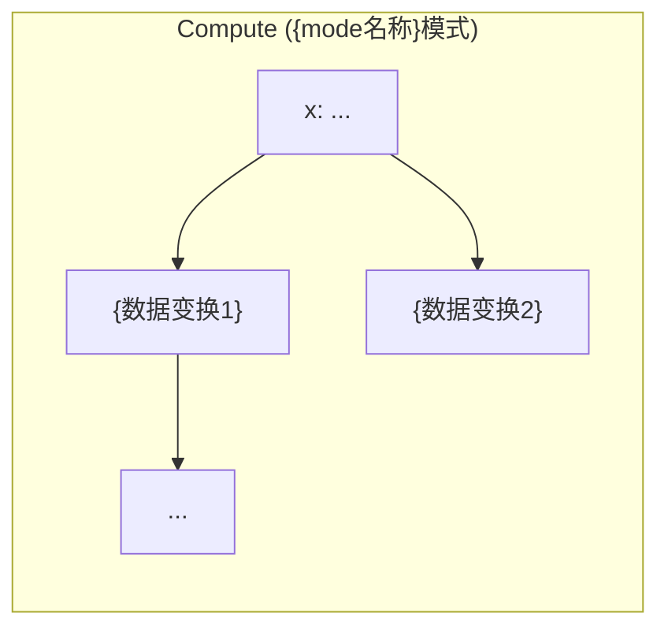
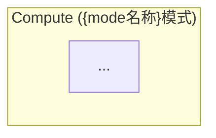

# {算子名} 概要设计说明书

> **文档版本**：v1.0
> **设计场景**：{Scene A/B/C/D — 参见设计场景说明}
> **设计目标**：{新增算子 / 存量算子重构 + 新增功能 / ...}
> **目标平台**：{Atlas A2 训练系列 / Atlas A3 训练系列 / Atlas A5 推理系列 / ...}

---

## 1 算法背景与需求

> 本章节由 `ascendc-op-general-design` skill 生成，基于业务上下文采集和 `op_spec` 推导。

### 1.1 业务背景

{说明该算子在哪个模型/场景中使用、解决了什么业务痛点。例如：}

> 盘古-72B 在 Attention 模块中需要 partial_rope 支持。当前需要通过 StridedSliceV2 + Mul + Concat 等多个小算子拼接，Profiling 显示耗时约 60.448us。本算子将 partial_rope 融合进 RotaryPositionEmbedding，消除小算子拼接开销。

### 1.2 算子生态现状

{列出与本算子功能相关的所有昇腾算子（或竞品算子）的对比表。}

| 算子名 | rotary_mode | Partial_rope | 目标平台 | 说明 |
|--------|------------|-------------|---------|------|
| {算1} | {mode支持} | {是否支持} | {平台} | {说明} |
| {算2} | {mode支持} | {是否支持} | {平台} | {说明} |
| **本算子** | {mode支持} | {是否支持} | {平台} | {新增功能定位} |

### 1.3 需求清单

| 编号 | 需求项 | 类型 | 说明 |
|------|--------|------|------|
| REQ-01 | {功能需求简述} | 功能 | {详细说明} |
| REQ-02 | {性能约束} | 性能 | {详细说明} |
| REQ-03 | {兼容性约束} | 约束 | {详细说明} |

**典型场景 Shape**：

| 场景 | Tensor | Shape | 数据类型 |
|------|--------|-------|---------|
| {场景名} | x | {shape} | {dtype} |
| | cos/sin | {shape} | {dtype} |

---

## 2 算子定义书

> 本章节内容继承自 `requirement.json`，仅做格式整理，不做重新推导。

### 2.1 数学公式 / 地址映射逻辑

{按 mode 分列数学公式（计算类）或地址映射逻辑（搬运类）。标注新增 mode 和存量 mode。}

#### 通用公式

{所有 mode 共享的核心公式}

#### Mode N — {mode名称}

{公式描述。存量 mode 标注"保持已有实现"，新增 mode 标注"新增"}

```
x1       = ...
x_rotate = ...
y        = x * cos + x_rotate * sin
```

#### {add} — {新特性名称}

{partial_rope 等 modifier 特性的公式。说明与全量 RoPE 的关系（rot_dim == D 时退化为全量）}

### 2.2 接口定义

**函数原型**：

```c
aclnnStatus aclnn{OpName}GetWorkspaceSize(
    const aclTensor *x,
    ...
    uint64_t *workspaceSize,
    aclOpExecutor **executor);

aclnnStatus aclnn{OpName}(
    void *workspace,
    uint64_t workspaceSize,
    aclOpExecutor *executor,
    aclrtStream stream);
```

**参数说明**：

| 参数名 | 输入/输出 | 描述 | 使用说明 |
|--------|-----------|------|----------|
| x | 输入 | {描述} | {说明} |
| cos | 输入 | {描述} | {说明} |
| ... | ... | ... | ... |
| out | 输出 | {描述} | {说明} |

### 2.3 支持范围清单

**数据类型支持矩阵**：

| 输入 dtype | cos/sin dtype | 输出 dtype | 状态 |
|-----------|---------------|-----------|------|
| {dtype1} | {dtype1} | {dtype1} | ✅ 支持 / 🆕 新增 / 保持 |
| 混合 dtype | — | — | ❌ 不支持 |

**Layout 支持**：

| Layout | 维度 | 状态 | 说明 |
|--------|------|------|------|
| BNSD | 4D `[B,N,S,D]` | ✅ 支持 | cos/sin S 维可广播 |
| BSND | 4D `[B,S,N,D]` | ✅ 支持 | cos/sin N 维可广播 |
| TND | 3D `[T,N,D]` | 🆕 新增 | 变长序列 |

**Mode 支持**：

| Mode | 名称 | 平台A | 平台B | 说明 |
|------|------|-------|-------|------|
| 0 | {name} | ✅ 已有 | ✅ 已有 | 保持现有实现 |
| N | {name} | 🆕 新增 | 🆕 新增 | {说明} |

### 2.4 边界语义约定

| 场景 | 行为 |
|------|------|
| {边界场景1} | {约定行为} |
| {边界场景2} | {约定行为} |
| {约束检查项} | {错误码或行为} |

---

## 3 架构设计

> 本章节由 `ascendc-op-general-design` skill 生成。描述数据流、并行策略和模板划分。

### 3.1 计算流程（按 mode 分别描述）

#### Mode 0 — {mode名称}



#### Mode N — {mode名称}



#### {新特性} 处理流程

{partial_rope 等特性的附加流程图}

### 3.2 数据流拓扑

**标准路径**：

```
GM: x ──→ UB: ub_x ──→ Compute(x_rotate + mul) ──→ UB: ub_y ──→ GM: y
GM: cos ──→ UB: ub_cos ──┘
GM: sin ──→ UB: ub_sin ──┘
```

**特殊路径（如有）**：

```
{描述使用 L0A/L0B/L0C/Cube 单元的路径}
```

**说明**：
- {各节点的存储层级标注、数据流向说明}
- {不同 code path 的差异}

### 3.3 轴分析

{分析各维度的轴属性，做合轴决策}

| 维度 | 语义 | 独立轴？ | 广播轴？ | 核间通信？ | 切分优先级 |
|------|------|---------|---------|-----------|-----------|
| B | batch | ✅ / ❌ | ✅ / ❌ | 无 | 高/中/低 |
| S | seq_len | ✅ | ❌ | 无 | 最高 |
| N | num_heads | ✅ | ✅/❌ | 无 | 中 |
| D | head_dim | ❌（全量处理） | — | — | — |

**合轴策略**：
- {相邻的非广播轴是否合并？合并后如何处理？}
- {广播轴的处理方式}
- {建议的轴抽象方案：XYZ 抽象 vs 保留 B/N/S 命名}

### 3.4 并行分解策略

1. **主切分轴**：{S 或 T 维度} —— 各 AICore 独立处理不同的分片
2. **次切分轴**：{B 或 N 维度}（当主切分轴不够时）
3. **核间关系**：{无通信 / AllReduce / Gather}
4. **负载均衡**：{说明策略}
5. **计算单元分配**：{Vector 单元 / Cube 单元}

> 约束：不给出 blockIdx 映射公式。

### 3.5 模板划分策略 ⭐

{基于各 mode 计算流程差异性的判断，给出候选模板划分方案。}

**判断依据**：
- {mode 0 和 mode 1 是否可以合并模板？理由是什么？}
- {mode N 是否需要独立模板？理由是什么？}
- {partial_rope 等 modifier：是嵌入各模板内部，还是独立模板？}
- {Layout 泛化：统一处理还是各 layout 独立模板？}
- {对齐场景：32B 对齐 vs 非对齐是否需要独立分支？}

**候选模板列表**：

| 候选模板 | 支持的 mode | 支持的 layout | 对齐要求 | 核心差异 | TILING_KEY 范围 |
|---------|------------|-------------|---------|---------|-----------------|
| {T1} | {mode} | {layout} | {对齐/非对齐} | {计算流程差异} | {候选范围} |
| {T2} | {mode} | {layout} | {对齐/非对齐} | {计算流程差异} | {候选范围} |

> 本方案为候选方案，最终模板划分在 template-division 步骤中锁定。

---

## 4 Tiling 设计

> 本章节由 `ascendc-op-general-design` skill 生成。提供 TilingData 字段定义和循环结构框架，为详设提供输入。

### 4.1 Tiling 级数与切分策略

| 级别 | 切分维度 | 切分逻辑类型 | 说明 |
|------|---------|-------------|------|
| Core-level | {维度1} → {维度2} → {维度3} | 动态等分 | 在可用 AICore 间均衡分配 |
| UB-level | {维度} | 静态循环 | 单次 UB 装载处理若干行 |

**边界条件**：
- **下限**：单次 UB 装载至少包含 1 个完整 head（size = D × sizeof(T)）
- **上限**：UB 空间扣除中间 Buffer 后，剩余空间全量用于数据缓存
- **对齐**：所有切分块大小满足 32B 对齐

### 4.2 TilingData 字段定义

| 字段名 | 类型 | 语义描述 | 取值来源 |
|--------|------|---------|---------|
| X | int64_t | x 输入 shape 的 X 维大小 | input shape |
| Y | int64_t | x 输入 shape 的 Y 维大小 | input shape |
| Z | int64_t | x 输入 shape 的 Z 维大小 | input shape |
| D | int64_t | cos 输入 shape 的 D 维大小 | input shape |
| AlignedD | int64_t | D 维 32B 对齐后的大小 | D 向上取整到 32B |
| Dx | int64_t | x 输入 shape 的 D 维大小 | input shape |
| blockNumX | int64_t | X 维多核切分的核数 | 核数分配公式 |
| blockFactorX | int64_t | X 维多核切分的每核大小 | X / blockNumX |
| blockNumY | int64_t | Y 维多核切分的核数 | 核数分配公式 |
| blockFactorY | int64_t | Y 维多核切分的每核大小 | Y / blockNumY |
| blockNumZ | int64_t | Z 维多核切分的核数 | 核数分配公式 |
| blockFactorZ | int64_t | Z 维多核切分的每核大小 | Z / blockNumZ |
| ubLoopNumX | int64_t | X 维 UB 切分的循环次数 | UB 空间计算 |
| ubFactorX | int64_t | X 维 UB 切分的大小 | UB 空间计算 |
| ubLoopNumY | int64_t | Y 维 UB 切分的循环次数 | UB 空间计算 |
| ubFactorY | int64_t | Y 维 UB 切分的大小 | UB 空间计算 |
| ubLoopNumZ | int64_t | Z 维 UB 切分的循环次数 | UB 空间计算 |
| ubFactorZ | int64_t | Z 维 UB 切分的大小 | UB 空间计算 |

> 约束：不给出默认值和序列化代码。

### 4.3 各模板循环结构 ⭐

{为每个模板绘制循环嵌套结构的伪代码。不代入 ubFactor 具体数值和 blockIdx 映射公式。}

#### 模板A：{模板名称}

{描述该模板对应的 mode、layout 组合}

多核切分：{切分公式描述}

核内循环：

```c
// {模板说明}
xBlockIdx = {blockIdx 分配方式在此描述};
zBlockIdx = {blockIdx 分配方式在此描述};

xBlockSize = (xBlockIdx == blockNumX - 1) ? (X - blockFactorX * xBlockIdx) : blockFactorX;
zBlockSize = (zBlockIdx == blockNumZ - 1) ? (Z - blockFactorZ * zBlockIdx) : blockFactorZ;

for (xIdx = 0; xIdx < ubLoopNumX; xIdx++) {
    for (zIdx = 0; zIdx < ubLoopNumZ; zIdx++) {
        CopyInCosAndSin(offset=..., size=[xSize, zSize, D]);
        for (yIdx = 0; yIdx < ubLoopNumY; yIdx++) {
            CopyInX(offset=..., size=[xSize, ySize, zSize, Dx]);
            Compute(x, cos, sin, size=[xSize, ySize, zSize, D]);
            CopyOutX(offset=..., size=[xSize, ySize, zSize, Dx]);
        }
    }
}
```

#### 模板B：{模板名称}

```c
// {模板说明}
```

### 4.4 对齐策略

- D 维度未 32B 对齐时的处理方案：{DataCopyPad / ...}
- 非对齐场景是否需要独立模板分支：{是/否，理由}
- D 维度对齐的特殊处理（如需）：

```
AlignedD = ((D + 31) / 32) * 32  // 32B 向上对齐
```

---

## 5 Buffer 与性能设计

> 本章节由 `ascendc-op-general-design` skill 生成。

### 5.1 Buffer 可行性评估（仅约束提供，不涉及布局）

> 概设只回答"能否放得下"，不回答"具体怎么放"。Buffer 布局/复用/BUFFER_NUM/TQue/TBuf 由 `ascendc-op-tiling` skill 负责。

- **共存约束清单**：列出必须同时驻留 UB 的数据项（如 x / cos / sin / x_rotate / y、中间结果 tmp），每项给参数级大小表达式
- **常驻 vs 流式定性判断**：哪些数据常驻 UB（减少 GM 读）、哪些流式加载（节省 UB）——如 cos/sin 常驻 vs 随行按需
- {partial_rope 场景下 x_rope 和 x_pass 的共存验证}
- **融合算子阶段共存验证**（融合模式时）：各阶段输入/输出/中间结果是否能在 UB 预算内共存

> 约束：不给出 BUFFER_NUM 具体数值或 TQue/TBuf 句柄，不给出 Buffer 地址分配方案。

### 5.2 关键性能设计权衡 ⭐

{如有多个设计方案，进行结构化的 trade-off 分析。}

例如，partial_rope 的数据搬运策略对比：

| 方案 | 描述 | 优点 | 缺点 | 推荐？ |
|------|------|------|------|--------|
| 方案1 | 一次性搬入 UB（rope + pass），原地计算 | {优点} | {缺点} | |
| 方案2 | 一次性搬入 UB，DataCopy 合并 rope 部分 | {优点} | {缺点} | |
| 方案3 | rope 和 pass 分离搬运，流水线阶段并行 | {优点} | {缺点} | |
| 方案4 | 分阶段处理 rope 和 pass，UB 独立设计 | {优点} | {缺点} | ⭐推荐 |

其他权衡场景：
- {interleave 跨步访存的处理：DataCopy 向量化 vs L1 辅助}
- {cos/sin 广播：常驻 UB vs 随行加载}

### 5.3 计算范式与瓶颈分析

| 维度 | 判定 |
|------|------|
| 计算模式 | {逐元素 / 规约 / 矩阵乘 / 混合}（+ 数据重排特征） |
| 主导类型 | {计算受限 / 带宽受限} |
| 算术强度 | {参数级表达式} ≈ {数值范围}（{dtype}） |
| 瓶颈分析 | {详细说明} |
| 优化方向 | {UB 利用率、广播复用、减少 GM 往返等} |

---

## 6 可行性论证

> 本章节由 `ascendc-op-general-design` skill 生成，提供理论分析支撑。

### 6.1 理论计算量与访存量估算

{使用参数级表达式，不代入具体数值。}

**标准路径（一个 head 的计算量）**：

```
GM_read  = D × sizeof(T) × N_read    // N 个输入张量的读取
GM_write = D × sizeof(T) × N_write    // N 个输出张量的写入
total_GM_traffic = ...                // 合计

total_FLOPs = ~ O(D)                  // 计算量

arithmetic_intensity = total_FLOPs / total_bytes ≈ ...
```

**{新特性} 场景**：

```
// 特殊场景的额外估算
```

**总预估（全量数据）**：

```
Total_GM_traffic = B × N × S × D × sizeof(T) × ...
Total_FLOPs      = B × N × S × D × ...
```

### 6.2 瓶颈断言

| 维度 | 断言 | 依据 |
|------|------|------|
| 瓶颈类型 | {带宽受限 / 计算受限} | 算术强度 {数值} — {与硬件计算密度拐点对比} |
| 效率上限 | {估算范围} | 受 {限制因素} 限制 |
| {特殊场景} | {影响} | {说明} |

### 6.3 风险标注与缓解建议

| 风险 | 场景 | 影响 | 缓解建议 |
|------|------|------|---------|
| {风险1} | {触发条件} | {影响} | {缓解措施} |
| {风险2} | {触发条件} | {影响} | {缓解措施} |

---

## 7 设计约束记录

### 7.1 保持不变的现有设计

| 模块 | 说明 | 原因 |
|------|------|------|
| {模块} | {描述} | {保持原因} |
| aclnn 接口签名 | {接口名不变} | 向后兼容 |

### 7.2 新增/变更的设计

| 模块 | 说明 | 影响范围 |
|------|------|----------|
| {模块} | {描述} | {Tiling / Kernel / 两者} |
| {新功能1} | {描述} | {影响范围} |

---

## 附录

### A. Golden 代码参考

```python
# Golden 函数的完整实现（从 op_spec 或用户提供）
def {op_name}_golden(x, cos, sin, mode, ...):
    ...
    return y
```

### B. 典型 Shape 表

| 场景 | Tensor | Shape | 数据类型 |
|------|--------|-------|----------|
| {场景1} | x | {shape} | {dtype} |
| | cos/sin | {shape} | {dtype} |
| {场景2} | x | {shape} | {dtype} |

### C. 关键决策记录

| 决策 ID | 决策项 | 选择 | 理由 |
|---------|--------|------|------|
| D-001 | {决策项} | **{选择}** | {理由} |
| D-002 | {决策项} | **{选择}** | {理由} |
