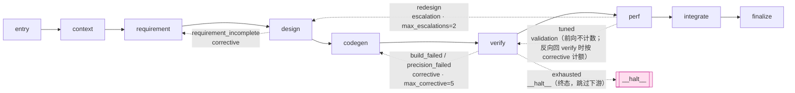

# L3 Orchestration — 状态机引擎

> **所属架构**：[ascendc-devkit 架构总览](../architecture-overview.md) > §2 分层架构
> **上游依赖**：L2 Application
> **下游依赖**：L4 Domain, L5 Capabilities, L6 Adapters, L7 Infrastructure
> **实现状态（graph 重构后）**：
> ✓ `kernel/state.py` (State + workflow_timeout_sec/stage_timeout_sec/resume_iteration + routing_scopes/node_status + with_scope_counters 作用域计数镜像) | ✓ `kernel/action.py` (Action 类型, RunGate 含 gate 字段, SpawnAgent 含 working_dir/repo_baseline/repo_root, UpdateDevRecord) | ✓ `kernel/event.py` (含 decision_pending, workflow_timeout, stage_timeout, spawn_context, node/loopback/stagnation scoped graph 事件) | ✓ `kernel/gate.py` (GateResult, Gate) | ✓ `kernel/runner.py` (Runner.run_stage, cancel, RunnerCancelledError, progress_callback DI, _check_timeout, start_iteration 迭代恢复, 可选 ExecContext) | ✓ `node.py` (StageNode / AtomicStage / SequentialGroup + node_paths) | ✓ `node_forkjoin.py` (ForkJoinGroup + merge_forkjoin 冲突检测) | ✓ `node_sidetask.py` (SideTask fire-and-forget) | ✓ `graph_executor.py` (GraphExecutor 树遍历 + 作用域路由 + 并行 ForkJoin + 旁路 join) | ✓ `exec_context.py` (ExecContext + CancelToken) | ✓ `model_config.py` (per-stage 模型映射) | ✓ `base.py` (StageProtocol, Stage, CompositeStage, validate_inputs hook) | ✓ `registry.py` (STAGE_REGISTRY, WORKFLOW_REGISTRY) | ✓ `workflow.py` (Workflow + generate_ascendc / _se / _dev / full_test 四个内置 workflow + root 属性 + validate_chain()) | ✓ `skill.py` | ✓ `stages/` (9-Stage + smoke + build_and_verify)
> DecisionPendingError/WorkflowTimeoutError/StageTimeoutError 在 `domain/exceptions.py`（L4）；退出码在 `domain/exit_codes.py`（L4, 含 EX_TIMEOUT=124）

---

## 1. 定位

这是整个系统的核心——决定"现在做什么、下一步做什么"的状态机。L3 不直接调 LLM、不碰文件系统、不编译代码，它只做一件事：**给定当前 state，计算出下一个 action**。

**引擎核心是纯函数。**

```
         ┌────────────────────────────────────────────┐
         │           kernel/runner.py                  │
         │                                             │
         │   for iteration in range(1, effective_max): │
         │       actions = stage.actions(state, iter)  │  ← 纯函数
         │       result = _execute_actions(actions)    │  ← 副作用入口
         │       state = stage.transition(state,result)│  ← 纯函数
         │       if output_contract satisfied: break   │
         │       event_log.append(...)                 │
         └────────────────────────────────────────────┘
```

`stage.actions()` 和 `stage.transition()` 是纯函数——给定相同输入，永远返回相同输出。所有副作用（LLM 调用、编译、文件读写）都发生在 `_execute_actions()` 这一步，由 runner 统一管理。

**关键能力**：
- **可测试**：`actions()`/`transition()` 可以纯单元测试，不需要 mock LLM 或 NPU
- **可组合**：Runner 不区分单 Stage 还是 Workflow——两者实现同一 StageProtocol，可互相替换嵌套
- **可理解**：看 events.jsonl 就能完全理解一次运行发生了什么

---

## 2. 子模块组织

```
orchestration/
├── registry.py          # STAGE_REGISTRY: str → Stage + WORKFLOW_REGISTRY
├── base.py              # StageProtocol / Stage 基类 (含 validate_inputs hook)
├── workflow.py          # Workflow 类 + 4 内置 workflow + root 属性 + validate_chain()
├── node.py              # ★ StageNode 树: AtomicStage / SequentialGroup + node_paths()
├── node_forkjoin.py     # ★ ForkJoinGroup (并行) + merge_forkjoin (冲突检测)
├── node_sidetask.py     # ★ SideTask (fire-and-forget 支线节点)
├── graph_executor.py    # ★ GraphExecutor — StageNode 树遍历 + 作用域 loopback 路由
├── exec_context.py      # ExecContext + CancelToken (并行安全的取消/截止)
├── model_config.py      # per-stage 模型映射 (resources/orchestration-config.json → models)
├── runtime_config.py    # Runner 运行期调参 + 各 stage 迭代配额 (resources/orchestration-config.json → runner / iterations); 无效配置 fail-fast 抛 ConfigError
├── skill.py             # L3 skill 薄封装 (→ L5 SkillLoader 委托, 供 L2 调用)
├── kernel/              # ★ 引擎核心（纯函数状态机）
│   ├── state.py         #   State (含 routing_scopes / node_status / with_scope_counters)
│   ├── action.py        #   Action 类型定义 (SpawnAgent, RunGate, Integrate, 等)
│   ├── event.py         #   Event schema (含 node/loopback/stagnation 作用域事件)
│   ├── gate.py          #   GateResult (frozen dataclass), Gate(ABC)
│   └── runner.py        #   Runner.run_stage() + cancel/RunnerCancelledError + ExecContext
└── stages/              # Stage 实现（自动注册）
    ├── entry.py         #   EntryStage — 请求校验
    ├── context.py       #   ContextStage — profile/adapter/参考代码/git 基线
    ├── requirement.py   #   RequirementStage — 需求解析 (Agent)
    ├── design.py        #   DesignStage — 算子/Tiling 设计 (Agent)
    ├── codegen.py       #   CodegenStage — 仓内代码生成 (Agent, cwd=op_dir)
    ├── verify.py        #   VerifyStage — 仓内编译 + 精度验证
    ├── perf.py          #   PerfStage — 性能基准测试
    ├── integrate.py     #   IntegrateStage — op_dir 校验 + 收尾
    ├── finalize.py      #   FinalizeStage — 报告+清理
    ├── gates.py         #   共用 Gate (BuildInRepoGate)
    ├── smoke.py         #   SmokeStage — 测试用最小 stage
    └── build_and_verify.py  # BuildAndVerify — 编译+验证组合 stage
```

---

## 3. 核心抽象

### 3.1 StageProtocol — Stage 与 Workflow 的统一协议

```python
class StageProtocol(ABC):
    """Stage 和 Workflow 的统一协议——二者可以互相嵌套。"""
    name: str
    description: str

    @abstractmethod
    def input_contract(self) -> StageIOContract:
        """声明本 stage 需要 state 中有哪些字段。"""
        ...

    @abstractmethod
    def output_contract(self) -> StageIOContract:
        """声明本 stage 完成后 state 中会新增/修改哪些字段。"""
        ...

    @abstractmethod
    def actions(self, state: State, iteration: int = 1) -> list[Action]:
        """给定当前 state 和迭代轮次，产出该 stage 要执行的 action 序列。"""
        ...

    @abstractmethod
    def gate(self) -> Gate | None:
        """进入该 stage 的前置 gate；返回 None 表示无条件进入。"""
        ...


class Stage(StageProtocol):
    """单个 Stage 的基类——原子执行单元。"""
    name: str = ""
    max_iterations: int = 3

    def gate(self) -> Gate | None:
        return None

    def transition(self, state: State, result) -> State:
        """纯函数: state + action_result → new state"""
        return state

### 3.1.1 Workflow — 声明式 Stage 链 + IO 契约静态验证

```python
# orchestration/workflow.py

@dataclass
class Workflow(StageProtocol):
    """有序 Stage 序列——本身也是 StageProtocol，可被嵌套。"""
    name: str = ""
    description: str = ""
    stages: list[Stage] = field(default_factory=list)

    def input_contract(self) -> StageIOContract:
        if not self.stages:
            return StageIOContract()
        return self.stages[0].input_contract()

    def output_contract(self) -> StageIOContract:
        if not self.stages:
            return StageIOContract()
        return self.stages[-1].output_contract()

    def actions(self, state, iteration): return []
    def gate(self): return None

    def validate_chain(self) -> list[str]:
        """静态验证 Stage 链的 IO 契约匹配。
        检查每个 Stage 的 output provides 是否覆盖下一个 Stage 的 input requires。
        返回空列表表示通过。"""
        errors = []
        for i in range(len(self.stages) - 1):
            curr, nxt = self.stages[i], self.stages[i + 1]
            provided = set(curr.output_contract().provides)
            required = set(nxt.input_contract().requires)
            missing = required - provided
            if missing:
                errors.append(
                    f"Stage '{nxt.name}' requires {sorted(missing)} "
                    f"but '{curr.name}' provides {sorted(provided)}"
                )
        return errors
```

**内置 Workflow**（4 个，均注册在 `WORKFLOW_REGISTRY`）：
```python
@register_workflow("generate_ascendc")        # 完整 9-Stage 管线（默认）
class GenerateAscendCWorkflow(Workflow): ...

@register_workflow("generate_ascendc_se")      # SE: requirement → 概要设计 → 交付物
class GenerateAscendCSEMWorkflow(Workflow): ...

@register_workflow("generate_ascendc_dev")     # Dev: 详细设计 → codegen → verify → perf → integrate → 交付
class GenerateAscendCDevWorkflow(Workflow): ...

@register_workflow("full_test")                # Graph-native: ForkJoinGroup 并行测试套件
class FullTestWorkflow(Workflow): ...
```

### 3.1.2 Graph 执行模型 — StageNode 树 + GraphExecutor

Workflow 的线性 `stages` 列表只是面向用户的声明形式。执行时，Workflow 通过 `root` 属性暴露为一棵 **StageNode 树**，由 `GraphExecutor` 统一遍历驱动（替代了早期的 `Runner.run()` 顺序循环）。

```
StageNode (ABC)
├── AtomicStage        # 叶子节点，包装单个 Stage，由 Runner 驱动执行
├── SequentialGroup    # 顺序执行子节点，scope 内 corrective/escalation loopback
├── ForkJoinGroup      # 并行 fork 子节点，join 时 merge_forkjoin 合并状态（冲突检测）
└── SideTask           # fire-and-forget 旁路任务，对主遍历透明，return 前 join
```

**作用域化路由（scoped routing）**：路由计数器不再是全局单一计数，而是按节点路径（如 `generate_ascendc/test_suite`）存入 `State.routing_scopes`。这让嵌套 group 各自拥有独立的 corrective/escalation 配额，子作用域配额耗尽时通过 `__escalate__` 向父作用域冒泡。`State.with_scope_counters` 在更新作用域计数的同时镜像到 root scope 的扁平字段（向后兼容）。

**节点完成追踪与 resume**：`State.node_status` 记录每个节点路径的 `completed` 状态。`GraphExecutor` 遍历时跳过已完成节点（frontier 推进），从而支持并行分支与嵌套结构的中断恢复。

**停滞检测（stagnation）**：每个作用域独立比对错误签名，若同一 scope 连续出现相同错误签名，halt corrective 循环，避免无效重试。

**终态哨兵 `__halt__`**：转移表的目标若为 `__halt__`，`GraphExecutor` 命中后写一条 `halt` 事件、置 `State.is_terminal=True` 并停止遍历（含父作用域），跳过所有下游 stage。用于 verify 穷尽编译/精度修复配额后的停机——不带病继续跑 perf/integrate，也不自动回退 design 改写设计。dispatcher 检测 `is_terminal` 后返回 `EX_DATAERR` 并打印人工排查提示。与 `__escalate__:<condition>`（向父作用域冒泡升级）是两种不同的非线性终态。

```python
# orchestration/graph_executor.py
class GraphExecutor:
    """遍历 StageNode 树，对 AtomicStage 调用 Runner，
    对 group 应用作用域 loop-back 路由。"""

    def __init__(self, runner, event_log=None,
                 route_decision_handler=None, progress_callback=None): ...

    def execute(self, root: StageNode, state) -> State:
        state = self._execute_node(root, state, scope_prefix="")
        self._join_side_tasks()   # SideTask 在 return 前统一 join
        return state
```

L2 `dispatch()` 因此从「构造 Runner → runner.run()」改为「构造 Runner → `GraphExecutor(runner, ...).execute(workflow.root, state)`」。


**注册机制**（`registry.py`）：
```python
WORKFLOW_REGISTRY: dict[str, Type] = {}

def register_workflow(name: str): ...     # 装饰器
def get_workflow(name: str): ...          # 返回 Workflow 实例
def list_workflows() -> list[str]: ...    # 列出已注册 Workflow
```

**Dispatcher 集成**：`dispatch()` 使用 `get_workflow(name)` 获取 Stage 实例列表，替代硬编码的 `_NEW_PIPELINE` 字符串数组。启动时调用 `workflow.validate_chain()` 进行静态 IO 链验证。

### 3.2 Action 类型（L3 给 L5/L6 下达的指令）

```python
@dataclass(frozen=True)
class SpawnAgent(Action):
    agent_name: str         # "ascendc-coder" / "incremental-developer"
    prompt: str             # 系统注入的上下文
    context: dict           # profile 信息等
    skills: list[str] | None = None
    max_retries: int = 3
    model: str | None = None        # per-stage 模型覆盖
    working_dir: Any = None         # 本次 spawn 的 cwd（算子仓 op_dir）
    repo_baseline: Any = None       # 改动收集用的 git 基线 ref
    repo_root: Any = None           # git diff 的仓根

@dataclass(frozen=True)
class RunGate(Action):
    gate_name: str          # "build" / "precision" / "performance"
    evidence: dict          # gate 需要的数据
    gate: Any = None        # 可直接携带 Gate 实例，免注册表查找

@dataclass(frozen=True)
class Integrate(Action):
    adapter_name: str
    action: str             # "materialize_new_operator"（standalone 落盘入口）
    operator: Any = None
    sources: dict[str, str] | None = None
    dest_root: Path | None = None
    repo_root: Path | None = None

@dataclass(frozen=True)
class AskUserQuestion(Action):
    """Runner 级用户交互——由 L3 Runner 的 `_execute()` 直接处理，不经过 Agent SDK。

    与 Agent 级 MCP 工具 `resolve_ambiguity` 的分工：
    - Runner 级：Stage 在 action list 中显式声明（如 context stage 询问"自动搜索还是手动指定路径"），
      Runner 渲染 prompt + 阻塞读 stdin，写入 events.jsonl
    - Agent 级：Agent 执行中调用 MCP 工具 `resolve_ambiguity`（如 codegen agent 询问 tiling 策略），
      发生在 SpawnAgent 内部，handler 运行在 Python 进程中（不受子进程 TTY 限制）
    - 交互模式下两者共存，非交互模式下 Runner 级走 default/abort，Agent 级 handler 自动选 options[0]
    - 详见 §3.6
    """
    question: str
    options: list[Option]
    default_index: int | None = None
    timeout_sec: int = 0
    notify: NotifyConfig | None = None
```

### 3.3 Gate 协议

```python
class Gate(ABC):
    """Gate 是一个纯判定函数：给定 evidence，返回 pass/fail + 理由。"""
    @abstractmethod
    def evaluate(self, evidence: dict) -> GateResult:
        ...

@dataclass(frozen=True)
class GateResult:
    passed: bool
    reason: str            # 人类可读的判定理由
    metrics: dict          # 结构化指标（如 {"max_diff": 1.2e-6}）
```

### 3.4 Runner — 主循环

```python
# kernel/runner.py

class RunnerCancelledError(Exception):
    """Runner was cancelled mid-execution."""
    pass

class ContractViolationError(Exception):
    """Stage wrote a field not declared in its output_contract."""
    pass

class Runner:
    """唯一持有副作用 + 信号处理的入口。

    通过依赖注入持有外部资源引用：
      - adapters: dict[str, Any]       — {"repository": GenericRepositoryAdapter, "npu": NPURunner}
      - decision_handler: Callable     — AskUserQuestion 决策回调
      - gate_registry: dict[str, Gate] — gate_name → Gate 实例映射
    """

    def __init__(self, agent_backend: AgentBackend | None = None,
                 workspace: Workspace | None = None,
                 adapters: dict[str, Any] | None = None,
                 decision_handler: Callable | None = None,
                 gate_registry: dict[str, Any] | None = None):
        self._agent_backend = agent_backend
        self._workspace = workspace
        self._adapters = adapters or {}
        self._decision_handler = decision_handler
        self._gate_registry = gate_registry or {}
        self._event_log: EventLog | None = None
        self._cancelled = False

    def cancel(self) -> None:
        """Signal the runner to stop at the next iteration boundary."""
        self._cancelled = True

    @property
    def is_cancelled(self) -> bool:
        return self._cancelled

    def run_stage(self, state: State, stage: Stage) -> State:
        """Run a single Stage. Returns updated State."""
        # 1. gate check → RuntimeError on failure
        # 2. validate_inputs(state) → RuntimeError on content errors
        # 3. loop: effective_max = min(stage.max_iterations, state.max_iterations)
        #    a. Check _cancelled → RunnerCancelledError (at iteration boundary)
        #    b. actions = stage.actions(state, iteration)
        #    c. result = self._execute_actions(actions, state)
        #       - Catches DecisionPendingError → writes decision_pending event → re-raises
        #    d. state = stage.transition(state, result)
        #    e. output contract satisfied → break (early termination)
        # 4. If output_contract not satisfied after max iterations → Logger.warn
        ...

    def _execute_actions(self, actions: list[Action], state: State | None = None) -> dict:
        """按 Action 类型路由执行:
          - SpawnAgent → self._execute_spawn_agent()
          - RunGate    → self._execute_run_gate()     # 调用真实 Gate.evaluate()
          - Integrate   → self._execute_integrate()    # 调用 adapter
          - AskUserQuestion → self._execute_ask_user_question()  # 决策处理
          - NoOp        → 跳过
          - 其他        → pass (由 stage.transition() 消费)
        """
```

**Slip 5 关键变更**：
- `_execute_actions` 新增 `state` 参数，用于 AskUserQuestion 读取 `non_interactive`/`on_decision` 配置
- `RunGate` 执行不再硬编码 `passed: True`，而是通过 `action.gate` 字段或 `gate_registry` 查找真实 Gate 实例并调用 `evaluate()`
- `Integrate` 执行从 `stage.transition()` 迁移到 `_execute_integrate()`，transition 简化为读取 result dict
- `AskUserQuestion` 支持三种路径：`decision_handler` 回调 → 非交互 default/abort → 交互终端 UI
- `SpawnAgent` 修复：`agent_backend` 为 None 时安全处理，不再 UnboundLocalError
- Runner 构造函数新增 3 个可选注入参数：`adapters`、`decision_handler`、`gate_registry`

**取消机制**：`cancel()` 不强制中断当前 action（action 是 cancellation 边界），而是在下个迭代循环开始前检查 `_cancelled` flag，抛 `RunnerCancelledError`。dispatch 层捕获后保存 state snapshot 并返回 EX_SIGINT。KeyboardInterrupt 走同样路径：dispatch 层捕获 → `runner.cancel()` → 下次迭代边界抛出。

**输入校验**：`validate_inputs()` 是 Stage ABC 的可选 hook，默认返回空列表。Runner 在 gate check 之后、迭代循环之前调用。若返回非空列表，抛 RuntimeError。与 IO contract（存在性校验）形成两层防线：contract 管字段存在，validate_inputs 管内容合法性。

### 3.5 State 类型定义

State 是 Stage 合约的产物累积器——每个 Stage 只能写自己 `output_contract` 中声明的字段。

```python
@dataclass(frozen=True)
class State:
    """一次运行的完整状态快照。不可变，每个 transition 返回新实例。"""

    # —— 运行元信息 ——
    run_id: str
    workflow_name: str
    mode: str                              # "new" | "incremental"
    current_stage: int                     # 当前所在 Stage 编号
    non_interactive: bool
    max_iterations: int

    # —— 仓与环境 ——
    target_repo: Path
    profile: RepositoryProfile | None = None
    adapter: RepositoryAdapter | None = None
    npu_id: int = 0
    chip_version: str = "ascend910b"

    # —— 算子身份 ——
    op_spec: OperatorSpec | None = None
    op_identity: OperatorIdentity | None = None

    # —— Stage 产物 (按 output_contract 声明写入) ——
    requirement_path: str | None = None
    reference_code: dict[str, str] | None = None       # S2 产出
    requirement: Requirement | None = None              # S3 产出
    unclear_items: list[UnclearItem] | None = None      # S3 产出
    design_spec: DesignSpec | None = None               # S4 产出
    tiling_strategy: TilingStrategy | None = None       # S4 产出
    kernel_architecture: KernelArch | None = None       # S4 产出
    generated_sources: dict[str, str] | None = None     # S5 产出（op_dir 内本轮改动文件视图）
    build_result: BuildResult | None = None             # S6 产出
    precision_result: PrecisionResult | None = None     # S6 产出
    performance_result: PerformanceResult | None = None # S6 产出
    target_files: list[Path] | None = None              # S8 产出（从 op_dir 读取）
    repo_baseline_ref: str = ""                         # S2 产出（写仓前 git 基线 ref）

    # —— 错误与迭代 ——
    last_error: ErrorFeedback | None = None            # 上次失败注入的反馈
    stage_iterations: dict[int, int] = field(default_factory=dict)
    is_terminal: bool = False

    def with_updates(self, **kwargs) -> State:
        """返回新 State 实例（不可变更新）。写 events.jsonl。"""
        ...
```

**关键约束**：

- **不可变**：`with_updates()` 返回新实例，不修改当前实例。`transition()` 函数是纯函数——给定相同的 State + Action result，永远产生相同的新 State。
- **IO 契约校验**：Runner 在 `transition()` 时校验 Stage 只写了自己 `output_contract` 声明的字段。如果 Codegen Stage 试图写 `precision_result`（那是 Verify Stage 的产出），抛 `ContractViolationError`。这个校验可以**提前到 Workflow 构造时做静态分析**——编译期发现而非运行时崩溃。
- **State 可分级序列化**：产物字段（`generated_sources` 含改动文件内容）可变得较大。代码权威态在算子仓 op_dir 内，`generated_sources` 只持有本轮改动文件的相对路径→内容视图，供上下文注入与报告复用。L3 `kernel/state.py` 定义两级访问：轻量 Snapshot（仅元信息 + 路径引用）和完整 State（含所有产物数据）。

### 3.6 Agent 提问 → 用户决策协议

Agent 执行中遇到阻塞性歧义时，通过 MCP 工具 `resolve_ambiguity` 向外部请求决策。**交互和非交互模式共用同一工具**——Agent 不区分模式，始终走"调用工具 → 得到答案"这一条认知路径。

MCP 工具的 handler 运行在 **Python 进程内**（不受 CLI 子进程 TTY 限制），按 mode 分支：

```
            Agent 调 resolve_ambiguity(question, options)
                           │
                           ▼
              ┌──────────────────────────────────────────┐
              │  MCP handler (Python)                    │
              │                                          │
              │  if 交互模式:                             │
              │    → 渲染 UI（Terminal box-drawing），     │
              │      等用户选择（Enter=default）            │
              │  if decision_response.json 存在（resume）:  │
              │    → 读取选择，删除文件，return answer      │
              │  if on_decision="abort":                  │
              │    → 写 pending_decision.json              │
              │    → return __DECISION_PENDING__ marker   │
              │  if on_decision="default":                │
              │    → 选 options[0]，记录日志               │
              │                                          │
              │  return answer                            │
              └──────────────────────────────────────────┘
                           │
                           ▼
                   Agent 收到答案，继续推理
```

**DecisionPendingError 生命周期**：

```
MCP handler 返回 marker
  → SDKBackend._spawn() 检测 pending_decision.json 存在
  → 抛 DecisionPendingError(question, options, workspace_dir)
  → Runner.run_stage() 捕获 → 写 decision_pending 事件到 events.jsonl → re-raise
  → dispatch() 捕获 → 保存 state snapshot → return EX_DECISION_PENDING(73)
  → 用户运行 respond --choice N → 写 decision_response.json
  → 用户运行 --resume → MCP handler 读取 decision_response.json → 继续执行
```

**为什么是 MCP 工具而非内置 `AskUserQuestion`**：
- 内置 `AskUserQuestion` 由 CLI 子进程渲染——子进程无 TTY 时阻塞，交互/非交互必须走不同路径
- MCP 工具 handler 在 Python 进程中执行，**完全掌控渲染和回答逻辑**，不受子进程 TTY 限制

#### 3.6.1 SDK 配置

```python
from claude_agent_sdk import tool, create_sdk_mcp_server, ClaudeAgentOptions

@tool("resolve_ambiguity", "需要人类决策时调用此工具。仅在阻塞性歧义（tiling 策略、精度/性能 tradeoff、代码结构分歧）时使用。变量命名等小事自行决定。",
      {"question": str, "options": list[str]})
async def resolve_ambiguity(args):
    if interactive_mode:
        answer = _render_ask_user_ui(args["question"], args["options"])
    else:
        answer = args["options"][0]
        log.info("auto-selected default for '%s': %s", args["question"], answer)
    return {"content": [{"type": "text", "text": answer}]}

options = ClaudeAgentOptions(
    allowed_tools=["Read", "Write", "Edit", "Bash", "Glob", "Grep",
                   "resolve_ambiguity"],     # MCP 工具始终可用
    disallowed_tools=["Task", "AskUserQuestion"],  # 始终禁用内置版
    mcp_servers={"engine": create_sdk_mcp_server(
        "engine", tools=[resolve_ambiguity]
    )},
)
```

Agent prompt（交互/非交互共用）：
*"遇到阻塞性歧义时使用 resolve_ambiguity 工具。不要猜测。变量命名、代码风格等小事自行决定，不要询问。"*

#### 3.6.2 交互模式 handler

```python
def _render_ask_user_ui(question: str, options: list[str]) -> str:
    """终端渲染 + 阻塞读输入。替代内置 AskUserQuestion 的渲染逻辑。"""
    print(f"\n  Agent 提问: {question}")
    for i, opt in enumerate(options):
        print(f"  [{i+1}] {opt}")
    while True:
        try:
            choice = input("  请选择 > ").strip()
            idx = int(choice) - 1
            if 0 <= idx < len(options):
                print(f"  已选择: {options[idx]}\n")
                return options[idx]
        except ValueError:
            pass
        print(f"  请输入 1-{len(options)}")
```

#### 3.6.3 非交互模式扩展：异步通知

非交互模式下 handler 默认选 `options[0]`，但可扩展为异步通知——在 handler 内集成 webhook 推送或 signal file 写入，等待外部响应。详见 §8。

#### 3.6.4 AgentResult status 枚举

Agent 用 Write/Edit 直接改算子仓 op_dir（cwd=op_dir），SDK 在 agent 完成后按「自报清单 ∪ op_dir git diff」收集本轮改动文件。

| status | 含义 | AgentResult 处理 |
|---|---|---|
| `"ok"` | 正常完成 | `AgentResult.artifacts` 填充本轮改动 |
| `"empty_artifacts"` | 未改任何文件 | artifacts 为空，触发早退/告警 |
| `"fatal"` | 异常终止（含 max_turns 超限） | 仍收集 op_dir 改动，有文件则返回 artifacts |

#### 3.6.5 各 Stage 的 resolve_ambiguity 可用性

| Stage | 可用 | 说明 |
|---|---|---|
| requirement | ✓ | 需求歧义是常态 |
| design | ✓ | tiling/架构取舍需人为判断 |
| codegen | ✓ | 编码歧义，但 Agent 应尽量自行决定 |
| perf | ✗ | 调优由 Agent 内部决策 |

#### 3.6.6 代码归属

`resolve_ambiguity` 是引擎基础设施，不是用户可替换的 skill。定义在 L5 agent 后端层：

```
runtime/src/ascendc_devkit/capabilities/
├── agent_backend.py          # SDKBackend._async_spawn() 构造 ClaudeAgentOptions
│                              #   引用 build_engine_mcp_server()
└── mcp_tools.py              # resolve_ambiguity 的 @tool 定义 + handler 实现
                               #   _render_ask_user_ui(), build_engine_mcp_server()
```

创建链路：

```python
# src/ascendc_devkit/capabilities/mcp_tools.py
from claude_agent_sdk import tool, create_sdk_mcp_server

@tool("resolve_ambiguity", "...", {"question": str, "options": list[str]})
async def resolve_ambiguity(args): ...

def build_engine_mcp_server(interactive: bool, on_decision: str = "default",
                             workspace_dir: str | None = None) -> McpSdkServerConfig:
    """构造包含 resolve_ambiguity 的 MCP server。
    on_decision: "default" | "abort" — 非交互模式下的决策策略
    workspace_dir: 用于读写 pending_decision.json / decision_response.json
    """
    handler = create_resolve_ambiguity_handler(interactive, on_decision, workspace_dir)
    return create_sdk_mcp_server("engine", tools=[handler])

# src/ascendc_devkit/capabilities/agent/sdk_backend.py
from .mcp_tools import build_engine_mcp_server

class SDKBackend:
    def __init__(self, interactive=True, on_decision="default",
                 decision_workspace=None, working_dir=None,
                 artifacts_ignore=None): ...

    def _spawn(self, agent_name, prompt, context, skills=None,
               model=None, working_dir=None,
               repo_baseline=None, repo_root=None):
        mcp = build_engine_mcp_server(self._interactive, self._on_decision,
                                       self._decision_workspace)
        # effective_cwd = working_dir（按调用决定）or 实例级默认
        # ... after agent query loop:
        if self._decision_workspace:
            pending = self._decision_workspace / "pending_decision.json"
            if pending.exists():
                from ascendc_devkit.domain.exceptions import DecisionPendingError
                raise DecisionPendingError(...)
```

**DecisionPendingError 归属**：`domain/exceptions.py`（L4 纯数据），所有层 import 它不会违反向下依赖规则。Runner（L3）、SDKBackend（L5）、Dispatcher（L2）都 import 自同一处。


---

## 4. Event Sourcing

`events.jsonl` 是系统运行历史的唯一权威记录。

```
events.jsonl 内容（append-only）:

{"ts":"...","type":"stage_enter","stage":1,"state_hash":"a1b2"}
{"ts":"...","type":"stage_complete","stage":1,"elapsed_ms":300}
{"ts":"...","type":"stage_enter","stage":5,"state_hash":"c3d4"}
{"ts":"...","type":"action_start","action":"spawn_agent","agent":"ascendc-coder"}
{"ts":"...","type":"action_complete","action":"spawn_agent","elapsed_ms":48000,"result":"ok"}
{"ts":"...","type":"decision_pending","stage":"design","iteration":1,"question":"Which tiling?"}
```

**提供的能力**：

| 能力 | 实现方式 |
|---|---|
| 可恢复 | runner 启动时读取 events.jsonl，重建 State，从最后 checkpoint 继续 |
| 可审计 | 每次运行的完整决策链可回溯 |
| 可回放 | `ascendc-devkit show --run <id>` 逐事件回放 |
| 可报告 | `application/report.py` 读取事件流生成报告 |

心跳事件**不**进 events.jsonl（噪音），只走 stdout。

---

## 5. Stage 内自我迭代与修复循环

当 Stage 执行失败且错误为 Recoverable，Runner 将失败信息反馈给 Agent，让 Agent 修复后重新进入该 Stage。**这是一个 Stage 内的闭环迭代，不是 Stage 之间的跳转。**

### 5.1 错误分类

| 错误类别 | 例子 | 策略 | 迭代行为 |
|---|---|---|---|
| Transient | LLM 限流、网络抖动 | 自动重试（指数退避，max 3 次） | Stage 内重试，不改 prompt |
| Recoverable | 编译错误、精度未达标 | Agent 自我修复 | Stage 内闭环迭代，注入 feedback |
| User-input | 详设歧义 | resolve_ambiguity (MCP) | handler 暂停等待决策 / 走 default |
| Fatal | profile 缺失、NPU 不可用 | 立即终止 + 明确退出码 | 不迭代 |
| Cancelled | Ctrl+C | 优雅停止 + checkpoint | — |

### 5.2 迭代控制流

```
┌─ Runner 在 Stage "Codegen" 内 ────────────────────────────────┐
│  iteration = 0                                                 │
│  ┌──────────────────────────────────────────────────┐         │
│  │  do:                                             │         │
│  │    iteration++                                   │         │
│  │    actions = stage.actions(state, iteration)     │         │
│  │    result = execute(actions)                     │         │
│  │                                                  │         │
│  │    if result.ok: break  # → 进入下一个 Stage     │         │
│  │                                                  │         │
│  │    error = classify(result)                      │         │
│  │                                                  │         │
│  │    if error == Transient:                        │         │
│  │        wait(backoff ** iteration); continue       │         │
│  │                                                  │         │
│  │    if error == Recoverable:                      │         │
│  │        state = state.with_context(               │         │
│  │            last_error=extract_feedback(result))   │         │
│  │        continue  # agent 看到 feedback            │         │
│  │                                                  │         │
│  │    if error == Fatal: abort                      │         │
│  │                                                  │         │
│  │    if non_interactive and iteration >= max:      │         │
│  │        abort or use_default()                    │         │
│  │    else: user decides retry/skip/abort            │         │
│  └──────────────────────────────────────────────────┘         │
└────────────────────────────────────────────────────────────────┘
```

### 5.3 迭代事件 schema

```jsonl
{"ts":"...","type":"stage_enter","stage":5,"stage_name":"Codegen"}
{"ts":"...","type":"iteration_start","stage":5,"iteration":1}
{"ts":"...","type":"action_start","action":"spawn_agent","agent":"ascendc-coder"}
{"ts":"...","type":"action_complete","action":"spawn_agent","result":"compile_error"}
{"ts":"...","type":"iteration_complete","stage":5,"iteration":1,"result":"recoverable_error","error":"undefined symbol: tailMaskBits"}
{"ts":"...","type":"iteration_start","stage":5,"iteration":2}
{"ts":"...","type":"action_complete","action":"spawn_agent","result":"ok"}
{"ts":"...","type":"iteration_complete","stage":5,"iteration":2,"result":"ok"}
{"ts":"...","type":"stage_complete","stage":5,"total_iterations":2}
```

### 5.4 两种模式下的迭代行为

```
交互模式（默认）                    非交互模式（--non-interactive）
─────────────────────              ──────────────────────────────────
--max-iterations 无效              --max-iterations 是硬上限
迭代遇到 Recoverable:              迭代遇到 Recoverable:
  → 自动注入 feedback               → 自动注入 feedback
  → Agent 修复，重新进入 Stage        → Agent 修复，重新进入 Stage
迭代遇到 User-input:               迭代遇到 User-input:
  → resolve_ambiguity handler 弹 UI    → handler 自动选 options[0]，不阻塞
  → 用户选择 retry/skip/abort           → 写到 events.jsonl 作为审计
达到 warn_threshold:               达到 max_iterations:
  → ⚠ 提示用户，用户可继续           → abort 或 use_default()
```

### 5.5 各 Stage 迭代配额（集中配置）

每个 Stage 的迭代配额是 **stage 内重试上限**（intra-stage retries），统一在 `resources/orchestration-config.json` 的 `iterations.stages` 段配置；未列出的 stage 回落到其类级 `default_max_iterations`。集中配置便于按实际经验全局调参，无需改代码。

```json
"iterations": {
  "stages": {
    "requirement": 10,
    "design": 10,
    "codegen": 5,
    "verify": 3,
    "perf": 3
  },
  "max_corrective": 5,
  "max_escalations": 2
}
```

| Stage | 默认配额 | 原因 |
|---|---|---|
| Requirement / Design | 10 | agent 驱动，可能多轮澄清/细化才收敛 |
| Codegen | 5 | 编译错误多轮修复是最常见的迭代场景 |
| Verify | 3 | 精度/编译修复需足够尝试次数 |
| Perf | 3 | 战术调优 1-3 轮，穷尽后升级 redesign |
| Entry / Context / Integrate / Finalize | 1 | 确定性单遍执行，无 agent 回环 |

其中 `max_corrective`（codegen↔verify 等跨 stage 修复回环上限）和 `max_escalations`（design 重写等战略升级上限）是 **跨 stage 回环配额**，与 stage 内配额是不同维度。

`base.Stage.effective_max_iterations()` 是配额解析的单一入口：runner 的迭代天花板、以及 verify(`exhausted`)/perf(`redesign`) 决策点都走它，保证"改配置一处、两处同步生效"。

**配置容错策略（fail-fast on invalid, tolerant of missing）**：
- 配置 **缺失**（无文件 / 无段 / 无项）→ 合法降级到代码默认值。
- 配置 **无效**（JSON 语法错 / 类型错 / 值非正整数）→ 抛 `ConfigError`（L4），由 CLI 入口 `cli/main.py` 捕获并映射到 `EX_CONFIG(78)`，消息明确指出文件、字段、期望值。不静默降级——避免在错误配额下跑很久才发现。

### 5.6 配置优先级（仅非交互模式）

```
1. CLI 参数:               --max-iterations N           # 最高，硬上限
   (--max-corrective / --max-escalations 同理；不传则用配置文件)
2. 配置文件:               orchestration-config.json → iterations
3. Stage 类定义:           class CodegenStage: default_max_iterations=5
4. 全局默认:               3                            # 最低
```

### 5.7 循环迭代关系全景（intra-stage 自迭代 + 跨 stage 回环）

工作流存在两个层次的循环，配额维度互相独立：

1. **Stage 内自迭代**：单个 stage 内部的 `actions → execute → transition`
   重试（受 `effective_max_iterations()` 控制，见 5.2/5.5）。
2. **跨 stage 回环**：由集中转移表（`workflow.py:TRANSITION_TABLE`）驱动的
   `GraphExecutor` 作用域路由，分三种 route_type，配额各异。

`generate_ascendc`（9-Stage）的回环关系如下图。实线为主链（线性后继），
虚线为转移表回边，标注「route_type · 配额」。



三种 route_type 与配额对照：

| route_type | 语义 | 配额 | 典型边 |
|------------|------|------|--------|
| `corrective` | 同策略修复，改代码重试 | `max_corrective=5`（非交互硬上限；交互无限） | verify→codegen、design→requirement |
| `escalation` | 战略级架构返工 | `max_escalations=2`（两模式都硬上限，需确认） | perf→design |
| `validation` | 前向重验，不计回环 | 前向无上限；**反向回边按 corrective 计额** | perf→verify |

> **反向 validation 兜底（2026-06-09 修复）**：`perf tuned → verify` 在拓扑上
> 是一条**反向**跳转。早期实现把所有 validation 边都当作「永不计数」，叠加
> perf 在无性能约束时恒返回 `tuned`，导致 `verify↔perf` 无限回环直至 workflow
> 超时。现已双重收敛：① 无 perf 约束时 `PerfStage.resolve_condition` 返回
> `default`（进 integrate，不再 `tuned`）；② `GraphExecutor` 对「反向 validation」
> 复用 corrective 配额上限兜底。前向 validation（正常重验）行为不变。
> 详见 `docs/issues/resolutions/plans/2026-06-09-e2e-loop-and-collection-fixes.md`。

停机与升级两类非线性终态（与回边区分）：

- `__halt__`：verify 穷尽修复配额后停机，置 `is_terminal=True`，跳过 perf/
  integrate/finalize（不带病续跑，也不自动改写 design）。
- `__escalate__:<condition>`：子作用域配额耗尽，向父作用域冒泡升级（嵌套
  group 场景）。

---

## 6. 可组合性


### 6.1 设计基石：Workflow 本身也是 StageProtocol

```
                        ┌──────────────────────┐
                        │   StageProtocol      │
                        └──────┬───────────────┘
                               │
                 ┌─────────────┴─────────────┐
                 ▼                           ▼
        ┌──────────────┐            ┌──────────────────┐
        │    Stage     │            │    Workflow      │
        │  (原子单元)   │            │  (Stage 序列)     │
        └──────┬───────┘            └────────┬─────────┘
               └──────────┬──────────────────┘
                          ▼
               ┌──────────────────────┐
               │  CompositeStage      │
               │  (Workflow 包装器)    │
               └──────────────────────┘
```

Runner 不需要区分自己在跑一个 Stage 还是一个 Workflow——一切可组合单元都是 StageProtocol。

### 6.2 场景一：新增 Stage（以 Fuzz 为例）

```python
# orchestration/stages/fuzz.py —— 只需要这一个文件
class FuzzStage(Stage):
    name = "fuzz"
    description = "对算子进行随机输入模糊测试"

    def input_contract(self):
        return StageIOContract(
            requires=["compiled_kernel", "test_cases"],
            optional=["fuzz_config"]
        )

    def output_contract(self):
        return StageIOContract(provides=["fuzz_result"])

    def actions(self, state: State) -> list[Action]:
        return [
            SpawnAgent("fuzz-generator",
                prompt=self._build_fuzz_prompt(state)),
            RunGate("fuzz_crash",
                evidence={"kernel": state.compiled_kernel,
                          "cases": state.fuzz_cases})
        ]

    def gate(self) -> Gate | None:
        return PrecisionGate()
```

工作量：1 个 stage 文件（~50 行）、1 个 agent prompt、1 个 gate。引擎核心零改动。

### 6.3 场景二：声明式重组 Stage 为新 Workflow

```python
# orchestration/registry.py
WORKFLOW_REGISTRY = {
    "generate_ascendc": Workflow(
        name="generate_ascendc",
        stages=[Entry, Context, Requirement, Design,
                Codegen, Verify, Integrate, Finalize]
    ),
    # 新 Workflow：Fuzz 插在 Verify 之前
    "fuzz_first": Workflow(
        name="fuzz_first",
        stages=[Entry, Context, Requirement, Design,
                Codegen, Fuzz, Verify, Integrate, Finalize]
    ),
    # 最小 Workflow：只验证已有算子
    "verify_only": Workflow(
        name="verify_only",
        stages=[Entry, Context, Verify, Finalize]
    ),
}
```

**编译期校验**：Workflow 构造时检查 Stage 链的 IO 契约——如果 Fuzz 排在 Codegen 之前但其 `requires=["compiled_kernel"]` 尚未被前置 Stage 提供，启动时报错。

### 6.4 场景三：Workflow 嵌套（CompositeStage）

```python
# 1. 注册可复用的子 Workflow
FULL_VERIFY = Workflow(name="full_verify", stages=[
    PrecisionGateStage(), FuzzGateStage(), PerfGateStage()
])

# 2. 在主 Workflow 中像普通 Stage 一样引用
GenerateAscendC = Workflow(name="generate_ascendc", stages=[
    Entry, Context, Requirement, Design, Codegen,
    CompositeStage(name="verify", sub_workflow=FULL_VERIFY),
    Integrate, Finalize
])
```

Runner 遇到 `CompositeStage` 内的 `RunSubWorkflow` 时递归调用自身。`events.jsonl` 中记录嵌套边界（`workflow_enter`/`workflow_exit`）。

### 6.5 场景四：Stage 内部细粒度拆分（SubStage）

```python
class SubStage:
    """Stage 内部的子步骤——比 Stage 更轻量，不独立注册，不产生 stage 事件。"""
    name: str
    actions: list[Action]
    gate: Gate | None = None
    on_failure: str = "abort"        # abort | skip | retry

class DecomposableStage(Stage):
    """支持内部细粒度拆分的 Stage 基类。"""
    sub_stages: list[SubStage]

    def actions(self, state: State) -> list[Action]:
        all_actions = []
        for ss in self.sub_stages:
            if ss.gate and not ss.gate.evaluate(state).passed:
                if ss.on_failure == "skip":   continue
                if ss.on_failure == "abort":   break
            all_actions.extend(ss.actions)
        return all_actions
```

### 6.6 SubStage vs CompositeStage

| 维度 | SubStage | CompositeStage |
|---|---|---|
| 粒度 | Stage 内部子步骤 | 独立 Workflow 包装为 Stage |
| 注册 | 不独立注册，父 Stage 内部实现细节 | 子 Workflow 在 registry 中独立可见 |
| 复用范围 | 仅父 Stage 内部 | 任意 Workflow 可引用 |
| events.jsonl | 不产生独立 stage 事件 | 产生嵌套 workflow 事件边界 |
| 适用场景 | 单 Stage 的逻辑分步 | 跨 Workflow 共享的 Stage 组合 |

### 6.7 可组合性总结

| 需求 | 实现方式 | 改什么 | 不改什么 |
|---|---|---|---|
| 新增 Stage | 实现 `Stage` 类 + 放 `stages/` | 1 个 stage 文件 + 可选 agent/gate | `kernel/` 引擎核心 |
| 重排 Stage 为新 Workflow | 声明式 `Workflow(name, stages=[...])` | `registry.py` 加一条条目 | 任何 Stage 实现 |
| Workflow 嵌套 | `CompositeStage(sub_workflow=...)` | 注册子 Workflow + 主 Workflow 引用 | `kernel/runner.py` |
| Stage 内部拆分 | `DecomposableStage(sub_stages=[...])` | 单个 Stage 的内部实现 | 引擎核心、其他 Stage |

---

## 7. 可中断与可恢复

```
第一次 Ctrl+C → 优雅停止:
  1. 标记 cancel flag
  2. 等当前 Action 跑完（Action 是 cancellation 边界）
  3. 持久化 checkpoint
  4. 清理子进程
  5. 退出码 130

第二次 Ctrl+C (10s 内) → 强制退出:
  1. SIGKILL 子进程
  2. workspace 标记 dirty
  3. 退出码 137
```

恢复入口：
- `ascendc-devkit run --resume <run_id>` → 从 `events.jsonl` 重建 State
- 增量开发 → 自动检测 `target_repo/<op>/.lingxi/dev_record.md`

---

## 8. 异步决策通知

决策通知有两个层级，分别适用不同的异步策略：

| 层级 | 机制 | 所在进程 | 异步通知 |
|---|---|---|---|
| **Agent 级** | MCP 工具 `resolve_ambiguity` 的 handler | Python 进程 | handler 可集成 webhook/signal file 推送 |
| **Runner 级** | `AskUserQuestion` Action | Python 进程（Runner 直接执行） | `notify` 字段指定触达方式 |

Agent 级问题（如"tiling 用 2-core 还是 4-core"）出现在 Agent session 中间，由 MCP handler 处理。handler 运行在 Python 进程中，可以自由实现异步通知逻辑——非交互模式下如果不想自动选默认值，可以在 handler 内推送 webhook 或写 signal file，等待外部输入后再返回答案。

Runner 级问题（如"自动搜索还是手动指定路径"）出现在 Stage 的 action list 中，通过 `AskUserQuestion.notify` 字段配置。**两种层级的异步触达模式相同**：

### 8.1 四种通知模式

| 模式 | 触发方式 | 用户响应方式 | 适用场景 |
|---|---|---|---|
| **stdin 阻塞**（默认） | 终端输出 + 等待键盘输入 | 直接在终端选择 | 本地开发 |
| **Webhook 回调** | HTTP POST 到指定 URL | 调 `ascendc-devkit respond --run <id> --choice N` | 远程任务、CI |
| **Signal 文件** | 在 workspace 写 `pending_decision.json` | 用户编辑文件写入选择 | 最简异步方案 |
| **组合模式** | 先 webhook，超时 fallback 到 signal 文件 | 按优先级自动降级 | 生产环境推荐 |

### 8.2 NotifyConfig

```python
@dataclass(frozen=True)
class NotifyConfig:
    channels: list[str]      # ["webhook", "stdin"] 等，按顺序尝试
    webhook_url: str | None
    message_template: str
```

### 8.3 用户侧响应

```bash
# 方式 1：CLI 响应
ascendc-devkit respond --run 20260525-143022 --choice 2

# 方式 2：编辑 signal file
$ cat output/20260525-143022/pending_decision.json
{"question": "...", "options": [...], "your_choice": null}  # ← 改为 1 或 2

# 方式 3：非交互模式 default
ascendc-devkit run ... --non-interactive --on-decision default
```

---

## 9. 与邻层的关系

| 方向 | 层 | 关系 |
|---|---|---|
| 向上 | L2 Application | 接收初始 State，返回 final_state + exit_code |
| 向下 | L4 Domain | import `State`、`Action`、`GateResult` 等类型 |
| 向下 | L5 Capabilities | 通过 `SpawnAgent` / `CallSkill` Action 触发 Agent/Skill |
| 向下 | L6 Adapters | 通过 `RunGate` / `Integrate` Action 触发仓内编译/验证/校验 |
| 向下 | L7 Infrastructure | 通过 `EventLog` 写 events.jsonl，通过 `Workspace` 管理目录 |

---

## 10. 跨 Stage 上下文传递机制

跨 Agent 节点的上下文不丢失是 L3 的核心职责之一。关键链路：

```
S3 Agent → S4 Agent → S5 Agent → S6 Gate(编译失败) → S5 Agent(修复)
```

每个 Agent 只能看到 L3 在 `spawn_agent` 时构造的 prompt 文本。它不知道上一个 Agent 做了什么，也不知道当前是第几个 Stage。

**上下文传递不靠 Agent 记忆，靠 State + 事件流 + 选择性 prompt 构造。**

### 10.1 机制总览

```
┌──────────────┐     ┌──────────────┐     ┌──────────────┐
│ S3 Agent     │     │ S4 Agent     │     │ S5 Agent     │
│ requirement  │     │ designer     │     │ coder        │
│ -analyst     │     │              │     │              │
└──────┬───────┘     └──────┬───────┘     └──────┬───────┘
       │                    │                    │
       ▼                    ▼                    ▼
  AgentResult         AgentResult          AgentResult
       │                    │                    │
       └──────────┬─────────┴──────────┬─────────┘
                  │                    │
                  ▼                    ▼
           transition()          transition()
           state.requirement     state.design_spec
           = result.artifact     = result.artifact
                  │                    │
                  └──────────┬─────────┘
                             │
                             ▼
                     State（累积所有前置 Stage 产出）
                             │
                             ▼
                  _build_prompt(state)
                  从 State 中按需提取字段
                  组装为当前 Agent 的 prompt
                             │
                             ▼
                      SpawnAgent("ascendc-coder", prompt)
```

Agent 之间不直接通信——它们的产出先写入 State，下一个 Agent 的 prompt 从 State 中提取。

### 10.2 第一层：State 作为跨 Stage 数据总线

每个 Stage 的 `actions(state)` 被调用时，`state` 中已经累积了所有前置 Stage 的产出。Agent prompt 由 Stage 的 `_build_prompt()` 从 State 中**选择性构造**：

```python
# Stage 5 Codegen 的 _build_prompt —— 上下文提取逻辑
def _build_prompt(self, state: State, iteration: int) -> str:
    """从 State 中提取相关 context，组装成 Agent 能理解的 prompt。"""
    sections = []

    # 来自 S3: 算子需求
    if state.requirement:
        sections.append(f"## 算子需求\n{state.requirement.to_markdown()}")

    # 来自 S4: 设计规格 + Tiling 策略
    if state.design_spec:
        sections.append(f"## 设计规格\n{state.design_spec.to_markdown()}")
    if state.tiling_strategy:
        sections.append(f"## Tiling 策略\n{state.tiling_strategy.describe()}")

    # 来自 S2: 参考代码（Agent 自学目标仓约定）
    if state.reference_code:
        sections.append(f"## 参考算子代码\n{_format_code_files(state.reference_code)}")

    # 来自上一轮迭代: 错误反馈
    if state.last_error and iteration > 1:
        sections.append(f"## 上次失败的反馈\n{state.last_error.to_prompt_fragment()}")

    # 硬件参数
    sections.append(f"## 硬件参数\nUB_SIZE={state.ub_size}, core_num={state.core_num}")

    return "\n\n".join(sections)
```

**关键设计**：不是把整个 State dump 给 Agent，而是按当前 Stage 的需求**选择性提取**。S5 Codegen 不需要知道 S3 的不明确项澄清过程——它只需要最终的 `requirement`。选择性提取避免了 prompt 膨胀。

### 10.3 第二层：events.jsonl 作为跨 Session 持久化记忆

Agent 的上下文窗口有限，不能塞入完整事件历史。events.jsonl 的作用是持久化——不是给 Agent 读的，是给 L3 重建 State 用的：

```
崩溃恢复：
  runner 崩溃 → 新 session 启动
  → EventLog.read(events.jsonl)     # 读取全部历史事件
  → replay_events(events)            # 逐步重放，重建 State
  → State 包含 S2/S3/S4 的全部产出   # 与崩溃前完全一致
  → 从 S5 Codegen iteration 2 继续   # Agent 看到的 prompt 与崩溃前一致
```

### 10.4 第三层：增量开发 dev_record.md 作为人类-Agent 共享记忆

增量开发跨多个人类 session。`dev_record.md` 提供人类可读的上下文连续体：

```markdown
# GELU 算子增量开发记录

## 当前进度
- Stage 1-4 ✅
- Stage 5 Codegen: 🔄 迭代 2/5
  上次错误: undefined symbol: tailMaskBits at gelu_tiling.cpp:42

## 已做决策
- tail block 处理: 使用 mask，tile 大小 256
- TilingData 新增字段: tail_mask_bits_ (uint32_t)

## 变更点状态
| # | 文件 | 变更类型 | 状态 |
|---|------|---------|------|
| 1 | gelu_tiling.h | 新增字段 tail_mask_bits_ | ✅ |
| 2 | gelu_tiling.cpp | 新增 tail 分块逻辑 | 🔄 |
```

新 session 恢复时：
1. L2 检测 `target_repo/<op>/.ascendc-devkit/dev_record.md` 存在
2. 从 events.jsonl 重建 State（结构化数据）
3. 从 dev_record.md 提取决策历史和当前进度
4. 两者合并注入 Agent prompt：State 提供结构化产物 + dev_record.md 提供人类决策上下文

### 10.5 上下文不丢失的保证

| 场景 | 保证机制 | 恢复能力 |
|---|---|---|
| Agent A → Agent B（同 session） | State 累积前置产出，B 的 prompt 从 State 提取 | 无丢失 |
| 同 Stage 内迭代失败（同 session） | `state.last_error` 注入 feedback，Agent 重新看到修正上下文 | 无丢失 |
| 进程崩溃（同 session） | 内存 State 消失，但可从 events.jsonl 完全重建 | 完整恢复 |
| 进程崩溃（跨 session） | events.jsonl + dev_record.md 双重恢复 | 完整恢复 |
| 增量开发跨多个人类 session | events.jsonl 重建 State + dev_record.md 补充人类决策 | 完整恢复 |

**一条原则**：如果信息能从 State + dev_record + reference_code 衍生出来，就不需要额外持久化。Agent 的 transcript 文件（`agents/<name>-<seq>.transcript`）是调试用的——不参与 State 恢复。
