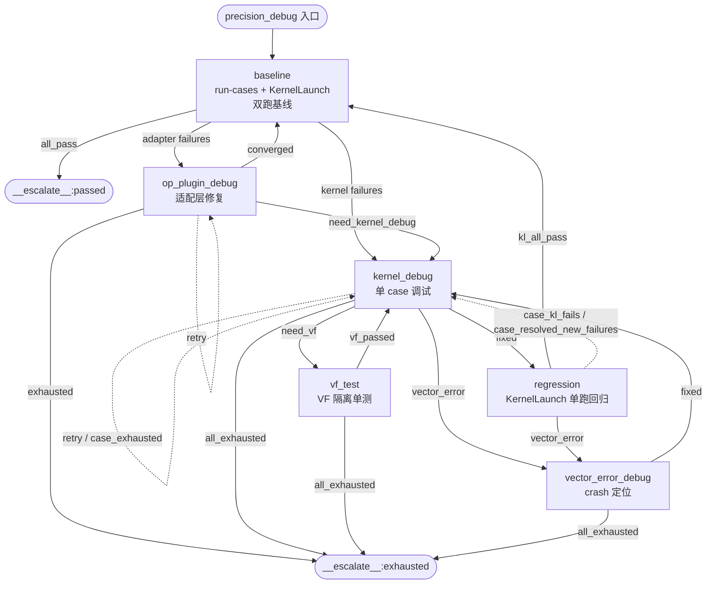
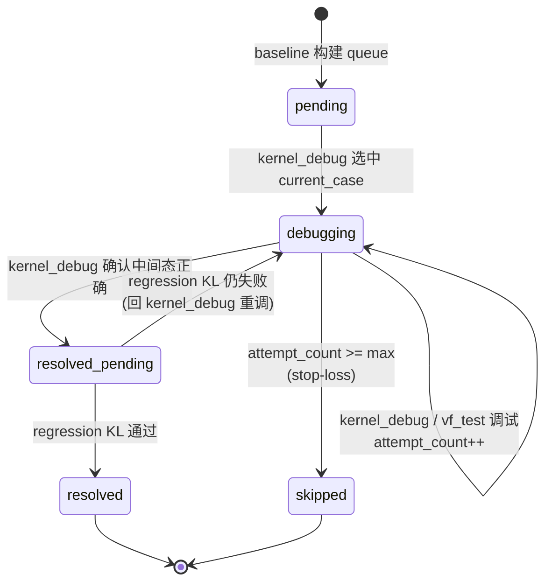

# A5 Precision Debug 编排层重构 — L3 方案分析

> 层级：L3（选项分析 + 决策 + 理由；调研中演进，拍板后冻结）  
> 日期：2026-08-01（v3，双工具基线 + op_plugin 诊断）  
> 覆盖问题：P1-P6（见 `01-problems.md`）

---

## 0. 用户定向（本次重构的四大决策）

| # | 决策 | 来源 |
|---|------|------|
| 1 | **删除 pipeline_sync 阶段**（流水同步方案移除） | 用户定调 |
| 2 | **删除 double buffer 切换逻辑**（全程原始 buffer 配置） | 用户定调 |
| 3 | **`__simd_vf__` 黑盒约束**（不得在 VF 内插探针/改代码，VF 验证只能走 vf-test 隔离单测） | 用户定调 |
| 4 | **工具分层 + 仿 A3 case-level 循环**，重命名阶段，重设整个流程 | 用户定调 |
| 5 | **双工具全量基线**：baseline 阶段同时用 run-cases + KernelLaunch 全量测试；run-cases 全 pass 则精度流程直接结束 | 用户定调 |
| 6 | **交叉对比隔离 op_plugin/aclnn 层问题**：run-cases 失败但 KernelLaunch 对应 case 通过 → 问题在 op_plugin/aclnn 层，路由到独立的 op_plugin 诊断 skill | 用户定调 |
| 7 | **case 诊断基于 KernelLaunch 结果**：后续逐 case 定位以 KernelLaunch 运行结果为输入 | 用户定调 |

> **camodel 已从 KernelLaunch 移除**：KernelLaunch 只剩上板实跑能力（无仿真 trace）。这使 pipeline_sync（依赖 camodel trace 分析流水）彻底无存在基础——决策 1 的技术依据。

---

## 1. 工具分层与交叉对比（决策 5/6/7 核心）

### 1.1 两个工具的覆盖范围

> **KernelLaunch 已改为直接调用二进制**（`_binary_match` 从 OPP 中取已编译的 `.o`，不再做 dynamic compile）。前提：算子必须先 `ascendc-devkit redeploy` 编译出包（OPP 中已有二进制 kernel）。两者跑的是**同一个编译产物**，只是调用路径不同。

| 工具 | 链路 | 覆盖层 | 不覆盖层 |
|------|------|--------|---------|
| **`ascendc-devkit run-cases`** | torch.ops → aclnn → host API（GetTilingFunc/GetKernelClass）→ kernel | kernel + tiling + host API + op_plugin + aclnn | — |
| **KernelLaunch** | `_binary_match`（从 OPP 取 `.o`）+ `_do_tiling`（host tiling 逻辑）→ `aclrtLaunch` kernel | kernel + tiling | op_plugin / aclnn 适配层 |

**交叉对比的隔离能力**：

```
run-cases 失败 + KernelLaunch 同 case 通过 → 问题在 op_plugin / aclnn 适配层
run-cases 失败 + KernelLaunch 同 case 失败 → 问题在 kernel / tiling 层
run-cases 通过 → 精度交付通过，流程结束（不论 KernelLaunch 结果）
```

### 1.2 工具在各阶段的分配

| 阶段 | 工具 | 理由 |
|------|------|------|
| baseline（全量基线） | **run-cases + KernelLaunch 双跑** | 建立两个维度的基线，交叉对比隔离问题层（决策 5/6） |
| kernel_debug（单 case 调试） | **KernelLaunch + DumpTensor** | 读 baseline 结果分析 + 插 DumpTensor 看中间态、定位 kernel/tiling 层数值错误（决策 7） |
| vf_test | **KernelLaunch**（SingleOperatorLaunch） | VF 函数黑盒隔离单测 |
| vector_error_debug | **KernelLaunch** | crash 定位 |
| op_plugin_debug（条件） | **读 + Edit op_plugin/aclnn 层代码 + 双跑验证** | run-cases 失败但 KernelLaunch 通过时，定位适配层问题，双跑验证收敛 |
| regression（双跑回归） | **run-cases + KernelLaunch 双跑** | 验收修复 + 更新 queue + 发现新回归（KernelLaunch 结果是下一个 case 的输入） |

---

## 2. 新流程设计（仿 A3 case-level 循环 + 双工具基线）

### 2.1 设计原则（从 A3 借鉴的精髓）

A3 的 case-level 循环精髓（`precision_debug_substages.py` 实证）：
1. **run_tests 建权威基线 + failed_case_queue**（全量回归，唯一精度判据写者）
2. **per-case fix loop**：fix 修一个 case → run_tests 全量回归确认 → 下一个 case
3. **per-case stop-loss**：`attempt_count >= max_attempts_per_case` → 框架自动 advance case
4. **resolve 判据**：单 case 验证通过 → `resolved_pending` → 全量回归通过 → `resolved`

A5 借鉴此骨架，但：基线双工具交叉对比、case 诊断基于 KernelLaunch、新增 op_plugin 适配层诊断阶段。

### 2.2 阶段命名与职责

| 顺序 | 阶段名 | 对应 skill/agent | 工具 | 职责 |
|------|--------|-----------------|------|------|
| 1 | `baseline` | `ascendc-precision-baseline` | run-cases **+ KernelLaunch** | 双工具全量基线（首跑需生成 KernelLaunch 测试脚本）；run-cases 全 pass → 直接退出；否则交叉对比，构建 failed_case_queue 并标注每 case 的归属层（kernel/tiling vs op_plugin/aclnn） |
| 2 | `kernel_debug` | `ascendc-precision-kernel-debug` | KernelLaunch | 对当前 case 做 KernelLaunch 直测：读 baseline 的 KernelLaunch 结果分析失败模式 → 插 DumpTensor 二分定位中间数值错误 → 修 kernel → 回验 |
| 3 | `vf_test` | `ascendc-precision-vf-debug` | KernelLaunch（SingleOperatorLaunch） | 条件触发：kernel_debug 定位到 VF 输出错误 → VF 隔离单测 |
| 4 | `vector_error_debug` | `ascendc-precision-vector-error-debug` | KernelLaunch | 条件触发：VECTOR_ERROR crash 定位 |
| 5 | `op_plugin_debug` | `ascendc-precision-op-plugin-debug` | 读 + Edit op_plugin/aclnn 代码 | 条件触发：run-cases 失败但 KernelLaunch 同 case 通过 → 适配层修复循环（双跑验证直到收敛） |
| 6 | `regression` | `ascendc-precision-regression` | run-cases **+ KernelLaunch** | 双跑回归：验证修复 + 更新 queue + 发现新回归 |

> **diagnose 已删除**：其职责（读 baseline 的 KernelLaunch 结果 + 分析失败模式 + 决定探针位置）合并进 kernel_debug。A5 无 candidate_pool，diagnose 与 kernel_debug 之间没有文件接力契约，拆分纯属多余。

### 2.3 新流程拓扑



### 2.4 case 状态机（仿 A3）



> **op_plugin_debug 不走 per-case 状态机**：它是框架级全局循环（所有 case 共享适配层）。
> 移交 kernel_debug（`need_kernel_debug`）时框架把指认的 case 改标 `error_layer=kernel` +
> `status=pending` 重新进入本状态机；未指认的纯适配层 case 标 `resolved`（baseline 重跑复验）。
> regression 已改为只跑 KernelLaunch，不再产生「KL 过了但 RC 仍失败」的 per-case 转 op_plugin
> 边——适配层问题一律由 baseline 双跑交叉对比发现并分流。

### 2.5 per-case 循环逻辑（框架驱动，agent 无感）

```
baseline（run-cases + KernelLaunch 双跑）→ 交叉对比
    │
    ├── run-cases 全 pass → __escalate__:passed（流程结束）
    │
    └── 有失败 → 构建 failed_case_queue
         每 case 标注归属层：
           KL pass + RC fail → op_plugin/aclnn 层（route_to_op_plugin）
           KL fail            → kernel/tiling 层（route_to_kernel_debug）
                          │
    ┌─────────────────────┘（kernel/tiling 层的 case 进入 per-case 循环）
    │ current_case = queue[idx]
    ▼
kernel_debug（KernelLaunch 直测）→ 读 baseline 结果分析 + 插 DumpTensor 定位中间态错误
    │
    ├── fixed → regression（KernelLaunch 单跑）
    │       ├── kl_all_pass → 回 baseline（权威双跑验收，RC 全 pass 才 __escalate__:passed）
    │       ├── 当前 case KL 过了 + 有新失败 case → advance 到新 case → 回 kernel_debug
    │       └── KernelLaunch 仍失败 → 回 kernel_debug（attempt++）
    ├── need_vf → vf_test → 回 kernel_debug
    ├── VECTOR_ERROR → vector_error_debug → 回 kernel_debug
    └── exhausted → attempt++ → 回 kernel_debug 或 stop-loss advance
                                         │
    （op_plugin/aclnn 层的 case 走框架层修复循环）│
                                         ▼
                              op_plugin_debug → 修适配层 → 双跑验证
                                ├── converged（RC 不报框架错误 + RC/KL 一致）→ 回 baseline 重新交叉对比
                                ├── need_kernel_debug（适配层非根因，残余失败在 kernel 层）→ 移交 kernel_debug
                                ├── retry → 继续修
                                └── exhausted → __escalate__:exhausted（适配层修不了，流程无法继续）
```

**与 A3 的关键差异**：

| 维度 | A3 | A5（新设计） |
|------|-----|-------------|
| 精度权威工具 | run-cases（贯穿全流程） | run-cases（baseline + regression）+ KernelLaunch（调试期） |
| 基线方式 | 单工具（run-cases） | **双工具交叉对比**（run-cases + KernelLaunch） |
| 问题层隔离 | 无（所有问题都当 kernel 问题） | **baseline 交叉对比自动隔离**（kernel/tiling vs op_plugin/aclnn） |
| 调试手段 | printf 二分（`fix` 单用例验证） | KernelLaunch 直测（DumpTensor 看中间态） |
| case 诊断输入 | run-cases 失败上下文 | **KernelLaunch 运行结果**（决策 7） |
| case 循环主体 | fix → run_tests | kernel_debug → regression |
| resolve 判据 | run_tests 全量通过 | regression 全量通过 |
| diagnose 与调试 | diagnose/fix 分离（candidate_pool 接力） | **合并进 kernel_debug**（无 pool，无需分离） |
| VF 维度 | 无 | vf_test 条件阶段（VF 黑盒约束） |
| crash 维度 | comment_bisect | vector_error_debug 专用阶段 |
| op_plugin 层 | 无（A3 不涉及） | **op_plugin_debug 框架层修复循环**（与双跑构建循环，直到 RC 不报框架错误 + 结果与 KL 一致） |

---

## 3. 各阶段详解

### 3.1 baseline — 双工具全量基线

**职责**：用 run-cases + KernelLaunch **双跑全量**，建立交叉对比基线，构建 `failed_case_queue` 并标注每 case 的归属层。

**工具**：run-cases + KernelLaunch。

**关键行为**：
1. **首跑需生成 KernelLaunch 测试脚本**（`{op_name}_kernel_launch_test.py`）：首次进入 baseline 时，读算子签名（`show_op_info`）+ golden_module + cases.csv，生成 KernelLaunch 全量测试脚本（含 golden 对比）。该脚本后续被 kernel_debug 复用。
2. `ascendc-devkit run-cases --workspace {ws} --label baseline --iter 0`（交付通路全量）。
3. `python3 {op_name}_kernel_launch_test.py`（kernel 直测全量）。
4. **run-cases 全 pass** → `__escalate__:passed`（精度交付通过，流程结束；不论 KernelLaunch 结果）。
5. run-cases 有失败 → 读两份结果做**逐 case 交叉对比**：
   - case 在 run-cases 失败 + KernelLaunch 通过 → 标 `error_layer: "op_plugin"`（适配层问题）
   - case 在 run-cases 失败 + KernelLaunch 也失败 → 标 `error_layer: "kernel"`（kernel/tiling 问题）
   - case 在 run-cases 失败 + KernelLaunch crash → 标 `error_layer: "kernel"` + `failure_type: "vector_error"`
6. 构建 `failed_case_queue`，每个 case 含 `error_layer` 标注。

**checkpoint 写入**：
```json
{
  "status": "in_progress",
  "phase": "baseline",
  "failed_case_queue": [
    {
      "case_id": "...", "shape": "...", "dtype": "...",
      "max_diff_rc": 1.2e-4,       // run-cases 的 max_diff
      "max_diff_kl": 1.1e-6,       // KernelLaunch 的 max_diff
      "error_layer": "op_plugin | kernel",
      "failure_type": "precision | runtime | vector_error",
      "status": "pending",
      "attempt_count": 0
    }
  ],
  "current_case_index": 0,
  "max_attempts_per_case": 3,
  "best_snapshot": { baseline 结果 }
}
```

**路由**：
- `all_pass`（run-cases 全过）→ `__escalate__:passed`
- `has_op_plugin_failures`（有 KL pass + RC fail 的 case）→ `op_plugin_debug`
- `has_kernel_failures`（有 KL fail 的 case）→ `kernel_debug`
- 同时有两类 → `op_plugin_debug` 先处理适配层，收敛后回 baseline 重新交叉对比，再进 `kernel_debug`

### 3.2 kernel_debug — 分析 + KernelLaunch 直测（核心调试阶段）

**职责**：读当前 case 的 KernelLaunch baseline 结果分析失败模式 → 插 DumpTensor 二分定位中间数值错误 → 修 kernel → 回验。

**工具**：KernelLaunch（上板实跑）。

**关键行为**：
1. **读 baseline 的 KernelLaunch 结果**分析当前 case 失败模式（OOB / 数值错误 / shape 问题 / tiling 问题）——吸收原 diagnose 职责。
2. 据分析在 kernel 插 DumpTensor（desc 100-199 CopyIn / 200-299 非 VF 计算 / 300-399 CopyOut）。
3. KernelLaunch 重跑当前 case（有探针），捕获 DumpTensor 输出。
4. 二分定位错误阶段（搬入错？非 VF 计算错？搬出错？）。
5. 定位到根因 → 修 kernel → KernelLaunch 回验（确认中间态正确）。
6. 中间态正确 → 标 `fixed` → 进 regression（双跑全量回归确认）。
7. 定位到「VF 输入正确但输出错误」→ 标 `need_vf`（VF 黑盒，不改 VF 代码）。
8. KernelLaunch crash (VECTOR_ERROR) → 转 `vector_error_debug`。

**VF 黑盒约束**（硬规则）：
- **不得在 `__simd_vf__` 函数体内插 DumpTensor/printf**。
- **不得修改 `__simd_vf__` 代码**。
- DumpTensor 只能插在 CopyIn/非 VF 的 Compute/CopyOut 段。
- 定位到 VF 输出错误 → `need_vf`，交给 vf_test。

**输入**：current_case 上下文 + baseline 的 KernelLaunch 结果（log + result）。

**产出**：`kernel_debug_round_{N}_result.json`

| 字段 | 说明 |
|------|------|
| `phase` | `kernel_debug` |
| `debug_status` | `fixed` / `need_vf` / `retry` / `exhausted` |
| `is_vf_issue` | true 时 VF 输出错误（转 vf_test） |
| `dump_evidence` | DumpTensor 中间态证据 |
| `code_modified` | 是否改了 kernel |
| `fix_summary` | 修复说明 |
| `error_type` | VECTOR_ERROR 时转 vector_error_debug |
| `error_pattern` | 精度误差分类：`systematic` / `localized` / `random` / `huge` / `dtype_specific` / `none` |
| `sync_check` | `ascendc-sync-static-check` 输出摘要（可选） |
| `tiling_check` | `tiling_bounds_check.py` 输出摘要（可选） |

**路由**：
- `fixed` → `regression`（双跑全量回归确认）
- `need_vf` → `vf_test`
- `VECTOR_ERROR` → `vector_error_debug`
- `retry` → 自循环（attempt_count++）
- `exhausted`（attempt_count ≥ max）→ 框架 advance case 或 `__escalate__:exhausted`

### 3.3 vf_test — VF 隔离单元测试（条件触发）

**职责**：kernel_debug 定位到 VF 输出错误时，把 VF 函数隔离抽出，用 SingleOperatorLaunch 独立验证。

**不变**：与现有 vf_test 设计一致（`__simd_vf__` 黑盒的唯一验证手段）。

### 3.4 vector_error_debug — crash 定位（条件触发）

**职责**：VECTOR_ERROR crash 定位与修复。

**基本不变**：保留现有 P1/P2/P3 guard 设计，但移除 buffer 模式相关逻辑。VECTOR_ERROR 修不好时返回 `case_exhausted`（跳过当前 case 继续下一个，不全局退出）。

### 3.5 regression — 双跑回归验证

**职责**：kernel_debug 确认中间态正确后，跑 **run-cases + KernelLaunch 双跑**全量回归，验证修复在交付通路有效，并检查是否引入新 regression。

**工具**：run-cases + KernelLaunch（与 baseline 一致的双跑）。

**关键行为**：
- `ascendc-devkit run-cases --workspace {ws} --label regression --iter {N}`
- `python3 {op_name}_kernel_launch_test.py`（复用 baseline 生成的脚本）
- 读双跑结果，判定（按优先级）：
  - **全部 case 双跑都过** → `__escalate__:passed`
  - **VECTOR_ERROR**（任一工具） → `vector_error_debug`
  - **当前 case KernelLaunch 仍失败** → `case_kl_fails`：问题还在 kernel 层 → 回 `kernel_debug`（attempt_count++）
  - **当前 case KernelLaunch 过了但 run-cases 仍失败** → `case_rc_only_fails`：kernel 层已修好，问题转到 op_plugin/aclnn 适配层 → 路由到 `op_plugin_debug`
  - **当前 case 双跑都过了** + 有新的失败 case → `case_resolved_new_failures`：当前 case `resolved` → 更新 queue（移除该 case + 新失败 case 加入末尾）→ advance 到下一个失败 case → 回 `kernel_debug`

> **为什么 `case_rc_only_fails` 路由到 op_plugin_debug 而非 kernel_debug**：
> kernel_debug 修的是 kernel 代码，回 kernel_debug 继续 attempt++ 只会改 kernel。但 KernelLaunch 已通过 = kernel 层对了，run-cases 仍失败 = 适配层引入了额外问题。此时再改 kernel 是南辕北辙——应路由到 op_plugin_debug 修适配层。修完后 op_plugin_debug `converged` 回 baseline 重新交叉对比，确认适配层修好。

**为什么 regression 也跑 KernelLaunch（而非只跑 run-cases）**：
- KernelLaunch 结果是下一个 case 的 kernel_debug 的**输入源**——必须反映最新 kernel 代码。
- `case_rc_only_fails` 路由依赖"KernelLaunch 过了但 run-cases 仍失败"的判定——只跑 run-cases 无法区分这个问题层。
- 若 kernel 改动引入了只在 KernelLaunch 暴露的回归（run-cases 因 op_plugin 层缓冲看不到），只有双跑才能发现。

**failed_case_queue 更新策略**：
- 当前 case resolved → 从 queue 移除。
- 全量双跑发现新的失败 case → **加入 queue 末尾**（含 `error_layer` 重新标注）。
- 若新失败 case 是之前 resolved 的 case → 标 `regressed`，重新进入 debugging。
- advance 指向 queue 中下一个非 resolved 的 case。

**与 baseline 的关系**：baseline 是入口（首轮建 queue + 交叉对比分流），regression 是 per-case 修复后的验收（双跑 + 更新 queue + advance）。两者都双跑，但 baseline 只跑一次（入口），regression 每修完一个 case 跑一次。

### 3.6 op_plugin_debug — op_plugin/aclnn 适配层修复循环（条件触发）

**触发条件**：baseline 交叉对比发现 run-cases 报**框架层错误**（crash/编译错误/注册失败等非精度问题），或 run-cases 与 KernelLaunch 结果**显著不一致**（同 case run-cases 失败但 KernelLaunch 通过，说明适配层引入了额外问题）。

**定位**：这是**框架层修复循环**，不是 per-case 调试。op_plugin/aclnn 适配层是所有 case 共享的——修好它才能让后续 per-case kernel 调试有意义。因此 op_plugin_debug 的循环退出判据是**全局的**（所有 case 的 run-cases 不报框架错误 + 结果与 KernelLaunch 一致），而非单个 case。

**工具**：读 + Edit op_plugin/aclnn 层代码 + run-cases + KernelLaunch 双跑验证。

**修复循环**（每次调用自包含一轮）：

```
op_plugin_debug 调用
    │
    ├── 读当前 run-cases 失败信息 + KernelLaunch 对比结果
    ├── 定位适配层问题（dtype 转换/shape reshape/attr 传递/tiling 映射）
    ├── 修 op_plugin/aclnn 代码
    │
    ▼ 双跑验证（run-cases + KernelLaunch 全量重跑）
    │
    ├── run-cases 仍报框架层错误 → retry（继续修）
    ├── run-cases 不报框架错误，但结果与 KL 仍不一致 → retry（继续修）
    ├── run-cases 不报框架错误 + 结果与 KL 基本一致 → converged（适配层修好）
    │       → 回 baseline 重新交叉对比（此时 error_layer 标注会更新）
    └── 达内部修复上限 → exhausted
```

**关键行为**：
1. 读 run-cases 失败信息（框架层错误 vs 精度问题）+ KernelLaunch 对应 case 的结果。
2. 误差/错误差值分析：
   - run-cases 报 crash/编译错误 → 适配层根本跑不通（如算子注册失败、aclnn 接口签名错、tiling 参数类型不匹配）。
   - run-cases 精度误差远大于 KernelLaunch → 适配层引入了额外误差（dtype 截断、shape reshape 错误、attr 传递错误、tiling 参数映射错误）。
3. 读 op_plugin 层代码（`{op_name}.cpp` / C++ OpAPI 实现）+ aclnn 接口定义。
4. 对比 KernelLaunch 传给 kernel 的参数 vs op_plugin/aclnn 传给 kernel 的参数（dtype/shape/attr/tiling），找差异。
5. 修 op_plugin 代码 → `redeploy` 重编出包。
6. **双跑验证**：run-cases + KernelLaunch 全量重跑，判收敛：
   - **收敛判据**（两项都满足）：
     1. run-cases **不报框架层错误**（无 crash/编译错误/注册失败）；
     2. run-cases 结果与 KernelLaunch 结果**基本一致**（同 case 的 pass/fail 状态一致，或精度误差在同量级）。
   - 收敛 → `converged`（适配层修好）。
   - 未收敛 → `retry`（继续下一轮修复）。

**输入**：双工具基线的 diff 差值 + op_plugin 代码路径 + run-cases 框架错误信息。

**产出**：`op_plugin_debug_round_{N}_result.json`

| 字段 | 说明 |
|------|------|
| `phase` | `op_plugin_debug` |
| `debug_status` | `converged`（适配层修好，回 baseline 重新对比）/ `retry`（继续修）/ `exhausted`（达修复上限） |
| `framework_error` | run-cases 的框架层错误类型（`none` / `crash` / `compile` / `registration` / `tiling_mismatch`） |
| `diff_analysis` | run-cases vs KernelLaunch 的误差差值分析 |
| `root_cause` | 适配层问题根因 |
| `code_modified` | 是否改了 op_plugin 代码 |
| `fix_summary` | 修复说明 |
| `convergence_check` | `{rc_no_framework_error: bool, rc_kl_consistent: bool}` |

**路由**：
- `converged` → `baseline`（重新交叉对比——此时适配层修好，`error_layer` 标注会更准确：原来因适配层 crash 导致的 "op_plugin" case 可能变为 "kernel" 层精度问题，或直接 pass）
- `need_kernel_debug` → `kernel_debug`（P7 新增：适配层非根因，残余失败移交 per-case kernel 调试，见下文）
- `retry` → 自循环
- `exhausted`（`op_plugin_round` ≥ `max_op_plugin_rounds`，默认 10）→ `__escalate__:exhausted`（适配层修不了，整个流程无法继续——因为 per-case kernel 调试依赖适配层跑通）

> **死循环防护**：`baseline → op_plugin_debug → converged → baseline → op_plugin_debug → ...` 若适配层修复不彻底会无限循环。用全局 `op_plugin_round` 计数器（框架在 op_plugin_debug transition 中递增），`retry` 达 `max_op_plugin_rounds`（默认 10）则钳为 `exhausted` 退出。`converged` / `need_kernel_debug` 是正向决策出口不受钳制。该计数器跨 baseline 回归不重置——一次 precision_debug 运行内 op_plugin_debug 的总调用次数有硬上限。

**与 kernel_debug 的边界**：
- kernel_debug 改的是**算子 kernel 源码**（`.cpp` kernel 代码）。
- op_plugin_debug 改的是**适配层代码**（op_plugin 的 C++ OpAPI / aclnn 接口实现 / tiling 参数映射）。
- 两者改的文件不同，不冲突。

**为什么 converged 回 baseline 而非 regression**：
op_plugin_debug 是框架层修复，影响所有 case 的交叉对比结果。修完后需要重新双跑建立新的基线——此时 `error_layer` 标注会重新计算：原来被适配层问题掩盖的 kernel 层问题会暴露出来，原来因适配层 crash 导致失败的 case 可能直接 pass。只有 baseline 重新交叉对比后，才能准确知道哪些 case 真正需要 per-case kernel 调试。

**新增：`need_kernel_debug` 出口（P7，适配层非根因时移交 kernel_debug）**：

当 op_plugin agent 逐项排查确认**适配层不是根因**（checklist 全 pass + KL vs op_plugin 传参无差异），或已修复适配层后，残余失败 case 在 **run-cases 与 KernelLaunch 下都失败**（`rc_no_framework_error=true` + `rc_kl_consistent=true` 但仍有一致失败的 case）→ 真实问题在 kernel/tiling 层。

原设计只有三条出口（converged→baseline / retry→自循环 / exhausted→escalate），适配层非根因时：
- retry 自循环空烧轮次 → exhausted → escalate 杀死流程（kernel_debug 本可修好）；
- 或被迫 converged→baseline 全量重跑重新分类（绕路、不携带 agent 已排查完适配层的证据）。

**决策**：新增 `debug_status=need_kernel_debug` 出口，agent 同时填 `kernel_cases`（判定为 kernel/tiling 层问题的 case_id 清单）。框架 transition 把 `kernel_cases` 改标 `error_layer=kernel` + `status=pending`（kernel_debug 只消费 pending case）、未指认的纯适配层 case 标 `resolved`（适配层工作已收口，baseline 重跑仍会复验，不会假通过）、`current_case_index` 指向第一个 pending kernel case，直接路由 `kernel_debug`。移交后 `kernel_debug → regression → baseline` 会重新双跑交叉对比，残余适配层问题仍会再次暴露——移交不绕过双跑验收。

**选择理由**：
- **可维护**：与 A3 fix 阶段 `need_printf`/`need_comment_bisect` 交接约定同型（明确出口 + 交接清单），单一事实来源在 result JSON `kernel_cases`。
- **可诊断**：`kernel_cases` 显式声明移交对象；移交后无 pending case（agent 声明移交但未指认 case）→ 退化走 converged 回 baseline，不硬闯空队列 kernel_debug。
- **架构合理**：op_plugin_debug（全局适配层循环）→ kernel_debug（per-case kernel 循环）是组内前向跳转，与 kernel_debug→vf_test/→vector_error_debug 同一机制；适配层判断只发生在持有双工具结果的 op_plugin agent，是唯一正确的产权方。
- **防误用**：轮次上限 `max_op_plugin_rounds` 只钳制 `retry`；`converged`/`need_kernel_debug` 是正向决策出口不受钳制。skill 明示判别要点：**仍有 case 只在 run-cases 失败而 KL 通过（RC/KL 不一致）→ 仍是适配层问题，必须 retry，不得报 need_kernel_debug**。

---

## A. 跨阶段结论接力文件（P8）

### A.1 目标

每个阶段把一段话结论写进一个共享 JSON，其他阶段开工前读它即可看到流程中所有已完成 agent 的结论，而不必逐个翻各阶段 result JSON（其结论性字段名不统一：`root_cause`/`fix_summary`/`diff_analysis`/`dump_evidence`）。

### A.2 方案

新建 `{debug_dir}/conclusions.json` 接力文件（§2.3 I/O 契约 = 文件）：

```json
{
  "updated_at": "2026-08-07T...",
  "phases": {
    "baseline": [{"round": 0, "conclusion": "...", "updated_at": "..."}],
    "op_plugin_debug": [{"round": 1, "conclusion": "...", "updated_at": "..."}]
  }
}
```

- **agent 只写自己阶段 result JSON 的 `conclusion` 字段**（一段话，6 个 skill 的 schema 均强制必填）；框架 transition 用 `_materialize_conclusion` 把它物化到 `conclusions.json`（`phases[phase]` 按轮次追加，保留历史；另维护 `last` = 最近一个完成的 agent）。写入权单一：agent 不直接写共享文件（与 checkpoint guard 同一原则）。
- **注入有界、只携带上一个 agent**：每个 agent spawn 时 `_common_context` 用 `_format_conclusions_block` 只渲染 `last`（= 当前 spawn 的"上一个 agent"结论）插入 prompt——构造性可见、且**不膨胀携带更早历史**（§2.9 构造性保证优先于检查门 + §2.3 文件接力）。完整历史由 agent 从 `conclusions_path` 读 `conclusions.json`。
- 缺/空 `conclusion` → 跳过不写 + Logger.warn 留痕（§1.2 可诊断，不静默吞）。

### A.3 选择理由

| 选项 | 说明 | 取舍 |
|---|---|---|
| A. 共享 `conclusions.json`，框架物化 | 单一写入权威 + 文件接力 + 保留轮次历史 | 采用。改动集中在 1 新模块 + 6 处 transition 各 1 行 + skill schema |
| B. agent 直接写共享文件 | 无需框架中转 | 弃。多 agent 并发写共享文件有撕裂风险，且与 checkpoint guard 的"共享状态框架独占写"原则冲突 |
| C. 复用 checkpoint.history 扩展 | 把结论塞进 history | 弃。history 是路由观测字段，塞自然语言结论污染路由快照；`conclusions.json` 独立职责更清晰 |

与 §2.5（唯一通路）：conclusion 的唯一来源是各阶段 result JSON 的 `conclusion` 字段，框架只做物化不做推导；6 阶段 skill 用同一字段名，不各立词表。

---

## B. 当前 case 的 max_diff 按最新测量回写（P9）

### B.1 问题

注入每个 phase prompt 的「当前待处理 case」块直接渲染 `failed_case_queue[current]`。该 dict 在 baseline 建队列时写入 `max_diff_rc`/`max_diff_kl`，之后无阶段回写——kernel_debug 重测出 `after_max_diff_kl=0.00098` 但 queue 仍显示 baseline 冻结值 65506，误导 regression 认为修复未生效。

### B.2 方案

框架在重测阶段 transition 里做**数据忠实回写**（§1.13：只转发 KL 脚本真实测得的值，不推导）：

- **kernel_debug**：读 `phase_result.verification.after_max_diff_kl` → 写回 `queue[current_case_index].max_diff_kl`。
- **regression**：重跑 KL 全量后，读 `{debug_dir}/baseline/kl_result.json`（KL 脚本输出，含 `all_results` 全量 per-case max_diff）→ 刷新 queue 中所有匹配 case 的 `max_diff_kl`。
- **baseline**：每次重建 queue（cross_compare 双跑），本身即最新，无需额外处理。
- `max_diff_rc` 仅 baseline 双跑测量（kernel_debug/regression 只跑 KL），baseline 重建队列时已是最新，其余阶段不改。

**注入块语义**：`max_diff_kl` = 最新一次 KernelLaunch 测量；`max_diff_rc` = 最近一次 run-cases 测量。block 增加一行标注，不再有"冻结值当当前状态展示"的误导。

### B.3 选择理由

| 选项 | 说明 | 取舍 |
|---|---|---|
| A. 重测阶段回写最新测量 | kernel_debug/regression transition 把测得值写回 queue | 采用。注入块反映真实进度，且数据忠实（§1.13） |
| B. 只改标注、不回写 | 把注入块字段改标 baseline 冻结值 | 弃。用户要求 regression 也更新最新（P9 定调），且 agent 拿到旧值仍不直观 |
| C. 注入块删掉 diff | 只留目标标识 | 弃。diff 是 agent 判断修复效果的直观信号，回写后即可放心保留 |

与 §2.9（构造性保证）：回写路径单一（框架 transition，数据来源 = agent 结果 JSON / KL 脚本输出），不新增 agent 写共享状态。

---

## 4. checkpoint 结构

### 4.1 写入边界

| 字段类别 | 写者 | 字段 |
|---------|------|------|
| **框架路由字段** | 仅框架 transition | `status`/`phase`/`current_case_index`/`max_attempts_per_case`/`history` |
| **case queue** | baseline skill 建 + 框架 advance | `failed_case_queue[].status`/`[].attempt_count` |
| **精度权威** | regression skill（比较更优才覆盖） | `best_snapshot` |
| **VECTOR_ERROR 路由** | 框架 `_record_phase_error` | `error_type`/`active_error_fingerprint` |
| **Git 安全** | 框架 `git_safety` | `initial_commit`/`rollback_safe`/`anchor_error` |

### 4.2 checkpoint.json schema

```json
{
  "status": "in_progress | passed | max_rounds_reached",
  "phase": "baseline | kernel_debug | vf_test | vector_error_debug | op_plugin_debug | regression",
  "failed_case_queue": [
    {
      "case_id": "...",
      "shape": "...",
      "dtype": "...",
      "max_diff_rc": 1.2e-4,
      "max_diff_kl": 1.1e-6,
      "error_layer": "op_plugin | kernel",
      "failure_type": "precision | runtime | vector_error",
      "status": "pending | debugging | resolved_pending | resolved | skipped",
      "attempt_count": 0,
      "last_fix_commit": ""
    }
  ],
  "current_case_index": 0,
  "max_attempts_per_case": 3,
  "op_plugin_round": 0,
  "max_op_plugin_rounds": 10,
  "best_snapshot": { ... },
  "error_type": "VECTOR_ERROR | (空)",
  "active_error_fingerprint": "...",
  "initial_commit": "...",
  "rollback_safe": true,
  "best_commit": "...",
  "history": [...]
}
```

> **注意**：删除了旧 schema 的 `pipeline_round`/`pipeline_status`/`dump_round`/`vf_round` 等 per-stage 轮次字段——case-level 循环用 `current_case_index` + per-case `attempt_count` 替代。

---

## 5. 过渡表（transition table）

```python
_A5_TRANSITION_TABLE = {
    "baseline": {
        "all_pass": ("__escalate__:passed", "validation"),
        "has_op_plugin_failures": ("op_plugin_debug", "corrective"),
        "has_kernel_failures":    ("kernel_debug", "corrective"),
        # 同时有两类 → has_op_plugin_failures 优先（先修适配层）
    },
    "kernel_debug": {
        "fixed":          ("regression", "validation"),
        "need_vf":        ("vf_test", "corrective"),
        "vector_error":   ("vector_error_debug", "corrective"),
        "retry":          ("kernel_debug", "corrective"),
        "case_exhausted": ("__case_advance__", "validation"),
        # 无全局 exhausted：case_exhausted → __case_advance__ 内部判断无更多 case
        # 时返回 __escalate__:exhausted
    },
    "vf_test": {
        "retry":          ("vf_test", "corrective"),
        "vf_passed":      ("kernel_debug", "corrective"),
        "vector_error":   ("vector_error_debug", "corrective"),
        "case_exhausted": ("__case_advance__", "validation"),
        # 同 kernel_debug：case_exhausted → __case_advance__ 处理
    },
    "vector_error_debug": {
        "retry":          ("vector_error_debug", "corrective"),
        "fixed":          ("kernel_debug", "validation"),
        "case_exhausted": ("__case_advance__", "validation"),  # VECTOR_ERROR 修不好 → 跳过此 case 继续下一个
        # 同上：__case_advance__ 内部判断无更多 case 时 __escalate__:exhausted
    },
    "op_plugin_debug": {
        "retry":          ("op_plugin_debug", "corrective"),
        "converged":      ("baseline", "validation"),   # 回 baseline 重新双跑交叉对比
        "exhausted":      ("__escalate__:exhausted", "validation"),
    },
    "regression": {
        "all_pass":       ("__escalate__:passed", "validation"),
        "case_resolved_new_failures": ("kernel_debug", "corrective"),  # 当前 case 过了，有新失败 case，advance 后继续调
        "case_kl_fails":  ("kernel_debug", "corrective"),   # KernelLaunch 仍失败 → 问题还在 kernel 层（attempt++）
        "case_rc_only_fails": ("op_plugin_debug", "corrective"),  # KL 过了但 RC 仍失败 → 问题转到适配层
        "vector_error":   ("vector_error_debug", "corrective"),
        # 无 exhausted：resolve_condition 不返回此条件
    },
}
```

> `__case_advance__` 是框架内联动作：advance `current_case_index` 到下一个非 resolved/skipped 的 case，若无更多 case 则 `__escalate__:exhausted`，否则回 `kernel_debug`。由 kernel_debug / vf_test / vector_error_debug 的 `case_exhausted`（attempt_count ≥ max 或 vector_error_round ≥ max）触发。regression 的 `case_resolved_new_failures` 也触发 advance。全局 `exhausted` 退出只在 `__case_advance__` 发现无更多 case 时发生——所有 per-case 阶段不再有独立的 `exhausted` 路由。

---

## 6. 文件结构（per-phase 子包）

```
src/ascendc_devkit/orchestration/stages/precision_debug_a5/
├── __init__.py            # 重导出 6 Substage + _A5_TRANSITION_TABLE
├── base.py                # _A5PrecisionDebugSubstage 基类 + _common_context
├── checkpoint.py          # checkpoint I/O + validate + case_loop helpers
├── best_snapshot.py       # best_snapshot 合并 + extract helpers
├── converge.py            # _sync_debug_result + _converge_to_best_commit
├── git_safety.py          # ← 移自 precision_debug_a5_git.py
├── vector_evidence.py     # ← 移自 vector_error_evidence.py（删 _SOURCE_BUFFER_MODES）
├── case_loop.py           # per-case 状态机：queue/index/advance/stop-loss
├── baseline.py            # BaselineSubstage（run-cases + KernelLaunch 双跑）
├── kernel_debug.py        # KernelDebugSubstage（读 baseline 结果 + KernelLaunch 直测）
├── vf_test.py             # VfTestSubstage（VF 隔离单测）
├── vector_error_debug.py  # VectorErrorDebugSubstage（crash 定位）
├── op_plugin_debug.py     # OpPluginDebugSubstage（适配层修复循环，条件触发）
└── regression.py          # RegressionSubstage（run-cases + KernelLaunch 双跑）
```

> 子阶段数 = 6（baseline / kernel_debug / vf_test / vector_error_debug / op_plugin_debug / regression）。

**删除**：
- 旧 `precision_debug_a5.py`（1895 行）
- `precision_debug_a5_git.py`（迁入子包 `git_safety.py`）
- `vector_error_evidence.py`（迁入子包 `vector_evidence.py`，删 buffer 映射）
- `.claude/skills/ascendc-pipeline-sync-debug/`（整个目录）
- `.claude/agents/ascendc-pipeline-sync-debug.md`

---

## 7. Skill 拆分与参考映射

### 7.1 总览

| # | 阶段 | skill 名 | agent 名 | 参考来源 |
|---|------|---------|---------|---------|
| 1 | baseline | `ascendc-precision-baseline` | `ascendc-precision-baseline` | A3 `ascendc-precision-run-tests`（run-cases + failed_case_queue 构建）+ 旧 A5 `ascendc-precision-finalize`（init 模式）+ `ascendc-custom-op-precision`（KernelLaunch 脚本生成） |
| 2 | kernel_debug | `ascendc-precision-kernel-debug` | `ascendc-precision-kernel-debug` | 旧 A5 `ascendc-precision-dump-debug`（DumpTensor 二分 + KernelLaunch）+ A3 `ascendc-precision-diagnose`（失败模式分析，合并进来）+ `ascendc-custom-op-precision`（KernelLaunch API 参考） |
| 3 | vf_test | `ascendc-precision-vf-debug` | `ascendc-precision-vf-debug` | **不变**（现有 skill 设计已正确：SingleOperatorLaunch 隔离 VF 函数） |
| 4 | vector_error_debug | `ascendc-precision-vector-error-debug` | `ascendc-precision-vector-error-debug` | **基本不变**，仅删 buffer 相关 + `fixed` 路由改回 `kernel_debug` |
| 5 | op_plugin_debug | `ascendc-precision-op-plugin-debug` | `ascendc-precision-op-plugin-debug` | **新建**，参考 `ascendc-pta`（op_plugin/aclnn 层代码结构知识）+ baseline 的交叉对比逻辑 |
| 6 | regression | `ascendc-precision-regression` | `ascendc-precision-regression` | 旧 A5 `ascendc-precision-finalize`（finalize 模式的 run-cases 逻辑）+ baseline 的 KernelLaunch 脚本复用 |

### 7.2 各 skill 任务详解与参考来源

#### skill 1：`ascendc-precision-baseline`（新建，从旧 skill 拼合）

**SKILL.md description**：

> A5 precision_debug 闭环的 baseline phase —— 双工具全量基线验证。首跑生成 KernelLaunch 测试脚本，随后 run-cases + KernelLaunch 双跑全量，逐 case 交叉对比隔离问题层（kernel/tiling vs op_plugin/aclnn），构建 failed_case_queue 并标注 error_layer。run-cases 全 pass 则精度交付通过、流程直接结束。框架 CompositeGroup 驱动，spawn 单次执行——读接力、写本 phase 产物、输出 RESULT 行即返回，不控制循环/路由（框架 BaselineSubstage.transition 替你做）。

**任务清单**：
1. 首跑生成 KernelLaunch 全量测试脚本（读算子签名 + golden + cases.csv → 写 `{op_name}_kernel_launch_test.py`）
2. 执行 `ascendc-devkit run-cases` 全量
3. 执行 `python3 {op_name}_kernel_launch_test.py` 全量
4. run-cases 全 pass → 输出 `all_pass`
5. 有失败 → 逐 case 交叉对比，标 `error_layer`（op_plugin / kernel）
6. 构建 `failed_case_queue` 写入 checkpoint
7. 刷新 `best_snapshot`

**参考来源**：

| 来源 | 复用什么 |
|------|---------|
| A3 `ascendc-precision-run-tests` SKILL.md | run-cases 全量执行 + `result.json` 解析 + `build-failed-case-queue.py` 脚本（failed_case_queue 构建逻辑） |
| A3 `ascendc-precision-run-tests/scripts/init-checkpoint.py` | checkpoint 初始化逻辑（git baseline + 备份） |
| 旧 A5 `ascendc-precision-finalize` SKILL.md（init 模式段） | A5 的 checkpoint 路径约定（`precision_debug_a5/`）+ baseline_result.json schema |
| `ascendc-custom-op-precision` SKILL.md | KernelLaunch 测试脚本模板（`KernelLauncher` 构造 + `set_input/set_output/run` + golden 对比 + `precision_test` 函数），§2.2 的上板脚本模板 |

#### skill 2：`ascendc-precision-kernel-debug`（从旧 skill 重命名 + 合并）

**SKILL.md description**：

> A5 precision_debug 闭环的 kernel_debug phase —— per-case kernel/tiling 层精度调试。读 baseline 的 KernelLaunch 结果分析当前 case 失败模式，在 kernel 中插 DumpTensor（desc 100-199 CopyIn / 200-299 非 VF 计算 / 300-399 CopyOut）二分定位中间数值错误，定位根因后修 kernel 并回验中间态正确。VF 黑盒约束：不得在 `__simd_vf__` 函数体内插探针或修改 VF 代码，定位到 VF 输出错误时标 need_vf 交给 vf_test。框架 CompositeGroup 驱动，spawn 单次执行——读接力、写本 phase 产物、输出 RESULT 行即返回，不控制循环/路由。

**任务清单**：
1. 读 baseline 的 KernelLaunch 结果 + run-cases 结果，分析当前 case 失败模式
2. **调用 `ascendc-sync-static-check` 扫描当前 kernel 代码的同步缺陷**（EnQue/DeQue 配对、SetFlag/WaitFlag、MTE2/MTE3 地址重叠、PipeBarrier、Mutex/TBuf、Scalar 流水）
3. **调用 `tiling_bounds_check.py` 轻量脚本检查当前 case 的 tiling 边界/对齐/尾块**（见 `03-solutions.md` §3.1）
4. 据分析 + 静态扫描结果在 kernel 插 DumpTensor（desc 100-199 CopyIn / 200-299 非 VF / 300-399 CopyOut）
5. KernelLaunch 重跑当前 case（有探针），捕获 DumpTensor 输出
6. 二分定位错误阶段
7. 定位根因 → 修 kernel → KernelLaunch 回验（确认中间态正确）→ `fixed`
8. VF 输入正确输出错误 → `need_vf`
9. VECTOR_ERROR → 转出
10. 刷新 `best_snapshot`（仅有效数值结果）

**VF 黑盒约束**：不得在 `__simd_vf__` 内插探针 / 不得改 VF 代码

**参考来源**：

| 来源 | 复用什么 |
|------|---------|
| 旧 A5 `ascendc-precision-dump-debug` SKILL.md | DumpTensor 二分定位完整流程（Step 1 desc 编号规范 / 二分法 / 配合测试脚本定位 / 退探针）+ KernelLaunch 参考（API 表 / 上板脚本模板）+ `is_vf_issue` 判定逻辑 + VECTOR_ERROR 交接规则 |
| A3 `ascendc-precision-diagnose` SKILL.md | 失败模式分析逻辑（OOB / 数值错误 / shape 问题 / tiling 问题的分类判断）——原 diagnose 职责合并进来，不再产 candidate_pool 而是直接内联到 kernel_debug 的分析步骤 |
| `ascendc-custom-op-precision` SKILL.md | KernelLaunch 高级用法（DumpTensor 插入 + GetValue + 多 dtype 支持） |
| `ascendc-dev-knowledge`（knowledge skill） | AscendC API 查证（修 kernel 时确认 API 签名/dtype） |
| `ascendc-sync-static-check` skill | 核内同步缺陷静态扫描（A5 删除 `pipeline_sync` 后主要同步诊断手段） |
| A3 `ascendc-precision-bounds-check` references / `transform-rules.md` | tiling 边界/对齐/尾块检查规则（裁剪为单 case 轻量脚本） |

#### skill 3：`ascendc-precision-vf-debug`（不变）

**SKILL.md description**（现有，不改）：

> A5 precision_debug 的 vf_test phase —— `__simd_vf__` 函数隔离单元测试（VF 黑盒的唯一验证手段）。前置：kernel_debug 返回 is_vf_issue=true 且 vf_functions[0] 指认了出错 VF 函数。对指认的单个 VF 函数做隔离单元测试并修复：按函数名读取规格 → VF 指令参考预查询 + 历史经验检索 → 参考算子级 golden_module 构造 VF 级期望值 → 用 SingleOperatorLaunch 生成测试 kernel + 编译运行 + 精度验证 → 单次合规性检查 → 必要时修复 → 回验。框架 CompositeGroup 驱动，spawn 单次执行。

**任务清单**：
1. 按函数名从 coding_index.md 读取 VF 函数规格
2. 预查询 VF 指令参考 + 历史经验检索
3. 参考 golden_module 构造 VF 级期望值
4. SingleOperatorLaunch 隔离测试
5. 合规性检查
6. `vf_status=passed` 时归档 vf_lesson.md

**参考来源**：**现有 skill 不改**。它是 `__simd_vf__` 黑盒的唯一验证手段，设计已正确。

#### skill 4：`ascendc-precision-vector-error-debug`（小改）

**SKILL.md description**（微调，删 buffer 相关 + 路由改回 kernel_debug）：

> A5 precision_debug 的 vector_error_debug phase —— device VECTOR_ERROR crash 定位与修复。触发条件：baseline/kernel_debug/vf_test/regression 任一阶段返回 error_type=VECTOR_ERROR。通过运行时证据归一化、A5 RegBase/VF 静态风险扫描（P1 guard）、Top-K 定向安全消融（P2 guard）、区域二分和行级确认定位 device vector error，实施修复并回验（P3 guard）。单次运行返回阶段结论，不派下级 subagent。修复后路由回 kernel_debug 做回归。

**任务清单**：
1. 稳定复现 VECTOR_ERROR
2. A5 静态规则扫描（P1 guard）
3. 受控实验（P2 guard）
4. 区域二分 + 行级确认
5. 修复（P3 guard）
6. 单 case 复现确认

**改动**：删 buffer 模式相关逻辑（`_SOURCE_BUFFER_MODES`）；`fixed` 路由从 `pipeline_sync` 改为 `kernel_debug`。

**参考来源**：**现有 skill 主体不变**（P1/P2/P3 guard 脚本 + references）。

#### skill 5：`ascendc-precision-op-plugin-debug`（新建）

**SKILL.md description**：

> A5 precision_debug 的 op_plugin_debug phase —— op_plugin/aclnn 适配层修复循环（框架层级，非 per-case）。触发条件：baseline 交叉对比发现 run-cases 失败但 KernelLaunch 同 case 通过（error_layer=op_plugin），或 regression 判定 KernelLaunch 过了但 run-cases 仍失败（case_rc_only_fails）。对比 KernelLaunch 传给 kernel 的参数 vs op_plugin/aclnn 传给 kernel 的参数（dtype/shape/attr/tiling），定位适配层差异并修复，随后 run-cases + KernelLaunch 双跑验证直到收敛（RC 不报框架错误 + RC/KL 结果基本一致）。收敛后回 baseline 重新交叉对比。框架 CompositeGroup 驱动，spawn 单次执行。

**任务清单**：
1. 读双工具基线的 diff 差值（`max_diff_rc` vs `max_diff_kl`）+ run-cases 框架错误信息
2. **按错误码表解码 run-cases 返回的错误码**（161xxx / 561xxx），定位注册/签名/环境/tiling 类型问题
3. **按 `op_plugin-checklist.md` 逐项排查**：注册宏、aclnn/C++ OpAPI 签名、dtype 转换、shape reshape、attr 传递、tiling 参数映射、`op_info.json` 字段
4. 读 op_plugin 层代码（`{op_name}.cpp` C++ OpAPI 实现）+ aclnn 接口定义
5. 对比 KernelLaunch 传给 kernel 的参数 vs op_plugin/aclnn 传给 kernel 的参数（dtype/shape/attr/tiling），找差异
6. 修 op_plugin 代码 → redeploy 重编出包
7. 双跑验证收敛（RC 不报框架错误 + RC/KL 结果一致 → `converged`）

**参考来源**：

| 来源 | 复用什么 |
|------|---------|
| `ascendc-pta` skill | op_plugin / aclnn 层的代码结构知识（C++ OpAPI 实现写法、aclnn 接口签名约定、GE converter、tiling 参数映射）——这是 op_plugin_debug 的核心领域知识 |
| baseline 的 KernelLaunch 测试脚本 | 双跑验证复用同一脚本 |
| `ascendc-dev-knowledge` | aclnn API 规格 / op_plugin 注册机制查证 |
| `ascendc-runtime-debug` references | 错误码表 `error_codes.md` + 调试流程清单 `debug_workflow.md`（A5 用清单方式复用，不做 plog 自动解析） |

#### skill 6：`ascendc-precision-regression`（新建）

**SKILL.md description**：

> A5 precision_debug 的 regression phase —— per-case 修复后双跑回归验收。kernel_debug 确认中间态正确（fixed）后进入此阶段，执行 run-cases + KernelLaunch 双跑全量，判定当前 case 是否真正通过：KernelLaunch 仍失败 → case_kl_fails（回 kernel_debug）；KernelLaunch 过了但 run-cases 仍失败 → case_rc_only_fails（转 op_plugin_debug）；当前 case 双跑过了但有新失败 case → case_resolved_new_failures（advance 后回 kernel_debug）；全部通过 → all_pass。更新 failed_case_queue（移除已 resolved case / 新失败 case 加入末尾）并刷新 best_snapshot。框架 CompositeGroup 驱动，spawn 单次执行。

**任务清单**：
1. 执行 `ascendc-devkit run-cases` 全量
2. 执行 `python3 {op_name}_kernel_launch_test.py` 全量（复用 baseline 生成的脚本）
3. 读双跑结果判定：
   - 全 pass → `all_pass`
   - 当前 case KL 仍失败 → `case_kl_fails`
   - 当前 case KL 过了但 RC 仍失败 → `case_rc_only_fails`
   - 当前 case 双跑过了 + 有新失败 case → `case_resolved_new_failures`
   - VECTOR_ERROR → 转出
4. 更新 `failed_case_queue`（当前 case resolved → 移除；新失败 case → 加入末尾）
5. 刷新 `best_snapshot`

**参考来源**：

| 来源 | 复用什么 |
|------|---------|
| 旧 A5 `ascendc-precision-finalize` SKILL.md（finalize 模式段） | run-cases 全量执行 + result.json 解析 + finalize_result.json schema |
| baseline 的 KernelLaunch 测试脚本 | 复用同一脚本跑全量 |
| baseline 的交叉对比逻辑 | regression 也需交叉对比判定 `case_kl_fails` vs `case_rc_only_fails` |

### 7.3 删除的 skill / agent

| 文件 | 动作 | 理由 |
|------|------|------|
| `.claude/skills/ascendc-pipeline-sync-debug/` | 删除整个目录 | pipeline_sync 阶段删除（决策 1） |
| `.claude/agents/ascendc-pipeline-sync-debug.md` | 删除 | 同上 |
| `.claude/skills/ascendc-precision-dump-debug/` | 删除（内容迁入 kernel-debug） | 重命名为 kernel-debug |
| `.claude/agents/ascendc-precision-dump-debug.md` | 删除 | 同上 |
| `.claude/skills/ascendc-precision-finalize/` | 删除（内容拆入 baseline + regression） | 拆分为 baseline（init 模式）+ regression（finalize 模式） |
| `.claude/agents/ascendc-precision-finalize.md` | 删除 | 同上 |
| `.claude/skills/ascendc-precision-diagnose/` | **不删**（A3 仍用） | A3 精度调试仍需要此 skill；A5 只是不再引用 |
| `.claude/agents/ascendc-precision-diagnose.md` | **不删** | 同上 |

---

## 8. 各阶段输入输出与编排层状态跳转

> 本章定义每个 Substage 的 **I/O 契约**（skill 产出什么 JSON、框架读什么做路由）和 **Python 编排层的 transition() + resolve_condition() 判断逻辑**。

### 8.0 通用约定

**文件接力路径**：

```
{workspace}/artifacts/precision_debug_a5/
├── checkpoint.json                              # 框架路由权威（transition 写、所有阶段读）
├── baseline/
│   ├── baseline_result.json                     # skill 产出（双跑结果 + 交叉对比 + queue）
│   └── {op_name}_kernel_launch_test.py          # 首跑生成的 KernelLaunch 脚本（后续复用）
├── kernel-debug/
│   └── kernel_debug_round_{N}_result.json     # skill 产物（含 error_pattern / sync_check / tiling_check）
├── vf-test/
│   └── vf_round_{N}_result.json
├── vector-error/
│   └── vector_error_round_{N}_result.json
├── op-plugin-debug/
│   └── op_plugin_debug_round_{N}_result.json
├── regression/
│   └── regression_round_{N}_result.json
└── scripts/
    └── tiling_bounds_check.py                 # 轻量 tiling 边界检查脚本（kernel_debug 调用）
```


**transition() 通用流程**（所有阶段共享）：
```python
def transition(self, state, result):
    # 1. 加载 checkpoint（spawn 前 + agent 可能修改后的）
    cp = _load_checkpoint(state)
    # 2. 恢复框架路由字段（防止 agent 越权改）
    cp = _restore_framework_routing_fields(state, cp, phase=self.name)
    # 3. 加载本阶段 result JSON（skill 产物，含 RESULT 判定）
    cp, round_num, phase_result = _load_expected_result(state, cp, phase=self.name, ...)
    # 4. 阶段特定逻辑（见各阶段下文）
    # 5. 保存 checkpoint
    _save_checkpoint(state, cp)
    # 6. lift 到 state._debug_checkpoint
    dc = _extract_checkpoint(cp)
    state = state.with_updates(_debug_checkpoint=dc)
    return _sync_debug_result(state, dc)
```

**resolve_condition() 通用流程**：
```python
def resolve_condition(self, state):
    dc = state._debug_checkpoint or {}
    # 各阶段读 dc 中的字段返回条件字符串
    # 条件字符串查 _A5_TRANSITION_TABLE 决定路由
```

---

### 8.1 baseline — BaselineSubstage

#### I/O 契约

| 方向 | 文件 / 字段 | 内容 |
|------|------------|------|
| **读（框架注入 context）** | `checkpoint.json`（若已存在） | 上次 baseline 结果（op_plugin_debug converged 回来时复跑） |
| **读（skill 自取）** | `cases.csv` / `golden_module` | 全量 case 列表 + golden 实现 |
| **写（skill 产出）** | `baseline/baseline_result.json` | `{phase, rc_result{pass,total,failed_cases[]}, kl_result{pass,total,failed_cases[]}, cross_compare[{case_id, rc_pass, kl_pass, max_diff_rc, max_diff_kl, error_layer}], baseline_status}` |
| **写（skill 产出）** | `baseline/{op_name}_kernel_launch_test.py` | 首跑生成的 KernelLaunch 脚本（后续 kernel_debug / regression 复用） |
| **写（skill → checkpoint）** | `checkpoint.json.best_snapshot` | 双跑的更优结果 |
| **写（框架 transition）** | `checkpoint.json` 路由字段 | `status` / `phase` / `failed_case_queue` / `current_case_index=0` / `history` |

#### transition() 逻辑

```python
def transition(self, state, result):
    cp = ...  # 通用流程 1-3
    baseline = _load_result(state, "baseline", "baseline_result")

    rc_failed = baseline.get("rc_result", {}).get("failed_cases", [])
    kl_result = baseline.get("kl_result", {})
    cross_compare = baseline.get("cross_compare", [])

    # 构建 failed_case_queue + 标注 error_layer
    queue = []
    for cc in cross_compare:
        case = {
            "case_id": cc["case_id"],
            "shape": cc.get("shape", ""),
            "dtype": cc.get("dtype", ""),
            "max_diff_rc": cc.get("max_diff_rc"),
            "max_diff_kl": cc.get("max_diff_kl"),
            "error_layer": "op_plugin" if (cc.get("rc_pass") is False
                                           and cc.get("kl_pass") is True)
                           else "kernel",
            "failure_type": cc.get("failure_type", "precision"),
            "status": "pending",
            "attempt_count": 0,
        }
        queue.append(case)

    cp["status"] = "in_progress"
    cp["phase"] = "baseline"
    cp["failed_case_queue"] = queue
    cp["current_case_index"] = 0
    cp["op_plugin_round"] = cp.get("op_plugin_round", 0)  # 不重置（跨 baseline 回归累计）
    cp["history"] = [...]  # 追加 baseline 条目
    _record_phase_error(cp, baseline, "baseline")  # VECTOR_ERROR 检测
    _merge_best_snapshot(cp, baseline, "baseline", 0)
    _save_checkpoint(state, cp)
    dc = _extract_checkpoint(cp)
    # lift baseline_status 供 resolve_condition 读
    dc["baseline_status"] = baseline.get("baseline_status", "failed")
    state = state.with_updates(_debug_checkpoint=dc)
    return _sync_debug_result(state, dc)
```

#### resolve_condition() 逻辑

```python
def resolve_condition(self, state):
    dc = state._debug_checkpoint or {}

    # 1. VECTOR_ERROR 优先
    if dc.get("error_type") == "VECTOR_ERROR":
        return "has_kernel_failures"  # VECTOR_ERROR 归 kernel 层，进 kernel_debug

    # 2. run-cases 全 pass（baseline_status 由 skill 写入，框架 lift 到 dc）
    if dc.get("baseline_status") == "passed":
        return "all_pass"

    # 3. 有失败 → 按层分流
    queue = dc.get("failed_case_queue", [])
    has_op_plugin = any(c["error_layer"] == "op_plugin" for c in queue)
    has_kernel = any(c["error_layer"] == "kernel" for c in queue)

    # kernel 优先（决策 Q6 修订，2026-09-01：精度问题优先调度
    # ascendc-precision-kernel-debug；op_plugin 适配层问题在 kernel 工作收敛后由
    # baseline 重跑重新分流处理）
    if has_kernel:
        return "has_kernel_failures"
    if has_op_plugin:
        return "has_op_plugin_failures"
    return "all_pass"  # 兜底（queue 为空或全 resolved）
```

---

### 8.2 kernel_debug — KernelDebugSubstage

#### I/O 契约

| 方向 | 文件 / 字段 | 内容 |
|------|------------|------|
| **读（框架注入 context）** | `checkpoint.json` | `failed_case_queue[current_case_index]`（当前 case）+ `best_snapshot`（上次 regression 的 KL 结果） |
| **读（skill 自取）** | `baseline/baseline_result.json` 的 `kl_result` | baseline 的 KernelLaunch 全量结果（分析失败模式输入） |
| **读（skill 自取）** | `baseline/{op_name}_kernel_launch_test.py` | 复用 KernelLaunch 脚本 |
| **写（skill 产出）** | `kernel-debug/kernel_debug_round_{N}_result.json` | `{phase, debug_status, is_vf_issue, vf_functions[], dump_evidence, code_modified, fix_summary, error_type, vector_error_evidence}` |
| **写（skill → checkpoint）** | `checkpoint.json.best_snapshot` | 仅有效数值结果（非 VECTOR_ERROR） |
| **写（框架 transition）** | `checkpoint.json` 路由字段 | `phase` / `attempt_count`（当前 case）/ `history` |

#### transition() 逻辑

```python
def transition(self, state, result):
    cp, round_num, phase_result = ...  # 通用流程 1-3

    debug_status = phase_result.get("debug_status", "retry")
    case_idx = cp.get("current_case_index", 0)
    queue = cp.get("failed_case_queue", [])

    # 更新当前 case 的 attempt_count
    if 0 <= case_idx < len(queue):
        queue[case_idx]["attempt_count"] = queue[case_idx].get("attempt_count", 0) + 1
        queue[case_idx]["status"] = "debugging"

    cp["phase"] = "kernel_debug"
    cp["history"] = [...]  # 追加
    error_type = _record_phase_error(cp, phase_result, "kernel_debug")

    if error_type != "VECTOR_ERROR" and debug_status != "retry":
        _merge_best_snapshot(cp, phase_result, "kernel_debug", round_num)

    # stop-loss 检查（attempt_count >= max）
    if 0 <= case_idx < len(queue):
        if queue[case_idx]["attempt_count"] >= cp.get("max_attempts_per_case", 3):
            queue[case_idx]["status"] = "skipped"
            # resolve_condition 会返回 case_exhausted

    _save_checkpoint(state, cp)
    return _sync(state, cp)
```

#### resolve_condition() 逻辑

```python
def resolve_condition(self, state):
    dc = state._debug_checkpoint or {}
    cp = _load_checkpoint_from_dc(dc)

    # 1. VECTOR_ERROR
    if dc.get("error_type") == "VECTOR_ERROR":
        return "vector_error"

    # 2. 读最新 result 的 debug_status
    case_idx = dc.get("current_case_index", 0)
    queue = dc.get("failed_case_queue", [])
    case = queue[case_idx] if 0 <= case_idx < len(queue) else {}

    # 3. stop-loss 优先
    if case.get("attempt_count", 0) >= dc.get("max_attempts_per_case", 3):
        return "case_exhausted"

    # 4. debug_status 路由
    status = dc.get("latest_debug_status", "retry")  # 从 result JSON 读
    if status == "fixed":
        return "fixed"
    if status == "need_vf":
        return "need_vf"
    return "retry"  # 默认自循环
```

---

### 8.3 vf_test — VfTestSubstage

#### I/O 契约

| 方向 | 文件 / 字段 | 内容 |
|------|------------|------|
| **读** | `checkpoint.json` | `failed_case_queue[current_case_index]` + 最新 kernel_debug result 的 `vf_functions[]` |
| **写（skill 产出）** | `vf-test/vf_round_{N}_result.json` | `{phase, vf_status, vf_func, code_modified, compliance, precision_result, fix_summary, next_hint, error_type}` |
| **写（skill → checkpoint）** | `best_snapshot` | 仅有效数值结果 |
| **写（框架）** | `phase` / `attempt_count`（当前 case）/ `history` |

#### transition() 逻辑

```python
def transition(self, state, result):
    cp, round_num, phase_result = ...  # 通用流程

    vf_status = phase_result.get("vf_status", "failed")
    case_idx = cp.get("current_case_index", 0)
    queue = cp.get("failed_case_queue", [])
    if 0 <= case_idx < len(queue):
        queue[case_idx]["attempt_count"] = queue[case_idx].get("attempt_count", 0) + 1

    cp["phase"] = "vf_test"
    cp["history"] = [...]
    error_type = _record_phase_error(cp, phase_result, "vf_test")
    if error_type != "VECTOR_ERROR":
        _merge_best_snapshot(cp, phase_result, "vf_test", round_num)

    # stop-loss
    if 0 <= case_idx < len(queue):
        if queue[case_idx]["attempt_count"] >= cp.get("max_attempts_per_case", 3):
            queue[case_idx]["status"] = "skipped"

    _save_checkpoint(state, cp)
    return _sync(state, cp)
```

#### resolve_condition() 逻辑

```python
def resolve_condition(self, state):
    dc = state._debug_checkpoint or {}
    if dc.get("error_type") == "VECTOR_ERROR":
        return "vector_error"
    case_idx = dc.get("current_case_index", 0)
    queue = dc.get("failed_case_queue", [])
    case = queue[case_idx] if 0 <= case_idx < len(queue) else {}
    if case.get("attempt_count", 0) >= dc.get("max_attempts_per_case", 3):
        return "case_exhausted"
    if dc.get("vf_status") == "passed":
        return "vf_passed"
    return "retry"
```

---

### 8.4 vector_error_debug — VectorErrorDebugSubstage

#### I/O 契约

| 方向 | 文件 / 字段 | 内容 |
|------|------------|------|
| **读** | `checkpoint.json` | `vector_error_evidence` / `active_error_fingerprint` / `vector_error_source_phase` |
| **写（skill 产出）** | `vector-error/vector_error_round_{N}_result.json` | `{phase, vector_error_status, error_signature, ...（现有 schema 不变）}` |
| **写（框架）** | `error_type` / `vector_error_status` / `phase` / `history` |
| **不写** | `best_snapshot`（VECTOR_ERROR 无数值信号，§4.1） |

#### transition() 逻辑

```python
def transition(self, state, result):
    cp, round_num, phase_result = ...  # 通用流程

    vector_status = phase_result.get("vector_error_status", "unresolved")
    # 验证 fixed 的合法性（需 verification.vector_error_cleared=true）
    if vector_status == "fixed":
        verification = phase_result.get("verification")
        if not (isinstance(verification, dict)
                and verification.get("vector_error_cleared") is True):
            vector_status = "unresolved"

    max_rounds = cp.get("max_vector_error_rounds", 3)
    terminal = vector_status != "fixed" and round_num >= max_rounds

    cp["phase"] = "vector_error_debug"
    cp["vector_error_status"] = vector_status
    cp["status"] = "max_rounds_reached" if terminal else "in_progress"
    # fixed 清除 active error_type
    cp["error_type"] = "" if vector_status == "fixed" else "VECTOR_ERROR"
    cp["history"] = [...]
    # 不调 _merge_best_snapshot
    _save_checkpoint(state, cp)
    return _sync(state, cp)
```

#### resolve_condition() 逻辑

```python
def resolve_condition(self, state):
    dc = state._debug_checkpoint or {}
    if dc.get("vector_error_status") == "fixed":
        return "fixed"
    # VECTOR_ERROR 修不好 → 跳过当前 case 继续下一个（不全局退出）
    if dc.get("vector_error_round", 0) >= dc.get("max_vector_error_rounds", 3):
        return "case_exhausted"
    return "retry"
```

---

### 8.5 op_plugin_debug — OpPluginDebugSubstage

#### I/O 契约

| 方向 | 文件 / 字段 | 内容 |
|------|------------|------|
| **读** | `checkpoint.json` | `failed_case_queue`（所有 error_layer=op_plugin 的 case）+ `best_snapshot`（双跑 diff） |
| **读（skill 自取）** | op_plugin 源码 + aclnn 接口定义 | 适配层代码（agent 用 Read/Grep 查） |
| **写（skill 产出）** | `op-plugin-debug/op_plugin_debug_round_{N}_result.json` | `{phase, debug_status, framework_error, diff_analysis, root_cause, code_modified, fix_summary, convergence_check{rc_no_framework_error, rc_kl_consistent}}` |
| **写（框架）** | `op_plugin_round`（递增）/ `phase` / `history` |
| **不写** | `best_snapshot`（适配层修复不改变 kernel 数值结果） |

#### transition() 逻辑

```python
def transition(self, state, result):
    cp, round_num, phase_result = ...  # 通用流程

    debug_status = phase_result.get("debug_status", "retry")
    cp["op_plugin_round"] = cp.get("op_plugin_round", 0) + 1
    cp["phase"] = "op_plugin_debug"
    cp["history"] = [...]
    _save_checkpoint(state, cp)
    return _sync(state, cp)
```

#### resolve_condition() 逻辑

```python
def resolve_condition(self, state):
    dc = state._debug_checkpoint or {}

    # 1. 死循环防护（问题 3 修复）
    if dc.get("op_plugin_round", 0) >= dc.get("max_op_plugin_rounds", 3):
        return "exhausted"

    # 2. 读 debug_status
    status = dc.get("latest_op_plugin_status", "retry")
    if status == "converged":
        return "converged"
    return "retry"
```

---

### 8.6 regression — RegressionSubstage

#### I/O 契约

| 方向 | 文件 / 字段 | 内容 |
|------|------------|------|
| **读** | `checkpoint.json` | `failed_case_queue[current_case_index]`（验证当前 case）+ 全 queue（检查新 regression） |
| **读（skill 自取）** | `baseline/{op_name}_kernel_launch_test.py` | 复用 KernelLaunch 脚本 |
| **写（skill 产出）** | `regression/regression_round_{N}_result.json` | `{phase, rc_result{pass,total,failed_cases[]}, kl_result{pass,total,failed_cases[]}, cross_compare[{case_id, rc_pass, kl_pass, ...}], current_case_passed, new_failed_cases[]}` |
| **写（skill → checkpoint）** | `best_snapshot` | 更优结果覆盖 |
| **写（框架 transition）** | `failed_case_queue`（移除 resolved + 新 case 加入）/ `phase` / `history` |

#### transition() 逻辑

```python
def transition(self, state, result):
    cp, round_num, phase_result = ...  # 通用流程

    case_idx = cp.get("current_case_index", 0)
    queue = cp.get("failed_case_queue", [])
    current_case = queue[case_idx] if 0 <= case_idx < len(queue) else {}

    cross_compare = phase_result.get("cross_compare", [])
    rc_failed_ids = {cc["case_id"] for cc in cross_compare if not cc.get("rc_pass")}
    kl_failed_ids = {cc["case_id"] for cc in cross_compare if not cc.get("kl_pass")}
    all_pass = len(rc_failed_ids) == 0

    if all_pass:
        cp["status"] = "passed"
    else:
        # 当前 case 状态更新
        current_id = current_case.get("case_id", "")
        if current_id not in rc_failed_ids and current_id not in kl_failed_ids:
            # 当前 case 双跑都过了 → resolved
            current_case["status"] = "resolved"
        # 新失败 case 加入 queue
        for cc in cross_compare:
            cid = cc["case_id"]
            if cid in rc_failed_ids or cid in kl_failed_ids:
                existing = next((c for c in queue if c["case_id"] == cid), None)
                if existing and existing.get("status") == "resolved":
                    existing["status"] = "debugging"  # 标 regressed
                elif not existing:
                    queue.append({
                        "case_id": cid, "shape": cc.get("shape", ""),
                        "dtype": cc.get("dtype", ""),
                        "max_diff_rc": cc.get("max_diff_rc"),
                        "max_diff_kl": cc.get("max_diff_kl"),
                        "error_layer": "op_plugin" if (cid in rc_failed_ids
                                                       and cid not in kl_failed_ids)
                                       else "kernel",
                        "failure_type": cc.get("failure_type", "precision"),
                        "status": "pending", "attempt_count": 0,
                    })

    cp["phase"] = "regression"
    cp["failed_case_queue"] = queue
    cp["history"] = [...]
    error_type = _record_phase_error(cp, phase_result, "regression")
    if error_type != "VECTOR_ERROR":
        _merge_best_snapshot(cp, phase_result, "regression", round_num)
    _save_checkpoint(state, cp)
    dc = _extract_checkpoint(cp)
    # lift 路由判定所需的临时字段（resolve_condition 读）
    dc["latest_rc_failed_ids"] = rc_failed_ids
    dc["latest_kl_failed_ids"] = kl_failed_ids
    state = state.with_updates(_debug_checkpoint=dc)
    return _sync_debug_result(state, dc)
```

#### resolve_condition() 逻辑

```python
def resolve_condition(self, state):
    dc = state._debug_checkpoint or {}
    cp = _load_checkpoint_from_dc(dc)

    # 1. 全 pass
    if dc.get("status") == "passed":
        return "all_pass"

    # 2. VECTOR_ERROR
    if dc.get("error_type") == "VECTOR_ERROR":
        return "vector_error"

    # 3. 当前 case 状态判定
    case_idx = dc.get("current_case_index", 0)
    queue = dc.get("failed_case_queue", [])
    current_case = queue[case_idx] if 0 <= case_idx < len(queue) else {}
    current_id = current_case.get("case_id", "")

    # 从最新 regression result 读交叉对比结果
    rc_failed_ids = dc.get("latest_rc_failed_ids", set())
    kl_failed_ids = dc.get("latest_kl_failed_ids", set())

    if current_id in kl_failed_ids:
        # KernelLaunch 仍失败 → 问题还在 kernel 层
        return "case_kl_fails"
    if current_id in rc_failed_ids and current_id not in kl_failed_ids:
        # KL 过了但 RC 仍失败 → 问题转到适配层
        return "case_rc_only_fails"
    # 当前 case 双跑过了 → 有新失败 case
    return "case_resolved_new_failures"
```

#### 框架内联动作 `__case_advance__`

当 kernel_debug / vf_test / vector_error_debug 返回 `case_exhausted` 时，框架执行：

```python
def _case_advance(cp):
    """advance current_case_index 到下一个非 resolved/skipped 的 case。"""
    queue = cp.get("failed_case_queue", [])
    idx = cp.get("current_case_index", 0)
    idx += 1
    # 跳过已 resolved/skipped 的 case
    while idx < len(queue) and queue[idx].get("status") in ("resolved", "skipped"):
        idx += 1
    if idx >= len(queue):
        return "__escalate__:exhausted"  # 全部 case 处理完
    cp["current_case_index"] = idx
    return "kernel_debug"  # 回 kernel_debug 调下一个 case
```

regression 的 `case_resolved_new_failures` 同样触发 advance（当前 case resolved → 框架 advance 到 queue 中下一个失败 case → 回 kernel_debug）。

---

## 9. PR 拆分

### PR-1：删旧 + 建空壳新拓扑（语义改动）

- 删 pipeline_sync / buffer 切换 / 旧 dump_debug 的 VF 内部检查段
- 建 6 个新 Substage（baseline/kernel_debug/vf_test/vector_error_debug/op_plugin_debug/regression）
- 新转移表 + 新 checkpoint schema
- 各 Substage 先用最小 prompt（职责 + 产出 + 返回协议）
- UT 覆盖新转移表路由
- 删旧 skill/agent（pipeline_sync）

### PR-2：文件拆分（零语义改动）

- 单文件 → per-phase 子包（§6 文件结构）
- git_safety / vector_evidence 迁入
- UT 全绿

### PR-3：per-case case_loop 完善

- case_loop.py 完整实现（queue/index/advance/stop-loss/`__case_advance__`）
- baseline 建 queue、regression 升级 resolved、kernel_debug 选中 case
- UT 覆盖 per-case 循环

### PR-4：prompt 瘦身 + skill/agent 完善

- 各 SKILL.md 重写（baseline/kernel_debug/regression）
- agent manifest 更新
- prompt 瘦身为 ~5 行模板
- 过渡态字段收敛（State 瞬态）
- 文档更新

---

## 10. 待用户确认

| # | 问题 | 选项 | 推荐 |
|---|------|------|------|
| **Q1** | 阶段命名（6 个）：baseline / kernel_debug / vf_test / vector_error_debug / op_plugin_debug / regression，是否 OK？ | 接受 / 改名 | 接受 |
| **Q2** | regression case 仍失败时回 kernel_debug（attempt++）还是直接 stop-loss？ | 回 kernel_debug / stop-loss | **回 kernel_debug**（可能是 tiling 问题，值得再调） |
| **Q3** | baseline 和 regression 都双跑，是否合并？ | 合并 / 分开 | **分开**（baseline 是入口建 queue + 交叉对比分流；regression 是 per-case 修复后验收 + 更新 queue + 发现新回归；路由条件不同） |
| **Q4** | per-case stop-loss 用跨阶段合计 attempt_count？ | 是 / 否 | **是** |
| **Q5** | op_plugin_debug 修复后回 baseline（重新交叉对比）还是回 regression？ | baseline / regression | **baseline**（适配层是全局共享的，修完需重新双跑建立新基线） |
| **Q6** | baseline 同时有 op_plugin 和 kernel 两类失败 case 时，先处理哪类？ | op_plugin 优先 / kernel 优先 / 按 case 顺序 | **op_plugin 优先** → **已修订：kernel 优先**（2026-09-01 用户拍板：出现精度问题时优先调度 `ascendc-precision-kernel-debug` 解 kernel/tiling 层问题；混合队列路由 kernel_debug 时 per-case 阶段跳过 op_plugin case，kernel 工作收敛后回 baseline 重跑把适配层失败分流到 op_plugin_debug。实现见 `baseline.py resolve_condition` + `case_loop._advance_past_resolved(skip_op_plugin=...)`） |
| **Q7** | KernelLaunch 测试脚本生成在 baseline 首跑时自动生成，还是需要单独的 script_gen 阶段？ | baseline 内 / 独立阶段 | **baseline 内**（首跑一次性生成，后续复用） |
