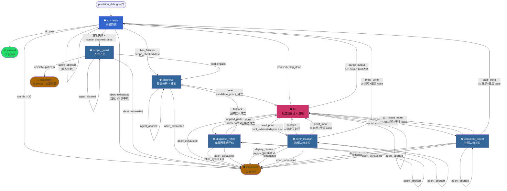
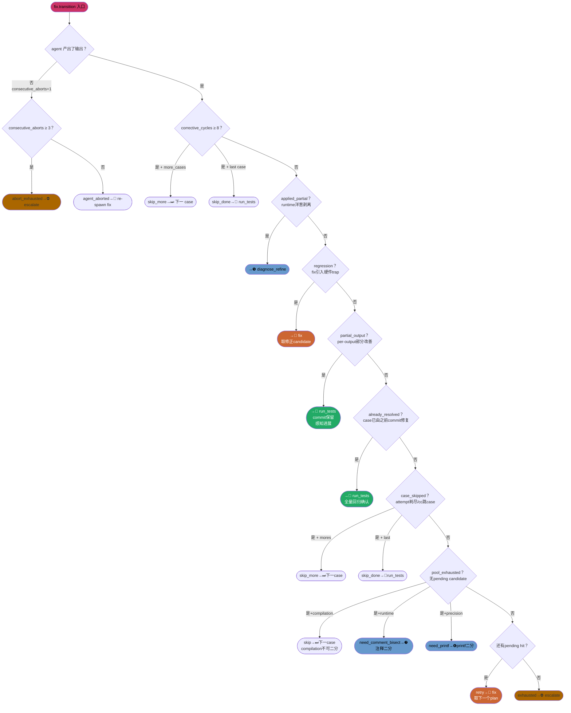
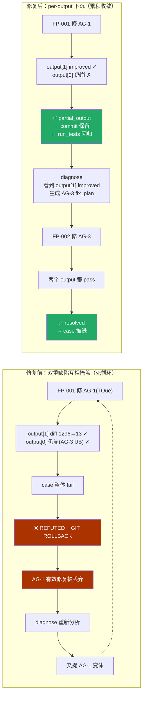
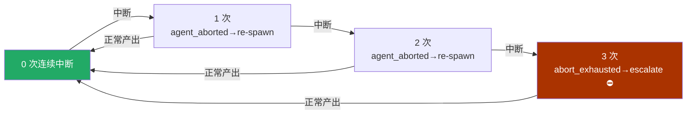
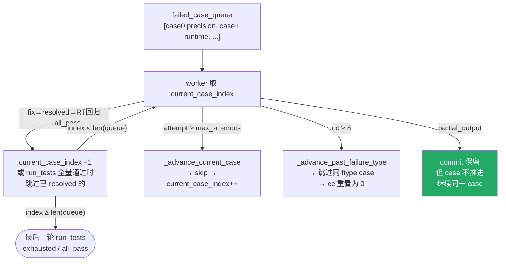

# precision_debug 闭环工作流 — 所有路由 & 情况

## 顶层：7 阶段主流程

---

## Fix 阶段路由（12 条，按优先级）

---

## Per-Output 下沉路径（新增 detail）

---

## Agent Abort 退火（A0）

---

## case 队列推进

---

## 三层收敛安全网

| 层级 | 计数器 | 触发线 | 动作 | 恢复 |
|------|--------|--------|------|------|
| 1️⃣ 语义收敛 | `rounds`（run_tests +1） | > 30 | exhausted → 出 group | - |
| 2️⃣ 小循环熔断 | `corrective_cycles`（fix/printf/bisect +1） | ≥ 8 | case_skipped → 推进 / run_tests | run_tests 归零 |
| 3️⃣ 中断退火 | `consecutive_aborts`（agent 无输出 +1） | ≥ 3 | abort_exhausted → 出 group | 正常产出归零 |
| 🆘 事后兜底 | graph_executor stagnation | 同一 pair 2 次 | halt | - |
| 🆘 最后保险 | CompositeGroup max_corrective | 200 | halt | - |
