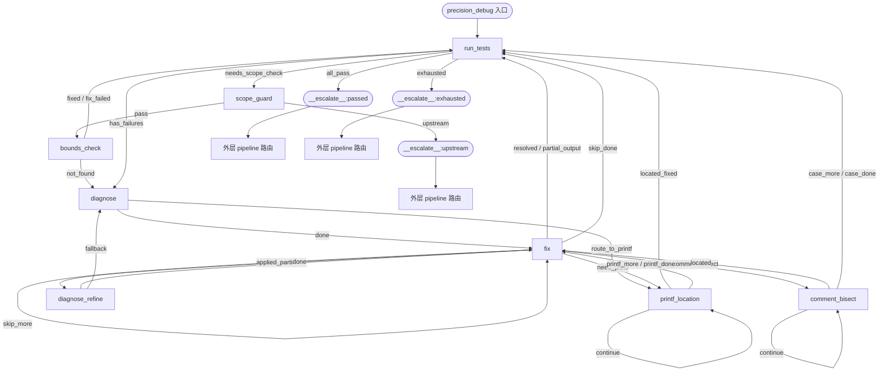

# A3 Precision Debug 阶段流程与状态跳转

> 文档版本：v1.0
> 对应代码：`src/ascendc_devkit/orchestration/stages/precision_debug_substages.py`、`src/ascendc_devkit/orchestration/precision_debug_tree.py`
> 适用芯片：A2 / A3 / 910B（非 A5 RegBase）

---

## 1. 总体架构

A3 Precision Debug 是 `AscendC-DevKit` 算子精度调试的核心闭环。它以 **CompositeGroup**（`precision_debug_tree.build_precision_debug_group`）形式挂载在 L3 编排中，由 `GraphExecutor` 通过 `spawn → wait → transition → route` 的同步方式驱动。

与旧版异步 LLM Orchestrator 不同，当前实现将循环控制权收回到框架：

- 每个 phase 作为独立子 Agent 被 `spawn` 一次；
- Agent 只负责产出原始结果与 LLM 判定；
- 所有路由不变式（case 推进、候选池去重、轮数上限、agent abort annealing、best commit 比较）由框架代码统一维护。

### 1.1 阶段组成

A3 流程包含 8 个子阶段（按 group 中顺序）：

| 顺序 | 子阶段 | 对应 Skill/Agent | 主要职责 | 默认是否顺序执行 |
|---|---|---|---|---|
| 1 | `run_tests` | `ascendc-precision-run-tests` | 全量回归测试，初始化 control.json，构建 failed_case_queue | 是 |
| 2 | `scope_guard` | `ascendc-precision-scope-guard` | 首轮失败时判定是否上游缺陷（codegen/test_design/golden/deploy），决定是否继续 | 否（仅 run_tests 触发） |
| 3 | `bounds_check` | `ascendc-precision-bounds-check` | 静态越界/对齐检查与机械修复 | 否（仅 scope_guard.pass 触发） |
| 4 | `diagnose` | `ascendc-precision-diagnose` | 静态分析失败症状，生成 candidate_pool | 是 |
| 5 | `fix` | `ascendc-precision-fix` | 应用 fix_plan，单用例验证，commit/rollback | 是 |
| 6 | `diagnose_refine` | `ascendc-precision-diagnose`（refine 模式） | runtime 洋葱剥离，增量因果链诊断 | 否（仅 fix.applied_partial 触发） |
| 7 | `printf_location` | `ascendc-precision-printf-locate` | 对 precision 失败做 printf 二分定位并修复 | 否（仅 fix.need_printf 触发） |
| 8 | `comment_bisect` | `ascendc-precision-comment-bisect` | 对 runtime crash 做注释二分定位 | 否（仅 fix.need_comment_bisect 触发） |

> 注意：CompositeGroup 中 `scope_guard` 排在最后，但它**不是线性后继**，仅通过 `run_tests.needs_scope_check` 进入；`bounds_check` 也不是线性后继，仅通过 `scope_guard.pass` 进入。

---

## 2. 总流程图



说明：

- `run_tests` 是 group 入口，也是唯一能全量回归的阶段；
- `scope_guard` 作为首轮入口守卫，避免把上游缺陷误当成精度问题；
- `bounds_check` 在 LLM 诊断前先做一次静态/机械检查，命中则直接修复并回到 `run_tests` 验证；
- 主循环为 `run_tests → diagnose → fix`，并可能进入 `diagnose_refine` / `printf_location` / `comment_bisect`；
- 所有终止态都以 `__escalate__:<cond>` 形式冒泡到外层 pipeline，由根 `TRANSITION_TABLE` 决定下一步（`generate_ascendc` 通常是 halt，`self_evolve_op` 通常是 cannbench_adapt 软门）。

---

## 3. 文件接力机制

精度调试的所有跨阶段状态通过两个文件层进行接力：

### 3.1 control.json（框架路由层）

路径：`{workspace.artifacts}/debug/{op_name}/control.json`

- 由框架读取以做路由决策；
- 各 phase agent 只写自己负责的字段，**禁止整体重写**；
- 包含所有框架路由字段：`status`、`failed_case_queue`、`current_case_index`、`candidate_pool`、`debug_state`、`printf_location_result`、`scope_*`、`corrective_cycles`、`best_*` 等。

### 3.2 precision_<phase>.json（phase 私有数据层）

路径：`{workspace.artifacts}/debug/{op_name}/phases/<phase>/precision_<phase>.json`

- 每个 phase 自己 owner 的深度数据；
- 多轮 spawn 时通过 `_rNNN_pMMM` 后缀归档，避免覆盖；
- 框架通常只用于加载期 schema 校验，不用于路由；
- phase 间读取通过非后缀化的 `latest` 路径。

---

## 4. 状态跳转详细逻辑

### 4.1 run_tests

**入口动作：**

1. 若 `control.json` 不存在，运行 `init-checkpoint.py` 初始化：
   - 备份算子源码到 `{operator_dir}/.precision-fix/original_backup/`；
   - 记录 git baseline；
   - 写入完整 `control.json` 与空 `precision_run_tests.json`。
2. 框架侧首次进入时做入口全量 commit（`_entry_commit_codegen`），把 codegen 产物固化进 git，保证后续 rollback 安全。
3. 开始墙钟计时（`_precision_start_ts`）。

**核心职责：**

- 执行全量回归测试（禁止单用例）；
- 解析 `result.json`，构建 `failed_case_queue`；
- 分类每个失败用例的 `failure_type`（`precision` / `runtime` / `compilation`）；
- 更新 `control.json` 的 `status` / `failed_case_queue` / `best_*` 等字段；
- 写 `precision_run_tests.json` 的 `last_result_json` / `last_run_log` / `_summary`。

**路由条件（resolve_condition）：**

| 条件 | 含义 | 跳转目标 |
|---|---|---|
| `agent_aborted` | agent 连续 abort 但未到阈值 | self-loop → `run_tests` |
| `abort_exhausted` | 连续 abort ≥ 3 次 | `__escalate__:exhausted` |
| `all_pass` | `status == "passed"` | `__escalate__:passed` |
| `exhausted` | `rounds > max_iterations` 或时间预算耗尽 | `__escalate__:exhausted` |
| `needs_scope_check` | 首轮失败且 `scope_checked == false` | `scope_guard` |
| `has_failures` | 默认分支 | `diagnose`（线性后继） |

**最佳 commit 判定（P4）：**

- 比较维度为 **通过用例数 `passed_count`**（`total_count - failed_count`）；
- 只有严格大于上一次才更新 `best_commit`，相等或退步不更新，防止越改越差；
- `crashed_count` / `real_max_err` 仅用于观测，不参与比较。

### 4.2 scope_guard

**触发条件：** run_tests 在首轮失败且尚未做 scope 判定时。

**核心职责：**

- 读 `history[-1].content` 与 `failed_case_queue`；
- 判断失败是「上游缺陷」（codegen/test_design/golden/deploy）还是「本阶段职责」（kernel 精度 / runtime 问题）；
- 写 `scope_verdict.json` 与 `control.json` 的 `scope_*` 字段。

**路由条件：**

| 条件 | 含义 | 跳转目标 |
|---|---|---|
| `pass` | 本阶段职责，继续精度调试 | `bounds_check` |
| `upstream` | 上游缺陷，不能继续 | `__escalate__:upstream` |
| `agent_aborted` | abort 未耗尽 | self-loop → `scope_guard` |
| `abort_exhausted` | 连续 abort ≥ 3 次 | `__escalate__:exhausted` |

**重要约束：**

- `scope_verdict` 必须是 `"upstream"` 或 `"pass"`，否则抛出 `PrecisionDebugContractError`；
- 已判定过的 verdict 会被缓存复用（幂等）。

### 4.3 bounds_check

**触发条件：** `scope_guard.pass`。

**核心职责：**

- 遍历 `failed_case_queue` 中每个失败用例的 shape/dtype；
- 构建 Python shadow 模拟 kernel 地址计算；
- 检查 GM_OOB / UB_OOB / ALIGN_32B / UB_TOTAL；
- 对 CRITICAL 发现应用模板化机械修复，并用 shadow 重跑验证（不跑单用例）。

**路由条件：**

| 条件 | 含义 | 跳转目标 |
|---|---|---|
| `fixed` | 发现 CRITICAL 且机械修复成功 | `run_tests`（全量验证） |
| `fix_failed` | 发现 CRITICAL 但修复失败（仍尝试 best-effort） | `run_tests` |
| `not_found` | 无 CRITICAL 问题 | `diagnose` |
| `agent_aborted` | abort 未耗尽 | self-loop → `bounds_check` |
| `abort_exhausted` | 连续 abort ≥ 3 次 | `__escalate__:exhausted` |

### 4.4 diagnose

**核心职责：**

- 按 `failure_type` 分支分析：
  - `compilation`：读编译日志，定位第一个错误，生成 fix_plan；
  - `runtime`：解码错误码 + 架构缺漏对比；
  - `precision`：Gate1 静态匹配 + Gate2 同步检查。
- 写 `candidate_pool` 到 `control.json`；
- 写 `precision_diagnose.json` 的 `arch_gaps` / `diagnose_done` / `_summary`。

**路由条件：**

| 条件 | 含义 | 跳转目标 |
|---|---|---|
| `route_to_printf` | agent 自评需直接 printf 二分（症状唯一/结构排除） | `printf_location` |
| `done` | 默认分支，候选池已生成 | `fix`（线性后继） |
| `agent_aborted` | abort 未耗尽 | self-loop → `diagnose` |
| `abort_exhausted` | 连续 abort ≥ 3 次 | `__escalate__:exhausted` |

### 4.5 fix

**核心职责：**

- 从 `candidate_pool` 取未验证最高优先级 fix_plan；
- 按 A/B 分级验证：
  - **A 级**（高置信不确定）：先插 printf 前后探针，confirmed 才应用；
  - **B 级**（低风险逻辑错误）：直接 Edit 应用。
- 单用例通过 → `commit` + `case.status = "resolved_pending"`；
- 失败 → rollback + 标记 hit `verified = "refuted"`。

**特殊处理：**

- `already_resolved`：发现当前 case 已被之前 commit 修复，直接标 `resolved_pending`；
- `applied_partial`：修复了原 runtime errcode 但暴露新的 pre-existing errcode（runtime 洋葱剥离）；
- `regression`：修复引入了硬件 trap；
- `partial_output`：多输出算子部分输出改善；
- 候选池耗尽：
  - `precision` → 需要 printf 二分；
  - `runtime` → 需要 comment_bisect；
  - `compilation` → 跳过当前 case。

**路由条件：**

| 条件 | 含义 | 跳转目标 |
|---|---|---|
| `resolved` | 单用例通过 / 已解决 | `run_tests` |
| `partial_output` | 部分输出改善 | `run_tests` |
| `applied_partial` | runtime 洋葱剥离 | `diagnose_refine` |
| `regression` | 修复引入硬件问题 | `fix`（self-loop，尝试修正候选） |
| `need_printf` | precision 候选池耗尽 | `printf_location` |
| `need_comment_bisect` | runtime 候选池耗尽 | `comment_bisect` |
| `retry` | 还有候选 | `fix`（self-loop） |
| `skip_more` | 当前 case 跳过，还有下一个 case | `fix` |
| `skip_done` | 当前 case 跳过，已是最后一个 | `run_tests` |
| `agent_aborted` | abort 未耗尽 | self-loop → `fix` |
| `abort_exhausted` | 连续 abort ≥ 3 次 | `__escalate__:exhausted` |
| `exhausted` | 时间预算耗尽 | `__escalate__:exhausted` |

**per-case stop-loss（P3）：**

- `attempt_count >= max_attempts_per_case`（默认 8）→ 框架自动 `current_case_index + 1`；
- `corrective_cycles >= max_corrective_cycles`（默认 6）→ 框架自动跳过所有同 failure_type 的 case。

### 4.6 diagnose_refine

**触发条件：** `fix.applied_partial`（runtime 洋葱剥离）。

**核心职责：**

- 只消费上一轮 fix 的 `error_migration_evidence`；
- 过单一道 Causal Chain 门：判断新暴露的 errcode 是否 pre-existing 且在执行流上是原问题的下游；
- 通过则生成增量 `fix_plan`（`source = "refine"`），fallback 则回到完整 diagnose。

**路由条件：**

| 条件 | 含义 | 跳转目标 |
|---|---|---|
| `done` | causal chain 通过 | `fix` |
| `fallback` | causal chain 不通过 | `diagnose` |
| `exhausted` | `refine_cycles > 3` | `__escalate__:exhausted` |
| `agent_aborted` | abort 未耗尽 | self-loop → `diagnose_refine` |
| `abort_exhausted` | 连续 abort ≥ 3 次 | `__escalate__:exhausted` |

### 4.7 printf_location

**触发条件：** `fix.need_printf`（precision 类型候选池耗尽）。

**核心职责：**

- 把算子公式拆成 `formula_steps`；
- 插入 printf 探针，build + 跑单用例，对比 CPU golden；
- 定位首个数值发散点并修复；
- 修复成功则 commit，`printf_location_result = "located_fixed"`；
- 无法定位则 `printf_location_result = "exhausted"`，由框架推进 case。

**deploy health（P8）：**

- 每轮必须写 `deploy_health = {build_ok, output_ok, agent_fallback}`；
- 连续 3 轮 `build_ok=false` 或 `output_ok=false` → `deploy_broken` 熔断。

**路由条件：**

| 条件 | 含义 | 跳转目标 |
|---|---|---|
| `located_fixed` | 定位并修复成功 | `run_tests` |
| `continue` | 继续二分 | self-loop → `printf_location` |
| `printf_more` | 当前 case 跳过，还有下一个 | `fix` |
| `printf_done` | 当前 case 跳过，已是最后一个 | `fix` |
| `deploy_broken` | deploy health 熔断 | `__escalate__:deploy_broken` |
| `exhausted` | corrective_cycles 耗尽 | `__escalate__:exhausted` |
| `agent_aborted` | abort 未耗尽 | self-loop → `printf_location` |
| `abort_exhausted` | 连续 abort ≥ 3 次 | `__escalate__:exhausted` |

### 4.8 comment_bisect

**触发条件：** `fix.need_comment_bisect`（runtime 候选池耗尽）。

**核心职责：**

- 对 runtime crash 做注释二分；
- printf 在此无用（kernel 死在 flush 前），判定信号是纯 crash/no-crash；
- 优先消融 DataCopy / DataCopyPad / TQue 调用点（参数降级，**禁止裸注释**）；
- 定位到根因后生成 `fix_plan`（`source = "comment_bisect"`），回到 `fix` 验证。

**多根因处理：**

- 同 case 再次进入时读取 `bisect_progress.located_roots` 跳过已定位区域。

**路由条件（与 printf_location 镜像）：**

| 条件 | 含义 | 跳转目标 |
|---|---|---|
| `located` | 定位到根因 | `fix` |
| `continue` | 继续二分 | self-loop → `comment_bisect` |
| `case_more` | 当前 case 跳过，还有下一个 | `fix` |
| `case_done` | 当前 case 跳过，已是最后一个 | `run_tests` |
| `deploy_broken` | deploy health 熔断 | `__escalate__:deploy_broken` |
| `exhausted` | corrective_cycles 耗尽 | `__escalate__:exhausted` |
| `agent_aborted` | abort 未耗尽 | self-loop → `comment_bisect` |
| `abort_exhausted` | 连续 abort ≥ 3 次 | `__escalate__:exhausted` |

---

## 5. 控制面状态机

### 5.1 核心计数器

| 字段 | 所有者 | 含义 | 默认值 |
|---|---|---|---|
| `rounds` | 框架（RunTestsSubstage.transition） | 全量回归轮数 | 0 |
| `max_iterations` | control.json / runtime_config | 最大轮数上限 | 15 |
| `corrective_cycles` | 框架 | 小循环计数（fix↔printf/fix↔comment_bisect） | 0 |
| `max_corrective_cycles` | control.json / runtime_config | 小循环上限 | 6 |
| `current_case_index` | 框架 | 当前处理 failed_case_queue 索引 | 0 |
| `max_attempts_per_case` | control.json / runtime_config | 单 case 止损上限 | 8 |
| `attempt_count` | fix agent | 当前 case 已尝试次数 | 0 |
| `run_iter_counter` | 框架 | run-cases iter-N 编号 | 0 |
| `phase_counter` | 框架 | 每 spawn 单调递增，用于归档 phase json | 0 |
| `consecutive_aborts` | 框架 | 连续 abort 计数 | 0 |
| `elapsed_sec` | 框架 | 已消耗墙钟时间 | 0 |
| `time_budget_sec` | control.json / runtime_config | 墙钟预算 | 12000s |
| `deploy_fail_streak` | 框架 | 连续 deploy 失败计数 | 0 |

### 5.2 case 状态

`failed_case_queue[i].status` 可能取值：

| 状态 | 含义 |
|---|---|
| `pending` | 待处理 |
| `resolved_pending` | 单用例已修复，待 run_tests 全量回归确认 |
| `resolved` | 全量回归确认通过 |
| `skipped` | 框架主动跳过（attempts 耗尽 / pool 耗尽） |

---

## 6. 终止条件

任一条件满足时，子阶段返回 `__escalate__:<cond>`，CompositeGroup 退出，外层 pipeline 决定下一步：

| 终止条件 | 触发场景 | 外层行为 |
|---|---|---|
| `passed` | 全部用例通过 | 正常进入 precision_debug 的线性后继 |
| `exhausted` | 轮数 / 时间 / 预算耗尽 | 通常进入 cannbench_adapt 软门或 halt |
| `upstream` | scope_guard 判定为上游缺陷 | 直接 halt |
| `deploy_broken` | 连续 deploy 失败熔断 | 通常 halt |

### 6.1 收敛到 best_commit

非 `upstream` 退出时，框架会调用 `_converge_to_best_commit`：

1. 用 `RepoGuard.rollback` 把 `op_dir` 回退到 `best_commit`（scoped，不动 HEAD）；
2. 重新 `Deployer.deploy` 编译 best_commit 源码；
3. smoke 通过则更新 `state.deploy_result`，失败则保留旧包并告警。

这样下游 `cannbench_eval` 读到的 `deploy_result` 始终指向通过用例最多的 commit，而不是最后一轮可能更差的 fix HEAD。

---

## 7. Agent Abort Annealing 机制

由于 Agent 可能因上下文限制、基础设施崩溃或超时而没有产出，框架实现了 abort annealing：

- 每个 phase 的 transition 首先检查 `_agent_produced_output`；
- 若 agent 没有产出可用结果，`consecutive_aborts += 1`；
- 若 `consecutive_aborts < 3`，则 self-loop 重试；
- 若 `consecutive_aborts >= 3`，则 `abort_exhausted` 退出 group；
- 一旦某轮正常产出，`consecutive_aborts` 清零。

该机制保证 transient abort 不会立即导致失败，同时 persistent abort 不会无限重试。

---

## 8. 时间预算机制

- 首次进入 run_tests 时框架记录 `_precision_start_ts`；
- 每个 transition 调用 `_update_elapsed_sec` 更新 `control.json.elapsed_sec`；
- 当 `elapsed_sec > time_budget_sec` 时，路由返回 `exhausted`；
- 超时退出同样会收敛到 `best_commit`。

---

## 9. 关键不变式

| 不变式 | 说明 |
|---|---|
| 框架 owns 路由-control | `current_case_index`、`corrective_cycles`、`best_*`、abort 计数、时间由框架维护 |
| Agent owns 领域数据 | `candidate_pool.hits` 内容、`_summary`、具体 fix plan 由 Agent 产出 |
| 混合切分 | `control.json` 是跨域共享态；`precision_<phase>.json` 是 phase 私有数据 |
| run_tests 必须全量 | 任何进入 run_tests 都必须执行全量回归，禁止单用例 |
| 禁止整体重写 JSON | Agent 必须用 python3 做 `read → modify → write` |
| 单点 best commit 判定 | 只有 RunTestsSubstage 在全量回归后才能更新 `best_commit` |
| 收敛安全 | 入口处 `_entry_commit_codegen` 保证 codegen 产物在 git 中，rollback 不会误删 |

---

## 10. 与 A5 的对比

| 维度 | A3（本文） | A5（RegBase） |
|---|---|---|
| 核心流程 | run_tests → diagnose → fix → printf/comment_bisect | init_baseline → pipeline_sync → dump_debug → vf_test → vector_error_debug → finalize |
| 定位方式 | LLM 静态分析 + printf 二分 + 注释二分 | DumpTensor 阶段化定位 + VF 隔离测试 |
| 循环单元 | per-case fix loop | per-stage 单通道，异常时回退 |
| 文件目录 | `artifacts/debug/<op_name>/` | `artifacts/precision_debug_a5/` |
| git 策略 | 入口 commit + per-fix commit | snapshot + rollback |

---

## 12. 各 phase 技能 / Agent 要实现的事情

本章按执行顺序列出每个子阶段对应的 Agent/Skill、触发条件、输入输出，以及该 Agent 被 spawn 一次时必须完成的具体任务清单。

---

### 12.1 run_tests

| 项 | 内容 |
|---|---|
| **Agent** | `ascendc-precision-run-tests` |
| **Skill** | `ascendc-precision-run-tests` |
| **触发条件** | CompositeGroup 入口；或任何 corrective loop 回到该阶段 |
| **主要输入** | `control_path`、`phase_json_path`、`operator_dir`、`op_name`、`chip`、`device_id`、`build_command`、`test_command` |
| **读 control.json** | `status`、`history`、`failed_case_queue`、`current_case_index`（只读框架字段） |
| **写 control.json** | `status`、`failed_case_queue`、`current_case_index`、`best_commit`、`best_real_max_err`、`best_failed_count` |
| **写 phase JSON** | `precision_run_tests.json`：`last_result_json`、`last_run_log`、`_summary` |
| **写 report.json** | 追加本轮 `run_tests` stage 条目 |

**必须完成的事情：**

1. **首轮初始化**：若 `control.json` 不存在，执行 `init-checkpoint.py`（备份源码到 `.precision-fix/original_backup/`、记录 git baseline、初始化 control.json 与空 phase JSON）。
2. **执行全量回归**：每次进入 `run_tests` 必须跑全量测试（`test_command`），**禁止只跑单用例**。
3. **解析结果并构建 failed_case_queue**：
   - 正常产生 `result.json` 时，调用 `build-failed-case-queue.py` 从 `result.json` 构建 `failed_case_queue`；
   - `run-cases` 非零退出且无 `result.json` 落盘（硬错误）时，必须手动构造单条目的 `failed_case_queue`（`case_id = "<op_name>:hard_error"`），并填好 `failure_type`、`status`、`last_run_log`。
4. **分类 failure_type**：按优先级 `runtime > compilation > precision`，根据日志中**实际出现**的关键词对每个 queue 条目和 run-level 分类。
5. **提取指标**：`failed_count`、`total_count`、`max_err`；`max_err` 取 `case_details[].diff` 最大值，提取不到则 `null`。
6. **写 `_summary`**：必须包含 `failure_type`、`test_result`、`failed_count`、`total_count`、`max_err`、`last_run_log`。
7. **全量通过**：所有用例通过时写 `status = "passed"`。
8. **原子化写入**：所有 JSON 操作使用 `python3 read → modify → write`，禁止整体 `Read`/`Write`。

**返回协议：**

```text
RESULT: RUN_TESTS_OK
RESULT: RUN_TESTS_ERROR
```

---

### 12.2 scope_guard

| 项 | 内容 |
|---|---|
| **Agent** | `ascendc-precision-scope-guard` |
| **Skill** | `ascendc-precision-scope-guard` |
| **触发条件** | `run_tests` 首轮失败且 `scope_checked == false` |
| **主要输入** | `control_path`、`phase_json_path`、`operator_dir` |
| **读 control.json** | `history[-1].content`、`failed_case_queue` |
| **写 control.json** | `scope_verdict`、`scope_checked`、`upstream_stage`、`scope_reason` |
| **写 phase JSON** | `scope_verdict.json`：`scope_verdict`、`upstream_stage`、`scope_reason`、`evidence` |
| **写 report.json** | 追加 `scope_guard` stage 条目 |

**必须完成的事情：**

1. **读证据**：从 `history[-1].content` 读取上一轮 `run_tests` 的 `failure_type`、`test_result`、`last_run_log`；读取 `failed_case_queue` 中各 case 的失败类型和症状。
2. **做归属判定**：
   - 编译失败 / schema 不匹配 / golden 缺 `get_input` / 注册失败 / deploy 缺字段 → `upstream`；
   - 运行时错误 / 精度误差 / 全 0/NaN/Inf → `pass`（本阶段职责）；
   - 组合型按主导失败归类，拿不准倾向 `pass`。
3. **写判决**：把 `scope_verdict`（必须是 `"upstream"` 或 `"pass"`）、`upstream_stage`（如 `codegen`/`test_design`/`golden`/`deploy`）、`scope_reason` 写入 `scope_verdict.json` 和 `control.json`。
4. **不上手修复**：只判定归属，不修改算子代码。

**返回协议：**

```text
RESULT: SCOPE_PASS
RESULT: SCOPE_UPSTREAM
```

---

### 12.3 bounds_check

| 项 | 内容 |
|---|---|
| **Agent** | `ascendc-precision-bounds-check` |
| **Skill** | `ascendc-precision-bounds-check` |
| **触发条件** | `scope_guard` 返回 `pass` |
| **主要输入** | `control_path`、`phase_json_path`、`operator_dir`、`op_name`、`design_target_chip` |
| **读 control.json** | `failed_case_queue`（全部失败用例的 shape/dtype） |
| **读 operator_dir** | tiling 代码、kernel C++ 源码 |
| **写 control.json** | `bounds_check_result`（仅此一个字段） |
| **写 phase JSON** | `precision_bounds_check.json`：`findings`、`fixes`、`shadow_script_path`、`ub_budget_analysis`、`_summary` |
| **写 report.json** | 追加 `bounds_check` stage 条目 |

**必须完成的事情：**

1. **逐 case 构建 Python shadow**：按 `failed_case_queue` 中每个唯一 shape/dtype 组合构造一个 Python 影子，模拟 kernel 地址计算。
2. **枚举执行空间**：遍历 `blockIdx × sOuterIdx`（或等价切分维度）。
3. **检查四类问题**：
   - `GM_OOB`：Global Memory 越界；
   - `UB_OOB`：Unified Buffer 越界；
   - `ALIGN_32B`：地址 / 长度 / stride 未满足 32B 对齐；
   - `UB_TOTAL`：UB 总用量超限。
4. **机械修复 CRITICAL 发现**：按 skill 内置修复模板（如调整 `blockLen`、补齐 padding、修正 offset）在源码中修改，并用同一 shadow 重跑验证。
5. **不跑单用例测试**：修复验证只通过 shadow，避免无关 bug 污染。
6. **写聚合 `_summary`**：`fixed_count`、`fix_failed_count`、`critical_count`、`analyzed_case_ids[]`。
7. **只运行一次**：`bounds_check_done` 由框架标记，agent 不重复执行。

**返回协议：**

```text
RESULT: BOUNDS_CHECK_FIXED
RESULT: BOUNDS_CHECK_FIX_FAILED
RESULT: BOUNDS_CHECK_CLEAN
RESULT: BOUNDS_CHECK_ERROR
```

---

### 12.4 diagnose

| 项 | 内容 |
|---|---|
| **Agent** | `ascendc-precision-diagnose` |
| **Skill** | `ascendc-precision-diagnose` |
| **触发条件** | `bounds_check` 返回 `not_found`；或 `run_tests.has_failures` 默认进入 |
| **主要输入** | `control_path`、`phase_json_path`、`operator_dir`、`op_name` |
| **读 control.json** | `failed_case_queue[current_case_index]`、`candidate_pool`、`history`、`failure_type` |
| **跨 phase 只读** | `precision_run_tests.json.last_result_json` / `precision_run_tests.json.last_run_log`、`bounds_check_result` |
| **写 control.json** | `candidate_pool`（首次生成或增量补充） |
| **写 phase JSON** | `precision_diagnose.json`：`runtime_error_info`、`arch_gaps`、`arch_gap_fix_plan`、`diagnose_done`、`_summary` |
| **写 report.json** | 追加 `diagnose` stage 条目 |

**必须完成的事情（按 failure_type 分支）：**

#### A. compilation 分支

1. 读取 build 日志，定位**第一个**编译错误（文件:行号 + 错误描述）。
2. 生成 `fix_plan`，`source = "initial_diagnose"`，加入 `candidate_pool.hits`。
3. 写 `gate_used = "compilation"`、`root_cause`。

#### B. runtime 分支

1. **解码运行时错误码**：从日志提取错误码（如 `507035`、`161xxx`、`561002`、`561003`），调用 `ascendc-runtime-debug` skill 获取结构化解释。
2. **架构缺漏检查**：在 `operator_dir` 内找 sibling 参考算子，对比 `CMakeLists.txt`、算子注册、Tiling 参数、头文件包含、接口签名，写 `arch_gaps` 和 `arch_gap_fix_plan`。
3. **汇总产出**：合并错误码解码方向与架构对比方案，生成 `fix_plan` 入 `candidate_pool`。
4. 若 queue 中存在非 runtime case，对它们做轻量 Gate1 扫描并补充 hits。

#### C. precision 分支

1. **症状分析**：用 numpy 对比 output vs expected，提取 `max_err` / `mean_err` / 误差符号 / 聚集区域；结合 `max_diff_location` 推断嫌疑代码；多 dtype 交叉验证。
2. **Gate1 静态匹配**：按 symptom 关键词检索 `references/gates/static-check/`，审查 Cast RoundMode、Reduce 精度、除零保护、dtype 降级、硬件约束、VEC 32B 对齐等。
3. **Gate2 同步检查**：调用 `ascendc-sync-static-check` skill，把高置信 finding 加入 hits。
4. **生成 candidate_pool**：合并 Gate1 + Gate2，按 priority 降序排序，写 `candidate_pool = {generated: true, incrementally_updated: false, hits: [...]}`。
5. **增量复用**：若 `candidate_pool.generated == true`，计算 symptom 匹配度，`matched_symptom >= 0.6` 则重排优先级；否则触发增量扫描，`source = "incremental_diagnose"`。

**返回协议：**

```text
RESULT: DIAGNOSED
```

---

### 12.5 fix

| 项 | 内容 |
|---|---|
| **Agent** | `ascendc-precision-fix` |
| **Skill** | `ascendc-precision-fix` |
| **触发条件** | `diagnose` 返回 `done`；或 `diagnose_refine` 返回 `done`；或 `printf_location` / `comment_bisect` 返回 `located`/`located_fixed` |
| **主要输入** | `control_path`、`phase_json_path`、`operator_dir`、`build_command`、`test_command` |
| **读 control.json** | `candidate_pool.hits[]`、`failed_case_queue[current_case_index]`、`max_attempts_per_case`、`history` |
| **跨 phase 只读** | `precision_diagnose.json.arch_gaps`、`precision_diagnose.json.arch_gap_fix_plan`、`precision_run_tests.json.last_result_json` / `last_run_log` |
| **写 control.json** | `candidate_pool.hits[].verified`、`failed_case_queue[idx].status`、`failed_case_queue[idx].attempt_count`、`failed_case_queue[idx].tried_fix_plan_ids` |
| **写 phase JSON** | `precision_fix.json`：`fix_code_log`（`grade`、`verification_result`、`tried_fixes`、`applied_fix`、`side_effect_cases`、`bisect`、`printf_attempts`）、`_summary` |
| **写 report.json** | 追加 `fix` stage 条目 |

**必须完成的事情：**

1. **already-resolved 检测（第一步）**：对比 `.precision-fix/original_backup/` 与当前源码，若 kernel 已被之前 commit 修改且单用例通过，则标 `case.status = "resolved_pending"`、`case.last_fix_commit = HEAD`，返回 `FIX_ALREADY_RESOLVED`。
2. **取候选**：从 `candidate_pool.hits` 筛选 `verified == "pending"` 且 `id` 不在 `current_case.tried_fix_plan_ids` 中的 hit，按 `priority` 降序取最高优先级。
3. **分级判定**：
   - **A 级**（必须 printf 前后探针验证）：32B 对齐、Buffer 大小、同步语义、DataCopy/DataCopyPad 参数单位、地址偏移计算；
   - **B 级**（直接改）：类型错误、常量修正、头文件缺失、拼写/变量名错误。
4. **A 级验证流程**：
   - 在 kernel 入口函数第一行插 `printf("[LIVENESS_CHECK]\n");`；
   - 在待修改行前后各插 `[FIX_BEFORE]` / `[FIX_AFTER]` 探针；
   - build + 跑单用例；
   - 先确认 `LIVENESS_CHECK` 有输出；再按判定表决定 confirmed/refuted；
   - 若 printf 探针掩盖同步 bug（`FIX_BEFORE/FIX_AFTER` 正常但之前同一位置发现垃圾值），标 `sync_issue_suspected=true`，调用 `ascendc-sync` 静态检查，必要时生成 `source="sync_check"` 的 fix_plan。
5. **B 级验证流程**：直接 Edit 应用修改 → build → 单用例验证。
6. **失败必回滚**：`git checkout -- <file>` 或从 `original_backup_dir` 恢复，不累积未验证修改。
7. **成功处理**：单用例通过 → `git commit`，标 hit `verified = "applied"`，标 case `status = "resolved_pending"`，`attempt_count += 1`，记录 `last_fix_commit`。
8. **失败处理**：标 hit `verified = "refuted"` 并写 `refuted_reason`，`attempt_count += 1`。
9. **候选池耗尽分流**：
   - `failure_type == "precision"` → 输出 `FIX_NEED_BISECT`（框架去 `printf_location`）；
   - `failure_type == "runtime"` → 输出 `FIX_NEED_COMMENT_BISECT`（框架去 `comment_bisect`）；
   - `failure_type == "compilation"` → 输出 `FIX_REFUTED`（框架 advance case）。
10. **写 `_summary`**：`plan_id`、`grade`、`verification_result`、`fix_applied`、`fix_files`、`fix_attempts_on_case`、`refuted_reason`；runtime 洋葱剥离时写 `error_migration_evidence`；引入硬件回归时写 `regression_evidence`。

**返回协议：**

```text
RESULT: FIX_APPLIED
RESULT: FIX_REFUTED
RESULT: FIX_NEED_BISECT
RESULT: FIX_ALREADY_RESOLVED
```

---

### 12.6 diagnose_refine

| 项 | 内容 |
|---|---|
| **Agent** | `ascendc-precision-diagnose`（refine 模式） |
| **Skill** | `ascendc-precision-diagnose` |
| **触发条件** | `fix` 返回 `applied_partial`（runtime 洋葱剥离） |
| **主要输入** | `control_path`、`phase_json_path`、`operator_dir` |
| **读 control.json** | `history[-1]` 中的 `error_migration_evidence`、`candidate_pool` |
| **写 control.json** | `candidate_pool`（追加 refine 生成的 fix_plan）、`refine_cycles` |
| **写 phase JSON** | `precision_diagnose_refine.json`：`refine_verdict`、`causal_chain_evaluation`、`new_fix_plan`、`fallback_reason`、`_summary` |
| **写 report.json** | 追加 `diagnose_refine` stage 条目 |

**必须完成的事情：**

1. **读上一轮 fix 的 `error_migration_evidence`**：包含 `before`（原 errcode）、`after`（新暴露 errcode）、`causal_chain`。
2. **过 Causal Chain Gate**，必须回答：
   - 为什么修了 A 之后 B 才暴露？
   - B 的触发代码在 fix 前就存在吗？（用 `git show fix~1:<file>` 验证）
   - B 在代码执行流上是 A 的下游吗？
   - 链上每一步必须在代码里可对应，禁止用"可能/推测/假设"。
3. **通过**：写 `refine_verdict = "pass"`，生成新 `fix_plan`（`source = "refine"`）并追加到 `candidate_pool`。
4. **不通过**：写 `refine_verdict = "fallback"`，写清楚 `fallback_reason`（因果链断点）。
5. **递增 refine_cycles**：框架会根据该计数器在超过 3 层洋葱剥离后退出。

**返回协议：**

```text
RESULT: DIAGNOSE_REFINE_PASS
RESULT: DIAGNOSE_REFINE_FALLBACK
```

---

### 12.7 printf_location

| 项 | 内容 |
|---|---|
| **Agent** | `ascendc-precision-printf-locate` |
| **Skill** | `ascendc-precision-printf` |
| **触发条件** | `fix` 返回 `need_printf`（precision 类型候选池耗尽） |
| **主要输入** | `control_path`、`phase_json_path`、`operator_dir`、`build_command`、`test_command` |
| **读 control.json** | `failed_case_queue[current_case_index]`、`debug_state`、`candidate_pool.hits[]`、`history` |
| **读 phase JSON** | `precision_printf.json` 上轮的 `bisect_progress`、`tried_bisect_paths` |
| **写 control.json** | `debug_state`、`printf_location_result`、`deploy_health` |
| **写 phase JSON** | `precision_printf.json`：`bisect_progress`、`tried_bisect_paths`、`_summary` |
| **写 report.json** | 追加 `printf_location` stage 条目 |

**必须完成的事情：**

1. **决定初始状态**：
   - `debug_state == "fresh"`：拆分 `formula_steps`，插入顶层阶段边界探针，进入 `bisecting`；
   - `debug_state == "bisecting"`：从 `bisect_progress` 恢复，聚焦 `current_focus` 继续二分。
2. **批量探针策略（优先）**：
   - 识别计算模式（GEMM-like / Element-wise / Reduce）；
   - 在 CopyIn 后、前处理(Cast)后、主计算后、后处理(CastOut)后、CopyOut 前各插一个边界探针；
   - 单次 build + 单用例，对比 CPU golden shadow，定位首个发散阶段；
   - 退探针：`git checkout -- <改过的文件>`，探针不入任何 commit。
3. **阶段内细粒度二分**：仅在发散阶段内对子步骤做传统二分，直到定位到具体 API。
4. **printf 失效处理**：若 `LIVENESS_CHECK` 无输出或 printf buffer 被冲，分析原因并尝试至少 2 种恢复手段，禁止直接绕过 printf 改代码。
5. **定位到根因**：查 `ascendc-dev-knowledge` API 文档确认用法 → 直接修复（Edit → build → 单用例验证 → commit/rollback → 重试）。
6. **每轮写 `deploy_health`**：`{build_ok, output_ok, agent_fallback}`。
7. **最终状态**：
   - 修复成功 → `printf_location_result = "located_fixed"`；
   - 轮数耗尽（默认 `max_rounds=30`）→ 归档路径到 `tried_bisect_paths`，`printf_location_result = "exhausted"`，`debug_state = "fresh"`。

**注意**：`printf_location` 必须在**当前 spawn 内**完成多轮 build→run→analyze 迭代，不要每轮探针就交回框架。只有 `PRINTF_FIXED` 或 `PRINTF_EXHAUSTED` 才返回。

**返回协议：**

```text
RESULT: PRINTF_CONTINUE    # 已废弃：应在 spawn 内自闭环，不再返回
RESULT: PRINTF_FIXED
RESULT: PRINTF_EXHAUSTED
```

---

### 12.8 comment_bisect

| 项 | 内容 |
|---|---|
| **Agent** | `ascendc-precision-comment-bisect` |
| **Skill** | `ascendc-precision-comment-bisect` |
| **触发条件** | `fix` 返回 `need_comment_bisect`（runtime 类型候选池耗尽） |
| **主要输入** | `control_path`、`phase_json_path`、`operator_dir`、`build_command`、`test_command` |
| **读 control.json** | `failed_case_queue[current_case_index]`、`candidate_pool`、`history`、`deploy_health` |
| **读 phase JSON** | `precision_comment_bisect.json` 上轮的 `bisect_progress`、`tried_bisect_paths` |
| **写 control.json** | `comment_bisect_result`、追加 `candidate_pool`（定位到的 fix_plan） |
| **写 phase JSON** | `precision_comment_bisect.json`：`bisect_progress`、`experiments`、`tried_bisect_paths`、`_summary` |
| **写 report.json** | 追加 `comment_bisect` stage 条目 |

**必须完成的事情：**

1. **判定信号**：只观察 crash/no-crash，不依赖 printf 输出（runtime crash 时 kernel 死在 flush 前）。
2. **先验快筛（DataCopy / TQue 定向消融）**：
   - 枚举所有 `DataCopy` / `DataCopyPad` / `TQue` 使用点；
   - 逐个做**参数降级消融**（如把 `blockLen` 改成安全常量），**禁止裸注释**（会让下游读未初始化 buffer 引入假 crash）；
   - 每次消融后 redeploy + 跑单用例；crash 消失即定位到该调用点。
3. **区域二分（fallback）**：若先验快筛全不命中，才进入区域二分。注释 CopyIn / Compute / CopyOut 整段，段内二分收敛到区块。
4. **行级确认**：在嫌疑区块内逐行注释，锁定触发行。
5. **多根因增量处理**：定位一处后写 fix_plan 入 `candidate_pool`（`source = "comment_bisect"`），返回 `located`；同 case 再次进入时读取 `bisect_progress.located_roots` 跳过已定位区域。
6. **每轮写 `deploy_health`**：`{build_ok, output_ok, agent_fallback}`。
7. **最终状态**：
   - 定位到根因 → `comment_bisect_result = "located"`；
   - 无法继续 / corrective_cycles 耗尽 → `comment_bisect_result = "exhausted"`。

**返回协议：**

```text
RESULT: COMMENT_BISECT_CONTINUE
RESULT: COMMENT_BISECT_LOCATED
RESULT: COMMENT_BISECT_EXHAUSTED
```

---

## 13. 跨 phase 通用纪律

| 纪律 | 说明 |
|---|---|
| **不控制循环** | Agent 只负责单次执行，不决定下一个 phase、不推进 `current_case_index`、不判定终止 |
| **不写 `debug_result.json`** | 由框架 `_sync_debug_result` 在终态物化 |
| **不整体重写 `control.json`** | 只改本 phase 负责的字段，保留其他所有字段 |
| **禁止写其他 phase 的 JSON** | 只读跨 phase 产物，写操作仅针对自己的 `precision_<phase>.json` |
| **JSON 原子化写入** | 使用 `python3` heredoc 做 `json.load → 修改 → json.dump`，禁止整体 `Read`/`Write` |
| **`_summary` 必填** | 框架从 `_summary` 生成 `control.json.history`；缺失则视为 agent abort |
| **不向用户提问** | 所有判定自包含，禁止 `AskUserQuestion` 或任何交互 |
| **探针/消融痕迹不入 commit** | printf 探针和临时注释在验证后必须 `git checkout` 清理，只有真正修复才 commit |

---

## 14. 参考文档

- `src/ascendc_devkit/orchestration/stages/precision_debug_substages.py`
- `src/ascendc_devkit/orchestration/precision_debug_tree.py`
- `src/ascendc_devkit/orchestration/stages/precision_debug.py`
- `docs/plan/self-evolution/31-precision-debug-stage-analysis.md`
- `docs/plan/self-evolution/54-precision-debug-skill-split-impl.md`
- `.claude/skills/ascendc-precision-run-tests/SKILL.md`
- `.claude/skills/ascendc-precision-diagnose/SKILL.md`
- `.claude/skills/ascendc-precision-fix/SKILL.md`
- `.claude/skills/ascendc-precision-printf/SKILL.md`
- `.claude/skills/ascendc-precision-comment-bisect/SKILL.md`
- `.claude/skills/ascendc-precision-scope-guard/SKILL.md`
- `.claude/skills/ascendc-precision-bounds-check/SKILL.md`
