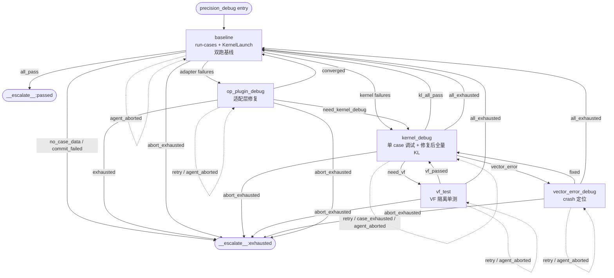

# A5 RegBase 精度调试流程（precision_debug）

> **所属架构**：[ascendc-devkit 架构总览](../architecture-overview.md) > §3 统一 Pipeline  
> **实现文件**：`src/ascendc_devkit/orchestration/stages/precision_debug_a5/`（包，15 个模块）  
> **编排入口**：`src/ascendc_devkit/orchestration/precision_debug_tree.py`  
> **根路由**：`src/ascendc_devkit/orchestration/workflow.py`（`self_evolve_op` / `generate_ascendc`）  
> **适用芯片**：A5 / 910D / 351x / 950DT（RegBase 架构）  
> **实现状态**：已实现 ✓

---

## 1. 定位与总览

`precision_debug` 是 ascendc-devkit 统一 Pipeline 中的**精度验证阶段**。针对 A5 RegBase 架构，该阶段采用独立的 **5 阶段（stage）调试流程**：

```
baseline → kernel_debug → [vf_test] → [vector_error_debug] → [op_plugin_debug]
```

`vf_test` / `vector_error_debug` 是条件进入的**诊断子阶段**（非线性正常路径）；`op_plugin_debug` 是**框架层级适配层修复循环**（非 per-case）。每个阶段均为框架 `CompositeGroup` 驱动、spawn 单次执行——读接力、写本阶段产物、输出 `RESULT` 行即返回，循环/路由由框架的 `transition()` 控制。

> **regression 阶段已合入 kernel_debug**：kernel_debug 修复当前 case 后**就地批跑全量
> KernelLaunch**（原 regression 职责），框架读 KL summary JSON 调和失败队列并推导路由
> （`kl_all_pass` → baseline / `case_kl_fails` → kernel_debug / `vector_error` →
> vector_error_debug），不再有独立 regression 阶段（§2.5 唯一通路）。

| 属性 | 说明 |
|------|------|
| 对外 Stage 名 | `precision_debug`（CompositeGroup，`variant="a5"` 标记） |
| 子阶段数 | 5（`baseline`、`kernel_debug`、`vf_test`、`vector_error_debug`、`op_plugin_debug`；regression 已合入 kernel_debug） |
| 输出契约 | `debug_result`（`PrecisionDebugResult`）、`debug_iterations` |
| 安全阀 | per-case 跨阶段累计 `attempt_count`（`max_attempts_per_case=10`）；`op_plugin_round`（`max_op_plugin_rounds=10`，只钳 `retry`）；`consecutive_aborts`（≥3 升级 exhausted）；框架级 `max_corrective=30` |
| 源码安全 | 入口快照 + full-suite 阶段 `best_commit` 记录 + 退出 converge（§7.2） |
| 叶子 Agent | `ascendc-precision-{baseline,kernel-debug,vf-debug,vector-error-debug,op-plugin-debug}` |

---

## 2. 为什么 A5 需要单独一套流程

A5（RegBase）与 A3（MemBase）在编程模型上有本质差异：

| 维度 | A3 MemBase | A5 RegBase |
|------|-----------|-----------|
| 计算基址 | Local Memory（UB/L1） | 矢量寄存器（Reg） |
| 核心计算单元 | `__aicore__` 内调用基础 API | `__aicore__` → `__simd_vf__` → 编译器 BuiltIn |
| 调试难点 | 算子级 golden 对比、代码补丁 | VF 融合、寄存器 mask/对齐、TilingKey 分发 |
| 精度问题入口 | 通常是算子整体逻辑错误 | 常常是某个 `__simd_vf__` 函数内部错误 |
| 调试工具 | 标准 `run-cases` + diagnose/fix 循环 | KernelLaunch + run-cases 双工具交叉对比 + DumpTensor 二分 + VF 隔离单测 |

**核心假设**：A5 算子的大部分计算发生在 `__simd_vf__` 函数内，精度问题往往来自**单个 VF 函数内部逻辑**或 **kernel/tiling 层**（与 op_plugin/aclnn 适配层问题相互纠缠）。因此 A5 流程必须先用**双工具交叉对比**（run-cases + KernelLaunch）隔离问题层，再在 `kernel_debug` 里用 DumpTensor 二分定位，必要时交给 `vf_test` 做 VF 隔离单测、`vector_error_debug` 处理 device crash。

---

## 3. 五阶段流程图



> **op_plugin_debug 的 kernel 层移交**：适配层逐项排查确认非适配层根因（或已修复）、残余失败
> case 在 run-cases 与 KernelLaunch 下都失败 → `debug_status=need_kernel_debug` + `kernel_cases`
> 清单，框架把对应 case 改标 `error_layer=kernel` 移交 `kernel_debug` 做 per-case 精度调试——
> 不再被迫 retry 烧轮次后 exhausted→escalate 杀流程。轮次上限只钳 `retry`；
> `converged` / `need_kernel_debug` 是正向决策出口不受钳制。

> **kernel_debug 修复后批跑全量 KernelLaunch（原 regression 职责，已合入）**：
> `debug_status=fixed` 后就地跑全量 KernelLaunch（复用 baseline 脚本，不跑 run-cases），KL 脚本把
> per_case 全量结果写入 `result_{op_name}_summary.json`；框架 transition 读该 JSON 调和失败队列
> 并推导路由：`kl_all_pass` → 回 `baseline` 做权威双跑验收（RC 全 pass 才 `__escalate__:passed`）；
> `case_kl_fails` → 回 `kernel_debug`（框架已从 KL 实测调和队列、kernel_debug spawn reconcile
> 推进到下一个失败 case）。VECTOR_ERROR → `vector_error_debug`。适配层问题一律由 baseline
> 双跑交叉对比发现并分流。

> **abort 退避**：每个 stage 的 `transition()` 开头经 `_abort_guard` 检测——spawn 未产出
> phase 产物 → `_handle_abort`（`consecutive_aborts`+1，路由 `agent_aborted` → 本 stage 自环
> 重派）；正常产出 → 清 `consecutive_aborts`。连续 abort ≥3 → `abort_exhausted` →
> `__escalate__:exhausted`。

---

## 4. 编排入口

A5 调试流程由 `precision_debug_tree.py` 根据芯片版本自动选择：

```python
def build_precision_debug_group(max_rounds=30, chip_version="A3") -> CompositeGroup:
    if _is_a5(chip_version):
        return _build_precision_debug_group_a5()
    return _build_precision_debug_group_a3(max_rounds)
```

A5 CompositeGroup 定义（完整见 `precision_debug_a5/transition_table.py`）：

```python
_A5_TRANSITION_TABLE = {
    "baseline": {
        "all_pass": ("__escalate__:passed", "validation"),
        "has_op_plugin_failures": ("op_plugin_debug", "corrective"),
        "has_kernel_failures": ("kernel_debug", "corrective"),
        "agent_aborted": ("baseline", "corrective"),
        "abort_exhausted": ("__escalate__:exhausted", "validation"),
    },
    "kernel_debug": {
        "kl_all_pass": ("baseline", "validation"),
        "case_kl_fails": ("kernel_debug", "corrective"),
        "need_vf": ("vf_test", "corrective"),
        "vector_error": ("vector_error_debug", "corrective"),
        "retry": ("kernel_debug", "corrective"),
        "case_exhausted": ("kernel_debug", "corrective"),
        "all_exhausted": ("baseline", "validation"),
        "agent_aborted": ("kernel_debug", "corrective"),
        "abort_exhausted": ("__escalate__:exhausted", "validation"),
    },
    "vf_test": { "retry"/"vf_passed"/"vector_error"/"case_exhausted"/"all_exhausted"/"agent_aborted"/"abort_exhausted" },
    "vector_error_debug": { "retry"/"fixed"/"case_exhausted"/"all_exhausted"/"agent_aborted"/"abort_exhausted" },
    "op_plugin_debug": { "retry"/"converged"/"need_kernel_debug"/"exhausted"/"agent_aborted"/"abort_exhausted" },
}
```

组装（`precision_debug_tree.py:187`）：

```python
group = CompositeGroup(
    name="precision_debug",
    children=[
        AtomicStage(BaselineSubstage()),
        AtomicStage(OpPluginDebugSubstage()),
        AtomicStage(KernelDebugSubstage()),
        AtomicStage(VfTestSubstage()),
        AtomicStage(VectorErrorDebugSubstage()),
    ],
    transition_table=_A5_TRANSITION_TABLE,
    output_contract_override=StageIOContract(provides=["debug_result", "debug_iterations"]),
    max_corrective=_A5_MAX_CORRECTIVE,  # 30
    max_escalations=_A5_MAX_CORRECTIVE,
)
group.variant = "a5"   # GraphExecutor 据此分派 A5 专属 converge（§7.2）
```

> `variant="a5"` 是 A5 group 的唯一显式标记，`_converge_precision_debug()`
> 依此选择 `_converge_a5_to_best_commit`（A5）或 `_converge_to_best_commit`（A3）。

---

## 5. 各阶段详解

### 5.1 baseline — 双工具全量基线

**职责**：A5 流程入口。首跑生成 KernelLaunch 全量测试脚本，随后 run-cases + KernelLaunch
**双跑全量**，逐 case 交叉对比隔离问题层，构建 `failed_case_queue` 并标注 `error_layer`。

**关键行为**：
1. 若不存在，生成 `{op_name}_kernel_launch_test.py`（KernelLaunch 直调二进制，不动态编译）。
2. `ascendc-devkit run-cases` 全量。
3. `python3 {op_name}_kernel_launch_test.py` 全量。
4. 逐 case 交叉对比：
   - run-cases 失败 + KernelLaunch 通过 → `error_layer=op_plugin`
   - run-cases 失败 + KernelLaunch 失败 → `error_layer=kernel`
   - KernelLaunch crash → `failure_type=vector_error`
5. 构建 `failed_case_queue`（含 `case_id/shape/dtype/max_diff_rc/max_diff_kl/error_layer/failure_type/status/attempt_count`）。
6. 输出完整 `rc_result`；framework 归一化数值结果并刷新 `best_snapshot`，成功提交
   `op_dir` 后原子更新 `best_snapshot.commit` 与 `best_commit`。

**路由**：
- `all_pass`（run-cases 全 pass）→ `__escalate__:passed`（流程结束）
- `has_kernel_failures`（任意 case `error_layer=kernel`）→ `kernel_debug`
- `has_op_plugin_failures`（任意 case `error_layer=op_plugin`）→ `op_plugin_debug`

> **2026-08-01 修复**：`_extract_a5_debug_checkpoint` 必须携带 `failed_case_queue`
> 全量（含 `error_layer`），否则 baseline 0/20 会被误判 `all_pass` 并错误升级 `passed`。

### 5.2 kernel_debug — per-case kernel/tiling 层调试（含修复后全量 KL 验收）

**职责**：读 baseline 的 KernelLaunch 结果分析当前 case 失败模式，逐 case 定位并修复
kernel/tiling 层精度问题；修复成功后**就地批跑全量 KernelLaunch** 验证（原 regression 阶段
职责，已合入本阶段）。

**关键行为**（单次 spawn 内，不做内部循环骨架）：
1. 先调 `ascendc-sync-static-check` 扫描同步缺陷（7 类核内同步）。
2. 再调 `tiling_bounds_check.py`（`precision_debug_a5/scripts/`）检查单 case 的
   InitBuffer 边界/对齐/UB 总量/尾块（UB_OOB/ALIGN_32B/UB_TOTAL/tail_block）。
3. 在 kernel 中插 DumpTensor（desc **100-199 CopyIn** / **200-299 非 VF 计算** /
   **300-399 CopyOut**）二分定位首个数值发散点。
4. 定位根因 → 修 kernel → KernelLaunch 回验当前 case 中间态正确 → `debug_status=fixed`。
5. **`fixed` 后批跑全量 KernelLaunch**（`{debug_dir}/baseline/{op_name}_kernel_launch_test.py`，
   复用 baseline 脚本、不跑 run-cases）——KL 脚本把 per_case 全量结果 dump 到
   `result_{op_name}_summary.json`；agent 在结果 JSON 输出完整 `kl_result`
   （`pass/total/max_diff/failed_cases`）作为佐证。框架 transition 读 summary 调和失败队列
   并推导路由（`kl_all_pass` / `case_kl_fails` / `vector_error`）。
6. VF 输入正确但输出错误 → `debug_status=need_vf`（交给 vf_test）。
7. device crash → 设 `error_type=VECTOR_ERROR`。

**VF 黑盒约束**：不得在 `__simd_vf__` 函数体内插 DumpTensor/printf 或修改 VF 代码；
定位到 VF 输出错误一律标 `need_vf` 交给 vf_test 隔离验证。

**路由**（`debug_status=fixed` 时由框架从全量 KL 实测推导，§9.7）：
- `kl_all_pass`（KL 全过）→ `baseline` 权威双跑验收
- `case_kl_fails`（KL 有任一失败）→ `kernel_debug` 修下一个失败 case（队列已由框架 KL 调和，
  spawn reconcile 推进）
- `need_vf` → `vf_test`
- `vector_error` → `vector_error_debug`
- `retry` → 自循环；`case_exhausted` → 推进下一个 case（回本阶段）
- `all_exhausted`（队列全部 case 已处理、最后一个 exhausted/止损跳过）→ `baseline`
  做权威双跑验收：剩余失败 case 由 baseline 重新交叉对比分流，避免在仍有大量 case
  精度未通过时提前 escalate 终止（2026-08-10 轨迹：最后一个 case_20 exhausted 后整个
  A5 流程终止，14 个 tie-break 残余 case 仍挂）。重入受 `max_corrective`（30）与停滞守卫约束。

**per-case 止损**：`attempt_count >= max_attempts_per_case(10)` → 跳过当前 case 并推进。

### 5.3 vf_test — VF 函数隔离单元测试

**职责**：当 kernel_debug 返回 `need_vf` 且指认了出错 VF 函数时，对单个 `__simd_vf__`
函数做隔离单元测试并修复。

**关键行为**：
1. 按函数名从 `coding_index.md` 读取 VF 函数规格。
2. 预查询 VF 指令参考 + 历史经验检索。
3. 参考算子级 `golden_module` 构造 VF 级期望值。
4. 用 `SingleOperatorLaunch`（复用 `regbase-vf-test` 工具链）生成测试 kernel、编译运行、精度验证。
5. `vf_status=passed` 时归档 `vf_lesson.md`。

**路由**：
- `vf_passed` → 回 `kernel_debug` 回验（VF 黑盒：框架只认隔离测试结果）
- `retry` → 自循环（`vf_round` 上限 3）；`case_exhausted` → 推进 case 回 kernel_debug
- `all_exhausted` → `baseline`（权威双跑验收，同 kernel_debug）

### 5.4 vector_error_debug — VECTOR_ERROR 定位与修复

**触发条件**：baseline / kernel_debug（含修复后全量 KL） / vf_test 任一阶段产物被
`_record_phase_error` 判定 `error_type=VECTOR_ERROR`（`_extract_error_type` 检查嵌套
`failed_cases` 的 `failure_type=vector_error` 与 `dump_evidence` 中的
`VECTOR_EXCEPTION / VECTOR_CORE_EXCEPTION / ACL_ERROR_RT_VECTOR` 模式）。

**错误身份与证据**：框架归一化运行时证据并生成 `active_error_fingerprint`
（`a5-vector-v1|case_id|kernel_name|error_code|pc_offset|source_phase|buffer_mode|tiling_key`），
它是唯一的错误身份；`evidence_quality`（`pc_mapped / runtime_identified / partial / insufficient`）
决定能否宣称定位。本阶段不跑全量、不依赖 device-side printf、不更新 `best_snapshot`
（crash/no-crash 非数值信号）。

**定位流程**（三层确定性 guard + 区域二分；脚本见
`.claude/skills/ascendc-precision-vector-error-debug/SKILL.md`）：
1. **Step 0 复现基线**：按 `vector_error_evidence.case_id` 稳定复现；不稳定重试 ≤2 次。
2. **Step 1 · P1 静态规则扫描**：`scan_a5_vector_risks.py` 只读扫描，覆盖 10 类 A5 风险
   （gm_ub_transport / ub_reg_load_store / mask_tail / address_generation / layout_cast_dist /
   vf_call_abi / incore_sync / queue_lifecycle / crosscore_tscm / tiling_boundary），
   只生成候选、绝不确认。
3. **Step 2 · P2 受控实验 guard**（默认入口，优先于区域二分）：`plan_a5_vector_experiments.py`
   把 Top-K 转成稳定实验计划（每轮 ≤4 个）+ SHA256 baseline manifest；逐实验
   apply-patch → 编译 → 跑目标 case → 按 fingerprint 分类 → 反向回滚。只承认
   `same_error` / `error_disappeared`（经源码 hash 恢复验证）。
4. **Step 3 区域二分**：CopyIn / Compute·VF / CopyOut / Tail / 同步区域做可编译的语义闭合替代二分。
5. **Step 4 行级确认**：只消费 P2 guard 通过的 `error_disappeared`，四项缺一不得进入修复层。
6. **Step 5 · P3 修复 guard**：`plan_a5_vector_repairs.py` 以 `--located-roots` 为必需门禁；
   build passed + 原 case 连续 ≥2 次未现原 fingerprint 方判 `vector_error_fixed`。

**路由**：
- `fixed` → 回 `kernel_debug`（恢复 kernel 修复循环）
- `retry` → 自循环（`vector_error_round` 上限 3）；`case_exhausted` → 推进 case
- `all_exhausted` → `__escalate__:exhausted`

### 5.5 op_plugin_debug — 适配层修复循环（框架层级，非 per-case）

**触发条件**：baseline 交叉对比发现 run-cases 失败但 KernelLaunch 同 case 通过
（`error_layer=op_plugin`）。
（kernel_debug 修复后批跑的全量 KL 只跑 KernelLaunch，不再产生 `case_rc_only_fails`；
op_plugin 层问题改由 baseline 权威双跑发现并分流。）

**职责**：修复 op_plugin/aclnn 适配层（框架级全局循环，不是逐 case 调试）。

**关键行为**：
1. 读取双工具基线 diff（`max_diff_rc` vs `max_diff_kl`）+ run-cases 框架错误信息。
2. 按错误码表解码 161xxx/561xxx 错误码。
3. 按 `op_plugin-checklist.md` 逐项排查：注册宏、aclnn/C++ OpAPI 签名、dtype 转换、
   shape reshape、attr 传递、tiling 参数映射、op_info.json 字段。
4. 对比 KernelLaunch 传给 kernel 的参数 vs op_plugin/aclnn 传给 kernel 的参数，定位差异并修复。
5. run-cases + KernelLaunch 双跑验证直到收敛（RC 不报框架错误 + RC/KL 结果基本一致 →
   `debug_status=converged`）。
6. **kernel/tiling 层移交**：若适配层逐项排查确认非适配层根因（或已修复），且残余失败 case 在
   run-cases 与 KernelLaunch 下都失败 → 属 kernel/tiling 层问题 → `debug_status=need_kernel_debug`
   + `kernel_cases` 清单，框架把对应 case 改标 `error_layer=kernel` 移交 `kernel_debug`
   做 per-case 精度调试。

**路由**：
- `converged` → 回 `baseline` 重新交叉对比
- `need_kernel_debug` → `kernel_debug`（移交 per-case kernel 调试）
- `retry` → 自循环（`op_plugin_round` 上限，防 baseline↔op_plugin_debug 无限循环；轮次上限只钳 `retry`）
- `exhausted` → `__escalate__:exhausted`

### 5.6 regression — 已删除，职责合入 kernel_debug

> **2026-08-25 变更**：独立 `regression` 阶段已删除（§2.5 唯一通路——「跑全量 KL 验证修复」
> 只存在于 kernel_debug 一处，无新旧并存）。其职责合入 **kernel_debug §5.2 步骤 5**：
> `debug_status=fixed` 后就地批跑全量 KernelLaunch，框架 transition 读 KL summary JSON
> 调和失败队列并推导路由（`kl_all_pass` → baseline / `case_kl_fails` → kernel_debug /
> `vector_error` → vector_error_debug）。
>
> 行为语义保持不变：
> - **只跑 KernelLaunch**（不跑 run-cases）：kernel_debug 修的是 kernel/tiling 层，
>   KernelLaunch 直跑 binary kernel 最直接最快；run-cases 经 op_plugin/aclnn 适配层，
>   适合作为最终交付验收（由 baseline 做），避免每次 per-case 修复都跑两遍。
> - **全局判定、无 per-case 判定**：队列的 resolved / regressed / 追加 / index 推进全部
>   由框架从 KL 实测推导（§9.7），agent 只在结果 JSON 输出 `kl_result` 汇总作佐证。
> - **best_snapshot 晋升**：仅当 agent 提供全量 `kl_result` 时（per-case 的
>   `precision_result` 不代表全量高水位，不晋升），框架 `_merge_best_snapshot` 返回
>   True（passed_count 严格更大）后 `_commit_modified_numeric_phase` 提交 `op_dir` 并
>   原子更新 `best_snapshot.commit` 与 `best_commit`。
>
> 相关产物/契约迁移：`regression/` 目录、`regression_round` 计数器、
> `ascendc-precision-regression` skill/agent 均已删除；全量 KL 的读取/调和逻辑
> 全部归 kernel_debug transition（`_reconcile_queue_from_full_kl`）。

---

## 6. 状态机与路由表

### 6.1 A5 组内状态机（权威 = `precision_debug_a5/transition_table.py`）

| 当前阶段 | 条件 | 目标 | route_type | 说明 |
|---------|------|------|-----------|------|
| `baseline` | `all_pass` | `__escalate__:passed` | validation | 双跑全过，直接结束 |
| `baseline` | `has_op_plugin_failures` | `op_plugin_debug` | corrective | 适配层问题 |
| `baseline` | `has_kernel_failures` | `kernel_debug` | corrective | kernel/tiling 问题 |
| `baseline` | `agent_aborted` | `baseline` | corrective | 自环重派 |
| `baseline` | `abort_exhausted` | `__escalate__:exhausted` | validation | 连续 abort ≥3 |
| `kernel_debug` | `kl_all_pass` | `baseline` | validation | 修复后全量 KL 全过 → 权威双跑验收 |
| `kernel_debug` | `case_kl_fails` | `kernel_debug` | corrective | 修复后全量 KL 有失败 → 修下一个失败 case（队列已由框架 KL 调和） |
| `kernel_debug` | `need_vf` | `vf_test` | corrective | VF 隔离单测 |
| `kernel_debug` | `vector_error` | `vector_error_debug` | corrective | crash 定位 |
| `kernel_debug` | `retry` | `kernel_debug` | corrective | 自循环 |
| `kernel_debug` | `case_exhausted` | `kernel_debug` | corrective | 推进 case |
| `kernel_debug` | `all_exhausted` | `baseline` | validation | 全部耗尽 → baseline 权威双跑验收 |
| `kernel_debug` | `agent_aborted` / `abort_exhausted` | 自环 / `__escalate__:exhausted` | corrective / validation | abort 退避 |
| `vf_test` | `vf_passed` | `kernel_debug` | corrective | 回 kernel 修复 |
| `vf_test` | `retry` / `case_exhausted` / `vector_error` | 自环 / `kernel_debug` / `vector_error_debug` | corrective | — |
| `vf_test` | `all_exhausted` | `baseline` | validation | — |
| `vector_error_debug` | `fixed` | `kernel_debug` | validation | 恢复 kernel 修复 |
| `vector_error_debug` | `retry` / `case_exhausted` | 自环 / `kernel_debug` | corrective | — |
| `vector_error_debug` | `all_exhausted` | `baseline` | validation | — |
| `op_plugin_debug` | `converged` | `baseline` | validation | 收敛后重新交叉对比 |
| `op_plugin_debug` | `need_kernel_debug` | `kernel_debug` | corrective | 适配层非根因，残余失败移交 per-case kernel 调试 |
| `op_plugin_debug` | `retry` | `op_plugin_debug` | corrective | 自循环（`op_plugin_round` 上限，只钳 `retry`） |
| `op_plugin_debug` | `exhausted` | `__escalate__:exhausted` | validation | — |

### 6.2 abort 退避机制

每个 stage 的 `transition()` 开头执行 `_abort_guard(state)`：

1. `_agent_produced_output`：检查本阶段 schema 文件（round-suffixed **与** latest 两条路径）
   是否存在且非空。
2. 无产物 → `_handle_abort`：`consecutive_aborts`+1，`_debug_checkpoint` 置
   `agent_aborted=True` → `resolve_condition` 经 `_resolve_abort_condition` 返回
   `agent_aborted`（<3）或 `abort_exhausted`（≥3）。
3. 有产物 → `_reset_consecutive_aborts`（清零），正常业务路由。

> **语义**：kernel_debug 无产物从旧版「硬契约错误 A5PrecisionDebugContractError」改为
> 「abort 退避」（re-spawn，≥3 升级 exhausted）；「有输出但 round 文件缺失」仍是契约错误。

### 6.3 工作流根路由

`precision_debug` 组通过 `__escalate__` 向上冒泡，根工作流决定最终去向：

| 工作流 | `passed` | `exhausted` | `upstream` / `deploy_broken` |
|--------|---------|------------|------------------------------|
| `generate_ascendc` | 线性进入 `perf` | `__halt__` | `__halt__` |
| `generate_ascendc_dev` | 线性进入 `perf` | `__halt__` | `__halt__` |
| `self_evolve_op` | 线性进入 `cannbench_adapt` | `cannbench_adapt`（软门放行） | `__halt__` / `cannbench_adapt` |

> 设计意图：`passed` 不写入表，`route=None` → GraphExecutor 走线性后继
> （`self_evolve_op` 即 `cannbench_adapt → cannbench_eval → finalize`，两级评估：
> ① precision 本地预检从不阻断 ② cannbench_eval 一次性权威 score）。

---

## 7. Checkpoint 结构

所有路由控制字段存在 `{workspace}/artifacts/precision_debug_a5/checkpoint.json`。

### 7.1 写入边界（框架所有 vs skill 所有）

| 字段类别 | 写者 | 字段 |
|---------|------|------|
| **框架路由字段**（`_A5_CONTROL_REQUIRED_KEYS`） | 仅框架 `transition()` | `status`、`phase`、`failed_case_queue`、`current_case_index`、`max_attempts_per_case`、`history`、`op_plugin_round`、`max_op_plugin_rounds`、`error_type`、`active_error_fingerprint`、`consecutive_aborts` |
| **精度进度** | 仅框架（从阶段 result 重建） | `best_snapshot`（`max_err/commit/passed/total/failed_cases/updated_by/updated_round`） |
| **VECTOR_ERROR 路由** | 仅框架（`_record_phase_error`） | `error_type`、`vector_error_source_phase`、`vector_error_evidence`、`active_error_fingerprint`、`vector_error_round`、`vector_error_status` |
| **Git 安全元数据** | 仅框架（`git_safety.py` / `best_snapshot.py`） | `initial_commit`、`candidate_commit`、`best_commit`、`commit_error`、`rollback_safe`、`anchor_error` |
| **每轮上限** | 框架初始化（`runtime_config.precision_debug_a5_max_*`，默认全 10） | `max_attempts_per_case=10`、`max_op_plugin_rounds=10`、`max_vf_rounds=10`、`max_vector_error_rounds=10` |

> framework 在 spawn 前冻结所有 framework-owned checkpoint 字段，transition 时恢复
> `queue/best_snapshot/best_commit/round/history/routing` 等字段；agent 只能通过阶段 result
> JSON 报告事实，不能直接改 checkpoint。

### 7.2 Git 源码安全层

- **入口快照**（`ensure_entry_snapshot`，`git_safety.py`，`actions()` 中幂等调用）：
  `git add op_dir` + `git commit` 全量固化，产出入口锚点；校验 repo_root 为 git toplevel。
- **candidate/best 两级提交**：
  - `kernel_debug fixed`、`vector_error_debug fixed`、`op_plugin_debug converged` 的源码修改
    由 framework 创建 `candidate_commit`，确保中间修复可恢复，但不提升 best。
  - `baseline`（RC 全量）与 `kernel_debug fixed` 后的全量 KL（`kl_result`）改善时，
    由 framework 提交尚未提交的 op_dir，并原子更新 `best_snapshot.commit` 与 `best_commit`。
- **退出 converge**（`_converge_a5_to_best_commit`）：`RepoGuard.rollback` + `Deployer.deploy`
  重编出包；`passed` 短路；`upstream` escalation 不 converge。若 best_commit 为空、
  op_dir dirty、rollback_safe=false 或 snapshot/commit 不一致，fail-closed 保留工作树，
  禁止 HEAD fallback + checkout/clean。

### 7.3 完整 checkpoint.json schema（关键字段）

```json
{
  "status": "in_progress | passed",
  "phase": "baseline | kernel_debug | vf_test | vector_error_debug | op_plugin_debug",
  "failed_case_queue": [
    {"case_id": "level2/softmax_1", "shape": [1024, 1024], "dtype": "float16",
     "max_diff_rc": 999.0, "max_diff_kl": 999.0,
     "error_layer": "kernel | op_plugin", "failure_type": "precision | runtime | vector_error",
     "status": "pending | debugging | resolved | skipped", "attempt_count": 0}
  ],
  "current_case_index": 0,
  "max_attempts_per_case": 10,
  "op_plugin_round": 0,
  "max_op_plugin_rounds": 10,
  "kernel_debug_round": 0,
  "vf_round": 0,
  "vector_error_round": 0,
  "vector_error_status": "",
  "vector_error_source_phase": "",
  "vector_error_evidence": {},
  "active_error_fingerprint": "",
  "error_type": "VECTOR_ERROR | (空)",
  "consecutive_aborts": 0,
  "initial_commit": "<git commit hash>",
  "best_commit": "<git commit hash>",
  "rollback_safe": true,
  "anchor_error": "",
  "best_snapshot": {
    "max_err": 1.2e-6, "commit": "<hash>", "passed": 9, "total": 20,
    "failed_cases": [], "updated_by": "kernel_debug", "updated_round": 1
  },
  "history": [
    {"phase": "baseline", "baseline_status": "failed"},
    {"phase": "kernel_debug", "round": 1, "debug_status": "fixed"}
  ]
}
```

### 7.4 best_snapshot 进度接力机制

- **唯一写入方**：framework `_merge_best_snapshot`。baseline agent 输出 `rc_result`、
  kernel_debug（fixed 后）输出 `kl_result`；framework 归一化后重建候选，仅当
  `_snapshot_better` 才采用。agent 对 checkpoint 的直接写入会被 pre-spawn guard 丢弃。
- **更优判据**（`_snapshot_better`）：`passed` 严格更大 → 更优；同 passed → `total` 更小
  （pass_rate 更高）→ 更优；再同 → `max_err` 更小 → 更优。
- **VECTOR_ERROR / ENV / SCHEMA / 无数值结果** → `_has_valid_numeric_result` false，不参与。
- **kernel_debug 晋升门槛**：仅当 agent 提供全量 `kl_result`（`pass/total/max_diff`）才参与
  best_snapshot 晋升；per-case 的 `precision_result`（单 case 验证）不代表全量高水位，不晋升。
- **读取方**：`_extract_a5_debug_checkpoint` 把 `best_snapshot` lift 到 `state._debug_checkpoint`。

### 7.5 路由字段 lift（`_extract_a5_debug_checkpoint`）

仅 lift 路由需要的最小字段到 `state._debug_checkpoint`：

```python
{
  "status", "phase", "max_iterations",
  "failed_case_queue",        # 全量，含 per-case error_layer（2026-08-01 补）
  "failed_case_count",
  "consecutive_aborts",       # abort 退避（2026-08-01 补）
  "current_case_status", "current_case_attempt", "current_case_max_attempts",
  "case_resolved", "failing_cases",
  "best_commit", "best_snapshot",
  "error_type", "active_error_fingerprint",
  "op_plugin_round", "max_op_plugin_rounds",
  "vector_error_round", "vector_error_status", "vector_error_source_phase",
}
```

> 各阶段 transition 再叠加本阶段专属字段：`baseline_status`、`debug_status`、
> `vf_status`、`vector_error_status`、`_case_skipped`、`_more_cases`、`_kl_status`
> （kernel_debug fixed 后由框架从全量 KL 实测推导的路由条件）。

---

## 8. 产物路径与文件契约（权威）

> 单一事实来源：本文档 + `precision_debug_a5/base.py`（`_PHASE_STEM_MAP` /
> `_phase_path` / `_expected_round_result_path` / `_round_result_stem`）与
> `case_loop._load_latest_kl_data`。以下用 `{debug_dir}` 表示
> `{workspace}/artifacts/precision_debug_a5/`（无 workspace 时 `{op_dir}/.precision-fix/`）。
> **agent 写路径必须与框架读路径一一对应；任何一边改动必须同步本文档与对方。**

### 8.1 目录结构（权威）

```text
{debug_dir}/
├── checkpoint.json                          # 框架唯一权威状态（§7.3）；agent 禁写 framework-owned 字段
├── conclusions.json                         # 跨阶段结论接力；框架 _materialize_conclusion 写、agent 只读
├── scripts/
│   └── tiling_bounds_check.py               # 框架每次 spawn provision（kernel_debug 用）
├── baseline/
│   ├── baseline_result.json                 # baseline agent 写 latest；框架 baseline.transition 读
│   ├── {op_name}_kernel_launch_test.py      # baseline agent 首跑生成；baseline / kernel_debug（fixed 后全量）复用执行
│   ├── result_{op_name}_summary.json        # KL 脚本 dump（per_case 全量）；框架队列调和读（权威源）
│   ├── result_{op_name}.log                 # KL stdout tee（agent 解析每 case 结果用）
│   └── log_{op_name}.log                    # KL logging 重定向
├── kernel-debug/
│   ├── kernel_debug_round_{N}_result.json   # agent 写；框架 kernel_debug.transition 读（exact round）
│   ├── kernel_debug_result.json             # latest 副本（_sync_phase_latest 从 round 复制）
│   └── kernel_debug_result_rNNN_pNNN.json   # relay（框架 _handle_abort 写）
├── vf-test/
│   ├── vf_round_{N}_result.json             # agent 写；框架 vf_test.transition 读（exact round）
│   ├── vf_result.json                       # latest 副本
│   └── vf_result_rNNN_pNNN.json             # relay
├── vector-error/
│   ├── vector_error_round_{N}_result.json   # agent 写；框架 vector_error_debug.transition 读（exact round）
│   ├── vector_error_result.json             # latest 副本
│   ├── vector_error_result_rNNN_pNNN.json   # relay
│   └── *_round_{N}_{static_scan|experiment_plan|baseline_manifest|experiment_validation|repair_plan|repair_validation}.json  # agent 附加产物
├── op-plugin-debug/
│   ├── op_plugin_round_{N}_result.json      # agent 写；框架 op_plugin_debug.transition 读（exact round）
│   ├── op_plugin_result.json                # latest 副本
│   └── op_plugin_result_rNNN_pNNN.json      # relay
```

### 8.2 文件归属契约（写者 → 读者）

| 文件 | 写者 | 读者 / 消费时机 | 关键内容 |
|------|------|-----------------|---------|
| `checkpoint.json` | **仅框架** `transition()` / `_save_a5_checkpoint` | 框架各 stage（每次 transition / spawn 注入 `current_case`）；agent 只读 | 队列 / `current_case_index` / round 计数 / best_snapshot / error（§7.3） |
| `conclusions.json` | **仅框架** `_materialize_conclusion` | 各 agent 开工前（`prior_conclusions` 注入） | 各阶段一段话结论 |
| `baseline/baseline_result.json` | **baseline agent**（写 latest 路径） | 框架 `baseline.transition`（`_load_result`）；kernel_debug / op_plugin_debug agent 开工读 | `baseline_status` / `rc_result` / `kl_result` / `cross_compare[]` / `classification` |
| `baseline/{op_name}_kernel_launch_test.py` | **baseline agent**（首跑生成） | baseline / kernel_debug（fixed 后全量）执行 | 全量 `run_case` 遍历 + 末尾 dump summary（§8.3） |
| `baseline/result_{op_name}_summary.json` | **KL 脚本**（脚本内 dump） | **框架** `_load_latest_kl_data` → `_reconcile_queue_from_kl`（baseline transition 的 pass 侧 + kernel_debug fixed 后 transition + kernel_debug spawn 前 `_reconcile_queue_for_spawn`）；`_apply_kl_failures_to_queue`（**仅 kernel_debug fixed 后**，失败侧 regressed/追加） | `{pass, total, max_diff, per_case:[{case_id, passed, max_diff}]}` 全量；**队列唯一真值源（pass 侧 resolved + 失败侧 regressed/追加）** |
| `baseline/result_{op_name}.log` | KL 脚本（stdout tee） | baseline / kernel_debug（fixed 后全量）agent 解析 | 每 case print 文本 |
| `kernel-debug/kernel_debug_round_{N}_result.json` | **kernel_debug agent** | 框架 `kernel_debug.transition` | `debug_status` / `verification` / `vf_functions` / `code_modified` /（fixed 时）`kl_result` / `new_failed_cases`（**佐证**，队列由框架从 KL summary 推导） |
| `vf-test/vf_round_{N}_result.json` | **vf_test agent** | 框架 `vf_test.transition` | `vf_status` / `vf_func` / `code_modified` |
| `vector-error/vector_error_round_{N}_result.json` | **vector_error_debug agent** | 框架 `vector_error_debug.transition` | `vector_error_status` / `verification` / `located_roots` |
| `op-plugin-debug/op_plugin_round_{N}_result.json` | **op_plugin_debug agent** | 框架 `op_plugin_debug.transition` | `debug_status` / `kernel_cases` / `code_modified` |

### 8.3 命名与读取约定（单一事实来源：框架）

- **round 计数器**（checkpoint 内）：`{stem}_round`，stem = `_round_result_stem(schema_file)`
  —— `kernel_debug_round` / `vf_round` / `vector_error_round` / `op_plugin_round`。
- **round 结果文件**：`{phase_dir}/{stem}_round_{N}_result.json`，`N = cp[{stem}_round] + 1`，
  由 `_expected_round_result_path` 决定并作为 `phase_round_result_path` 注入 prompt；
  **agent 必须写框架注入的这个精确路径**（skill 也用 `{round}` 占位符描述同一路径）。
- **latest**：`{phase_dir}/{schema_filename}`（如 `kernel-debug/kernel_debug_result.json`），
  由 **framework transition 收尾**统一 `_sync_phase_latest` 从 round 复制（agent 不复制，
  2026-08-24 起收归框架）。**baseline 例外**：`_round_file_convention=False`，直接写
  latest `baseline/baseline_result.json`，无 round 文件。
- **relay**：`{phase_dir}/{stem}_r{round:03d}_p{phase_counter:03d}.json`
  （`_phase_path(round_suffix=True)`），框架 `_handle_abort` 写。
- **框架读取顺序**（round-convention stage）：
  - `kernel_debug`：relay → exact round 文件；都缺 → `A5PrecisionDebugContractError`。
  - 其余 round stage（vf_test / vector_error_debug / op_plugin_debug）：
    exact round 文件 → latest；都缺 → `{}`（各 transition 按默认状态处理）。
- **KL 调和数据源**（`_load_latest_kl_data`，case_loop.py）：首选
  `baseline/result_{op_name}_summary.json`（per_case 全量），回退 legacy
  `baseline/kl_result.json`（all_results）。`_reconcile_queue_from_kl` 只认
  `per_case` / `all_results` **全量**列表；`failed_cases` 子集无 pass 证据，不参与
  resolved 判定。**此文件必须由 KL 脚本生成，agent 不手工维护**（见 §8.2）。
  kernel_debug fixed 后由框架 `_reconcile_queue_from_full_kl` 读取（§9.7）。

### 8.4 子阶段产物 Schema（与 skill 返回格式一致）

| 产物 | 关键字段 |
|------|---------|
| `baseline_result.json` | `baseline_status`(`passed/failed`), `rc_result`(`pass/total/max_diff/failed_cases`), `kl_result`(同构), `cross_compare[]`(`case_id/rc_pass/kl_pass/max_diff_rc/max_diff_kl/error_layer/failure_type/actionable`), `classification`(`has_op_plugin_failures/has_kernel_failures`) |
| `kernel_debug_round_{N}_result.json` | `debug_status`(`fixed/need_vf/retry/exhausted`), `verification`(`before/after_max_diff_kl`,`after_passed`), `vf_functions[]`, `code_modified`, `error_type`；`fixed` 时另含 `kl_result`(`pass/total/max_diff/failed_cases`) 与 `new_failed_cases[]`(佐证) |
| `vf_round_{N}_result.json` | `vf_status`(`passed/failed`), `vf_func`, `code_modified`, `compliance`, `next_hint` |
| `vector_error_round_{N}_result.json` | `vector_error_status`(`fixed/unresolved/not_reproduced`), `verification`(`vector_error_cleared`), `located_roots`, `code_modified` |
| `op_plugin_round_{N}_result.json` | `debug_status`(`converged/retry/exhausted/need_kernel_debug`), `kernel_cases[]`, `code_modified` |

---

## 9. 关键设计决策

### 9.1 双工具交叉对比隔离问题层

baseline 跑 run-cases + KernelLaunch **双跑**，逐 case 对比隔离：
run-cases 失败 + KernelLaunch 通过 = `op_plugin`（适配层）；两者都失败 = `kernel`
（kernel/tiling）。这是 A5 快速区分「kernel 问题」与「适配层问题」的核心手段，也决定
`kernel_debug` 与 `op_plugin_debug` 的分流。
**kernel_debug 修复后批跑全量 KernelLaunch**（原 regression 职责，§2.5 唯一通路——快速验收
kernel 修复），`kl_all_pass` 回 baseline 做权威双跑验收；适配层问题一律由 baseline 双跑
交叉对比发现并分流，不再有独立 regression 阶段直接路由 op_plugin_debug。

### 9.2 无 double-buffer 切换

A5 流程**不切换 double buffer**（旧版 `pipeline_sync` 已删除）：`InitBuffer` 保持
生产配置不变，kernel 调试直接基于正式 buffer 配置。同步/流水问题由
`kernel_debug` 内的 `ascendc-sync-static-check` 静态扫描 + DumpTensor 中间态二分处理。

### 9.3 VF 是黑盒

`__simd_vf__` 函数体是**黑盒**：禁止插 DumpTensor/printf、禁止修改 VF 代码。
kernel_debug 定位到 VF 输出错误时标 `need_vf`，交给 `vf_test` 用
`SingleOperatorLaunch` 隔离单测验证——框架只认隔离测试结果。

### 9.4 op_plugin_debug 是框架级全局循环

适配层修复不是 per-case 调试，而是全局循环：`op_plugin_round` + `max_op_plugin_rounds`
防止 `baseline ↔ op_plugin_debug` 无限往返；收敛后回 baseline 重新交叉对比。
轮次上限**只钳 `retry`**；`converged` / `need_kernel_debug` 是正向决策出口不受钳制。
适配层排查确认非根因（残余失败在 kernel/tiling 层）时走 `need_kernel_debug` 移交
`kernel_debug`，不再被迫 exhausted→escalate 杀流程。

### 9.5 per-case 止损与 abort 退避

- **per-case 止损**：跨阶段累计 `attempt_count`（`max_attempts_per_case=10`）→ 跳过当前
  case 推进，避免单个 case 卡死整个流程。
- **abort 退避**：spawn 无产物 → `agent_aborted` 自环重派，连续 ≥3 升级 `abort_exhausted`
  → `__escalate__:exhausted`，绝不按缺失 result 的默认值（如 `all_pass`）误路由。

### 9.6 best_commit 只跟 full-suite 走

`baseline`（RC 全量）与 `kernel_debug fixed` 后的全量 KL（`kl_result`）改善时提升
`best_commit`；源码修改阶段只写 `candidate_commit`。退出时 converge 到 best_commit
（rollback+redeploy），并在任何未保存脏工作树场景 fail-closed，保证 `cannbench_eval`
不会因 checkout+clean 丢失已验证修复。

### 9.7 修复后全量 KL 队列由框架从 KL 实测推导（与 baseline 同构，原 regression 职责）

`failed_case_queue` 的维护权在框架，真值源是 KL 脚本产物 `result_{op_name}_summary.json`
（per_case 全量，§8.2/§8.3）。kernel_debug fixed 后的 transition
（`_reconcile_queue_from_full_kl`）从 KL 实测机械推导，不依赖 agent 转述：
- KL 通过 → `resolved`（pass 侧，`_reconcile_queue_from_kl`）；
- KL 失败且已在队列 `resolved` → 标 `debugging`（regressed，`_apply_kl_failures_to_queue`
  改原条目，不新增副本）；若原 `error_layer=op_plugin` → 翻转为 `kernel`（KL 直测
  kernel binary 失败 = kernel 层证据，不能让 kernel_debug 接到误标 case）；
- KL 失败且不在队列 → 追加队尾 `pending`（`error_layer=kernel`、`attempt_count=0`，
  从 cases.csv 富集 shape/dtype）。

VECTOR_ERROR 时 KL 脚本可能崩在 dump summary 之前，`result_{op_name}_summary.json`
可能是过期产物——此时跳过 KL 调和，避免用旧数据误标队列（交给 vector_error_debug）。

路由条件（`debug_status=fixed`）由框架从同一 KL summary 推导：`kl_all_pass`（全过）→
baseline 权威双跑验收；`case_kl_fails`（任一失败）→ kernel_debug 修下一个失败 case。
`_kl_status` 缺失（KL 实测未知，如 agent 未批跑全量）→ 保守 `case_kl_fails`，绝不把
未经验收的修复当 full-pass 直通 baseline。per-case 的「当前 case 过了但别的失败」由框架
KL 调和（当前 case 标 resolved）+ kernel_debug spawn reconcile（推进 index）自动覆盖。
agent 的 `new_failed_cases` 降为佐证（框架交叉校验，不一致以 KL 实测为准并留痕）。这修复了
「agent 漏报失败清单即丢失」与「重复 append 副本」两个历史缺陷，使回归路由变成下游从
真实产物派生的构造性保证（§2.9）。

---

## 10. 与 A3 调试流程的对比

| 维度 | A3 MemBase | A5 RegBase |
|------|-----------|-----------|
| 子阶段 | `run_tests → diagnose → fix → printf_location/comment_bisect (+ scope_guard/bounds_check)` | `baseline → kernel_debug → vf_test/vector_error_debug/op_plugin_debug`（regression 已合入 kernel_debug） |
| 调试粒度 | 算子级整体诊断与修复 | 双工具隔离问题层 → 阶段定位 → VF 隔离 |
| buffer 切换 | 否 | 否（无 double-buffer 切换） |
| 核心工具 | `run-cases` + diagnose/fix 循环 | run-cases + KernelLaunch 双跑 + DumpTensor 二分 + SingleOperatorLaunch |
| 条件进入的阶段 | `scope_guard`、`comment_bisect`、`bounds_check` | `vf_test`（`need_vf`）、`vector_error_debug`（`error_type=VECTOR_ERROR`）、`op_plugin_debug`（`error_layer=op_plugin`） |
| abort 退避 | 有（`agent_aborted` / `abort_exhausted`） | 有（对齐，2026-08-01 补齐） |
| 输出 | `debug_result`, `debug_iterations` | 相同 |
| 向上契约 | `__escalate__:passed/exhausted/upstream/deploy_broken` | 相同 |

---

## 11. 典型执行示例

### 11.1 基线直接通过

```
baseline (all_pass) → __escalate__:passed
```

### 11.2 kernel 修复后全量 KL 通过

```
baseline (has_kernel_failures)
  → kernel_debug round 1 (fixed → 全量 KL kl_all_pass)
  → baseline (all_pass)
  → __escalate__:passed
```

### 11.3 涉及 VF 修复的完整循环

```
baseline (kernel failures)
  → kernel_debug round 1 (need_vf)
  → vf_test round 1 (failed, next_hint)
  → vf_test round 2 (passed)
  → kernel_debug round 2 (fixed → 全量 KL case_kl_fails：当前 case 通过、其它 case 仍失败)
  → kernel_debug round 3 (fixed → 全量 KL kl_all_pass)
  → baseline (all_pass)
  → __escalate__:passed
```

### 11.4 适配层问题（self_evolve_op 软门放行）

```
baseline (has_op_plugin_failures)
  → op_plugin_debug round 1 (retry)
  → op_plugin_debug round 2 (converged)
  → baseline (has_kernel_failures)
  → kernel_debug (all_exhausted)
  → __escalate__:exhausted
  → cannbench_adapt → cannbench_eval（软门放行，拿 ② score）
```

### 11.4b 适配层排查非根因 → 移交 kernel_debug（need_kernel_debug）

```
baseline (has_op_plugin_failures)
  → op_plugin_debug round 1 (need_kernel_debug:
      适配层 checklist 全 pass + KL/op_plugin 传参无差异，
      残余失败在 RC/KL 双跑下都失败 → 属 kernel 层)
  → kernel_debug round 1 (fixed → 全量 KL kl_all_pass)
  → baseline (all_pass)
  → __escalate__:passed
```

### 11.5 VECTOR_ERROR 定位后回归

```
baseline (VECTOR_ERROR)
  → vector_error_debug round 1 (unresolved)
  → vector_error_debug round 2 (fixed)
  → kernel_debug (fixed → 全量 KL kl_all_pass)
  → baseline (all_pass)
  → __escalate__:passed
```

### 11.6 abort 退避

```
baseline (abort: 无产物) → agent_aborted → baseline（自环重派）
  → baseline (abort) → agent_aborted → baseline
  → baseline (abort) → abort_exhausted → __escalate__:exhausted
```

---

## 12. 相关文件索引

| 文件 | 说明 |
|------|------|
| `src/ascendc_devkit/orchestration/stages/precision_debug_a5/` | A5 5 阶段包（base/checkpoint/best_snapshot/converge/git_safety/vector_evidence/case_loop/transition_table + 5 个 stage 实现；regression 已删除） |
| `src/ascendc_devkit/orchestration/precision_debug_tree.py` | CompositeGroup 构建器（A3/A5 分支，`variant` 标记） |
| `src/ascendc_devkit/orchestration/graph_executor.py` | `_converge_precision_debug`（A5/A3 converge 分派）+ 组内循环驱动 |
| `src/ascendc_devkit/orchestration/workflow.py` | 根工作流路由表（`self_evolve_op` / `generate_ascendc`） |
| `src/ascendc_devkit/orchestration/stages/precision_debug_a5/scripts/tiling_bounds_check.py` | 单 case tiling 边界/对齐/UB 总量/尾块检查 |
| `resources/orchestration-config.json` | stage → skill / tail-call 映射 |
| `.claude/agents/ascendc-precision-{baseline,kernel-debug,vf-debug,vector-error-debug,op-plugin-debug}.md` | 5 个阶段 agent 契约 |
| `.claude/skills/ascendc-precision-{baseline,kernel-debug,vf-debug,vector-error-debug,op-plugin-debug}/SKILL.md` | 5 个阶段叶子 skill |
| `.claude/skills/ascendc-sync-static-check/SKILL.md` | 核内同步静态扫描（kernel_debug tail-call） |
| `.claude/skills/regbase-vf-test/SKILL.md` | VF 单元测试工具链与经验库（vf_test 复用） |
| `tests/ut/orchestration/test_precision_debug_a5_routing.py` | A5 路由链 + abort 退避回归测试 |
| `tests/ut/orchestration/test_precision_debug_a5_source_safety.py` | A5 源码安全 + 契约测试 |
